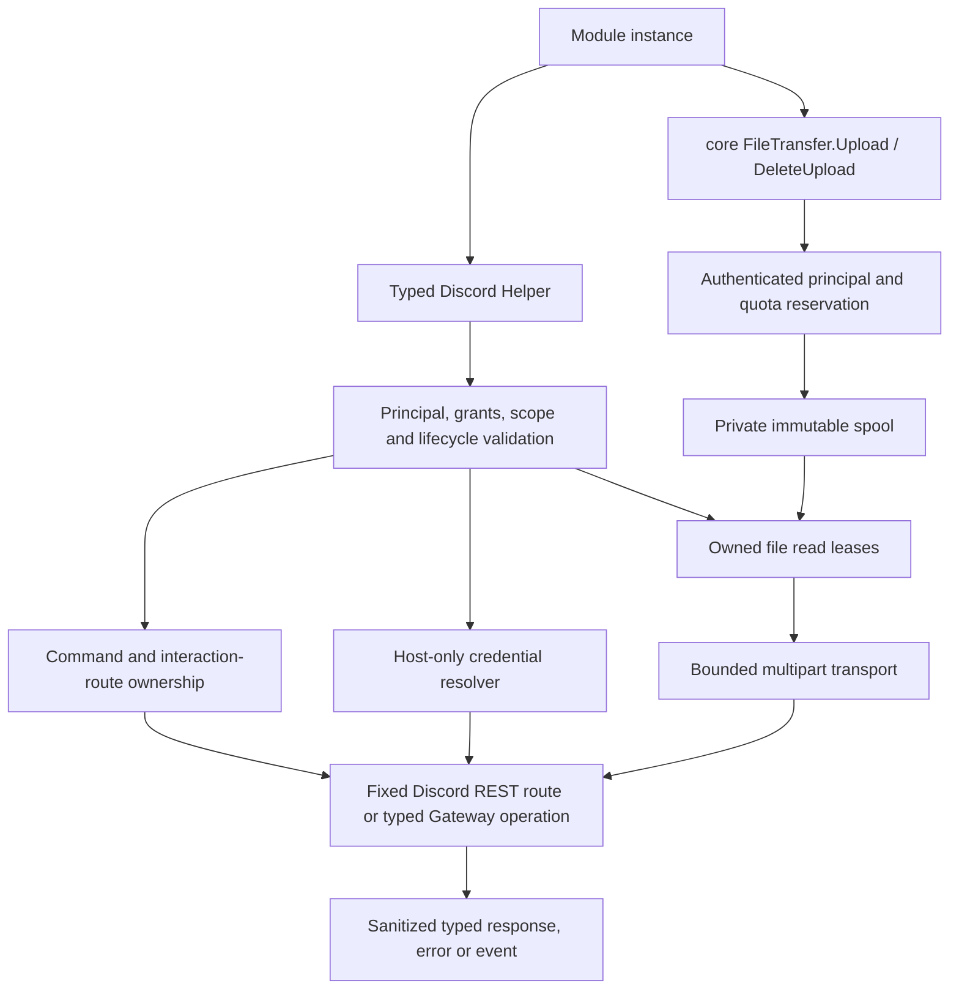
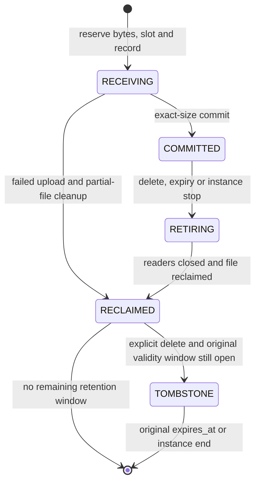
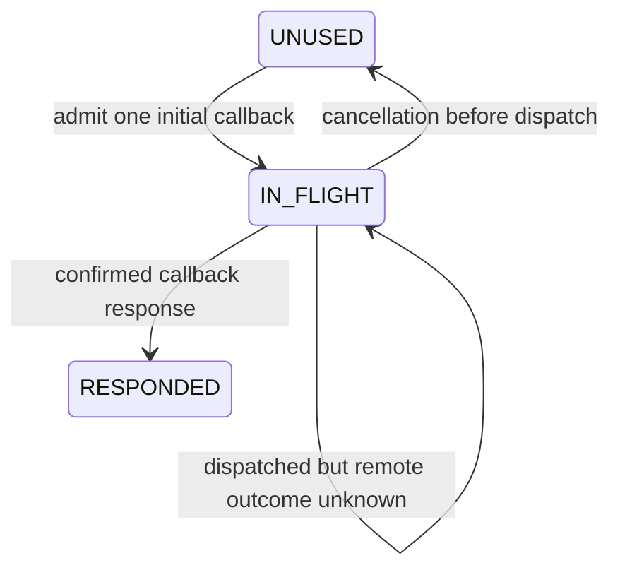

# 중립 파일 전송과 전체 Discord 봇 API 어댑터 - Spec Proposal

| Item       | Detail                           |
|------------|----------------------------------|
| Author     | Seonguk Moon                     |
| Created    | 2026-10-29                       |
| Status     | **Draft** / In Review / Approved |
| Reviewers  |                                  |

---

## 1. Summary

FlexModule의 코어에 백엔드 중립적인 파일 업로드 서비스를 추가하고, 현재 로컬 DiscordGo가 제공하는 공식 봇 기능 전체를 형식이 지정된 Discord 어댑터로 제공합니다. 모든 요청은 인증된 모듈 인스턴스, 실제 부여된 capability, 리소스 범위와 수명 주기를 검사하며, 파일과 자격증명은 인스턴스에 귀속된 참조로만 전달합니다. 명령과 인터랙션의 소유권, 취소 가능한 외부 요청, 메모리 사용량이 파일 크기에 비례하지 않는 multipart 전송을 함께 정의합니다.

## 2. Background & Motivation

### 확인된 현재 상태

현재 [Helper 스키마](../../proto/discord-v1/helper.proto)는 40개 RPC를 선언하지만, [런타임 서버](../../shared/discord-v1/runtime/helper.go)는 그중 18개를 구현하지 않아 상속된 `Unimplemented` 응답을 반환합니다. 같은 파일의 `HelperClientImpl`에는 실제 호출 없이 `nil` 또는 `nil, nil`을 반환하는 구현도 있습니다. 이 제안은 이 18개만 채우는 작업이 아닙니다. 전체 로컬 `Session` 공개 메서드 229개를 분류하여 공식 봇 작업, 편의 함수, 백엔드 내부 기능, 제외 기능을 모두 배정합니다.

분류 결과는 정규 봇 RPC 149개(REST 146개와 Gateway 3개), 편의 alias 43개, 백엔드 내부 또는 상태 도우미 13개, 제외 24개입니다. 내부 또는 상태 도우미 가운데 `UserChannelPermissions` 하나는 형식이 지정된 상태 계산 RPC로 유지하므로 SDK에서 도출한 서로 다른 공개 작업은 150개입니다. 여기에 이 제안에서 정의하는 인터랙션 경로 등록 및 해제와 사전 설정 자격증명 참조 조회를 추가합니다. 코어 파일 전송 RPC 두 개는 Discord 서비스에 포함하지 않습니다.

현재 [MultipartBodyWithJSON](../../discordgo/util.go)은 파일 `Reader`를 `bytes.Buffer`로 모두 복사하고 완성된 본문을 `[]byte`로 반환합니다. 따라서 파일을 디스크에 저장한 다음 기존 함수에 `Reader`만 전달해도 대용량 요청의 메모리 문제는 해결되지 않습니다. [REST 요청 경로](../../discordgo/restapi.go)는 전체 본문 바이트 배열을 받으며, 기본 [Session 설정](../../discordgo/discord.go)은 rate limit 재시도와 REST 재시도를 활성화합니다. 일부 메서드는 요청 context를 전달할 옵션도 받지 않습니다.

기존 검토에서는 명령의 `DefaultMemberPermissions` 제거, 초기화와 콜백 오류 누락, 파일 및 patch 변환 손실을 확인했습니다. 실서비스 Discord 또는 격리 환경에서 이 제안의 구현을 검증한 상태는 아닙니다. 아래 수용 조건은 구현 이후 충족해야 하는 조건입니다.

### 확정된 요구와 제안하는 구현 경계

사용자가 확정한 범위는 범용 모듈 런타임과 현재 로컬 SDK의 공식 봇 기능 전체입니다. 음악 관련 처리, 모듈의 미디어 프로필, 음성 재생 여부는 일반 메시지, 운영, 관리 기능의 사용 조건이 아닙니다. 코어에는 Discord DTO나 Discord의 권한 계산을 넣지 않습니다.

사용자는 파일 저장 계층의 파일당 500 MiB, 완료 시점부터 30분 TTL, 같은 인스턴스 안에서의 재사용, 명시적 삭제, 중지 시 정리와 업로드 자원 quota를 확정했습니다. 읽기 lease, spool 상태, 소유권 레코드, 삭제 tombstone, multipart 조립 방식과 정규 RPC 매핑은 그 요구를 구현하기 위한 기술 설계입니다. Discord가 500 MiB를 받는다는 요구나 보장은 아닙니다.

## 3. Goals & Non-Goals

### 3.1 Goals

- [ ] 229개 로컬 메서드 모두에 정규 작업, 정확한 alias 매핑, 내부 전용 또는 제외 사유를 지정하고, 허용한 작업 전체에 동작하는 서버와 SDK를 제공합니다.
- [ ] 멤버, 역할, 채널, 메시지, 감사 로그, 모더레이션, 스레드, 예약 이벤트, 온보딩, webhook, 명령, 투표, 수익화 및 봇용 Gateway 작업을 빠짐없이 연결합니다.
- [ ] 모든 RPC에서 인증된 인스턴스와 actual grants, 대상 리소스, 인스턴스 상태를 확인하고 Discord 자체 권한과 구분합니다.
- [ ] 토큰 매개변수와 토큰을 포함한 응답을 목적이 제한된 `CredentialRef` 및 명시적 SDK handle로 대체합니다.
- [ ] 백엔드 중립 스트리밍 업로드, 정확한 quota 예약, lease 기반 삭제, 취소와 중지 시 정리를 구현합니다.
- [ ] 파일 전체를 메모리에 올리지 않는 실제 HTTP multipart 경로를 모든 파일 지원 작업에 적용하고 첨부 파일 patch 의미를 보존합니다.
- [ ] 명령과 인터랙션 경로의 소유권을 보존하고 충돌, 원격 결과 불확실성, 오류 및 취소를 호출자에게 전달합니다.

### 3.2 Non-Goals

- [ ] 임의 URL, HTTP 메서드, 헤더, Gateway opcode, SQL 또는 셸 명령을 실행하는 범용 전달 API는 제공하지 않습니다.
- [ ] 사용자 계정 자동화, 애플리케이션 소유자 전용 관리, OAuth 전용 작업, 폐지된 경로를 봇 API로 노출하지 않습니다. 일반 OAuth 인증 흐름이나 비밀 내보내기 API도 추가하지 않습니다.
- [ ] 현지 SDK에 없는 최신 Discord 기능까지 지원한다고 주장하거나 비공식 endpoint를 자동 추정하지 않습니다.
- [ ] 완료된 업로드의 인스턴스 간 공유, 재시작 후 복구, 영구 파일 저장 API, 이벤트 재생 및 정확히 한 번 처리를 제공하지 않습니다.
- [ ] 자동 업로드, 자동 interaction defer, 자동 API 재시도 또는 새로운 재시도 하위 시스템을 다른 도우미 호출에 숨기지 않습니다.
- [ ] 코어 설정 조회, 샌드박스 실행과 영구 디렉터리는 [P4](flexmodule-4-runtime-and-isolation.md)가 담당합니다. 음성 연결과 재생 작업은 [P5](flexmodule-5-voice-jobs.md)가 담당하며, 원시 voice 연결 API로 우회하지 않습니다.

## 4. Technical Design

### 4.1 Architecture Overview

`core-v2`의 `FileTransfer`는 메타데이터와 청크를 받아 호스트가 관리하는 임시 spool에 기록합니다. 서비스는 `InstancePrincipal`과 코어 권한 검사만 사용하며 Discord endpoint, 메시지, guild 또는 attachment DTO를 알지 못합니다. `discord-v2` 어댑터는 같은 인스턴스의 `UploadedFileRef`를 읽기 lease로 해석하여 Discord 전송에 사용합니다.



인스턴스 인증과 `Authorize(ctx, AccessRequest)`는 [P4](flexmodule-4-runtime-and-isolation.md)의 계약을 재사용합니다. `AccessRequest`의 작업 이름은 서버에 등록된 작업 정책으로 정하며, caller가 capability 이름이나 허용 상태를 바꿀 수 없습니다. ModuleID는 설치 설정에서 정한 안정적인 식별자이고 InstanceID는 매 실행 새로 발급합니다. 둘 다 RPC의 `module-id` 메타데이터를 신뢰하여 결정하지 않습니다.

Discord 어댑터는 P4의 백엔드 `Prepare`, `Activate`, `Drain`, `Cleanup` 수명 주기에 참여합니다. `Prepare`에서는 실제 grant, 필요한 Gateway intents, 명령 및 경로 소유권을 확인합니다. 일반 이벤트는 `RUNNING`에서만 받아들입니다. 업로드는 `RUNNING`에서만 새로 시작하며 명령 등록, 정적 인터랙션 경로 등록, 사전 설정 credential 참조 조회는 등록된 초기화 안전 정책에 따라 `INITIALIZING`에서도 허용합니다.

`START` 진행 중 `READY`에 도착한 `RUNNING` 전용 helper는 인증과 실제 grant 및 scope 검사를 먼저 통과한 경우 P1/P4의 bounded activation gate에서 기다립니다. 이 대기는 `control_rpcs_per_instance` 상한, caller context 및 남은 startup deadline을 따르며 작업 admission, quota 예약, lease 획득과 외부 부작용보다 먼저 이루어집니다. `START` 성공과 호스트의 `RUNNING` commit 뒤에 권한, scope와 상태를 다시 확인한 후 실행하고, 실패/취소/drain은 대기 요청을 실패시킵니다. 다른 잘못된 상태는 그대로 거부합니다. `START` callback은 worker를 시작하고 반환하며 그 worker의 helper 완료를 동기적으로 기다리지 않습니다. 별도 activation RPC나 자동 재시도는 두지 않습니다.

`DRAINING`에서는 신규 업로드, 장기 작업, 구독과 credential 발급을 거부합니다. 기존 외부 요청은 drain deadline까지만 진행합니다. 이미 수락한 이벤트의 유한한 후속 작업은 P4의 호스트 발급 `flexmodule-work-ref`와 기존 actual grants를 함께 검사할 때만 허용합니다. 이 참조는 작업의 drain 적격성을 증명할 뿐 인스턴스 신원이나 권한을 부여하지 않습니다. 소유 자원 취소와 해제는 정리 경로에서 허용합니다.

HTTP와 Gateway는 백엔드 내부에서만 접근합니다. 런타임과 모듈은 [P1](flexmodule-1-protocol-contracts.md)의 새 프로토콜로 함께 전환하고 v1 서비스와 가짜 도우미를 제거합니다. 문서에서 말하는 alias는 새 SDK가 정규 작업으로 명시적으로 변환하는 편의 기능이며, 구버전 wire 호환 서비스나 구버전 토큰 인자를 유지하는 shim이 아닙니다.

#### Discord wire 버전과 endpoint 초기화

현재 로컬 [endpoint 선언](../../discordgo/endpoints.go)의 `APIVersion`은 `"9"`이고, `EndpointAPI`는 package 초기화 때 그 값으로 만들어집니다. 공식 [API versioning 문서](https://docs.discord.com/developers/reference.md#api-versioning)는 v9와 v10을 모두 available로 표시하므로 v9가 고장 났거나 사용할 수 없다고 설명하지 않습니다. 이 제안에서는 현재 attachment 수정 계약과 HTTP 경로를 하나의 기준으로 구현하기 위해 Discord HTTP API와 main Gateway 버전을 모두 `10`으로 선택합니다. 이는 기술적 전환 선택이며 사용자가 명시적으로 요청한 버전이라고 기록하지 않습니다. FlexModule 프로토콜 major `2` 및 P5의 Discord Voice Gateway `8`과는 서로 다른 번호입니다.

SDK의 API 버전 선언을 endpoint 변수 초기화 전에 `"10"`으로 변경하고, main Gateway 연결 URL도 명시적으로 `v=10`을 사용합니다. 초기화가 끝난 뒤 전역 `APIVersion`만 대입하여 이미 만들어진 endpoint와 버전이 갈라지게 하지 않습니다. 현재 `EndpointVoice`는 끝에 `/`가 있는 API base에 `/voice/`를 더하므로 중복 slash가 생깁니다. base 및 voice segment의 결합을 수정하여 `VoiceRegions`의 실제 요청 경로를 정확히 `/api/v10/voice/regions`로 만들고 redirect나 서버의 경로 정규화에 의존하지 않습니다.

### 4.2 Data Model Changes

범용 모듈 데이터베이스는 추가하지 않습니다. 아래 레코드는 런타임 또는 Discord 백엔드가 소유하는 관리 메타데이터입니다. 모듈의 파일 및 SQLite 등 영구 데이터와 위치, 접근 권한, 정리 수명을 분리합니다.

| 레코드 | 필수 정보와 제약 | 수명 |
|---|---|---|
| 업로드 예약 | 서버 생성 내부 ID, ModuleID, InstanceID, 선언 크기, 받은 크기, 상태, spool 식별자, 취소 context | 업로드 종료와 실제 부분 파일 정리까지 |
| 완료 업로드 | opaque ID, 소유 인스턴스, 저장된 이름과 MIME, 실제 크기, 완료 시각, 원래 만료 시각, 상태, 활성 lease 수, 취소 원인 | 삭제/만료/중지로 새 읽기를 막은 뒤에도 마지막 lease와 파일 정리가 끝날 때까지 |
| 삭제 tombstone | opaque ID, ModuleID, InstanceID, 서버에 저장된 원래 `expires_at`, 삭제 사실 | 원래 `expires_at` 또는 인스턴스 종료 중 먼저 발생한 때까지. 새 읽기와 TTL 연장 불가 |
| 읽기 lease | 업로드 ID, 소유 인스턴스, 외부 요청의 admission lease, 취소 context, 열린 reader, 해제 여부 | 실제 reader와 multipart 작업이 모두 끝날 때까지 |
| quota 계수 | 호스트 및 인스턴스별 예약 바이트, 회수 전 완료 바이트, 진행 중 업로드 수, 예약/완료/회수 대기/tombstone을 합친 레코드 수 | 바이트와 레코드의 해제 조건을 구분합니다. 재시작 시 잔여 spool을 정리하며 이전 참조와 tombstone을 복구하지 않습니다. |
| credential binding | 호스트의 비밀 원천, 사전 승인 binding 이름, 목적, 정확한 리소스 selector, 원본 만료/운영자 제한 | P4의 호스트 설정 수명 |
| credential 참조 | opaque ID, backend, 목적, ModuleID와 InstanceID, 리소스 selector, 만료, 폐기 상태 | 현재 인스턴스 및 원본 credential 유효 기간 안에서만 |
| 명령 소유권 | application ID, guild ID 또는 global, command type, name, command ID, 안정적인 ModuleID, 등록/변경 의도 및 확정/결과 불명 상태 | 백엔드 전용 영속 메타데이터. 재시작이나 보통의 stop으로 삭제하지 않음 |
| 인터랙션 경로 | `(application_id, interaction_kind, exact custom_id)` 고유 키와 ModuleID | 영속 보관. 기본 TTL 없음. 명시적 해제 또는 uninstall로 제거 |
| Gateway 상관관계 | 런타임의 비공개 wire nonce, InstanceID, guild ID, 원래 nonce, 청크 수신 진행, 만료 | 예상 청크 완료, 인스턴스 정리 또는 필수 유한 운영자 설정에 따른 만료까지 |

명령 키는 `(application_id, guild_id, command_type, name)`에서 유일해야 합니다. global 명령과 guild 명령은 다른 namespace입니다. command ID의 소유권과 이름 변경 전후 키의 예약을 함께 관리합니다. 로컬 소유권 등록 및 변경 의도는 원격 변경 전에 영속화하고, 성공 응답을 받으면 확정합니다. 단일 백엔드 coordinator가 해당 application의 변경을 직렬화하며, 영속 메타데이터의 교체는 원자적이어야 합니다. 원격 Discord 변경까지 하나의 로컬 트랜잭션에 포함되는 것은 아닙니다.

공개 파일 객체는 P1의 `UploadedFileRef{opaque_id, file_name, content_type, size_bytes, expires_at}`입니다. 실제 파일 경로나 descriptor를 전달하지 않습니다. 참조의 부가 메타데이터는 편의를 위한 사본이며 서버가 보관한 소유권, 크기와 원래 만료가 기준입니다. Discord wire 파일 필드는 P1의 `FileAttachment{uploaded_file_ref, filename, description?}`이고 공용 Go view는 P2의 `FileAttachment{Ref, Filename, Description}`입니다. converter는 `Ref`를 wire `uploaded_file_ref`에 매핑합니다. `filename`은 해당 요청에서 사용할 첨부 이름이며 호스트 경로가 아닙니다.

`CredentialRef`는 P1의 `opaque_id`, `backend_id`, `purpose`, `resource_scope`, `expires_at`을 사용합니다. 리소스 selector의 키들은 AND 조건으로 검사하고 vault가 보관한 바인딩을 기준으로 삼습니다. 모듈이 참조의 표시 필드만 바꿔 목적이나 범위를 넓힐 수 없습니다. Go SDK의 `InteractionHandle`과 `WebhookHandle`은 안전한 DiscordGo 값과 credential 참조를 별도 필드로 보관하며 `Value.Token`은 항상 빈 문자열입니다.

새 API에서 도달하는 모든 요청, 응답과 중첩 DTO는 [P2](flexmodule-2-domain-conversions.md)의 완전 변환 범위에 포함합니다. 기존 154개 protobuf 메시지만 구현한 뒤 새 API의 타입을 생략하는 방식은 허용하지 않습니다. 파일 reader와 credential, live Session 등은 필드 누락이 아니라 명시적으로 정의한 경계 타입으로 교체합니다.

### 4.3 Core Logic

#### 4.3.1 권한과 리소스 검사

1. broker 연결에서 `InstancePrincipal`을 얻고 현재 인스턴스와 admission 상태를 확인합니다.
2. 등록된 작업 정책으로 요구 capability와 허용 상태를 조회합니다. REST는 `discord.rest.<CanonicalMethod>`, Gateway는 `discord.gateway.<CanonicalMethod>`, 상태 계산은 `discord.state.UserChannelPermissions`입니다. 접두어는 wildcard grant가 아닙니다.
3. 실제 grant의 리소스 selector와 요청의 모든 관련 리소스를 대조합니다. guild/channel 관계, 역할의 guild, webhook의 channel, command의 application 및 guild, 이동할 대상 channel, 자동 모더레이션의 예외 역할/채널 등도 포함합니다. caller가 제공한 `guild_id`만 보고 해당 channel의 소속을 인정하지 않습니다.
4. 필요한 관계는 신뢰할 수 있는 백엔드 상태 또는 context가 적용된 제한적인 조회로 확인합니다. 확인되지 않으면 실패시키며 추정으로 허용하지 않습니다. 내부 확인용 조회 결과를 모듈에 추가 노출하지 않습니다. 전체 목록을 정확하게 한정할 수 없는 작업은 그 범위를 포괄하는 명시적 grant가 있어야 하며, 권한 없는 데이터가 포함된 목록을 반환하지 않습니다.
5. 명령, 인터랙션 경로, credential, 파일처럼 소유권이 있는 자원은 별도 소유권 검사까지 통과해야 합니다. 결과에도 허용한 범위와 credential 투영을 적용합니다.

필수 capability 미승인은 활성화를 막고 선택 capability 미승인은 actual grants에 반영합니다. Discord guild 내 사용자 역할이나 `DefaultMemberPermissions`는 이 grant를 대체하지 않습니다. 반대로 FlexModule grant가 있어도 Discord의 봇 권한 부족, 역할 계층, endpoint 제약에 따른 거부는 그대로 발생할 수 있습니다.

`UserChannelPermissions`는 REST endpoint가 아니라 Discord 상태 계산 도우미입니다. 승인된 channel의 guild, 역할, member와 permission overwrite snapshot을 사용하며 누락 자료의 `Channel`, `Guild`, `GuildMember` 조회에는 필요한 grant, 범위와 context를 다시 적용합니다. 자료가 불완전하거나 추가 조회를 허용받지 못하면 실패합니다. 결과는 10진수 permission mask이며 캐시 시점의 계산값이지 현재의 원격 작업 허가증이나 FlexModule capability가 아닙니다.

#### 4.3.2 스트리밍 업로드와 quota

확정된 기본값은 다음과 같습니다. 운영자가 변경할 수 있지만 구현에서 다른 숫자를 숨은 기본값으로 사용하지 않습니다.

| 항목 | 기본값 |
|---|---|
| 청크 데이터 최대 크기 | 256 KiB |
| 파일당 최대 크기 | 500 MiB |
| 진행 중 업로드 | 인스턴스당 2개, 호스트당 8개 |
| 저장 quota | 인스턴스당 2 GiB, 호스트당 8 GiB |
| 완료 참조 TTL | 완료 commit 시점부터 30분 |

MiB와 GiB는 이진 단위입니다. 예약 중인 파일도 선언한 전체 크기를 quota에 포함합니다. 계산은 `진행 중 선언 크기의 합 + 실제 회수되지 않은 완료 파일 크기의 합`이며, 같은 파일의 여러 lease 때문에 바이트를 중복 가산하지 않습니다. 삭제 또는 만료되었더라도 reader가 남아 있거나 실제 파일 정리가 끝나지 않았으면 계속 계산합니다.

바이트와 동시성 한도 외에 호스트 및 인스턴스별 업로드 레코드 개수 상한도 운영자가 유한한 값으로 반드시 설정해야 합니다. 이 상한에는 사용자 확인 숫자 기본값이 없습니다. 진행 중 예약, 완료한 live ref, 회수 대기 레코드 및 삭제 tombstone이 모두 한 개씩 포함됩니다. 한 업로드의 상태가 바뀌어도 같은 자리 하나를 계속 점유하며, 파일 크기가 0이거나 삭제로 바이트가 회수되어도 tombstone이 남아 있으면 개수를 줄이지 않습니다. 유효한 tombstone을 새 업로드 수용을 위해 조기 퇴거하지 않으며, 어느 개수 한도든 도달하면 `ResourceExhausted`와 `QUOTA_EXCEEDED`로 거부합니다.

첫 메시지는 반드시 메타데이터 하나여야 합니다. 인증, 상태, 메타데이터 형식, 파일 상한, 인스턴스 및 호스트의 바이트 quota, 업로드 슬롯과 레코드 자리 하나를 단일 원자적 예약 단계에서 검사하고 확보합니다. 실패 시 부분 예약을 남기지 않습니다. 통과하면 호스트가 임의의 내부 spool 이름으로 파일을 독점 생성하고, 이후 청크의 offset이 누적 수신 바이트와 정확히 같은지 확인하며 순서대로 기록합니다.

청크는 256 KiB 이하이며 중간 offset 재시작, 중복 청크, 역순, 메타데이터 재전송을 허용하지 않습니다. 선언 크기를 넘긴 즉시 실패합니다. EOF에서 받은 크기가 선언 크기와 일치해야 합니다. 크기 0의 파일은 메타데이터 뒤 EOF로 완료할 수 있습니다. 빈 청크를 진행 신호나 무제한 keepalive로 사용하지 않습니다. 파일 이름, MIME, JSON 크기, 참조 개수, 개별 작업 시간과 외부 전송 동시성 등 추가로 필요한 상한은 운영자가 유한한 값으로 반드시 설정하며, 설정 누락을 무제한 허용으로 해석하지 않습니다.

파일 기록과 닫기가 성공하고 인스턴스가 아직 commit 가능한 상태일 때만 완료 레코드로 전환합니다. 예약 바이트는 저장 바이트로 이동할 뿐 이중 계산하지 않습니다. TTL은 이때 시작하고 업로드 슬롯은 반환하지만 레코드 자리는 유지합니다. 클라이언트는 최종 RPC 성공 응답을 받은 참조만 사용할 수 있습니다. 서버 commit 후 응답이 유실되면 클라이언트가 모르는 완료 파일이 남을 수 있으며 TTL 또는 인스턴스 정리가 회수합니다. 이를 성공 응답의 정확히 한 번 전달이나 업로드 재개 기능으로 표현하지 않습니다.

취소, 조기 EOF, 기록 오류, 크기 불일치와 인스턴스 중지는 부분 파일을 닫고 제거한 뒤 바이트, 업로드 슬롯과 레코드 예약을 해제합니다. commit하지 않은 업로드에는 공개 ref가 없으므로 삭제 tombstone을 만들지 않습니다. 제거 실패 시 실제 점유분과 필요한 정리 레코드를 계수에서 먼저 빼지 않으며 정리 실패를 보고하고 잔여 spool을 소유 인스턴스와 연결해 둡니다. 런타임 시작 시 orphan spool을 정리하며 이전 인스턴스 참조를 새 인스턴스에 되살리지 않습니다.

#### 4.3.3 읽기 lease, 삭제와 경쟁 조건

삭제, 만료와 중지는 `COMMITTED`를 원자적으로 `RETIRING`으로 바꾸며 새 lease를 차단합니다. 파일 회수와 삭제 멱등성의 보존 기간은 별개입니다.



- 읽기 lease 획득과 `RETIRING` 전환은 동일한 레코드 동기화 경계에서 처리합니다. 먼저 승인된 lease는 읽기를 계속할 수 있고, 먼저 삭제된 파일에는 새 reader를 만들 수 없습니다.
- `DeleteUpload` 성공은 새 사용이 금지되었다는 뜻입니다. 활성 lease가 끝나기 전에 파일 공간까지 모두 회수되었다는 뜻은 아닙니다. 완료 파일을 사용하는 다른 요청을 삭제만으로 임의 중단하지 않습니다.
- 원래 `expires_at` 전에 삭제한 known owned ref는 같은 인스턴스가 유효하고 현재 시각이 원래 만료보다 이른 동안 반복 삭제에 성공합니다. 회수 대기 레코드 또는 회수 뒤 tombstone에서 owner를 검사하며, 바이트 회수가 끝났다는 이유로 즉시 `REF_NOT_FOUND`를 반환하지 않습니다. 읽기는 두 상태 모두 거부합니다.
- 삭제 tombstone은 원래 `expires_at` 도달 또는 인스턴스 종료 중 먼저 발생한 때 제거합니다. 삭제, 반복 삭제 및 읽기 시작은 만료를 연장하지 않습니다. 자연 TTL 만료에 새 보존 기간을 부여하거나 영구 삭제 이력을 쌓지 않습니다. 만료 또는 인스턴스 종료 뒤에는 삭제 멱등 성공을 보장하지 않으며, expired/unknown ref는 `NotFound`입니다.
- TTL 만료도 새 lease를 막지만 이미 진행 중인 요청은 자신의 유한 deadline 안에서 완료할 수 있습니다. 아직 reader나 정리 작업이 남으면 만료 이후에도 해당 내부 레코드와 바이트를 계속 계수하되, 삭제 성공이나 새 읽기를 위한 유효 참조로 취급하지 않습니다.
- 인스턴스 중지는 새 작업을 막고 활성 lease, HTTP 요청과 multipart writer를 취소합니다. tombstone을 폐기하고 reader와 writer가 끝난 뒤 unlink와 바이트/정리 레코드 계수 해제를 한 번만 수행합니다.
- lease 해제와 정리는 반복 호출해도 이중 close, 음수 계수 또는 다른 소유자의 파일 삭제가 발생하지 않아야 합니다. 바이트 회수와 레코드 자리 반환을 분리하며, 유효 tombstone이 남은 동안 레코드 개수는 유지합니다. 이미 삭제 또는 회수한 참조의 새 읽기는 실패합니다.
- 파일명, `../`, 절대 경로 또는 symlink를 통해 저장 위치를 정할 수 없습니다. 모듈은 spool 디렉터리에 접근하지 못하며 저장 파일은 완료 후 불변입니다.

#### 4.3.4 실제 bounded HTTP multipart 전송

파일이 있는 `ChannelMessageSendComplex`, `ChannelMessageEditComplex`, `WebhookThreadExecute`, `WebhookMessageEdit`, `InteractionRespond`, `ForumThreadStartComplex`는 모두 새 스트리밍 경로를 사용합니다. interaction 응답 수정과 followup의 SDK alias도 같은 경로에 도달합니다. 파일이 없는 호출은 bounded JSON 요청을 사용할 수 있습니다.

1. 모든 파일 참조의 owner, 상태, 크기를 검증하고 각 읽기 lease를 얻습니다. 하나라도 실패하면 얻은 lease를 모두 해제하고 외부 요청을 보내지 않습니다.
2. 해당 endpoint 및 destination의 실제 업로드 한도를 적용합니다. 일반 문서의 기본 파일당 한도는 20 MiB이며, Create Message의 전체 요청 한도 25 MiB는 multipart 경계와 JSON을 포함합니다. 첨부 개수는 해당 메시지 API의 최대 10개 제약을 적용합니다. interaction은 받은 `attachment_size_limit`을 보존하여 해당 interaction에 적용합니다. 알려진 destination의 한도를 사용하되 없는 범용 capability 조회 API를 만들어 가정하지 않습니다. 알려지지 않은 상향 한도를 500 MiB로 추정하지 않으며 Discord의 최종 거부도 구조화된 오류로 전달합니다.
3. 유한한 크기의 `payload_json`, part 헤더 및 고정 boundary를 정합니다. 파일 이름의 CR/LF/NUL과 잘못된 MIME을 거부하고 헤더 매개변수를 올바르게 인코딩합니다. 파일명을 호스트 경로나 원시 헤더로 붙이지 않습니다. Go 1.24에서 제공되는 API만 사용하며 Go 1.25의 `multipart.FileContentDisposition`에 의존하지 않습니다.
4. 같은 boundary와 동일한 헤더 직렬화 규칙으로 multipart 구조 바이트 수를 계산하고 파일 크기를 더하여 정확한 `Content-Length`를 얻습니다. 계산 단계에서는 파일 본문을 읽지 않으며 정수 overflow를 검사합니다. bounded JSON과 헤더를 제외한 파일 전체를 `[]byte`로 생성하지 않습니다.
5. `io.Pipe`와 `multipart.Writer` 또는 동일한 특성의 reader 조합으로 본문을 만듭니다. 각 spool reader를 처음부터 열어 제한된 copy buffer로 전송합니다. 파일 크기가 증가해도 본문 조립의 메모리 상한은 증가하지 않아야 합니다.
6. RPC context 취소는 rate-limit 대기, file reader, pipe 양 끝, writer와 HTTP 요청에 모두 전파합니다. HTTP가 먼저 실패하면 writer를 해제하고, writer가 먼저 실패하면 HTTP 본문을 종료합니다. 모든 producer가 끝난 뒤 lease를 해제합니다.

이 경로는 기존 `MultipartBodyWithJSON`이나 `RequestRaw([]byte)`로 되돌아가서는 안 됩니다. 고정된 Discord route, 인증 적용과 기존 endpoint/bucket 구분을 보존하는 호스트 내부 typed transport를 구성하며 모듈에는 이 transport를 노출하지 않습니다. 각 HTTP 요청은 `http.NewRequestWithContext`로 RPC context에 연결합니다. rate-limit bucket 대기는 context를 받는 획득 경로에서 deadline 또는 취소와 대기 timer를 함께 선택하며, 취소된 대기가 bucket을 점유한 채 남지 않도록 해제합니다. 기존 SDK의 blocking bucket 획득이나 `time.Sleep`을 그대로 호출해서는 안 됩니다. 이는 새 retry 시스템이 아니라 요청 admission과 전송의 취소 경계입니다. context가 없는 기존 메서드를 호출한 후 결과를 버리는 방식은 취소 구현으로 인정하지 않습니다.

`MaxRestRetries=0`, `ShouldRetryOnRateLimit=false`를 백엔드의 고정 정책으로 설정합니다. 모듈의 옵션으로 바꾸거나 요청마다 공유 Session 값을 경합하도록 변경하지 않습니다. 429는 `retry_after`를 반환하고 자동 재전송하지 않습니다. 원격 변경의 응답을 잃으면 결과가 불명일 수 있으므로 자동 resend나 임의 idempotency를 보장하지 않습니다. HTTP redirect도 credential을 다른 주소로 보내거나 본문을 암묵적으로 다시 전송하지 않도록 차단합니다.

참조 자체는 같은 인스턴스에서 여러 호출에 재사용할 수 있습니다. 새로운 명시적 호출마다 새 lease와 처음부터 읽는 reader를 만들며 이전의 소비된 `io.Reader`를 재사용하지 않습니다. 스트리밍 transport는 reader 재개방 가능한 소스를 보유하되 이것이 자동 retry 허용을 뜻하지는 않습니다. 호출자가 직접 다시 시도할 때도 TTL, 실제 grant, destination 한도와 원격 중복 가능성을 다시 평가합니다.

#### 4.3.5 첨부 파일 patch와 DTO 존재성

`MessageEdit`, `WebhookEdit`, command patch 및 nullable 필드는 P1/P2의 존재성 계약을 그대로 사용합니다. unset, 빈 문자열, `0`, `false`, 명시적 `null`, 빈 목록을 서로 바꾸지 않습니다. 첨부 수정에는 P1의 `AttachmentEditList`와 `AttachmentEditEntry`를 사용하고, Go 편의 view도 P2의 `Attachments *[]AttachmentEditEntry`를 그대로 사용합니다. 응답 snapshot인 `MessageAttachment`를 수정 요청 entry로 재사용하지 않습니다.

present `attachments`는 수정 후 남을 전체 목록입니다. 각 entry의 `source` oneof는 `existing_attachment_id` 또는 `new_file_index` 중 정확히 하나여야 하며 index `0`도 명시적 선택입니다. 기존 ID의 중복, 빈 oneof, 범위 밖/중복 index를 거부합니다. 새 파일이 있으면 목록이 반드시 존재하고 모든 `files` index가 정확히 한 번씩 포함되어야 합니다. 기존 ID는 JSON attachment ID로 유지하고 새 index `n`은 `payload_json.attachments[].id=n`과 multipart `files[n]`으로 인코딩합니다. 보존할 기존 ID를 숨은 GET으로 추정하거나 새 파일을 목록에 암묵적으로 append하지 않습니다.

기존 ID entry의 `filename` 및 `description`은 P1이 정한 endpoint별 허용 metadata 변경만 보냅니다. 미지정은 유지, 빈 description은 설명 제거이며 빈 filename과 지원하지 않는 null은 거부합니다. 새 index entry의 metadata는 선택된 `FileAttachment.Filename`과 `Description`이 기준이고, 중복 지정한 값과 description의 존재 여부가 다르면 전송 전에 실패합니다. 생략한 새 entry metadata는 그 파일의 값을 사용합니다. multipart part filename, JSON metadata, `attachment://filename`과 적용 가능한 spoiler 이름이 같은 최종 이름을 사용해야 합니다.

이 인코딩은 `ChannelMessageEditComplex`, `WebhookMessageEdit`, `InteractionRespond`의 메시지 갱신 응답에 동일하게 적용합니다. `InteractionResponseEdit`, `FollowupMessageEdit` 등 편의 함수는 같은 typed patch를 canonical 작업에 전달하며 별도 retained-only 목록으로 축소하지 않습니다.

`attachments` 미지정으로 기존 첨부를 유지하는 동작은 새 파일이 없는 수정에만 허용합니다. present 빈 목록은 전체 첨부 제거이며 새 파일을 함께 보내면 거부합니다. 수정 attachment 목록에는 null을 허용하지 않습니다. 파일 참조를 바이트 없는 SDK `File{Reader:nil}`로 성공 변환하지 않습니다.

```text
ENCODE_ATTACHMENT_EDIT(patch):
  if attachments is absent:
    require files is empty; omit the attachments JSON key
  else:
    validate exactly one source in every entry
    require every files index, including zero, occurs exactly once
    reject duplicate existing IDs, invalid indexes and conflicting metadata
    for each entry in caller order:
      existing ID -> encode its ID and supported present metadata
      new index n -> encode id=n and validated files[n] metadata
    emit the complete attachments array, including [] when explicitly empty
  emit each new upload once as multipart files[n]
  never fetch existing attachments or append missing entries implicitly
```

#### 4.3.6 자격증명 경계

봇 토큰은 호스트에만 존재하며 일반 `CredentialRef`로도 모듈에 발급하지 않습니다. voice handshake token 역시 P5 내부 자원입니다. interaction과 webhook 자격증명은 runtime projection에서 목적이 제한된 참조로 바꾸며, 원시 SDK `Token` 필드에 참조 문자열을 넣지 않습니다.

`GetProvisionedCredentialRef`는 호스트가 해당 ModuleID에 설정한 binding 이름만 받습니다. 비밀 저장소의 임의 키, 토큰 원문이나 OAuth 인가 코드를 받지 않습니다. `GuildMemberAdd`의 사용자 `guilds.join` credential처럼 공식 봇 endpoint가 추가로 요구하는 사용자 자격증명은 이 경로로 참조할 수 있습니다. 해당 credential의 사용자, application, 목적과 대상 리소스를 확인하고 봇 인증은 백엔드가 별도로 적용합니다. 일반 사용자 OAuth endpoint를 이 예외로 허용하지 않습니다.

참조 만료는 원본 credential의 유효 기간과 운영자가 정한 유한 수명을 넘지 않습니다. 다른 인스턴스의 참조, 목적이 다른 참조, 표시 필드를 바꾼 참조, 만료 또는 중지된 인스턴스의 참조는 해석하지 않습니다. 사용자는 자동 OAuth 갱신이나 원문 회수 API를 제공받지 않습니다.

projection과 오류 정리는 모든 REST 응답 및 이벤트가 모듈 FIFO에 들어가기 전에 수행합니다. 토큰 필드뿐 아니라 중첩 DTO, webhook URL, interaction URL, raw 오류 본문, HTTP 요청 URL과 헤더, 디버그 로그에 들어간 원문도 포함합니다. 알 수 없는 원시 payload를 그대로 보내는 우회 경로는 없습니다. SDK의 credential 포함 디버그 로깅을 사용하지 않고 구조화된 허용 필드만 기록합니다. 안전한 Discord 도메인 URL과 파일 메타데이터까지 무조건 제거하지는 않으며, credential-bearing 필드의 처리 기준은 P2의 경계 분류를 따릅니다.

#### 4.3.7 명령 소유권과 인터랙션 라우팅

명령 create/edit/delete에는 capability와 리소스 검사 외에 안정적인 ModuleID 소유권 검사를 적용합니다. 이름 충돌은 `(application, guild/global, type, name)` 기준으로 원자적으로 검사하며 다른 모듈 또는 소유자가 없는 기존 명령을 조용히 덮어쓰거나 자동 인수하지 않습니다. `DefaultMemberPermissions`, context, integration type과 localization을 그대로 보존합니다.

`ApplicationCommandBulkOverwrite`는 해당 application/guild namespace의 모든 현재 명령을 호출 모듈이 독점 소유할 때만 허용합니다. 변경 잠금 안에서 영속 레지스트리와 최신 원격 목록을 대조하고 다른 모듈 또는 미등록 소유자의 명령이 하나라도 있으면 원격 overwrite 전에 실패합니다. 공유 namespace에서는 개별 명령 API를 사용합니다. 다른 명령을 보존한다는 명목으로 외부의 동시 변경까지 안전하게 병합하는 것처럼 설명하지 않습니다.

원격 성공 뒤 로컬 기록 실패, timeout 또는 응답 유실은 결과 불명 상태로 남깁니다. 소유권 예약을 풀고 곧바로 같은 이름을 재생성하지 않습니다. 읽기 조회와 운영자 조정으로 상태를 확인할 때까지 관련 충돌을 차단합니다. 초기화 실패도 이미 수행된 원격 변경을 자동으로 되돌렸다는 뜻이 아닙니다. 보통의 stop/restart는 소유권 레코드를 유지하고 활성 인스턴스 연결만 해제합니다.

명령과 autocomplete 이벤트는 command ID의 소유 ModuleID를 확인한 뒤 현재 활성 인스턴스로 보냅니다. interaction type을 확인하기 전에 `ApplicationCommandData()`를 호출하지 않으며, DM처럼 `Member`가 없으면 실제 `User` 필드를 사용합니다. 소유자가 없거나 실행 중인 인스턴스가 없으면 다른 모듈에 callback credential을 배포하지 않습니다. 이 경우 운영자에게 라우팅 실패를 보고하며 자동 응답이나 defer는 수행하지 않습니다.

버튼, select 및 modal은 별도의 명시적 경로 등록을 사용합니다. 키는 `(application_id, interaction_kind, exact custom_id)`이며 `interaction_kind`는 `MESSAGE_COMPONENT` 또는 `MODAL_SUBMIT`입니다. 다른 소유자가 같은 키를 등록하면 전체 등록 요청을 거부하고 같은 소유자의 반복 등록은 성공합니다. `INITIALIZING`의 정적 등록과 `RUNNING`의 동적 등록을 허용하며, 등록은 유한한 운영자 route quota 안에서만 가능합니다.

외부에 interactive button/select 또는 modal root를 보내기 전에 해당 `custom_id`의 소유자가 호출 모듈인지 검사합니다. URL 버튼처럼 callback이 없는 요소와 modal text-input의 child ID는 독립 경로가 아닙니다. `custom_id`를 숨은 접두어로 수정하지 않으므로 공식 100자 용량을 그대로 사용할 수 있지만 여러 모듈이 같은 application에서 동일한 일반 ID를 자유롭게 재사용할 수는 없습니다. webhook `wait=false`도 message ID 없이 정확한 경로 키로 라우팅할 수 있습니다.

경로 소유권은 재시작 후 기존 메시지의 callback을 처리하기 위해 영속화하고 기본 TTL을 두지 않습니다. `UnregisterInteractionRoutes` 또는 uninstall로 해제하며, 재시작 후에는 현재 인스턴스의 actual grants와 리소스 범위를 다시 검사한 뒤에만 callback을 보냅니다. 해제와 전송이 경합하면 전송은 경로 admission lease를 먼저 확보하거나 실패해야 하며, 해제 이후 들어온 이벤트에는 새 credential을 발급하지 않습니다.

#### 4.3.8 Gateway, 이벤트 및 상태 변경

`UpdateStatusComplex`, `RequestGuildMembers`, `RequestGuildMembersList`는 봇이 지원하는 형식 지정 Gateway 작업입니다. 원시 `GatewayWriteStruct`와 session open/close는 공개 RPC가 아닙니다. 읽기 전용 공식 REST `Gateway`와 `GatewayBot`은 유지하며 공개 base Gateway URL, shard 권장값과 session-start 한도 snapshot만 제공합니다. 이 조회가 연결 생성, identify, 재접속 또는 원시 websocket 전송 권한을 부여하지 않으며 resume URL, session ID와 credential은 반환하지 않습니다. `UpdateStatusComplex`의 bot-wide presence는 공유 자원이므로 운영자의 실제 grant로 정한 한 현재 소유자만 변경할 수 있습니다. 경쟁 소유권은 거부하며 다른 모듈의 값을 last-write-wins로 덮어쓰지 않습니다. `Activities=nil`은 Gateway가 요구하는 빈 목록으로 정규화합니다. 상태 변경 성공은 Gateway write 성공이지 Discord가 표시 상태를 확정했다는 응답이 아닙니다.

멤버 요청은 query와 사용자 ID 목록을 서로 다른 typed 작업으로 받습니다. `limit=0`의 기존 의미를 보존하고 guild 범위, `presences` 요청과 활성 privileged intents를 확인합니다. 현재 Gateway의 단일 문자열 `guild_id`를 사용합니다. 구형 Batch 편의 함수는 입력 순서대로 단일 guild RPC를 호출하며 실패 또는 취소 이후 나머지를 호출하지 않습니다. 이전 guild의 효과를 되돌리지 않고 전체 batch 원자성이나 전체 재시도를 보장하지 않습니다.

Gateway 요청 성공은 write 성공이며 모든 chunk의 도착을 의미하지 않습니다. 백엔드는 private wire nonce를 발급해 `(InstanceID, guildID, caller nonce)`와 연결하고, 해당 요청으로 확인된 typed chunk에만 원래 nonce를 복원합니다. 다른 인스턴스의 nonce를 모듈이 주장하여 응답을 가져갈 수 없습니다. 상관관계 레코드는 예상 chunk 완료, 인스턴스 정리 또는 필수 유한 운영자 TTL에서 해제합니다. 늦은 orphan chunk에는 요청자 route가 없으며 새 인스턴스로 넘기지 않습니다. Discord 자체의 누락 또는 늦은 결과와 런타임 FIFO 수용 실패를 구분하고, 후자는 P4의 명시적 인스턴스 실패 정책으로 처리합니다.

운영자가 승인한 기능 계획에서 Gateway intents를 정하고 최초 연결 전에 필요한 합집합을 반영합니다. `Prepare`는 모듈의 actual grants에 필요한 intent가 현재 연결 및 Discord 설정에서 활성화되어 있는지 검사합니다. 나중에 시작하는 모듈 때문에 새로운 intent가 필요하면 `BACKEND_RECONFIGURATION_REQUIRED`로 활성화를 거부하고 운영자의 조정된 재시작을 요구합니다. 다른 모듈의 연결을 몰래 재연결하거나 권한을 넓히지 않습니다.

이벤트는 [P1](flexmodule-1-protocol-contracts.md)의 allowlisted typed `EventEnvelope`로만 인코딩합니다. 부분 update의 존재성을 SDK zero value로 잃기 전에 호스트에서 보존하고, 실제로 있을 때만 `BeforeUpdate`/`BeforeDelete` snapshot을 제공합니다. 공식 `STAGE_INSTANCE_CREATE`, `STAGE_INSTANCE_DELETE`, `STAGE_INSTANCE_UPDATE`가 실제 등록 이름이 되도록 현재 로컬 `STAGE_INSTANCE_EVENT_*` 이름과 생성 경로를 함께 수정합니다. 기존 오타를 alias로 유지하지 않습니다.

READY는 안전한 snapshot만 전달합니다. raw event, 세션 재개 정보, voice server credential 및 SDK 내부 synthetic control 이벤트를 모듈에 전달하지 않습니다. 일반 `VoiceStateUpdate` 관측은 재생 권한과 별도 기능이며 원시 voice join이나 channel 이동 권한을 부여하지 않습니다. 이벤트 수용, 순서, 메모리 상한과 drain은 P4를 따르고, 하나의 느린 모듈이 다른 모듈의 수신을 막지 않도록 합니다.

## 5. API Design

### 5-1. New / Modified

#### 5-1.1 코어 파일 전송 계약

아래 블록은 P1의 canonical `FileTransfer`, 업로드 메시지와 field 번호를 재현한 것이며 별도 정의가 아닙니다. 현재 저장소에 이미 구현된 코드도 아닙니다. package는 `flexmodule.core.v2`이고 `google/protobuf/empty.proto`와 `google/protobuf/timestamp.proto`를 사용합니다. owner ID, 호스트 경로와 credential은 업로드 메시지에 없습니다.

```proto
// FileTransfer stores temporary, immutable files owned by the authenticated instance.
// The service does not interpret backend-specific attachment or message semantics.
service FileTransfer {
  // Upload requires exactly one metadata message followed by ordered file chunks.
  // It reserves declared bytes, an upload slot and a bounded record entry first.
  // Only exact-size completion commits; a lost final response may leave a TTL-bound orphan.
  rpc Upload(stream UploadChunk) returns (UploadedFileRef);

  // DeleteUpload prevents new read leases for an owned reference.
  // Success does not imply that bytes held by existing readers have been reclaimed.
  // Repeated deletion succeeds only before the original expires_at while the
  // owning instance remains valid, including after reclamation into a tombstone.
  // Deletion never extends that window; expired or unknown refs return NOT_FOUND.
  rpc DeleteUpload(DeleteUploadRequest) returns (google.protobuf.Empty);
}

message UploadMetadata {
  string file_name = 1;
  string content_type = 2;
  uint64 declared_size_bytes = 3;
}

message FileChunk {
  uint64 offset = 1;
  bytes data = 2;
}

message UploadChunk {
  oneof part {
    UploadMetadata metadata = 1;
    FileChunk chunk = 2;
  }
}

message UploadedFileRef {
  string opaque_id = 1;
  string file_name = 2;
  string content_type = 3;
  uint64 size_bytes = 4;
  google.protobuf.Timestamp expires_at = 5;
}

message DeleteUploadRequest {
  UploadedFileRef file = 1;
}
```

호스트 내부 읽기 API는 다음 의미를 갖습니다. 모듈 SDK에 reader resolver나 spool 경로를 공개하지 않습니다.

```go
// AcquireReadLease authenticates ownership and pins immutable storage for one operation.
// It rejects expired or retiring references and never trusts caller-supplied metadata.
func (s *UploadStore) AcquireReadLease(ctx context.Context, principal InstancePrincipal, ref *corev2.UploadedFileRef) (*UploadReadLease, error)

// Open creates a fresh reader at offset zero within an already admitted read lease.
// Each outbound attempt owns its reader; this method does not authorize automatic retries.
func (l *UploadReadLease) Open(ctx context.Context) (io.ReadCloser, error)

// Release waits for owned readers to close before releasing the storage pin.
// Repeated calls do not close shared readers twice or decrement accounting twice.
func (l *UploadReadLease) Release() error
```

```text
Upload(stream):
  principal := Authorize(core.upload, RUNNING)
  metadata := receive exactly one metadata message
  validate metadata and atomically reserve host+instance bytes, upload slots and one record entry
  create private spool file; received := 0
  for each chunk until EOF:
    check context and instance admission
    require chunk.offset == received
    require 0 < len(chunk.data) <= 256 KiB
    require received + len(chunk.data) <= declared_size
    write the entire chunk or fail; received += written
  require received == declared_size
  close the writer successfully
  under the record lock:
    require commit is still allowed
    move reserved bytes to committed bytes; set expires_at = commit_time + 30 min
    release upload slot; retain the record entry; publish opaque reference
  send final result; never return a partial reference
  on failure before commit:
    close writer; remove partial storage; release bytes, slot and record only after reclamation

DeleteUpload(ref):
  authenticate owner and authorize own-resource cleanup
  under the record lock:
    reject unknown ref as REF_NOT_FOUND; never trust caller expires_at
    reject expired ref as REF_EXPIRED even if an internal cleanup record remains
    require the same owning instance is still valid
    if owned deletion tombstone exists: return success
    if already RETIRING because of explicit deletion: return success
    atomically mark COMMITTED as RETIRING; reject future lease acquisition
  if no active reader remains:
    reclaim file and then remove its byte charge
    retain an owner-checked tombstone if the original validity window remains open
  keep the record count until the tombstone is removed and actual cleanup is complete
  return success; never authorize a new read of a retiring or reclaimed ref

EXPIRE_OR_STOP(record):
  prohibit new reads and expire deletion-idempotency retention at original expires_at or instance end
  remove any tombstone without extending its lifetime
  retain internal cleanup accounting until readers/writers and actual reclamation finish
  release the record entry only when neither retention nor cleanup still needs it
```

#### 5-1.2 Discord RPC와 요청/응답 정규화

서비스 package는 `flexmodule.discord.v2`입니다. 다음 인터페이스는 generated/server 수준의 계약이며, 모든 메서드는 각자 별도의 protobuf request와 RPC를 가져야 합니다. 하나의 문자열 `method`나 임의 JSON body를 받는 공통 호출 RPC로 대체하지 않습니다. wire의 `google.protobuf.Empty`는 Go에서 `*emptypb.Empty`이며 실제 응답 데이터가 없는 작업에만 사용합니다. P1에 명시한 SDK convenience 메서드의 `error` 단독 반환은 유지합니다. 어느 형태도 빈 성공으로 오류를 감추는 장치가 아닙니다.

```go
// DiscordHelper is the complete generated/server-level boundary derived from the local SDK.
// Every method authenticates the broker principal, checks actual grants and every
// resource binding, preserves field presence, and propagates the supplied context.
// Responses are safe snapshots; credential-bearing values use explicit handles.
// Errors use the shared structured status contract and never expose raw tokens,
// request URLs, headers, or upstream bodies. Success never authorizes an implicit retry.
type DiscordHelper interface {
    Application(ctx context.Context, req *ApplicationRequest) (*ApplicationResponse, error)
    User(ctx context.Context, req *UserRequest) (*UserResponse, error)
    UserUpdate(ctx context.Context, req *UserUpdateRequest) (*UserUpdateResponse, error)
    UserChannelCreate(ctx context.Context, req *UserChannelCreateRequest) (*UserChannelCreateResponse, error)
    UserGuilds(ctx context.Context, req *UserGuildsRequest) (*UserGuildsResponse, error)
    UserChannelPermissions(ctx context.Context, req *UserChannelPermissionsRequest) (*UserChannelPermissionsResponse, error)
    Guild(ctx context.Context, req *GuildRequest) (*GuildResponse, error)
    GuildPreview(ctx context.Context, req *GuildPreviewRequest) (*GuildPreviewResponse, error)
    GuildEdit(ctx context.Context, req *GuildEditRequest) (*GuildEditResponse, error)
    GuildLeave(ctx context.Context, req *GuildLeaveRequest) (*emptypb.Empty, error)
    GuildBans(ctx context.Context, req *GuildBansRequest) (*GuildBansResponse, error)
    GuildBan(ctx context.Context, req *GuildBanRequest) (*GuildBanResponse, error)
    GuildBanCreateWithReason(ctx context.Context, req *GuildBanCreateWithReasonRequest) (*emptypb.Empty, error)
    GuildBanDelete(ctx context.Context, req *GuildBanDeleteRequest) (*emptypb.Empty, error)
    GuildMembers(ctx context.Context, req *GuildMembersRequest) (*GuildMembersResponse, error)
    GuildMembersSearch(ctx context.Context, req *GuildMembersSearchRequest) (*GuildMembersSearchResponse, error)
    GuildMember(ctx context.Context, req *GuildMemberRequest) (*GuildMemberResponse, error)
    GuildMemberAdd(ctx context.Context, req *GuildMemberAddRequest) (*emptypb.Empty, error)
    GuildMemberDeleteWithReason(ctx context.Context, req *GuildMemberDeleteWithReasonRequest) (*emptypb.Empty, error)
    GuildMemberEdit(ctx context.Context, req *GuildMemberEditRequest) (*GuildMemberEditResponse, error)
    GuildMemberNickname(ctx context.Context, req *GuildMemberNicknameRequest) (*emptypb.Empty, error)
    GuildMemberRoleAdd(ctx context.Context, req *GuildMemberRoleAddRequest) (*emptypb.Empty, error)
    GuildMemberRoleRemove(ctx context.Context, req *GuildMemberRoleRemoveRequest) (*emptypb.Empty, error)
    GuildChannels(ctx context.Context, req *GuildChannelsRequest) (*GuildChannelsResponse, error)
    GuildChannelCreateComplex(ctx context.Context, req *GuildChannelCreateComplexRequest) (*GuildChannelCreateComplexResponse, error)
    GuildChannelsReorder(ctx context.Context, req *GuildChannelsReorderRequest) (*emptypb.Empty, error)
    GuildInvites(ctx context.Context, req *GuildInvitesRequest) (*GuildInvitesResponse, error)
    GuildRoles(ctx context.Context, req *GuildRolesRequest) (*GuildRolesResponse, error)
    GuildRoleCreate(ctx context.Context, req *GuildRoleCreateRequest) (*GuildRoleCreateResponse, error)
    GuildRoleEdit(ctx context.Context, req *GuildRoleEditRequest) (*GuildRoleEditResponse, error)
    GuildRoleReorder(ctx context.Context, req *GuildRoleReorderRequest) (*GuildRoleReorderResponse, error)
    GuildRoleDelete(ctx context.Context, req *GuildRoleDeleteRequest) (*emptypb.Empty, error)
    GuildPruneCount(ctx context.Context, req *GuildPruneCountRequest) (*GuildPruneCountResponse, error)
    GuildPrune(ctx context.Context, req *GuildPruneRequest) (*GuildPruneResponse, error)
    GuildIntegrations(ctx context.Context, req *GuildIntegrationsRequest) (*GuildIntegrationsResponse, error)
    GuildIntegrationDelete(ctx context.Context, req *GuildIntegrationDeleteRequest) (*emptypb.Empty, error)
    GuildEmbed(ctx context.Context, req *GuildEmbedRequest) (*GuildEmbedResponse, error)
    GuildEmbedEdit(ctx context.Context, req *GuildEmbedEditRequest) (*emptypb.Empty, error)
    GuildAuditLog(ctx context.Context, req *GuildAuditLogRequest) (*GuildAuditLogResponse, error)
    GuildEmojis(ctx context.Context, req *GuildEmojisRequest) (*GuildEmojisResponse, error)
    GuildEmoji(ctx context.Context, req *GuildEmojiRequest) (*GuildEmojiResponse, error)
    GuildEmojiCreate(ctx context.Context, req *GuildEmojiCreateRequest) (*GuildEmojiCreateResponse, error)
    GuildEmojiEdit(ctx context.Context, req *GuildEmojiEditRequest) (*GuildEmojiEditResponse, error)
    GuildEmojiDelete(ctx context.Context, req *GuildEmojiDeleteRequest) (*emptypb.Empty, error)
    ApplicationEmojis(ctx context.Context, req *ApplicationEmojisRequest) (*ApplicationEmojisResponse, error)
    ApplicationEmoji(ctx context.Context, req *ApplicationEmojiRequest) (*ApplicationEmojiResponse, error)
    ApplicationEmojiCreate(ctx context.Context, req *ApplicationEmojiCreateRequest) (*ApplicationEmojiCreateResponse, error)
    ApplicationEmojiEdit(ctx context.Context, req *ApplicationEmojiEditRequest) (*ApplicationEmojiEditResponse, error)
    ApplicationEmojiDelete(ctx context.Context, req *ApplicationEmojiDeleteRequest) (*emptypb.Empty, error)
    GuildTemplate(ctx context.Context, req *GuildTemplateRequest) (*GuildTemplateResponse, error)
    GuildTemplates(ctx context.Context, req *GuildTemplatesRequest) (*GuildTemplatesResponse, error)
    GuildTemplateCreate(ctx context.Context, req *GuildTemplateCreateRequest) (*GuildTemplateCreateResponse, error)
    GuildTemplateSync(ctx context.Context, req *GuildTemplateSyncRequest) (*emptypb.Empty, error)
    GuildTemplateEdit(ctx context.Context, req *GuildTemplateEditRequest) (*GuildTemplateEditResponse, error)
    GuildTemplateDelete(ctx context.Context, req *GuildTemplateDeleteRequest) (*emptypb.Empty, error)
    Channel(ctx context.Context, req *ChannelRequest) (*ChannelResponse, error)
    ChannelEdit(ctx context.Context, req *ChannelEditRequest) (*ChannelEditResponse, error)
    ChannelDelete(ctx context.Context, req *ChannelDeleteRequest) (*ChannelDeleteResponse, error)
    ChannelTyping(ctx context.Context, req *ChannelTypingRequest) (*emptypb.Empty, error)
    ChannelMessages(ctx context.Context, req *ChannelMessagesRequest) (*ChannelMessagesResponse, error)
    ChannelMessage(ctx context.Context, req *ChannelMessageRequest) (*ChannelMessageResponse, error)
    ChannelMessageSendComplex(ctx context.Context, req *ChannelMessageSendComplexRequest) (*ChannelMessageSendComplexResponse, error)
    ChannelMessageEditComplex(ctx context.Context, req *ChannelMessageEditComplexRequest) (*ChannelMessageEditComplexResponse, error)
    ChannelMessageDelete(ctx context.Context, req *ChannelMessageDeleteRequest) (*emptypb.Empty, error)
    ChannelMessagesBulkDelete(ctx context.Context, req *ChannelMessagesBulkDeleteRequest) (*emptypb.Empty, error)
    ChannelMessagePin(ctx context.Context, req *ChannelMessagePinRequest) (*emptypb.Empty, error)
    ChannelMessageUnpin(ctx context.Context, req *ChannelMessageUnpinRequest) (*emptypb.Empty, error)
    ChannelMessagesPinned(ctx context.Context, req *ChannelMessagesPinnedRequest) (*ChannelMessagesPinnedResponse, error)
    ChannelInvites(ctx context.Context, req *ChannelInvitesRequest) (*ChannelInvitesResponse, error)
    ChannelInviteCreate(ctx context.Context, req *ChannelInviteCreateRequest) (*ChannelInviteCreateResponse, error)
    ChannelPermissionSet(ctx context.Context, req *ChannelPermissionSetRequest) (*emptypb.Empty, error)
    ChannelPermissionDelete(ctx context.Context, req *ChannelPermissionDeleteRequest) (*emptypb.Empty, error)
    ChannelMessageCrosspost(ctx context.Context, req *ChannelMessageCrosspostRequest) (*ChannelMessageCrosspostResponse, error)
    ChannelNewsFollow(ctx context.Context, req *ChannelNewsFollowRequest) (*ChannelNewsFollowResponse, error)
    InviteComplex(ctx context.Context, req *InviteComplexRequest) (*InviteComplexResponse, error)
    InviteDelete(ctx context.Context, req *InviteDeleteRequest) (*InviteDeleteResponse, error)
    VoiceRegions(ctx context.Context, req *VoiceRegionsRequest) (*VoiceRegionsResponse, error)
    Gateway(ctx context.Context, req *GatewayRequest) (*GatewayResponse, error)
    // GatewayBot returns the domain snapshot directly, not a recursive value wrapper.
    GatewayBot(ctx context.Context, req *GatewayBotRequest) (*GatewayBotResponse, error)
    WebhookCreate(ctx context.Context, req *WebhookCreateRequest) (*WebhookCreateResponse, error)
    ChannelWebhooks(ctx context.Context, req *ChannelWebhooksRequest) (*ChannelWebhooksResponse, error)
    GuildWebhooks(ctx context.Context, req *GuildWebhooksRequest) (*GuildWebhooksResponse, error)
    Webhook(ctx context.Context, req *WebhookRequest) (*WebhookResponse, error)
    WebhookWithToken(ctx context.Context, req *WebhookWithTokenRequest) (*WebhookWithTokenResponse, error)
    WebhookEdit(ctx context.Context, req *WebhookEditRequest) (*WebhookEditResponse, error)
    WebhookEditWithToken(ctx context.Context, req *WebhookEditWithTokenRequest) (*WebhookEditWithTokenResponse, error)
    WebhookDelete(ctx context.Context, req *WebhookDeleteRequest) (*emptypb.Empty, error)
    WebhookDeleteWithToken(ctx context.Context, req *WebhookDeleteWithTokenRequest) (*emptypb.Empty, error)
    WebhookThreadExecute(ctx context.Context, req *WebhookThreadExecuteRequest) (*WebhookThreadExecuteResponse, error)
    WebhookMessage(ctx context.Context, req *WebhookMessageRequest) (*WebhookMessageResponse, error)
    WebhookMessageEdit(ctx context.Context, req *WebhookMessageEditRequest) (*WebhookMessageEditResponse, error)
    WebhookMessageDelete(ctx context.Context, req *WebhookMessageDeleteRequest) (*emptypb.Empty, error)
    MessageReactionAdd(ctx context.Context, req *MessageReactionAddRequest) (*emptypb.Empty, error)
    MessageReactionRemove(ctx context.Context, req *MessageReactionRemoveRequest) (*emptypb.Empty, error)
    MessageReactionsRemoveAll(ctx context.Context, req *MessageReactionsRemoveAllRequest) (*emptypb.Empty, error)
    MessageReactionsRemoveEmoji(ctx context.Context, req *MessageReactionsRemoveEmojiRequest) (*emptypb.Empty, error)
    MessageReactions(ctx context.Context, req *MessageReactionsRequest) (*MessageReactionsResponse, error)
    MessageThreadStartComplex(ctx context.Context, req *MessageThreadStartComplexRequest) (*MessageThreadStartComplexResponse, error)
    ThreadStartComplex(ctx context.Context, req *ThreadStartComplexRequest) (*ThreadStartComplexResponse, error)
    ForumThreadStartComplex(ctx context.Context, req *ForumThreadStartComplexRequest) (*ForumThreadStartComplexResponse, error)
    ThreadJoin(ctx context.Context, req *ThreadJoinRequest) (*emptypb.Empty, error)
    ThreadLeave(ctx context.Context, req *ThreadLeaveRequest) (*emptypb.Empty, error)
    ThreadMemberAdd(ctx context.Context, req *ThreadMemberAddRequest) (*emptypb.Empty, error)
    ThreadMemberRemove(ctx context.Context, req *ThreadMemberRemoveRequest) (*emptypb.Empty, error)
    ThreadMember(ctx context.Context, req *ThreadMemberRequest) (*ThreadMemberResponse, error)
    ThreadMembers(ctx context.Context, req *ThreadMembersRequest) (*ThreadMembersResponse, error)
    GuildThreadsActive(ctx context.Context, req *GuildThreadsActiveRequest) (*GuildThreadsActiveResponse, error)
    ThreadsArchived(ctx context.Context, req *ThreadsArchivedRequest) (*ThreadsArchivedResponse, error)
    ThreadsPrivateArchived(ctx context.Context, req *ThreadsPrivateArchivedRequest) (*ThreadsPrivateArchivedResponse, error)
    ThreadsPrivateJoinedArchived(ctx context.Context, req *ThreadsPrivateJoinedArchivedRequest) (*ThreadsPrivateJoinedArchivedResponse, error)
    ApplicationCommandCreate(ctx context.Context, req *ApplicationCommandCreateRequest) (*ApplicationCommandCreateResponse, error)
    ApplicationCommandEdit(ctx context.Context, req *ApplicationCommandEditRequest) (*ApplicationCommandEditResponse, error)
    ApplicationCommandBulkOverwrite(ctx context.Context, req *ApplicationCommandBulkOverwriteRequest) (*ApplicationCommandBulkOverwriteResponse, error)
    ApplicationCommandDelete(ctx context.Context, req *ApplicationCommandDeleteRequest) (*emptypb.Empty, error)
    ApplicationCommand(ctx context.Context, req *ApplicationCommandRequest) (*ApplicationCommandResponse, error)
    ApplicationCommands(ctx context.Context, req *ApplicationCommandsRequest) (*ApplicationCommandsResponse, error)
    GuildApplicationCommandsPermissions(ctx context.Context, req *GuildApplicationCommandsPermissionsRequest) (*GuildApplicationCommandsPermissionsResponse, error)
    ApplicationCommandPermissions(ctx context.Context, req *ApplicationCommandPermissionsRequest) (*ApplicationCommandPermissionsResponse, error)
    InteractionRespond(ctx context.Context, req *InteractionRespondRequest) (*emptypb.Empty, error)
    StageInstanceCreate(ctx context.Context, req *StageInstanceCreateRequest) (*StageInstanceCreateResponse, error)
    StageInstance(ctx context.Context, req *StageInstanceRequest) (*StageInstanceResponse, error)
    StageInstanceEdit(ctx context.Context, req *StageInstanceEditRequest) (*StageInstanceEditResponse, error)
    StageInstanceDelete(ctx context.Context, req *StageInstanceDeleteRequest) (*emptypb.Empty, error)
    GuildScheduledEvents(ctx context.Context, req *GuildScheduledEventsRequest) (*GuildScheduledEventsResponse, error)
    GuildScheduledEvent(ctx context.Context, req *GuildScheduledEventRequest) (*GuildScheduledEventResponse, error)
    GuildScheduledEventCreate(ctx context.Context, req *GuildScheduledEventCreateRequest) (*GuildScheduledEventCreateResponse, error)
    GuildScheduledEventEdit(ctx context.Context, req *GuildScheduledEventEditRequest) (*GuildScheduledEventEditResponse, error)
    GuildScheduledEventDelete(ctx context.Context, req *GuildScheduledEventDeleteRequest) (*emptypb.Empty, error)
    GuildScheduledEventUsers(ctx context.Context, req *GuildScheduledEventUsersRequest) (*GuildScheduledEventUsersResponse, error)
    GuildOnboarding(ctx context.Context, req *GuildOnboardingRequest) (*GuildOnboardingResponse, error)
    GuildOnboardingEdit(ctx context.Context, req *GuildOnboardingEditRequest) (*GuildOnboardingEditResponse, error)
    AutoModerationRules(ctx context.Context, req *AutoModerationRulesRequest) (*AutoModerationRulesResponse, error)
    AutoModerationRule(ctx context.Context, req *AutoModerationRuleRequest) (*AutoModerationRuleResponse, error)
    AutoModerationRuleCreate(ctx context.Context, req *AutoModerationRuleCreateRequest) (*AutoModerationRuleCreateResponse, error)
    AutoModerationRuleEdit(ctx context.Context, req *AutoModerationRuleEditRequest) (*AutoModerationRuleEditResponse, error)
    AutoModerationRuleDelete(ctx context.Context, req *AutoModerationRuleDeleteRequest) (*emptypb.Empty, error)
    ApplicationRoleConnectionMetadata(ctx context.Context, req *ApplicationRoleConnectionMetadataRequest) (*ApplicationRoleConnectionMetadataResponse, error)
    ApplicationRoleConnectionMetadataUpdate(ctx context.Context, req *ApplicationRoleConnectionMetadataUpdateRequest) (*ApplicationRoleConnectionMetadataUpdateResponse, error)
    PollAnswerVoters(ctx context.Context, req *PollAnswerVotersRequest) (*PollAnswerVotersResponse, error)
    PollExpire(ctx context.Context, req *PollExpireRequest) (*PollExpireResponse, error)
    SKUs(ctx context.Context, req *SKUsRequest) (*SKUsResponse, error)
    Entitlements(ctx context.Context, req *EntitlementsRequest) (*EntitlementsResponse, error)
    EntitlementConsume(ctx context.Context, req *EntitlementConsumeRequest) (*emptypb.Empty, error)
    EntitlementTestCreate(ctx context.Context, req *EntitlementTestCreateRequest) (*emptypb.Empty, error)
    EntitlementTestDelete(ctx context.Context, req *EntitlementTestDeleteRequest) (*emptypb.Empty, error)
    Subscriptions(ctx context.Context, req *SubscriptionsRequest) (*SubscriptionsResponse, error)
    Subscription(ctx context.Context, req *SubscriptionRequest) (*SubscriptionResponse, error)
    UpdateStatusComplex(ctx context.Context, req *UpdateStatusComplexRequest) (*emptypb.Empty, error)
    RequestGuildMembers(ctx context.Context, req *RequestGuildMembersRequest) (*emptypb.Empty, error)
    RequestGuildMembersList(ctx context.Context, req *RequestGuildMembersListRequest) (*emptypb.Empty, error)
}
```

위 시그니처의 request/response 정의는 다음의 규칙과 예외를 모두 적용합니다. 원본 매개변수와 반환 타입의 전체 목록은 7절의 소스 분류 표에 연결합니다.

| 원본 요소 | 새 요청/응답 계약 |
|---|---|
| `guildID`, `channelID`, `userID`, `appID` 등 tuple 인자 | 각각의 snake_case 필드. ID는 문자열이며 호출자 owner를 뜻하지 않음 |
| payload 구조체 인자 | 명시적인 도메인 DTO로 모든 지원 필드와 존재성 보존. `data` 등 원본 payload를 임의로 요약하지 않음 |
| slice, map 및 pointer-to-slice | 의미에 맞는 repeated/map 또는 present wrapper. patch에서 미지정과 비우기를 구분 |
| `int`, `uint`, time 및 permission | P1/P2의 범위 검사와 timestamp 규칙 적용. permission은 10진수 문자열. SDK 표현 범위를 벗어나면 거부 |
| `(T, error)` | `OperationResponse.value` 안에 해당 typed 값과 별도 gRPC status를 둡니다. 목록은 concrete typed list wrapper를 사용합니다. `GatewayBot`만 기존 도메인 `GatewayBotResponse`를 직접 반환하며 별도 wrapper 또는 `value` 재귀 필드를 만들지 않습니다. |
| `error`만 반환 | wire는 `google.protobuf.Empty`, generated/server Go는 `*emptypb.Empty` 또는 구조화된 오류입니다. 명시된 SDK convenience의 `error` 단독 반환은 유지합니다. |
| `...RequestOption` | `RequestOptions{optional audit_log_reason, optional locale}`만 공개. locale은 로컬 `Locale`의 문자열 의미를 보존하여 고정된 `X-Discord-Locale` 헤더로만 전달. context는 RPC context. CR/LF 및 잘못된 형식을 거부하고 임의 header, client, retry, URL 주입은 허용하지 않음 |
| 원본 `reason` 인자 | P1에 따라 source 인자 순서의 field 번호와 이름을 유지한 `optional string reason`입니다. 이를 options로 이동하거나 뒤 인자의 번호를 바꾸지 않습니다. reason과 `options.audit_log_reason`을 모두 지정하면 명시적 빈 문자열을 포함해 같아야 하며 충돌은 `InvalidArgument`입니다. 하나만 있으면 그 값을 사용하고 둘 다 없으면 유효 기본값은 `""`입니다. |
| raw token 인자 및 payload access token | `CredentialRef`로 교체. raw secret 문자열을 허용하지 않음 |
| 파일 `io.Reader` | 명시적인 `FileAttachment`로 교체. 먼저 성공한 `Upload` 참조가 필요 |

다음 예외는 반드시 반영합니다.

- `ApplicationRequest.app_id`는 `@me`만 허용합니다. `oauth2.go`에 있다는 이유로 이 봇 정보 조회를 제외하거나 임의 앱 소유자 조회로 확장하지 않습니다.
- `GuildRequest`는 `with_counts`를 추가하며 기본은 false입니다. `GuildWithCounts` 편의 함수는 true로 지정합니다.
- `GuildTemplateCreate`는 원본에 오류 반환이 없지만 새 RPC에서는 HTTP 및 decode 오류를 반드시 반환합니다.
- `GatewayBotResponse`는 공개 URL, shards와 전체 `SessionStartLimit`을 가진 도메인 snapshot 그 자체입니다. `GatewayBotResponse.value`나 같은 이름의 별도 응답 wrapper를 추가하지 않습니다.
- `WebhookDeleteWithToken`의 성공은 wire `google.protobuf.Empty`입니다. 공식 빈 삭제 응답을 Webhook으로 decode하는 원본 동작을 복제하지 않습니다.
- `WebhookThreadExecuteResponse.value`는 `wait=false`의 정상적인 무본문 응답에서 미지정일 수 있습니다. `wait=true`의 응답을 임의의 `nil, nil`로 바꾸지 않습니다.
- `GuildMemberNickname`은 `user_id=@me`의 별도 경로와 빈 닉네임 의미를 보존하므로 일반 member edit alias로 합치지 않습니다.
- `ChannelMessageEditComplexRequest`는 수정할 channel/message ID와 patch를 보존하며, 중복된 ID 필드가 있다면 서로 불일치하는 요청을 거부합니다.
- `UserChannelPermissionsResponse.permissions`는 10진수 문자열이고 RPC 경로의 성격은 상태 계산입니다. Discord REST endpoint를 만든 것으로 설명하지 않습니다.

민감한 매개변수의 규범 Go 계약은 다음과 같습니다. 타입의 필드는 P1/P2의 wire DTO와 동일한 의미를 가집니다. 파일 입력은 P2가 정의한 단일 공용 `FileAttachment{Ref, Filename, Description}`를 그대로 사용하며, `Ref`를 wire `uploaded_file_ref`로 매핑합니다. 이 문서에서 다른 필드명의 동명 타입을 다시 정의하지 않습니다.

```go
// GuildMemberAddRequest adds a user using bot authorization plus a provisioned guilds.join ref.
// AccessTokenRef must bind the same user and application; roles and member fields remain typed.
type GuildMemberAddRequest struct {
    GuildID string
    UserID  string
    Data    *GuildMemberAddParams
    Options *RequestOptions
}

// GuildMemberAddParams replaces only the credential field of the complete domain payload.
// AccessTokenRef is resolved exclusively inside the host, never by a pure field converter.
type GuildMemberAddParams struct {
    AccessTokenRef *corev2.CredentialRef
    Nick          string
    Roles         []string
    Mute          bool
    Deaf          bool
}

// WebhookThreadExecuteRequest supports a webhook credential or a narrowly bound interaction ref.
// Interaction-purpose refs never grant arbitrary webhook access or another interaction's messages.
type WebhookThreadExecuteRequest struct {
    WebhookID string
    CredentialRef *corev2.CredentialRef
    Wait bool
    ThreadID string
    Data *WebhookParams
    Options *RequestOptions
}

// InteractionRespondRequest binds the initial callback to the delivered interaction credential.
// A single callback is admitted at a time; timeout after dispatch leaves the remote outcome unknown.
type InteractionRespondRequest struct {
    Interaction *InteractionHandle
    Response *InteractionResponse
    Options *RequestOptions
}
```

초기 callback은 credential 레코드의 아래 상태 전이로 중복 경쟁을 막습니다. 전송 전 취소는 `UNUSED`로 돌아갈 수 있지만, 전송 후 결과 불명 상태에서는 다시 미사용으로 바꾸지 않습니다. 원격 응답을 받지 못했다고 자동 재응답하지 않습니다. callback의 사용 가능 시간과 종류는 Discord의 실제 계약을 적용하고 원본 만료보다 긴 임의 수명을 부여하지 않습니다.



`WebhookWithToken`, `WebhookEditWithToken`, `WebhookDeleteWithToken`, `WebhookMessage`, `WebhookMessageEdit`, `WebhookMessageDelete`도 같은 위치의 raw `token`을 `credential_ref`로 교체합니다. webhook 자체 조회/수정/삭제는 webhook-purpose만 허용하며 interaction-purpose는 허용한 메시지 및 followup 작업에서만 사용할 수 있습니다. `InteractionResponse`, `InteractionResponseEdit`, `InteractionResponseDelete` 편의 함수는 각각 `WebhookMessage`, `WebhookMessageEdit`, `WebhookMessageDelete`에 `message_id=@original`을 넣습니다. `FollowupMessageCreate/Edit/Delete`는 대응 webhook 메시지 작업을 사용하되 interaction 목적, application, channel과 메시지 바인딩을 유지합니다.

#### 5-1.3 백엔드 관리 API

```go
// InteractionRouteClaim identifies one exact custom-id route within an application.
// Kind is MESSAGE_COMPONENT or MODAL_SUBMIT; UNSPECIFIED is invalid for a claim.
// Command IDs use the command registry instead of this custom-id registry.
type InteractionRouteClaim struct {
    ApplicationID   string
    InteractionKind InteractionRouteKind
    CustomID        string
}

// RegisterInteractionRoutesRequest carries an all-or-none set of exact route claims.
// Ownership always comes from the authenticated principal, not from this payload.
type RegisterInteractionRoutesRequest struct { Claims []InteractionRouteClaim }

// UnregisterInteractionRoutesRequest removes only the authenticated module's claims.
// Releasing routes does not delete Discord messages or make their buttons disappear.
type UnregisterInteractionRoutesRequest struct { Claims []InteractionRouteClaim }

// RegisterInteractionRoutes atomically claims routes for the stable module owner.
// Repeating an owned claim succeeds; any foreign collision rejects the entire batch.
func (h *Helper) RegisterInteractionRoutes(ctx context.Context, req *RegisterInteractionRoutesRequest) (*emptypb.Empty, error)

// UnregisterInteractionRoutes releases owned claims and prevents new dispatch admissions.
// Repeating an already absent owned release has no further effect; foreign claims are never removed.
func (h *Helper) UnregisterInteractionRoutes(ctx context.Context, req *UnregisterInteractionRoutesRequest) (*emptypb.Empty, error)

// GetProvisionedCredentialRefRequest names an operator-configured binding for this module.
// BindingName is not a secret-store path, a raw token, or a caller-selected OAuth purpose.
type GetProvisionedCredentialRefRequest struct { BindingName string }

// GetProvisionedCredentialRef issues an instance-owned reference to an approved binding.
// It never exports bot tokens or secrets and never performs an OAuth authorization flow.
func (h *Helper) GetProvisionedCredentialRef(ctx context.Context, req *GetProvisionedCredentialRefRequest) (*corev2.CredentialRef, error)
```

route 관리는 `discord.routes.manage`, 사전 설정 credential 참조 발급은 `discord.credentials.reference`의 실제 grant와 범위를 검사합니다. 경로 등록은 한 요청 전체를 로컬 레지스트리 트랜잭션으로 처리하여 일부 등록 후 다른 키의 충돌을 성공으로 숨기지 않습니다. 해제 역시 다른 owner가 하나라도 포함되면 전체 요청을 거부합니다. 단순 존재 여부를 다른 모듈에 알려 주는 공개 레지스트리 검색 API는 추가하지 않습니다.

```text
RegisterInteractionRoutes(request):
  principal := Authorize(routes.manage, INITIALIZING or RUNNING)
  validate exact application, allowed kind, custom ID, complete batch and route quota
  under registry transaction:
    require every existing key belongs to principal.ModuleID or is absent
    persist absent keys with principal.ModuleID; keep same-owner keys unchanged
  return Empty

DispatchInteraction(event):
  if command or autocomplete: owner := command_registry[event.command_id]
  if component or modal: owner := route_registry[application, kind, exact_custom_id]
  require exactly one owner and a currently eligible active instance
  validate that instance's actual event grant and resource scope
  project safe payload and mint an instance-bound interaction credential
  admit immutable typed envelope to that instance's bounded FIFO
  on failed admission: revoke newly minted credential and report lifecycle failure

GetProvisionedCredentialRef(binding_name):
  principal := Authorize(credentials.reference, INITIALIZING or RUNNING)
  binding := host configuration for principal.ModuleID and binding_name
  require allowed purpose, matching resource scope and unexpired secret source
  issue an opaque ref bound to principal.InstanceID and finite expiry
  return ref; never serialize the secret
```

#### 5-1.4 작업별 행위와 수용 조건

다음 표의 정규 작업은 5-1.2의 각 메서드에 대한 행위 계약입니다. 각 메서드는 아래의 공통 수용 조건 전체와 자신이 속한 행의 추가 조건을 모두 충족해야 합니다. 한 대표 메서드만 검사하여 같은 행의 다른 메서드가 구현되었다고 인정하지 않습니다.

| 영역과 정규 작업 | 동작 및 추가 수용 조건 |
|---|---|
| 봇/사용자: `Application`, `User`, `UserUpdate`, `UserChannelCreate`, `UserGuilds` | 현재 봇 앱 조회만 허용합니다. 자기 봇 profile 변경과 대상 사용자 조회를 구분하며 username/avatar/banner 및 목록의 limit/before/after/with_counts를 전달합니다. DM recipient와 결과 channel 관계를 검사합니다. 목록에는 전체 반환 범위에 맞는 grant가 필요합니다. |
| guild: `Guild`, `GuildPreview`, `GuildEdit`, `GuildLeave` | 조회와 실제 변경/탈퇴를 구분합니다. GuildParams의 모든 지원 필드를 보존하고 channel 등 중첩 대상의 범위를 확인합니다. guild 탈퇴는 공유 봇 연결에 영향을 주는 별도 명시적 grant가 있어야 하며 영향받는 백엔드 자원을 정리합니다. |
| 멤버 조회/검색: `GuildMembers`, `GuildMembersSearch`, `GuildMember` | after/query/limit의 의미와 부분 member 자료를 보존합니다. 검색을 전체 목록으로 바꾸거나 서버 pagination을 숨은 전체 조회로 늘리지 않습니다. |
| 멤버 변경: `GuildMemberAdd`, `GuildMemberDeleteWithReason`, `GuildMemberEdit`, `GuildMemberNickname`, `GuildMemberRoleAdd`, `GuildMemberRoleRemove` | 추가의 user credential, role IDs, nick/mute/deaf, 이동 channel과 timeout의 unset/null을 보존합니다. nickname의 `@me` 분기, 사유 전달, role add/remove의 정확한 대상이 실제로 적용되어야 합니다. |
| ban/prune: `GuildBans`, `GuildBan`, `GuildBanCreateWithReason`, `GuildBanDelete`, `GuildPruneCount`, `GuildPrune` | 목록 경계와 days, 사유를 보존합니다. count 조회를 실제 prune으로 바꾸지 않으며 성공 count를 누락하지 않습니다. Discord 역할 계층 오류를 FlexModule 승인 오류와 구분합니다. |
| 채널: `GuildChannels`, `GuildChannelCreateComplex`, `GuildChannelsReorder`, `Channel`, `ChannelEdit`, `ChannelDelete`, `ChannelTyping`, `ChannelPermissionSet`, `ChannelPermissionDelete`, `ChannelNewsFollow` | 종류, parent, position, overwrite, thread/forum 설정의 모든 지원 필드를 보존합니다. reorder의 각 항목, overwrite target 및 news follow의 source/destination을 검사합니다. allow/deny는 decimal mask이고 수정 시 false/0/clear의 의미를 잃지 않습니다. |
| 역할: `GuildRoles`, `GuildRoleCreate`, `GuildRoleEdit`, `GuildRoleReorder`, `GuildRoleDelete` | 권한 mask와 표시 설정, position을 보존하고 역할마다 guild를 확인합니다. reorder 반환 목록과 순서를 보존하며 사용자의 default command permissions를 대신 수정하지 않습니다. |
| 초대: `GuildInvites`, `ChannelInvites`, `ChannelInviteCreate`, `InviteComplex`, `InviteDelete` | invite code, 예약 이벤트 ID, with_counts/with_expiration 및 생성 payload를 구분합니다. user-only invite 수락은 노출하지 않습니다. 불명확한 invite 소속을 caller 주장만으로 허용하지 않습니다. |
| 통합/widget/감사: `GuildIntegrations`, `GuildIntegrationDelete`, `GuildEmbed`, `GuildEmbedEdit`, `GuildAuditLog` | widget은 실제 `/widget` 경로를 사용합니다. audit의 user/before/action_type/limit와 OldValue/NewValue의 정확한 JSON 수치 및 존재성을 보존합니다. integration 조회/삭제와 제외된 레거시 생성/편집을 구분합니다. |
| 이모지: `GuildEmojis`, `GuildEmoji`, `GuildEmojiCreate`, `GuildEmojiEdit`, `GuildEmojiDelete`, `ApplicationEmojis`, `ApplicationEmoji`, `ApplicationEmojiCreate`, `ApplicationEmojiEdit`, `ApplicationEmojiDelete` | guild와 application namespace를 혼동하지 않습니다. 이름, 이미지 데이터, 역할 등 지원 필드와 반환 Emoji.Available을 보존합니다. 앱 범위를 넘는 ID를 거부합니다. |
| 템플릿: `GuildTemplate`, `GuildTemplates`, `GuildTemplateCreate`, `GuildTemplateSync`, `GuildTemplateEdit`, `GuildTemplateDelete` | template code와 guild 관계, metadata를 보존합니다. Create의 원본 오류 누락을 고치며 템플릿을 사용한 신규 guild 생성은 지원한다고 주장하지 않습니다. |
| 메시지: `ChannelMessages`, `ChannelMessage`, `ChannelMessageSendComplex`, `ChannelMessageEditComplex`, `ChannelMessageDelete`, `ChannelMessagesBulkDelete`, `ChannelMessagePin`, `ChannelMessageUnpin`, `ChannelMessagesPinned`, `ChannelMessageCrosspost` | pagination 선택자, reply/reference, allowed mentions, flags, component, poll, attachment 및 patch 존재성을 보존합니다. bulk delete는 범위 초과 입력을 조용히 잘라내지 않으며 숨은 분할 재시도를 하지 않습니다. 0개는 명시적인 무작업, 1개는 단건 삭제 의미를 보존합니다. |
| 반응: `MessageReactionAdd`, `MessageReactionRemove`, `MessageReactionsRemoveAll`, `MessageReactionsRemoveEmoji`, `MessageReactions` | channel/message/emoji와 대상 user, pagination을 정확히 전달합니다. 사용자별 제거와 이모지 전체 제거를 혼동하지 않으며 emoji URL 인코딩을 고정 경로에서 수행합니다. |
| 스레드 생성: `MessageThreadStartComplex`, `ThreadStartComplex`, `ForumThreadStartComplex` | 메시지 기반/독립/포럼 생성 경로를 구분합니다. ThreadStart 전체 필드와 포럼 initial MessageSend를 보존하고 포럼 파일은 bounded multipart를 사용합니다. |
| 스레드 조회/참여: `ThreadJoin`, `ThreadLeave`, `ThreadMemberAdd`, `ThreadMemberRemove`, `ThreadMember`, `ThreadMembers`, `GuildThreadsActive`, `ThreadsArchived`, `ThreadsPrivateArchived`, `ThreadsPrivateJoinedArchived` | bot 본인의 참여와 다른 member 조작, with_member, limit, before/after를 구분합니다. ThreadsList의 members 및 has_more를 보존합니다. 폐지된 채널별 active endpoint로 우회하지 않습니다. |
| webhook: `WebhookCreate`, `ChannelWebhooks`, `GuildWebhooks`, `Webhook`, `WebhookWithToken`, `WebhookEdit`, `WebhookEditWithToken`, `WebhookDelete`, `WebhookDeleteWithToken`, `WebhookThreadExecute`, `WebhookMessage`, `WebhookMessageEdit`, `WebhookMessageDelete` | 봇 인증 경로와 credential ref 경로를 구분합니다. 반환 토큰을 원문으로 노출하지 않으며 wait/thread/payload와 multipart를 보존합니다. 토큰 기반 edit에 봇 인증 전용 channel 이동을 몰래 추가하지 않습니다. |
| 명령: `ApplicationCommandCreate`, `ApplicationCommandEdit`, `ApplicationCommandBulkOverwrite`, `ApplicationCommandDelete`, `ApplicationCommand`, `ApplicationCommands`, `GuildApplicationCommandsPermissions`, `ApplicationCommandPermissions` | 모든 명령 형태, localization, contexts, integration types와 default permission 존재성을 보존합니다. 읽기, owner mutation과 독점 namespace bulk overwrite를 구분하고 다른 owner의 command ID를 조작하지 못하게 합니다. OAuth-only permission 쓰기는 제외합니다. |
| 초기 응답: `InteractionRespond` | command, autocomplete, component, modal 등에 맞는 response type/data를 보존합니다. 초기 callback을 중복 전송하지 않으며 response files/poll/modal/autocomplete choices를 빠뜨리지 않습니다. 늦은 응답을 자동 defer로 숨기지 않습니다. |
| stage/예약 이벤트: `StageInstanceCreate`, `StageInstance`, `StageInstanceEdit`, `StageInstanceDelete`, `GuildScheduledEvents`, `GuildScheduledEvent`, `GuildScheduledEventCreate`, `GuildScheduledEventEdit`, `GuildScheduledEventDelete`, `GuildScheduledEventUsers` | stage channel과 guild, event type/status, nullable 종료 시각, location metadata, user_count/with_member와 pagination을 보존합니다. 외부 장소 이벤트를 무조건 voice channel로 해석하지 않습니다. |
| 온보딩: `GuildOnboarding`, `GuildOnboardingEdit` | prompt/options, default channel, enabled, mode와 목록 비우기의 의미를 보존하고 참조한 channel/role 범위를 확인합니다. |
| 자동 모더레이션: `AutoModerationRules`, `AutoModerationRule`, `AutoModerationRuleCreate`, `AutoModerationRuleEdit`, `AutoModerationRuleDelete` | trigger/action metadata, filters, presets, exemptions와 enabled=false를 보존합니다. 예외 역할/채널과 action 대상 channel을 모두 검사합니다. |
| 앱 역할 연결 정의: `ApplicationRoleConnectionMetadata`, `ApplicationRoleConnectionMetadataUpdate` | 앱 metadata 정의 조회/갱신을 지원합니다. type/key/localizations 및 전체 목록을 보존하며 사용자 OAuth role-connection 조회/변경으로 확장하지 않습니다. |
| 투표: `PollAnswerVoters`, `PollExpire` | channel/message/answer ID를 정확하게 전달합니다. 원본이 받지 않는 새로운 pagination 인자를 지원한다고 주장하지 않습니다. context 없는 로컬 경로도 실제 HTTP 취소와 오류 전달이 가능해야 합니다. |
| 수익화: `SKUs`, `Entitlements`, `EntitlementConsume`, `EntitlementTestCreate`, `EntitlementTestDelete`, `Subscriptions`, `Subscription` | application/SKU/user/entitlement/subscription 범위를 검사합니다. 필터, before/after 시각과 limit를 보존하며 test entitlement 생성/삭제를 실제 구매와 혼동하지 않습니다. consume 오류를 성공 처리하거나 자동 반복하지 않습니다. |
| voice region: `VoiceRegions` | region snapshot과 flags를 보존합니다. 이것만으로 voice connection, playback 또는 receive 권한을 부여하지 않습니다. |
| 읽기 전용 Gateway metadata: `Gateway`, `GatewayBot` | 공개 URL과 shard 권장값을 반환합니다. `SessionStartLimit`의 Total, Remaining, ResetAfter, MaxConcurrency를 모두 보존하며 로컬 중첩 타입은 `SessionInformation`입니다. ResetAfter는 millisecond 단위입니다. 조회가 session-start 한도를 소비하거나 연결을 시작하지 않고 resume/session credential을 포함하지 않아야 합니다. |
| Gateway: `UpdateStatusComplex`, `RequestGuildMembers`, `RequestGuildMembersList` | presence 소유권, active intent, per-guild scope와 nonce 상관관계, context가 적용된 write를 확인합니다. write 성공과 청크/상태의 원격 완료를 구분합니다. |
| 상태 helper: `UserChannelPermissions` | 완전 캐시, 일부 누락, nil 상태, 조회 실패를 구분합니다. Discord permission 계산을 runtime grant나 최신 원격 허가로 사용하지 않습니다. |

각 정규 작업의 공통 수용 조건은 다음과 같습니다.

1. 해당 메서드의 정확한 route, HTTP/Gateway 동작, path/query/payload 필드를 기록하는 제어된 transport에서 요청과 결과를 확인합니다. 단순히 `Unimplemented`가 없다는 검사로 대체하지 않습니다.
2. 모든 지원 도메인 필드와 patch 존재성, 빈 목록, `0`, `false`, enum/flags, permission mask가 왕복 보존되어야 합니다. 데이터가 없는 정상 응답과 decode 실패를 구분합니다.
3. grant 미승인, 범위 불일치, 잘못된 소유자 또는 만료 참조 요청은 외부 mutation이 0회여야 합니다. cleanup 등 이미 승인된 내부 동작의 효과는 별도로 확인합니다.
4. context 취소, deadline, upstream 오류와 전송 실패가 구조화된 오류로 도달하고 원시 토큰, URL, 헤더가 노출되지 않아야 합니다. 오류 후 임의의 nil 성공이나 자동 재전송이 없어야 합니다.
5. client adapter, server adapter 및 실제 backend 동작을 각각 확인합니다. 새 RPC를 추가했는데 서버가 상속된 `Unimplemented`를 사용하거나 SDK가 no-op으로 성공하면 실패입니다.
6. 파일을 받는 각 작업은 큰 spool을 사용해 메모리가 파일 크기에 비례하지 않는지, cancel/delete/expire/stop 경쟁에서 lease와 quota가 누수 없이 회수되는지 확인합니다. Discord 실제 제한 검증은 저장소 최대 500 MiB 검증과 별도로 수행합니다.

#### 5-1.5 편의 함수, 기존 누락 RPC와 제외 범위

편의 함수는 소스의 기본값을 명시적으로 채워 정규 RPC로 보냅니다. text/TTS/embed/reply 전송은 `ChannelMessageSendComplex`, 간단한 수정은 `ChannelMessageEditComplex`, 간단한 채널 생성은 `GuildChannelCreateComplex`, 간단한 thread/forum 생성은 대응 `*Complex`로 합칩니다. 파일 전송 편의 함수는 `io.Reader`를 몰래 업로드하지 않고 이미 완료된 파일 참조를 받습니다. move/mute/deafen/timeout은 `GuildMemberEdit`의 정확한 patch로 매핑하며 null과 false를 구분합니다. 상태 편의 함수는 `UpdateStatusComplex`로, `Invite`/`InviteWithCounts`는 `InviteComplex`로 합칩니다. 전체 43개 alias의 기본값은 7절 분류 표를 따릅니다.

reason 없는 `GuildBanCreate`와 `GuildMemberDelete`는 각각 `GuildBanCreateWithReason`과 `GuildMemberDeleteWithReason`으로 매핑하되 canonical optional reason field는 미지정으로 둡니다. 이는 source의 유효 기본값을 wire에 명시적으로 채우는 일반 규칙의 presence 예외입니다. audit option이 있으면 그 값을 적용하고 둘 다 없을 때만 원본 SDK의 유효 기본값인 빈 문자열을 사용하므로, `WithAuditLogReason("x")`도 지원합니다. canonical reason을 명시한 호출에서는 audit option과 함께 지정할 경우 빈 문자열을 포함해 두 값이 같아야 합니다. 첨부 수정 alias는 원래의 complete attachment list, oneof 선택과 index를 그대로 전달하고 목록을 자동 보완하지 않습니다.

현재 구현이 빠진 18개 RPC의 처리는 다음과 같습니다.

| 기존 미구현 RPC | 신규 처리 |
|---|---|
| `ApplicationCommandCreate` | 같은 이름의 완전한 typed RPC와 owner 등록 구현 |
| `ApplicationCommandEdit` | 같은 이름의 typed RPC와 owner/이름 충돌 검사 구현 |
| `ApplicationCommandDelete` | 같은 이름의 typed RPC와 owner-only 삭제 구현 |
| `ApplicationCommands` | 같은 이름의 typed 조회 구현 |
| `MessageReactionAdd` | 같은 이름의 typed 반응 추가 구현 |
| `MessageReactionRemove` | 같은 이름의 typed 대상 사용자 반응 제거 구현 |
| `MessageReactionsRemoveAll` | 같은 이름의 typed 전체 반응 제거 구현 |
| `ThreadStart` | SDK 편의 함수에서 `ThreadStartComplex`로 매핑 |
| `ThreadJoin` | 같은 이름의 typed 참여 구현 |
| `ThreadLeave` | 같은 이름의 typed 이탈 구현 |
| `ThreadMemberAdd` | 같은 이름의 typed member 추가 구현 |
| `ThreadMemberRemove` | 같은 이름의 typed member 제거 구현 |
| `VoiceRegions` | 같은 이름의 typed snapshot 조회 구현 |
| `WebhookCreate` | 같은 이름의 typed 생성과 credential projection 구현 |
| `WebhookExecute` | `WebhookThreadExecute`에 빈 thread ID를 주는 SDK 편의 함수 |
| `UserChannelPermissions` | 형식이 지정된 backend 상태 helper 구현 |
| `Gateway` | 같은 이름의 읽기 전용 typed REST 구현. 공개 base Gateway URL만 반환 |
| `GatewayBot` | 같은 이름의 읽기 전용 typed REST 구현. 공개 URL, shard 권장값과 전체 SessionStartLimit snapshot 반환 |

다음 제외를 일반적인 “나머지 미지원”으로 숨기지 않습니다. 각 소스 메서드는 전체 분류 표에도 별도로 남깁니다.

| 제외 또는 내부 전용 메서드 | 이유와 대체 경계 |
|---|---|
| `Applications`, `ApplicationCreate`, `ApplicationUpdate`, `ApplicationDelete`, `ApplicationBotCreate` | 앱 소유자/개발자 계정 관리 및 토큰 생성 경로. 봇용 현재 앱 정보 `Application(@me)`와 구분 |
| `ApplicationAssets` | 현재 공식 봇 Application resource가 아닌 레거시 OAuth 앱 자산 경로 |
| `UserConnections`, `UserGuildMember`, `UserApplicationRoleConnection`, `UserApplicationRoleConnectionUpdate`, `InviteAccept` | 사용자/OAuth 전용 동작. 추가 사용자 자격증명이 필요한 봇 작업 `GuildMemberAdd`와 구분 |
| `GuildCreate`, `GuildCreateWithTemplate` | Discord가 앱의 guild 생성을 폐지한 경로 |
| `GuildDelete` | guild 소유자 삭제 경로. 현재 일반 봇 작업으로 제공하지 않음 |
| `GuildIntegrationCreate`, `GuildIntegrationEdit` | 현재 공식 Guild resource에서 제공하지 않는 레거시 동작. 조회와 삭제는 지원 |
| `ThreadsActive` | 레거시 채널별 active 경로. 승인된 `Channel`/`GuildThreadsActive` 결과에서 parent와 member 관계를 보존하여 채널별로 필터링 가능 |
| `ApplicationCommandPermissionsEdit` | 사용자 Bearer 전용. 봇 token 불가. permission 읽기와 default_member_permissions 보존은 포함 |
| `ApplicationCommandPermissionsBatchEdit` | Permissions v2에서 비활성화된 endpoint |
| `Request`, `RequestWithBucketID`, `RequestRaw`, `RequestWithLockedBucket`, `GatewayWriteStruct` | 임의 HTTP/URL/bucket/헤더/opcode 우회. 공개 API 없음 |
| `AddHandler`, `AddHandlerOnce` | 함수는 wire DTO가 아님. 모듈의 typed event 처리와 로컬 SDK 콜백 정책으로 대체 |
| `Open`, `Close`, `CloseWithCode`, `HeartbeatLatency` | 공유 연결과 session 제어는 백엔드 전용. 읽기 전용 `Gateway`/`GatewayBot` REST metadata는 별도로 유지 |
| `ChannelVoiceJoin`, `ChannelVoiceJoinManual` | P5의 소유 job/subscription 및 channel reservation으로 대체 |
| `UserAvatar`, `UserAvatarDecode`, `GuildIcon`, `GuildSplash` | `image.Image`를 RPC로 전송하지 않음. 안전한 도메인 메타데이터와 문서화된 CDN URL의 모듈 측 편의 처리. 네트워크 접근에는 P4의 egress grant 적용 |

현재 SDK가 잘못된 HTTP 결과를 처리하거나 필드를 손실하는 동작은 호환 대상이 아닙니다. 반대로 SDK의 모든 도메인 인자, 의미 있는 반환값과 문서화된 봇 기능은 단순히 구현이 어렵다는 이유로 제외하지 않습니다.

### 5-2. Error Handling

gRPC status와 P1의 `core.ErrorDetail`을 사용합니다. 이 API는 REST 서비스가 아니므로 임의 HTTP status를 새 오류 응답으로 만들지 않습니다. 실제 Discord HTTP status는 `discord.DiscordErrorDetail`에 보존합니다.

`ErrorDetail`은 `origin(FLEXMODULE/BACKEND/TRANSPORT)`, `reason`, `operation`, `backend_id`, `remote_outcome(NOT_SENT/RESPONSE_RECEIVED/UNKNOWN)`, `violations`, 허용된 typed `backend_detail`을 포함합니다. Discord detail은 `http_status`, 선택 `api_code`, `retry_after`, `field_errors`를 갖습니다. `RESPONSE_RECEIVED`는 원격 응답을 받았다는 뜻일 뿐 rollback이나 재시도 안전성을 증명하지 않습니다.

| 상황 | gRPC 결과 및 필수 의미 |
|---|---|
| 인증된 broker principal 없음 | `Unauthenticated`. 요청의 module ID를 대신 사용하지 않음 |
| actual grant 미승인, 리소스 또는 owner 불일치 | `PermissionDenied`. 다른 owner의 상세 존재 정보나 secret을 노출하지 않는 설명 |
| 새 읽기에 사용한 삭제/회수된 파일 참조, 만료 또는 unknown ref | `NotFound`, `REF_EXPIRED` 또는 `REF_NOT_FOUND`. 단, 같은 owner의 삭제 ref에 대한 `DeleteUpload`는 원래 만료 전 및 인스턴스 유효 기간 안에서 tombstone이 있으면 성공합니다. 새 인스턴스로 참조를 이전하지 않음 |
| credential 목적/자원 불일치 | `PermissionDenied`, `REF_SCOPE_MISMATCH`. resolve 또는 외부 호출 전 실패 |
| 메타데이터 누락, 잘못된 oneof, 중복 메타데이터, 순서 불일치 | `InvalidArgument`, `UPLOAD_SEQUENCE_INVALID`. 부분 파일 정리 |
| 큰 청크 또는 파일 상한 초과 | `OutOfRange`, 각각 `CHUNK_TOO_LARGE` 또는 `UPLOAD_TOO_LARGE` |
| 선언 크기 불일치 | `InvalidArgument`, `UPLOAD_SIZE_MISMATCH`. 조기 EOF나 실제 길이 불일치를 성공으로 처리하지 않음 |
| 바이트/동시성/업로드 레코드/route 등의 quota 초과 | `ResourceExhausted`, `QUOTA_EXCEEDED`. 부분 예약 없음. zero-byte 및 tombstone도 레코드 상한에 포함 |
| 허용되지 않는 인스턴스 상태, 추가 intent 필요, 독점 bulk 조건 실패 | `FailedPrecondition`. `INSTANCE_NOT_RUNNING`, `BACKEND_RECONFIGURATION_REQUIRED` 등 구체적 reason |
| 다른 owner의 명령 이름 또는 route 충돌 | `AlreadyExists`. 외부 mutation 전에 거부하며 기존 소유자를 덮어쓰지 않음 |
| 초기 callback 사용 중 또는 이미 완료 | `FailedPrecondition`. 결과 불명인 callback을 새 callback으로 자동 재전송하지 않음 |
| 지원하지 않는 variant 또는 잘못된 attachment 목록/metadata 조합 | `InvalidArgument`. variant는 `UNSUPPORTED_VARIANT`이며 위반 필드 경로를 포함 |
| 표현 범위를 벗어난 수치 | `OutOfRange`, `NUMERIC_OUT_OF_RANGE`. 위반 필드 경로를 포함하며 narrowing이나 반올림으로 숨기지 않음 |
| RPC 취소 또는 deadline | `Canceled` 또는 `DeadlineExceeded`. I/O 및 producer 정리. 이미 dispatch했다면 원격 결과는 `UNKNOWN`일 수 있음 |
| Discord validation/missing resource/permission 실패 | 각각 의미에 맞는 `InvalidArgument`/`NotFound`/`PermissionDenied`, origin은 `BACKEND`. 실제 status 및 API code 보존 |
| Discord 인증 거부 | `FailedPrecondition`, origin `BACKEND`, 실제 401 보존. 모듈 broker 인증 실패로 오인시키지 않음 |
| Discord rate limit | `ResourceExhausted`, origin `BACKEND`, 실제 429와 `retry_after` 보존. 자동 sleep/retry 없음 |
| Discord 5xx 또는 네트워크 실패 | `Unavailable` 또는 오류 성격에 맞는 transport status. 원격 전송 여부와 결과 불확실성을 보존 |
| 파일 기록/닫기/정리 실패, 깨진 내부 응답 또는 projection 실패 | `Internal` 또는 저장소 자원 부족의 `ResourceExhausted`. nil 성공 금지. 파일을 회수하기 전에 quota를 해제하지 않음 |

error string에 원본 HTTP 요청, 전체 Discord 오류 body나 URL을 연결하지 않습니다. 필요한 오류 코드, 필드 경로와 안전한 설명만 projection한 뒤 로그와 RPC 응답에 사용합니다. `GuildTemplateCreate`처럼 원본이 삼킨 오류, 파일 producer의 뒤늦은 오류, context 없는 메서드의 전송 오류도 같은 경계를 통과해야 합니다.

## 6. Implementation Plan

### 6-1. Milestones

기간과 담당자는 아직 정하지 않았습니다. 각 단계의 입력과 완료 조건을 아래에 명시하며, 앞 단계에 의존하는 단계들을 독립 배포할 수 있다고 표현하지 않습니다.

| Phase | Task | Estimated Duration | Owner |
|---|---|---|---|
| Phase 1 | P0 빌드 기준과 P1 계약을 입력으로 229개 소스 메서드, 150개 SDK 기반 정규 작업, alias와 제외를 고정합니다. 모든 tuple/payload/결과 타입 및 credential/file 예외가 request/response와 연결되고 새 관리 API까지 생성된 서비스 목록에 들어가야 완료입니다. | 미정 | 미정 |
| Phase 2 | P4의 인증 principal과 quota/cleanup 인터페이스를 입력으로 core FileTransfer, private spool, 예약 계수와 lease/tombstone 상태를 구현합니다. 정확한 기본 상한, EOF/취소, delete/expire/stop 경쟁, 회수 직후 반복 삭제 성공과 원래 만료 뒤 실패, host/instance 레코드 상한 및 zero-byte 누적 거부, 유효 tombstone 조기 퇴거 금지, 실제 회수 전 계수 유지와 이전 인스턴스 참조 거부가 모두 충족되어야 완료입니다. | 미정 | 미정 |
| Phase 3 | P2의 전체 DTO 변환과 P4의 Authorize를 입력으로 146개 REST, 3개 Gateway 및 상태 helper를 실제 어댑터에 연결합니다. 각 작업의 정상 요청/응답, 모든 인자, 실패, scope 거부와 context 취소가 확인되고 stub/상속 Unimplemented가 없어야 완료입니다. | 미정 | 미정 |
| Phase 4 | 파일 lease와 typed payload를 입력으로 bounded multipart transport, endpoint별 한도, complete attachment edit list, 오류 projection과 재시도 비활성화를 구현합니다. 모든 파일 지원 작업에서 메모리 상한과 reader 재개방, producer 취소, 새 index 0과 기존 ID 혼합, absent/clear 구분, 누락/중복 index 및 metadata 충돌 거부가 충족되어야 완료입니다. | 미정 | 미정 |
| Phase 5 | 인증과 실제 API 어댑터를 입력으로 credential projection/사전 설정 binding, command ownership, route 등록/해제와 nonce 상관관계를 통합합니다. 다른 owner 충돌, 재시작 후 소유권, callback 중복, scope 재검사와 원격 결과 불명 상태가 명세대로 처리되어야 완료입니다. | 미정 | 미정 |
| Phase 6 | 전체 구현을 P4 수명 주기와 P5 선택 음성 기능에 통합하고 모든 기존 호출자를 v2로 전환합니다. 구버전 경로/가짜 client를 제거하고 API별 수용 결과, live Discord 조건과 운영자 설정을 P6 예제 및 회귀 문서에 반영해야 완료입니다. | 미정 | 미정 |

생성된 Helper 서버의 완전성은 compile-time 인터페이스 검사로 강제합니다. `protoc-gen-go-grpc` 생성 옵션을 `require_unimplemented_servers=false`로 고정하여 `mustEmbedUnimplemented...` 요구를 제거하고, 구체 서버가 생성된 전체 서비스 인터페이스를 직접 만족하도록 합니다. `Unimplemented...Server` 또는 `Unsafe...Server` 임베딩으로 빠진 구현을 우회하지 않습니다. 생성된 service descriptor의 모든 unary 및 streaming 메서드를 열거해 소스 catalog와 대조하고, 각 작업에 유효한 요청을 보내 해당 구체 handler와 backend 동작까지 도달하는 descriptor 기반 수용 검사를 수행합니다. 기본 `Unimplemented` 응답, 등록되지 않은 handler와 nil 성공 stub은 모두 실패입니다. 생성된 선언이 있다는 사실만으로 API가 지원된다고 기록하지 않습니다.

Discord wire 버전 전환에는 별도 경로 fixture가 필요합니다. package 초기화로 생성한 HTTP endpoint가 `/api/v10/`을 사용하고 main Gateway 연결 URL은 `v=10`인지 확인합니다. `VoiceRegions` 요청의 최종 path가 정확히 `/api/v10/voice/regions`이며 중복 slash, redirect 또는 초기화 뒤 전역 버전 변경에 의존하지 않는지도 확인합니다. FlexModule major `2`나 Voice Gateway `8`을 이 값으로 바꾸면 실패입니다. 이 항목과 위 마일스톤의 수용 조건은 구현 후 실행할 검증이며, 문서 작성 중 새 build, test 또는 live Discord 검증을 실행한 결과가 아닙니다.

### 6-2. Dependencies

- [P0 빌드 및 의존성 기준](flexmodule-0-build-and-dependency-baseline.md): Go 1.24 기준, 고정된 로컬 DiscordGo와 protobuf 도구 체인입니다.
- [P1 프로토콜 계약](flexmodule-1-protocol-contracts.md): `core-v2`/`discord-v2`, typed DTO, 참조, ErrorDetail, context와 event envelope 계약입니다.
- [P2 도메인 변환](flexmodule-2-domain-conversions.md): 기존 선언 전체와 새 API에서 도달하는 도메인 타입의 양방향 변환, patch 존재성 및 live handle 경계입니다.
- [P4 런타임 및 격리](flexmodule-4-runtime-and-isolation.md): broker principal, actual grants, resource scope, 실행 상태, drain work-ref, 호스트 secret 설정, 격리된 spool 접근 및 정리입니다. P3 어댑터가 먼저 완성되어도 이 검증 없이 안전하게 실행 가능하다고 선언하지 않습니다.
- [P5 음성 작업](flexmodule-5-voice-jobs.md): 선택 voice 기능과 동일 guild/channel 자원 정리의 연동입니다. 일반 봇 API의 필수 미디어 도구 의존성은 아닙니다.
- [P6 예제 및 검증](flexmodule-6-examples-and-validation.md): 관리/명령/메시지와 선택 오디오 예제, 실제 환경 검증 및 운영 문서입니다.
- Discord의 실제 봇 설치, application/guild 권한, privileged intent 설정 및 필요한 경우 운영자가 사전 설정한 사용자 credential이 필요합니다. 문서화한 grant만으로 Discord의 외부 승인이 생기지 않습니다.
- gRPC/Protobuf, 로컬 DiscordGo 및 Go 표준 `context`, `io`, `net/http`, `mime/multipart`를 사용합니다. 임시 파일 저장소의 가용 공간, 필수 유한 운영자 한도와 영속 소유권 메타데이터 보관 위치가 준비되어야 합니다.

## 7. References

### 관련 제안과 현재 소스

- [P1 프로토콜 계약](flexmodule-1-protocol-contracts.md), [P2 도메인 변환](flexmodule-2-domain-conversions.md), [P4 런타임 및 격리](flexmodule-4-runtime-and-isolation.md), [P5 음성 작업](flexmodule-5-voice-jobs.md), [P6 예제 및 검증](flexmodule-6-examples-and-validation.md)
- [현재 Helper proto](../../proto/discord-v1/helper.proto), [현재 Helper 서버와 stub client](../../shared/discord-v1/runtime/helper.go), [현재 Discord helper](../../shared/discord-v1/runtime/discord_helper.go)
- [DiscordGo REST 메서드와 HTTP 처리](../../discordgo/restapi.go), [Gateway 메서드](../../discordgo/wsapi.go), [OAuth 관련 로컬 메서드](../../discordgo/oauth2.go), [endpoint 정의](../../discordgo/endpoints.go)
- [현재 multipart buffering](../../discordgo/util.go), [Session 기본 설정](../../discordgo/discord.go), [이벤트 등록](../../discordgo/eventhandlers.go), [도메인 타입](../../discordgo/structs.go), [메시지 타입](../../discordgo/message.go), [인터랙션 타입](../../discordgo/interactions.go)

### 외부 규범 및 기능 분류 근거

- [Discord 파일 업로드](https://docs.discord.com/developers/reference#uploading-files)
- [Discord Create Message](https://docs.discord.com/developers/resources/message#create-message), [Edit Message](https://docs.discord.com/developers/resources/message#edit-message)
- [Interaction 객체와 응답](https://docs.discord.com/developers/interactions/receiving-and-responding#interaction-object-interaction-structure)
- [Discord rate limits](https://docs.discord.com/developers/topics/rate-limits)
- [Get Current Bot Application Information](https://docs.discord.com/developers/topics/oauth2#get-current-bot-application-information)
- [Add Guild Member](https://docs.discord.com/developers/resources/guild#add-guild-member)
- [Application Role Connection Metadata](https://docs.discord.com/developers/resources/application-role-connection-metadata)
- [User resource](https://docs.discord.com/developers/resources/user)
- [앱 guild 생성 폐지 안내](https://docs.discord.com/developers/change-log#deprecating-guild-creation-by-apps), [관련 endpoint 제거](https://docs.discord.com/developers/change-log#guild-create-deprecation)
- [Command permission 편집의 Bearer 요구](https://docs.discord.com/developers/interactions/application-commands#edit-application-command-permissions), [비활성화된 batch 편집](https://docs.discord.com/developers/interactions/application-commands#batch-edit-application-command-permissions)
- [Protobuf field presence](https://protobuf.dev/programming-guides/field_presence/)
- [gRPC status](https://grpc.io/docs/guides/status-codes/), [cancellation](https://grpc.io/docs/guides/cancellation/), [deadlines](https://grpc.io/docs/guides/deadlines/)

### 전체 소스 분류 표의 적용 기준

전체 소스 분류 표는 229개 메서드 각각의 정확한 소스 시그니처, 현재 파일과 줄 범위, 정규 작업 이름 또는 제외 사유, alias 기본값과 credential 조건을 기록합니다. 본문의 typed 시그니처와 행위 계약을 함께 적용하며, source body가 가진 오류 누락이나 전체 multipart buffering까지 신규 계약으로 받아들이지는 않습니다. 기존 40개 Helper RPC의 이관 결과와 새 요청/응답에서 도달하는 타입의 범위도 같은 기준으로 연결합니다.


### 부록 A. 공개 Session 메서드 229개의 전체 분류

아래 시그니처는 현재 로컬 SDK의 원본 선언이며 v2 RPC 시그니처가 아닙니다. v2 request/response는 5절과 P1의 필드 번호·presence·credential·파일 규칙을 적용합니다. 149개 정규 작업은 REST 146개와 형식 지정 Gateway 3개이며, 별도 상태 계산 `UserChannelPermissions`를 포함하여 SDK 유래 typed 작업은 150개입니다. 편의 메서드 43개는 새 독립 RPC를 만들지 않습니다. 나머지는 내부 12개와 제외 24개이며 모든 229개 선언이 정확히 한 행에 있습니다.

표의 기본 인자는 원본 편의 메서드의 효과를 기록합니다. `reason` 인자가 없는 별칭은 v2의 optional canonical `reason`을 미지정으로 두어 `options.audit_log_reason`을 사용할 수 있게 합니다. 둘 다 없을 때만 유효 기본값이 빈 문자열입니다. explicit canonical reason과 audit option을 함께 지정하면 같아야 합니다. `GuildMemberMove` 및 `GuildMemberTimeout`의 nil은 각각 명시적인 channel/timeout null이며 일반 omitted patch가 아닙니다. `RequestOption` 함수 자체는 전송하지 않고 audit reason 및 locale만 허용합니다. `GatewayBot`은 기존 도메인 `GatewayBotResponse`를 직접 반환하는 예외이며 자기 자신을 `value`로 감싼 동명 메시지를 다시 정의하지 않습니다.

| 원본 선언 | 최종 분류와 작업 | credential 경계 | 인자 매핑·예외·제외 근거 | 소스 |
|---|---|---|---|---|
| `func (s *Session) AddHandler(handler interface{}) func()` | 호스트 내부<br>`event_registration` | `none` | Go 콜백 등록 및 해제 함수는 SDK 프로세스 내부 도구입니다. 모듈 이벤트 구독은 형식 지정 event envelope와 grant로 구현하며 함수를 wire로 전달하지 않습니다. | [discordgo/event.go:120-129](../../discordgo/event.go#L120-L129) |
| `func (s *Session) AddHandlerOnce(handler interface{}) func()` | 호스트 내부<br>`event_registration` | `none` | Go 콜백 등록 및 해제 함수는 SDK 프로세스 내부 도구입니다. 모듈 이벤트 구독은 형식 지정 event envelope와 grant로 구현하며 함수를 wire로 전달하지 않습니다.<br>AddHandlerOnce의 1회 해제는 모듈 SDK의 로컬 처리 정책이며 별도 봇 RPC가 아닙니다. | [discordgo/event.go:134-143](../../discordgo/event.go#L134-L143) |
| `func (s *Session) Application(appID string) (st *Application, err error)` | 정규 RPC<br>`Application`<br>`rest` | `runtime_bot` | GET /oauth2/applications/@me는 공식 Get Current Bot Application Information입니다. oauth2.go에 있다는 이유로 제외하지 않되 appID는 정확히 @me만 허용하며 임의 앱 ID의 소유자 조회로 확장하지 않습니다.<br>요청 appID는 @me만 허용합니다. 실제 봇 application ID로 임의 경로를 만들거나 다른 앱을 조회하지 않습니다.<br>[공식 근거](https://docs.discord.com/developers/topics/oauth2#get-current-bot-application-information) | [discordgo/oauth2.go:45-54](../../discordgo/oauth2.go#L45-L54) |
| `func (s *Session) Applications() (st []*Application, err error)` | 제외<br>`rest` | `user_or_application_owner` | 개발자/소유자 계정의 애플리케이션 관리 경로이며 현재 봇용 공식 애플리케이션 API가 아닙니다. OAuth 애플리케이션 생성/삭제 및 봇 토큰 생성/노출 서비스를 제공하지 않습니다.<br>[공식 근거](https://docs.discord.com/developers/resources/application)<br>[공식 근거](https://docs.discord.com/developers/topics/oauth2#bot-users) | [discordgo/oauth2.go:57-66](../../discordgo/oauth2.go#L57-L66) |
| `func (s *Session) ApplicationCreate(ap *Application) (st *Application, err error)` | 제외<br>`rest` | `user_or_application_owner` | 개발자/소유자 계정의 애플리케이션 관리 경로이며 현재 봇용 공식 애플리케이션 API가 아닙니다. OAuth 애플리케이션 생성/삭제 및 봇 토큰 생성/노출 서비스를 제공하지 않습니다.<br>[공식 근거](https://docs.discord.com/developers/resources/application)<br>[공식 근거](https://docs.discord.com/developers/topics/oauth2#bot-users) | [discordgo/oauth2.go:71-85](../../discordgo/oauth2.go#L71-L85) |
| `func (s *Session) ApplicationUpdate(appID string, ap *Application) (st *Application, err error)` | 제외<br>`rest` | `user_or_application_owner` | 개발자/소유자 계정의 애플리케이션 관리 경로이며 현재 봇용 공식 애플리케이션 API가 아닙니다. OAuth 애플리케이션 생성/삭제 및 봇 토큰 생성/노출 서비스를 제공하지 않습니다.<br>[공식 근거](https://docs.discord.com/developers/resources/application)<br>[공식 근거](https://docs.discord.com/developers/topics/oauth2#bot-users) | [discordgo/oauth2.go:89-103](../../discordgo/oauth2.go#L89-L103) |
| `func (s *Session) ApplicationDelete(appID string) (err error)` | 제외<br>`rest` | `user_or_application_owner` | 개발자/소유자 계정의 애플리케이션 관리 경로이며 현재 봇용 공식 애플리케이션 API가 아닙니다. OAuth 애플리케이션 생성/삭제 및 봇 토큰 생성/노출 서비스를 제공하지 않습니다.<br>[공식 근거](https://docs.discord.com/developers/resources/application)<br>[공식 근거](https://docs.discord.com/developers/topics/oauth2#bot-users) | [discordgo/oauth2.go:107-115](../../discordgo/oauth2.go#L107-L115) |
| `func (s *Session) ApplicationAssets(appID string) (ass []*Asset, err error)` | 제외<br>`rest` | `legacy_application_owner_or_public_asset_route` | 이 메서드는 /oauth2/applications/{id}/assets 레거시 경로를 사용합니다. 현재 공식 봇 Application Resource에 정의된 자산 조회 작업이 아니므로 비공식/소유자 경로를 허용 API로 승격하지 않습니다.<br>이 제외는 oauth2.go 파일 전체를 제외하는 정책이 아닙니다. Application(@me)은 별도 허용합니다.<br>[공식 근거](https://docs.discord.com/developers/resources/application) | [discordgo/oauth2.go:125-134](../../discordgo/oauth2.go#L125-L134) |
| `func (s *Session) ApplicationBotCreate(appID string) (st *User, err error)` | 제외<br>`rest` | `user_or_application_owner` | 개발자/소유자 계정의 애플리케이션 관리 경로이며 현재 봇용 공식 애플리케이션 API가 아닙니다. OAuth 애플리케이션 생성/삭제 및 봇 토큰 생성/노출 서비스를 제공하지 않습니다.<br>[공식 근거](https://docs.discord.com/developers/resources/application)<br>[공식 근거](https://docs.discord.com/developers/topics/oauth2#bot-users) | [discordgo/oauth2.go:145-154](../../discordgo/oauth2.go#L145-L154) |
| `func (s *Session) Request(method, urlStr string, data interface{}, options ...RequestOption) (response []byte, err error)` | 제외<br>`rest` | `none` | 임의 HTTP method/URL/header/body/bucket 또는 임의 Gateway opcode 전송은 인증과 리소스 범위 검사를 우회할 수 있습니다. 모든 허용 작업은 이름 있는 형식 지정 RPC를 사용하며 범용 전송 escape hatch는 제공하지 않습니다. | [discordgo/restapi.go:167-169](../../discordgo/restapi.go#L167-L169) |
| `func (s *Session) RequestWithBucketID(method, urlStr string, data interface{}, bucketID string, options ...RequestOption) (response []byte, err error)` | 제외<br>`rest` | `none` | 임의 HTTP method/URL/header/body/bucket 또는 임의 Gateway opcode 전송은 인증과 리소스 범위 검사를 우회할 수 있습니다. 모든 허용 작업은 이름 있는 형식 지정 RPC를 사용하며 범용 전송 escape hatch는 제공하지 않습니다. | [discordgo/restapi.go:172-182](../../discordgo/restapi.go#L172-L182) |
| `func (s *Session) RequestRaw(method, urlStr, contentType string, b []byte, bucketID string, sequence int, options ...RequestOption) (response []byte, err error)` | 제외<br>`rest` | `none` | 임의 HTTP method/URL/header/body/bucket 또는 임의 Gateway opcode 전송은 인증과 리소스 범위 검사를 우회할 수 있습니다. 모든 허용 작업은 이름 있는 형식 지정 RPC를 사용하며 범용 전송 escape hatch는 제공하지 않습니다. | [discordgo/restapi.go:188-193](../../discordgo/restapi.go#L188-L193) |
| `func (s *Session) RequestWithLockedBucket(method, urlStr, contentType string, b []byte, bucket *Bucket, sequence int, options ...RequestOption) (response []byte, err error)` | 제외<br>`rest` | `none` | 임의 HTTP method/URL/header/body/bucket 또는 임의 Gateway opcode 전송은 인증과 리소스 범위 검사를 우회할 수 있습니다. 모든 허용 작업은 이름 있는 형식 지정 RPC를 사용하며 범용 전송 escape hatch는 제공하지 않습니다. | [discordgo/restapi.go:196-310](../../discordgo/restapi.go#L196-L310) |
| `func (s *Session) User(userID string, options ...RequestOption) (st *User, err error)` | 정규 RPC<br>`User`<br>`rest` | `runtime_bot` | 5절의 typed 입력·응답·scope 규칙을 적용합니다. | [discordgo/restapi.go:327-336](../../discordgo/restapi.go#L327-L336) |
| `func (s *Session) UserAvatar(userID string, options ...RequestOption) (img image.Image, err error)` | 호스트 내부<br>`rest` | `none` | CDN 이미지를 다운로드하고 image.Image로 디코딩하는 SDK 편의 도구입니다. image.Image는 DTO가 아니므로 RPC로 전송하지 않습니다. User 또는 Guild의 안전한 해시/메타데이터와 문서화된 CDN URL 구성으로 대체합니다.<br>임의 URL 또는 런타임 인증 헤더를 전달하는 HTTP 프록시로 대체하지 않습니다. | [discordgo/restapi.go:340-347](../../discordgo/restapi.go#L340-L347) |
| `func (s *Session) UserAvatarDecode(u *User, options ...RequestOption) (img image.Image, err error)` | 호스트 내부<br>`rest` | `none` | CDN 이미지를 다운로드하고 image.Image로 디코딩하는 SDK 편의 도구입니다. image.Image는 DTO가 아니므로 RPC로 전송하지 않습니다. User 또는 Guild의 안전한 해시/메타데이터와 문서화된 CDN URL 구성으로 대체합니다.<br>임의 URL 또는 런타임 인증 헤더를 전달하는 HTTP 프록시로 대체하지 않습니다. | [discordgo/restapi.go:351-359](../../discordgo/restapi.go#L351-L359) |
| `func (s *Session) UserUpdate(username, avatar, banner string, options ...RequestOption) (st *User, err error)` | 정규 RPC<br>`UserUpdate`<br>`rest` | `runtime_bot` | 5절의 typed 입력·응답·scope 규칙을 적용합니다. | [discordgo/restapi.go:362-382](../../discordgo/restapi.go#L362-L382) |
| `func (s *Session) UserConnections(options ...RequestOption) (conn []*UserConnection, err error)` | 제외<br>`rest` | `user_oauth2_bearer` | 현재 사용자의 OAuth2 권한을 직접 사용하는 사용자 전용 endpoint입니다. 봇 리소스 작업에 부가 사용자 자격증명이 필요한 GuildMemberAdd와 다르며 이번 봇 API 범위에 포함하지 않습니다.<br>[공식 근거](https://docs.discord.com/developers/resources/user) | [discordgo/restapi.go:385-397](../../discordgo/restapi.go#L385-L397) |
| `func (s *Session) UserChannelCreate(recipientID string, options ...RequestOption) (st *Channel, err error)` | 정규 RPC<br>`UserChannelCreate`<br>`rest` | `runtime_bot` | 5절의 typed 입력·응답·scope 규칙을 적용합니다. | [discordgo/restapi.go:401-414](../../discordgo/restapi.go#L401-L414) |
| `func (s *Session) UserGuildMember(guildID string, options ...RequestOption) (st *Member, err error)` | 제외<br>`rest` | `user_oauth2_bearer` | 현재 사용자의 OAuth2 권한을 직접 사용하는 사용자 전용 endpoint입니다. 봇 리소스 작업에 부가 사용자 자격증명이 필요한 GuildMemberAdd와 다르며 이번 봇 API 범위에 포함하지 않습니다.<br>[공식 근거](https://docs.discord.com/developers/resources/user) | [discordgo/restapi.go:418-426](../../discordgo/restapi.go#L418-L426) |
| `func (s *Session) UserGuilds(limit int, beforeID, afterID string, withCounts bool, options ...RequestOption) (st []*UserGuild, err error)` | 정규 RPC<br>`UserGuilds`<br>`rest` | `runtime_bot` | 봇 자신의 guild 목록 조회이므로 사용자 OAuth-only로 제외하지 않습니다. withCounts=false 및 limit<=0은 원본처럼 query를 생략합니다. 대형 봇 sharding용 신규 shard 매개변수는 현재 로컬 시그니처에 없으며 지원한다고 주장하지 않습니다. | [discordgo/restapi.go:433-463](../../discordgo/restapi.go#L433-L463) |
| `func (s *Session) UserChannelPermissions(userID, channelID string, fetchOptions ...RequestOption) (apermissions int64, err error)` | 상태 계산 RPC<br>`UserChannelPermissions`<br>`backend_state_helper` | `runtime_bot_for_authorized_rest_fallback` | 공식 REST endpoint는 아니지만 기존 유용한 형식 지정 backend state helper로 유지합니다. 캐시에서 Discord permission overwrite를 계산하고 누락 snapshot은 권한을 검사한 Channel/Guild/GuildMember 조회로 보완합니다.<br>request는 user_id/channel_id, response는 decimal permission mask입니다. 실제 계산 권한과 조회 fallback의 인스턴스 grant/resource scope를 검사합니다.<br>Discord 권한 계산 결과는 런타임 capability grant가 아니며 원격 변경을 허용하는 증명도 아닙니다. State nil/불완전 cache 때문에 권한을 추측하지 않고 실제 조회/실패로 구분합니다. | [discordgo/restapi.go:472-510](../../discordgo/restapi.go#L472-L510) |
| `func (s *Session) Guild(guildID string, options ...RequestOption) (st *Guild, err error)` | 정규 RPC<br>`Guild`<br>`rest` | `runtime_bot` | 원본 기본/대응: `{"with_counts":false}` | [discordgo/restapi.go:585-593](../../discordgo/restapi.go#L585-L593) |
| `func (s *Session) GuildWithCounts(guildID string, options ...RequestOption) (st *Guild, err error)` | 편의 별칭<br>`Guild`<br>`rest` | `runtime_bot` | Guild 조회와 같은 endpoint이며 with_counts=true를 고정한 편의형입니다. canonical Guild request에 명시적인 with_counts를 추가하고 기본값 false를 보존합니다.<br>원본 기본/대응: `{"with_counts":true}` | [discordgo/restapi.go:597-606](../../discordgo/restapi.go#L597-L606) |
| `func (s *Session) GuildPreview(guildID string, options ...RequestOption) (st *GuildPreview, err error)` | 정규 RPC<br>`GuildPreview`<br>`rest` | `runtime_bot` | 5절의 typed 입력·응답·scope 규칙을 적용합니다. | [discordgo/restapi.go:610-618](../../discordgo/restapi.go#L610-L618) |
| `func (s *Session) GuildCreate(name string, options ...RequestOption) (st *Guild, err error)` | 제외<br>`rest` | `retired_bot_operation` | Discord가 앱의 guild 생성을 폐지했습니다. 2025-07-15 이후 앱용 생성 경로가 제한되었으며 2025-07-28 공식 변경 이력에 endpoint/OpenAPI 제거가 명시되어 있습니다. 신규 typed RPC를 만들거나 성공 가능한 봇 기능으로 약속하지 않습니다.<br>[공식 근거](https://docs.discord.com/developers/change-log#guild-create-deprecation)<br>[공식 근거](https://docs.discord.com/developers/change-log#deprecating-guild-creation-by-apps)<br>[공식 근거](https://docs.discord.com/developers/resources/guild-template) | [discordgo/restapi.go:622-635](../../discordgo/restapi.go#L622-L635) |
| `func (s *Session) GuildEdit(guildID string, g *GuildParams, options ...RequestOption) (st *Guild, err error)` | 정규 RPC<br>`GuildEdit`<br>`rest` | `runtime_bot` | 5절의 typed 입력·응답·scope 규칙을 적용합니다. | [discordgo/restapi.go:640-677](../../discordgo/restapi.go#L640-L677) |
| `func (s *Session) GuildDelete(guildID string, options ...RequestOption) (err error)` | 제외<br>`rest` | `guild_owner_user` | guild 소유자만 수행할 수 있는 삭제 경로입니다. 앱의 guild 생성 폐지 및 기존 bot-owned guild 소유권 이전 이후 현재 일반 봇 기능으로 노출하지 않습니다.<br>[공식 근거](https://docs.discord.com/developers/change-log#deprecating-guild-creation-by-apps)<br>[공식 근거](https://docs.discord.com/developers/resources/guild) | [discordgo/restapi.go:681-685](../../discordgo/restapi.go#L681-L685) |
| `func (s *Session) GuildLeave(guildID string, options ...RequestOption) (err error)` | 정규 RPC<br>`GuildLeave`<br>`rest` | `runtime_bot` | 5절의 typed 입력·응답·scope 규칙을 적용합니다. | [discordgo/restapi.go:689-693](../../discordgo/restapi.go#L689-L693) |
| `func (s *Session) GuildBans(guildID string, limit int, beforeID, afterID string, options ...RequestOption) (st []*GuildBan, err error)` | 정규 RPC<br>`GuildBans`<br>`rest` | `runtime_bot` | 5절의 typed 입력·응답·scope 규칙을 적용합니다. | [discordgo/restapi.go:700-726](../../discordgo/restapi.go#L700-L726) |
| `func (s *Session) GuildBanCreate(guildID, userID string, days int, options ...RequestOption) (err error)` | 편의 별칭<br>`GuildBanCreateWithReason`<br>`rest` | `runtime_bot` | 편의 메서드를 완전한 형식 지정 작업으로 합칩니다. 독립 RPC를 만들지 않습니다.<br>원본 기본/대응: `{"reason":""}` | [discordgo/restapi.go:732-734](../../discordgo/restapi.go#L732-L734) |
| `func (s *Session) GuildBan(guildID, userID string, options ...RequestOption) (st *GuildBan, err error)` | 정규 RPC<br>`GuildBan`<br>`rest` | `runtime_bot` | 5절의 typed 입력·응답·scope 규칙을 적용합니다. | [discordgo/restapi.go:737-747](../../discordgo/restapi.go#L737-L747) |
| `func (s *Session) GuildBanCreateWithReason(guildID, userID, reason string, days int, options ...RequestOption) (err error)` | 정규 RPC<br>`GuildBanCreateWithReason`<br>`rest` | `runtime_bot` | 5절의 typed 입력·응답·scope 규칙을 적용합니다. | [discordgo/restapi.go:754-772](../../discordgo/restapi.go#L754-L772) |
| `func (s *Session) GuildBanDelete(guildID, userID string, options ...RequestOption) (err error)` | 정규 RPC<br>`GuildBanDelete`<br>`rest` | `runtime_bot` | 5절의 typed 입력·응답·scope 규칙을 적용합니다. | [discordgo/restapi.go:777-781](../../discordgo/restapi.go#L777-L781) |
| `func (s *Session) GuildMembers(guildID string, after string, limit int, options ...RequestOption) (st []*Member, err error)` | 정규 RPC<br>`GuildMembers`<br>`rest` | `runtime_bot` | 5절의 typed 입력·응답·scope 규칙을 적용합니다. | [discordgo/restapi.go:787-812](../../discordgo/restapi.go#L787-L812) |
| `func (s *Session) GuildMembersSearch(guildID, query string, limit int, options ...RequestOption) (st []*Member, err error)` | 정규 RPC<br>`GuildMembersSearch`<br>`rest` | `runtime_bot` | 5절의 typed 입력·응답·scope 규칙을 적용합니다. | [discordgo/restapi.go:818-835](../../discordgo/restapi.go#L818-L835) |
| `func (s *Session) GuildMember(guildID, userID string, options ...RequestOption) (st *Member, err error)` | 정규 RPC<br>`GuildMember`<br>`rest` | `runtime_bot` | 5절의 typed 입력·응답·scope 규칙을 적용합니다. | [discordgo/restapi.go:840-851](../../discordgo/restapi.go#L840-L851) |
| `func (s *Session) GuildMemberAdd(guildID, userID string, data *GuildMemberAddParams, options ...RequestOption) (err error)` | 정규 RPC<br>`GuildMemberAdd`<br>`rest` | `runtime_bot_plus_operator_user_credential_ref`<br>동일 봇 애플리케이션에 발급되고 userID, guildID, 인증된 InstanceID, 용도, 만료에 묶인 operator-provisioned 사용자 자격증명 참조 | 공식 Add Guild Member는 봇 Authorization과 대상 사용자의 guilds.join OAuth2 자격증명을 함께 사용합니다. 사용자 자격증명이 추가로 필요하다는 이유로 이 봇 endpoint를 제외하지 않습니다.<br>[공식 근거](https://docs.discord.com/developers/resources/guild#add-guild-member) | [discordgo/restapi.go:857-865](../../discordgo/restapi.go#L857-L865) |
| `func (s *Session) GuildMemberDelete(guildID, userID string, options ...RequestOption) (err error)` | 편의 별칭<br>`GuildMemberDeleteWithReason`<br>`rest` | `runtime_bot` | 편의 메서드를 완전한 형식 지정 작업으로 합칩니다. 독립 RPC를 만들지 않습니다.<br>원본 기본/대응: `{"reason":""}` | [discordgo/restapi.go:870-873](../../discordgo/restapi.go#L870-L873) |
| `func (s *Session) GuildMemberDeleteWithReason(guildID, userID, reason string, options ...RequestOption) (err error)` | 정규 RPC<br>`GuildMemberDeleteWithReason`<br>`rest` | `runtime_bot` | 5절의 typed 입력·응답·scope 규칙을 적용합니다. | [discordgo/restapi.go:879-888](../../discordgo/restapi.go#L879-L888) |
| `func (s *Session) GuildMemberEdit(guildID, userID string, data *GuildMemberParams, options ...RequestOption) (st *Member, err error)` | 정규 RPC<br>`GuildMemberEdit`<br>`rest` | `runtime_bot` | 5절의 typed 입력·응답·scope 규칙을 적용합니다. | [discordgo/restapi.go:894-903](../../discordgo/restapi.go#L894-L903) |
| `func (s *Session) GuildMemberEditComplex(guildID, userID string, data *GuildMemberParams, options ...RequestOption) (st *Member, err error)` | 편의 별칭<br>`GuildMemberEdit`<br>`rest` | `runtime_bot` | 편의 메서드를 완전한 형식 지정 작업으로 합칩니다. 독립 RPC를 만들지 않습니다.<br>원본 기본/대응: `{"data":"원래 GuildMemberParams를 그대로 전달합니다."}` | [discordgo/restapi.go:911-913](../../discordgo/restapi.go#L911-L913) |
| `func (s *Session) GuildMemberMove(guildID string, userID string, channelID *string, options ...RequestOption) (err error)` | 편의 별칭<br>`GuildMemberEdit`<br>`rest` | `runtime_bot` | 편의 메서드를 완전한 형식 지정 작업으로 합칩니다. 독립 RPC를 만들지 않습니다.<br>원본 기본/대응: `{"channel_id":"channelID: nil은 명시적 null로 연결 해제","other_fields":"unset"}`<br>nullable patch wrapper로 unset/값/null을 구별합니다. SDK omitempty 때문에 nil이 사라지지 않도록 canonical 전송 adapter에서 명시적 null을 보존합니다. | [discordgo/restapi.go:922-929](../../discordgo/restapi.go#L922-L929) |
| `func (s *Session) GuildMemberNickname(guildID, userID, nickname string, options ...RequestOption) (err error)` | 정규 RPC<br>`GuildMemberNickname`<br>`rest` | `runtime_bot` | userID=@me는 /members/@me/nick으로 분기하는 별도 경로이므로 generic GuildMemberEdit alias로 단순 치환하지 않습니다. 빈 nickname은 명시적인 빈 문자열을 보냅니다. | [discordgo/restapi.go:936-948](../../discordgo/restapi.go#L936-L948) |
| `func (s *Session) GuildMemberMute(guildID string, userID string, mute bool, options ...RequestOption) (err error)` | 편의 별칭<br>`GuildMemberEdit`<br>`rest` | `runtime_bot` | 편의 메서드를 완전한 형식 지정 작업으로 합칩니다. 독립 RPC를 만들지 않습니다.<br>원본 기본/대응: `{"mute":"mute 값; false도 present","other_fields":"unset"}`<br>nullable patch wrapper로 unset/값/null을 구별합니다. SDK omitempty 때문에 nil이 사라지지 않도록 canonical 전송 adapter에서 명시적 null을 보존합니다. | [discordgo/restapi.go:954-961](../../discordgo/restapi.go#L954-L961) |
| `func (s *Session) GuildMemberTimeout(guildID string, userID string, until *time.Time, options ...RequestOption) (err error)` | 편의 별칭<br>`GuildMemberEdit`<br>`rest` | `runtime_bot` | 편의 메서드를 완전한 형식 지정 작업으로 합칩니다. 독립 RPC를 만들지 않습니다.<br>원본 기본/대응: `{"communication_disabled_until":"until: nil은 명시적 null로 timeout 해제","other_fields":"unset"}`<br>nullable patch wrapper로 unset/값/null을 구별합니다. SDK omitempty 때문에 nil이 사라지지 않도록 canonical 전송 adapter에서 명시적 null을 보존합니다. | [discordgo/restapi.go:967-974](../../discordgo/restapi.go#L967-L974) |
| `func (s *Session) GuildMemberDeafen(guildID string, userID string, deaf bool, options ...RequestOption) (err error)` | 편의 별칭<br>`GuildMemberEdit`<br>`rest` | `runtime_bot` | 편의 메서드를 완전한 형식 지정 작업으로 합칩니다. 독립 RPC를 만들지 않습니다.<br>원본 기본/대응: `{"deaf":"deaf 값; false도 present","other_fields":"unset"}`<br>nullable patch wrapper로 unset/값/null을 구별합니다. SDK omitempty 때문에 nil이 사라지지 않도록 canonical 전송 adapter에서 명시적 null을 보존합니다. | [discordgo/restapi.go:980-987](../../discordgo/restapi.go#L980-L987) |
| `func (s *Session) GuildMemberRoleAdd(guildID, userID, roleID string, options ...RequestOption) (err error)` | 정규 RPC<br>`GuildMemberRoleAdd`<br>`rest` | `runtime_bot` | 5절의 typed 입력·응답·scope 규칙을 적용합니다. | [discordgo/restapi.go:993-998](../../discordgo/restapi.go#L993-L998) |
| `func (s *Session) GuildMemberRoleRemove(guildID, userID, roleID string, options ...RequestOption) (err error)` | 정규 RPC<br>`GuildMemberRoleRemove`<br>`rest` | `runtime_bot` | 5절의 typed 입력·응답·scope 규칙을 적용합니다. | [discordgo/restapi.go:1004-1009](../../discordgo/restapi.go#L1004-L1009) |
| `func (s *Session) GuildChannels(guildID string, options ...RequestOption) (st []*Channel, err error)` | 정규 RPC<br>`GuildChannels`<br>`rest` | `runtime_bot` | 5절의 typed 입력·응답·scope 규칙을 적용합니다. | [discordgo/restapi.go:1014-1024](../../discordgo/restapi.go#L1014-L1024) |
| `func (s *Session) GuildChannelCreateComplex(guildID string, data GuildChannelCreateData, options ...RequestOption) (st *Channel, err error)` | 정규 RPC<br>`GuildChannelCreateComplex`<br>`rest` | `runtime_bot` | 5절의 typed 입력·응답·scope 규칙을 적용합니다. | [discordgo/restapi.go:1043-1051](../../discordgo/restapi.go#L1043-L1051) |
| `func (s *Session) GuildChannelCreate(guildID, name string, ctype ChannelType, options ...RequestOption) (st *Channel, err error)` | 편의 별칭<br>`GuildChannelCreateComplex`<br>`rest` | `runtime_bot` | 편의 메서드를 완전한 형식 지정 작업으로 합칩니다. 독립 RPC를 만들지 않습니다.<br>원본 기본/대응: `{"Name":"name","Type":"ctype","other_fields":"원본 GuildChannelCreateData zero/omitted defaults"}` | [discordgo/restapi.go:1057-1062](../../discordgo/restapi.go#L1057-L1062) |
| `func (s *Session) GuildChannelsReorder(guildID string, channels []*Channel, options ...RequestOption) (err error)` | 정규 RPC<br>`GuildChannelsReorder`<br>`rest` | `runtime_bot` | 5절의 typed 입력·응답·scope 규칙을 적용합니다. | [discordgo/restapi.go:1067-1081](../../discordgo/restapi.go#L1067-L1081) |
| `func (s *Session) GuildInvites(guildID string, options ...RequestOption) (st []*Invite, err error)` | 정규 RPC<br>`GuildInvites`<br>`rest` | `runtime_bot` | 5절의 typed 입력·응답·scope 규칙을 적용합니다. | [discordgo/restapi.go:1085-1093](../../discordgo/restapi.go#L1085-L1093) |
| `func (s *Session) GuildRoles(guildID string, options ...RequestOption) (st []*Role, err error)` | 정규 RPC<br>`GuildRoles`<br>`rest` | `runtime_bot` | 5절의 typed 입력·응답·scope 규칙을 적용합니다. | [discordgo/restapi.go:1097-1107](../../discordgo/restapi.go#L1097-L1107) |
| `func (s *Session) GuildRoleCreate(guildID string, data *RoleParams, options ...RequestOption) (st *Role, err error)` | 정규 RPC<br>`GuildRoleCreate`<br>`rest` | `runtime_bot` | 5절의 typed 입력·응답·scope 규칙을 적용합니다. | [discordgo/restapi.go:1112-1121](../../discordgo/restapi.go#L1112-L1121) |
| `func (s *Session) GuildRoleEdit(guildID, roleID string, data *RoleParams, options ...RequestOption) (st *Role, err error)` | 정규 RPC<br>`GuildRoleEdit`<br>`rest` | `runtime_bot` | 5절의 typed 입력·응답·scope 규칙을 적용합니다. | [discordgo/restapi.go:1127-1142](../../discordgo/restapi.go#L1127-L1142) |
| `func (s *Session) GuildRoleReorder(guildID string, roles []*Role, options ...RequestOption) (st []*Role, err error)` | 정규 RPC<br>`GuildRoleReorder`<br>`rest` | `runtime_bot` | 5절의 typed 입력·응답·scope 규칙을 적용합니다. | [discordgo/restapi.go:1147-1157](../../discordgo/restapi.go#L1147-L1157) |
| `func (s *Session) GuildRoleDelete(guildID, roleID string, options ...RequestOption) (err error)` | 정규 RPC<br>`GuildRoleDelete`<br>`rest` | `runtime_bot` | 5절의 typed 입력·응답·scope 규칙을 적용합니다. | [discordgo/restapi.go:1162-1167](../../discordgo/restapi.go#L1162-L1167) |
| `func (s *Session) GuildPruneCount(guildID string, days uint32, options ...RequestOption) (count uint32, err error)` | 정규 RPC<br>`GuildPruneCount`<br>`rest` | `runtime_bot` | 5절의 typed 입력·응답·scope 규칙을 적용합니다. | [discordgo/restapi.go:1173-1199](../../discordgo/restapi.go#L1173-L1199) |
| `func (s *Session) GuildPrune(guildID string, days uint32, options ...RequestOption) (count uint32, err error)` | 정규 RPC<br>`GuildPrune`<br>`rest` | `runtime_bot` | 5절의 typed 입력·응답·scope 규칙을 적용합니다. | [discordgo/restapi.go:1205-1235](../../discordgo/restapi.go#L1205-L1235) |
| `func (s *Session) GuildIntegrations(guildID string, options ...RequestOption) (st []*Integration, err error)` | 정규 RPC<br>`GuildIntegrations`<br>`rest` | `runtime_bot` | 5절의 typed 입력·응답·scope 규칙을 적용합니다. | [discordgo/restapi.go:1239-1249](../../discordgo/restapi.go#L1239-L1249) |
| `func (s *Session) GuildIntegrationCreate(guildID, integrationType, integrationID string, options ...RequestOption) (err error)` | 제외<br>`rest` | `legacy_user_integration_owner` | 로컬 SDK에 남아 있는 레거시 integration 생성/편집 경로입니다. 현재 공식 Guild Resource는 integration 조회/삭제만 정의하며 이 경로를 공식 봇 작업으로 문서화하지 않습니다. 비공식 또는 소유자 계정 integration 제어를 신규 RPC로 노출하지 않습니다.<br>[공식 근거](https://docs.discord.com/developers/resources/guild#get-guild-integrations)<br>[공식 근거](https://docs.discord.com/developers/resources/guild#delete-guild-integration) | [discordgo/restapi.go:1255-1264](../../discordgo/restapi.go#L1255-L1264) |
| `func (s *Session) GuildIntegrationEdit(guildID, integrationID string, expireBehavior, expireGracePeriod int, enableEmoticons bool, options ...RequestOption) (err error)` | 제외<br>`rest` | `legacy_user_integration_owner` | 로컬 SDK에 남아 있는 레거시 integration 생성/편집 경로입니다. 현재 공식 Guild Resource는 integration 조회/삭제만 정의하며 이 경로를 공식 봇 작업으로 문서화하지 않습니다. 비공식 또는 소유자 계정 integration 제어를 신규 RPC로 노출하지 않습니다.<br>[공식 근거](https://docs.discord.com/developers/resources/guild#get-guild-integrations)<br>[공식 근거](https://docs.discord.com/developers/resources/guild#delete-guild-integration) | [discordgo/restapi.go:1273-1283](../../discordgo/restapi.go#L1273-L1283) |
| `func (s *Session) GuildIntegrationDelete(guildID, integrationID string, options ...RequestOption) (err error)` | 정규 RPC<br>`GuildIntegrationDelete`<br>`rest` | `runtime_bot` | 5절의 typed 입력·응답·scope 규칙을 적용합니다. | [discordgo/restapi.go:1288-1292](../../discordgo/restapi.go#L1288-L1292) |
| `func (s *Session) GuildIcon(guildID string, options ...RequestOption) (img image.Image, err error)` | 호스트 내부<br>`rest` | `none` | CDN 이미지를 다운로드하고 image.Image로 디코딩하는 SDK 편의 도구입니다. image.Image는 DTO가 아니므로 RPC로 전송하지 않습니다. User 또는 Guild의 안전한 해시/메타데이터와 문서화된 CDN URL 구성으로 대체합니다.<br>임의 URL 또는 런타임 인증 헤더를 전달하는 HTTP 프록시로 대체하지 않습니다. | [discordgo/restapi.go:1296-1314](../../discordgo/restapi.go#L1296-L1314) |
| `func (s *Session) GuildSplash(guildID string, options ...RequestOption) (img image.Image, err error)` | 호스트 내부<br>`rest` | `none` | CDN 이미지를 다운로드하고 image.Image로 디코딩하는 SDK 편의 도구입니다. image.Image는 DTO가 아니므로 RPC로 전송하지 않습니다. User 또는 Guild의 안전한 해시/메타데이터와 문서화된 CDN URL 구성으로 대체합니다.<br>임의 URL 또는 런타임 인증 헤더를 전달하는 HTTP 프록시로 대체하지 않습니다. | [discordgo/restapi.go:1318-1336](../../discordgo/restapi.go#L1318-L1336) |
| `func (s *Session) GuildEmbed(guildID string, options ...RequestOption) (st *GuildEmbed, err error)` | 정규 RPC<br>`GuildEmbed`<br>`rest` | `runtime_bot` | 이름은 레거시이지만 endpoints.go:91의 EndpointGuildEmbed는 EndpointGuildWidget 별칭입니다. 실제 GET /guilds/{id}/widget이므로 허용합니다. | [discordgo/restapi.go:1340-1349](../../discordgo/restapi.go#L1340-L1349) |
| `func (s *Session) GuildEmbedEdit(guildID string, data *GuildEmbed, options ...RequestOption) (err error)` | 정규 RPC<br>`GuildEmbedEdit`<br>`rest` | `runtime_bot` | 실제 endpoint는 /guilds/{id}/widget입니다. obsolete /embed 호출로 오분류하지 않습니다. | [discordgo/restapi.go:1354-1357](../../discordgo/restapi.go#L1354-L1357) |
| `func (s *Session) GuildAuditLog(guildID, userID, beforeID string, actionType, limit int, options ...RequestOption) (st *GuildAuditLog, err error)` | 정규 RPC<br>`GuildAuditLog`<br>`rest` | `runtime_bot` | 5절의 typed 입력·응답·scope 규칙을 적용합니다. | [discordgo/restapi.go:1365-1393](../../discordgo/restapi.go#L1365-L1393) |
| `func (s *Session) GuildEmojis(guildID string, options ...RequestOption) (emoji []*Emoji, err error)` | 정규 RPC<br>`GuildEmojis`<br>`rest` | `runtime_bot` | 5절의 typed 입력·응답·scope 규칙을 적용합니다. | [discordgo/restapi.go:1397-1406](../../discordgo/restapi.go#L1397-L1406) |
| `func (s *Session) GuildEmoji(guildID, emojiID string, options ...RequestOption) (emoji *Emoji, err error)` | 정규 RPC<br>`GuildEmoji`<br>`rest` | `runtime_bot` | 5절의 typed 입력·응답·scope 규칙을 적용합니다. | [discordgo/restapi.go:1411-1420](../../discordgo/restapi.go#L1411-L1420) |
| `func (s *Session) GuildEmojiCreate(guildID string, data *EmojiParams, options ...RequestOption) (emoji *Emoji, err error)` | 정규 RPC<br>`GuildEmojiCreate`<br>`rest` | `runtime_bot` | 5절의 typed 입력·응답·scope 규칙을 적용합니다. | [discordgo/restapi.go:1425-1433](../../discordgo/restapi.go#L1425-L1433) |
| `func (s *Session) GuildEmojiEdit(guildID, emojiID string, data *EmojiParams, options ...RequestOption) (emoji *Emoji, err error)` | 정규 RPC<br>`GuildEmojiEdit`<br>`rest` | `runtime_bot` | 5절의 typed 입력·응답·scope 규칙을 적용합니다. | [discordgo/restapi.go:1439-1447](../../discordgo/restapi.go#L1439-L1447) |
| `func (s *Session) GuildEmojiDelete(guildID, emojiID string, options ...RequestOption) (err error)` | 정규 RPC<br>`GuildEmojiDelete`<br>`rest` | `runtime_bot` | 5절의 typed 입력·응답·scope 규칙을 적용합니다. | [discordgo/restapi.go:1452-1456](../../discordgo/restapi.go#L1452-L1456) |
| `func (s *Session) ApplicationEmojis(appID string, options ...RequestOption) (emojis []*Emoji, err error)` | 정규 RPC<br>`ApplicationEmojis`<br>`rest` | `runtime_bot` | 5절의 typed 입력·응답·scope 규칙을 적용합니다. | [discordgo/restapi.go:1460-1477](../../discordgo/restapi.go#L1460-L1477) |
| `func (s *Session) ApplicationEmoji(appID, emojiID string, options ...RequestOption) (emoji *Emoji, err error)` | 정규 RPC<br>`ApplicationEmoji`<br>`rest` | `runtime_bot` | 5절의 typed 입력·응답·scope 규칙을 적용합니다. | [discordgo/restapi.go:1482-1491](../../discordgo/restapi.go#L1482-L1491) |
| `func (s *Session) ApplicationEmojiCreate(appID string, data *EmojiParams, options ...RequestOption) (emoji *Emoji, err error)` | 정규 RPC<br>`ApplicationEmojiCreate`<br>`rest` | `runtime_bot` | 5절의 typed 입력·응답·scope 규칙을 적용합니다. | [discordgo/restapi.go:1496-1504](../../discordgo/restapi.go#L1496-L1504) |
| `func (s *Session) ApplicationEmojiEdit(appID string, emojiID string, data *EmojiParams, options ...RequestOption) (emoji *Emoji, err error)` | 정규 RPC<br>`ApplicationEmojiEdit`<br>`rest` | `runtime_bot` | 5절의 typed 입력·응답·scope 규칙을 적용합니다. | [discordgo/restapi.go:1510-1518](../../discordgo/restapi.go#L1510-L1518) |
| `func (s *Session) ApplicationEmojiDelete(appID, emojiID string, options ...RequestOption) (err error)` | 정규 RPC<br>`ApplicationEmojiDelete`<br>`rest` | `runtime_bot` | 5절의 typed 입력·응답·scope 규칙을 적용합니다. | [discordgo/restapi.go:1523-1526](../../discordgo/restapi.go#L1523-L1526) |
| `func (s *Session) GuildTemplate(templateCode string, options ...RequestOption) (st *GuildTemplate, err error)` | 정규 RPC<br>`GuildTemplate`<br>`rest` | `runtime_bot` | 5절의 typed 입력·응답·scope 규칙을 적용합니다. | [discordgo/restapi.go:1530-1539](../../discordgo/restapi.go#L1530-L1539) |
| `func (s *Session) GuildCreateWithTemplate(templateCode, name, icon string, options ...RequestOption) (st *Guild, err error)` | 제외<br>`rest` | `retired_bot_operation` | Discord가 앱의 guild 생성을 폐지했습니다. 2025-07-15 이후 앱용 생성 경로가 제한되었으며 2025-07-28 공식 변경 이력에 endpoint/OpenAPI 제거가 명시되어 있습니다. 신규 typed RPC를 만들거나 성공 가능한 봇 기능으로 약속하지 않습니다.<br>[공식 근거](https://docs.discord.com/developers/change-log#guild-create-deprecation)<br>[공식 근거](https://docs.discord.com/developers/change-log#deprecating-guild-creation-by-apps)<br>[공식 근거](https://docs.discord.com/developers/resources/guild-template) | [discordgo/restapi.go:1545-1559](../../discordgo/restapi.go#L1545-L1559) |
| `func (s *Session) GuildTemplates(guildID string, options ...RequestOption) (st []*GuildTemplate, err error)` | 정규 RPC<br>`GuildTemplates`<br>`rest` | `runtime_bot` | 5절의 typed 입력·응답·scope 규칙을 적용합니다. | [discordgo/restapi.go:1563-1572](../../discordgo/restapi.go#L1563-L1572) |
| `func (s *Session) GuildTemplateCreate(guildID string, data *GuildTemplateParams, options ...RequestOption) (st *GuildTemplate)` | 정규 RPC<br>`GuildTemplateCreate`<br>`rest` | `runtime_bot` | 현재 SDK 시그니처는 error를 반환하지 않아 HTTP/unmarshal 오류를 삼킵니다. canonical RPC는 같은 도메인 작업을 typed request/response로 실행하고 HTTP 및 decode 오류를 gRPC status로 반환해야 합니다. 기존 메서드의 nil 성공을 전파하지 않습니다. | [discordgo/restapi.go:1577-1585](../../discordgo/restapi.go#L1577-L1585) |
| `func (s *Session) GuildTemplateSync(guildID, templateCode string, options ...RequestOption) (err error)` | 정규 RPC<br>`GuildTemplateSync`<br>`rest` | `runtime_bot` | 5절의 typed 입력·응답·scope 규칙을 적용합니다. | [discordgo/restapi.go:1590-1594](../../discordgo/restapi.go#L1590-L1594) |
| `func (s *Session) GuildTemplateEdit(guildID, templateCode string, data *GuildTemplateParams, options ...RequestOption) (st *GuildTemplate, err error)` | 정규 RPC<br>`GuildTemplateEdit`<br>`rest` | `runtime_bot` | 5절의 typed 입력·응답·scope 규칙을 적용합니다. | [discordgo/restapi.go:1600-1609](../../discordgo/restapi.go#L1600-L1609) |
| `func (s *Session) GuildTemplateDelete(guildID, templateCode string, options ...RequestOption) (err error)` | 정규 RPC<br>`GuildTemplateDelete`<br>`rest` | `runtime_bot` | 5절의 typed 입력·응답·scope 규칙을 적용합니다. | [discordgo/restapi.go:1614-1618](../../discordgo/restapi.go#L1614-L1618) |
| `func (s *Session) Channel(channelID string, options ...RequestOption) (st *Channel, err error)` | 정규 RPC<br>`Channel`<br>`rest` | `runtime_bot` | 5절의 typed 입력·응답·scope 규칙을 적용합니다. | [discordgo/restapi.go:1626-1634](../../discordgo/restapi.go#L1626-L1634) |
| `func (s *Session) ChannelEdit(channelID string, data *ChannelEdit, options ...RequestOption) (st *Channel, err error)` | 정규 RPC<br>`ChannelEdit`<br>`rest` | `runtime_bot` | 5절의 typed 입력·응답·scope 규칙을 적용합니다. | [discordgo/restapi.go:1639-1648](../../discordgo/restapi.go#L1639-L1648) |
| `func (s *Session) ChannelEditComplex(channelID string, data *ChannelEdit, options ...RequestOption) (st *Channel, err error)` | 편의 별칭<br>`ChannelEdit`<br>`rest` | `runtime_bot` | 편의 메서드를 완전한 형식 지정 작업으로 합칩니다. 독립 RPC를 만들지 않습니다.<br>원본 기본/대응: `{"data":"원래 ChannelEdit를 그대로 전달합니다."}` | [discordgo/restapi.go:1654-1656](../../discordgo/restapi.go#L1654-L1656) |
| `func (s *Session) ChannelDelete(channelID string, options ...RequestOption) (st *Channel, err error)` | 정규 RPC<br>`ChannelDelete`<br>`rest` | `runtime_bot` | 5절의 typed 입력·응답·scope 규칙을 적용합니다. | [discordgo/restapi.go:1660-1669](../../discordgo/restapi.go#L1660-L1669) |
| `func (s *Session) ChannelTyping(channelID string, options ...RequestOption) (err error)` | 정규 RPC<br>`ChannelTyping`<br>`rest` | `runtime_bot` | 5절의 typed 입력·응답·scope 규칙을 적용합니다. | [discordgo/restapi.go:1674-1678](../../discordgo/restapi.go#L1674-L1678) |
| `func (s *Session) ChannelMessages(channelID string, limit int, beforeID, afterID, aroundID string, options ...RequestOption) (st []*Message, err error)` | 정규 RPC<br>`ChannelMessages`<br>`rest` | `runtime_bot` | 5절의 typed 입력·응답·scope 규칙을 적용합니다. | [discordgo/restapi.go:1687-1715](../../discordgo/restapi.go#L1687-L1715) |
| `func (s *Session) ChannelMessage(channelID, messageID string, options ...RequestOption) (st *Message, err error)` | 정규 RPC<br>`ChannelMessage`<br>`rest` | `runtime_bot` | 5절의 typed 입력·응답·scope 규칙을 적용합니다. | [discordgo/restapi.go:1720-1729](../../discordgo/restapi.go#L1720-L1729) |
| `func (s *Session) ChannelMessageSend(channelID string, content string, options ...RequestOption) (*Message, error)` | 편의 별칭<br>`ChannelMessageSendComplex`<br>`rest` | `runtime_bot` | 편의 메서드를 완전한 형식 지정 작업으로 합칩니다. 독립 RPC를 만들지 않습니다.<br>원본 기본/대응: `{"Content":"content","other_fields":"원본 MessageSend의 zero/omitted defaults; TTS는 명시하지 않으면 false"}` | [discordgo/restapi.go:1734-1738](../../discordgo/restapi.go#L1734-L1738) |
| `func (s *Session) ChannelMessageSendComplex(channelID string, data *MessageSend, options ...RequestOption) (st *Message, err error)` | 정규 RPC<br>`ChannelMessageSendComplex`<br>`rest` | `runtime_bot` | 5절의 typed 입력·응답·scope 규칙을 적용합니다. | [discordgo/restapi.go:1745-1797](../../discordgo/restapi.go#L1745-L1797) |
| `func (s *Session) ChannelMessageSendTTS(channelID string, content string, options ...RequestOption) (*Message, error)` | 편의 별칭<br>`ChannelMessageSendComplex`<br>`rest` | `runtime_bot` | 편의 메서드를 완전한 형식 지정 작업으로 합칩니다. 독립 RPC를 만들지 않습니다.<br>원본 기본/대응: `{"Content":"content","TTS":true,"other_fields":"원본 MessageSend의 zero/omitted defaults; TTS는 명시하지 않으면 false"}` | [discordgo/restapi.go:1802-1807](../../discordgo/restapi.go#L1802-L1807) |
| `func (s *Session) ChannelMessageSendEmbed(channelID string, embed *MessageEmbed, options ...RequestOption) (*Message, error)` | 편의 별칭<br>`ChannelMessageSendComplex`<br>`rest` | `runtime_bot` | 편의 메서드를 완전한 형식 지정 작업으로 합칩니다. 독립 RPC를 만들지 않습니다.<br>원본 기본/대응: `{"Embeds":"[embed]","other_fields":"원본 MessageSend의 zero/omitted defaults; TTS는 명시하지 않으면 false"}` | [discordgo/restapi.go:1812-1814](../../discordgo/restapi.go#L1812-L1814) |
| `func (s *Session) ChannelMessageSendEmbeds(channelID string, embeds []*MessageEmbed, options ...RequestOption) (*Message, error)` | 편의 별칭<br>`ChannelMessageSendComplex`<br>`rest` | `runtime_bot` | 편의 메서드를 완전한 형식 지정 작업으로 합칩니다. 독립 RPC를 만들지 않습니다.<br>원본 기본/대응: `{"Embeds":"embeds","other_fields":"원본 MessageSend의 zero/omitted defaults; TTS는 명시하지 않으면 false"}` | [discordgo/restapi.go:1819-1823](../../discordgo/restapi.go#L1819-L1823) |
| `func (s *Session) ChannelMessageSendReply(channelID string, content string, reference *MessageReference, options ...RequestOption) (*Message, error)` | 편의 별칭<br>`ChannelMessageSendComplex`<br>`rest` | `runtime_bot` | 편의 메서드를 완전한 형식 지정 작업으로 합칩니다. 독립 RPC를 만들지 않습니다.<br>원본 기본/대응: `{"Content":"content","Reference":"reference; nil 거부","other_fields":"원본 MessageSend의 zero/omitted defaults; TTS는 명시하지 않으면 false"}` | [discordgo/restapi.go:1829-1837](../../discordgo/restapi.go#L1829-L1837) |
| `func (s *Session) ChannelMessageSendEmbedReply(channelID string, embed *MessageEmbed, reference *MessageReference, options ...RequestOption) (*Message, error)` | 편의 별칭<br>`ChannelMessageSendComplex`<br>`rest` | `runtime_bot` | 편의 메서드를 완전한 형식 지정 작업으로 합칩니다. 독립 RPC를 만들지 않습니다.<br>원본 기본/대응: `{"Embeds":"[embed]","Reference":"reference; nil 거부","other_fields":"원본 MessageSend의 zero/omitted defaults; TTS는 명시하지 않으면 false"}` | [discordgo/restapi.go:1843-1845](../../discordgo/restapi.go#L1843-L1845) |
| `func (s *Session) ChannelMessageSendEmbedsReply(channelID string, embeds []*MessageEmbed, reference *MessageReference, options ...RequestOption) (*Message, error)` | 편의 별칭<br>`ChannelMessageSendComplex`<br>`rest` | `runtime_bot` | 편의 메서드를 완전한 형식 지정 작업으로 합칩니다. 독립 RPC를 만들지 않습니다.<br>원본 기본/대응: `{"Embeds":"embeds","Reference":"reference; nil 거부","other_fields":"원본 MessageSend의 zero/omitted defaults; TTS는 명시하지 않으면 false"}` | [discordgo/restapi.go:1851-1859](../../discordgo/restapi.go#L1851-L1859) |
| `func (s *Session) ChannelMessageEdit(channelID, messageID, content string, options ...RequestOption) (*Message, error)` | 편의 별칭<br>`ChannelMessageEditComplex`<br>`rest` | `runtime_bot` | 편의 메서드를 완전한 형식 지정 작업으로 합칩니다. 독립 RPC를 만들지 않습니다.<br>원본 기본/대응: `{"Content":"present(content)","ID":"messageID","Channel":"channelID","other_fields":"unset; NewMessageEdit/SetContent/SetEmbeds와 동일한 필드 존재성"}` | [discordgo/restapi.go:1866-1868](../../discordgo/restapi.go#L1866-L1868) |
| `func (s *Session) ChannelMessageEditComplex(m *MessageEdit, options ...RequestOption) (st *Message, err error)` | 정규 RPC<br>`ChannelMessageEditComplex`<br>`rest` | `runtime_bot` | 5절의 typed 입력·응답·scope 규칙을 적용합니다. | [discordgo/restapi.go:1872-1909](../../discordgo/restapi.go#L1872-L1909) |
| `func (s *Session) ChannelMessageEditEmbed(channelID, messageID string, embed *MessageEmbed, options ...RequestOption) (*Message, error)` | 편의 별칭<br>`ChannelMessageEditComplex`<br>`rest` | `runtime_bot` | 편의 메서드를 완전한 형식 지정 작업으로 합칩니다. 독립 RPC를 만들지 않습니다.<br>원본 기본/대응: `{"Embeds":"present([embed])","ID":"messageID","Channel":"channelID","other_fields":"unset; NewMessageEdit/SetContent/SetEmbeds와 동일한 필드 존재성"}` | [discordgo/restapi.go:1915-1917](../../discordgo/restapi.go#L1915-L1917) |
| `func (s *Session) ChannelMessageEditEmbeds(channelID, messageID string, embeds []*MessageEmbed, options ...RequestOption) (*Message, error)` | 편의 별칭<br>`ChannelMessageEditComplex`<br>`rest` | `runtime_bot` | 편의 메서드를 완전한 형식 지정 작업으로 합칩니다. 독립 RPC를 만들지 않습니다.<br>원본 기본/대응: `{"Embeds":"present(embeds); 빈 목록은 clear","ID":"messageID","Channel":"channelID","other_fields":"unset; NewMessageEdit/SetContent/SetEmbeds와 동일한 필드 존재성"}` | [discordgo/restapi.go:1923-1925](../../discordgo/restapi.go#L1923-L1925) |
| `func (s *Session) ChannelMessageDelete(channelID, messageID string, options ...RequestOption) (err error)` | 정규 RPC<br>`ChannelMessageDelete`<br>`rest` | `runtime_bot` | 5절의 typed 입력·응답·scope 규칙을 적용합니다. | [discordgo/restapi.go:1928-1932](../../discordgo/restapi.go#L1928-L1932) |
| `func (s *Session) ChannelMessagesBulkDelete(channelID string, messages []string, options ...RequestOption) (err error)` | 정규 RPC<br>`ChannelMessagesBulkDelete`<br>`rest` | `runtime_bot` | 원본은 0개 no-op, 1개 단건 삭제, 100개 초과 조용한 truncate입니다. 신규 request는 원본 입력을 보존하여 endpoint 허용 범위를 검증하고 초과분을 성공으로 숨기지 않습니다. 작업 분할/재시도는 암묵적으로 추가하지 않습니다. | [discordgo/restapi.go:1939-1960](../../discordgo/restapi.go#L1939-L1960) |
| `func (s *Session) ChannelMessagePin(channelID, messageID string, options ...RequestOption) (err error)` | 정규 RPC<br>`ChannelMessagePin`<br>`rest` | `runtime_bot` | 5절의 typed 입력·응답·scope 규칙을 적용합니다. | [discordgo/restapi.go:1965-1969](../../discordgo/restapi.go#L1965-L1969) |
| `func (s *Session) ChannelMessageUnpin(channelID, messageID string, options ...RequestOption) (err error)` | 정규 RPC<br>`ChannelMessageUnpin`<br>`rest` | `runtime_bot` | 5절의 typed 입력·응답·scope 규칙을 적용합니다. | [discordgo/restapi.go:1974-1978](../../discordgo/restapi.go#L1974-L1978) |
| `func (s *Session) ChannelMessagesPinned(channelID string, options ...RequestOption) (st []*Message, err error)` | 정규 RPC<br>`ChannelMessagesPinned`<br>`rest` | `runtime_bot` | 5절의 typed 입력·응답·scope 규칙을 적용합니다. | [discordgo/restapi.go:1983-1993](../../discordgo/restapi.go#L1983-L1993) |
| `func (s *Session) ChannelFileSend(channelID, name string, r io.Reader, options ...RequestOption) (*Message, error)` | 편의 별칭<br>`ChannelMessageSendComplex`<br>`rest` | `runtime_bot` | 편의 메서드를 완전한 형식 지정 작업으로 합칩니다. 독립 RPC를 만들지 않습니다.<br>원본 기본/대응: `{"Files":"[{Name:name, UploadedFileRef:원래 reader에 대응하는 사전 업로드 참조}]","other_fields":"원본 MessageSend의 zero/omitted defaults; TTS는 명시하지 않으면 false"}`<br>io.Reader는 wire로 전달하지 않습니다. 파일 편의 호출의 읽기는 별도 core upload로 완료하고 재사용 가능한 인스턴스 소유 UploadedFileRef를 전달합니다. | [discordgo/restapi.go:1999-2001](../../discordgo/restapi.go#L1999-L2001) |
| `func (s *Session) ChannelFileSendWithMessage(channelID, content string, name string, r io.Reader, options ...RequestOption) (*Message, error)` | 편의 별칭<br>`ChannelMessageSendComplex`<br>`rest` | `runtime_bot` | 편의 메서드를 완전한 형식 지정 작업으로 합칩니다. 독립 RPC를 만들지 않습니다.<br>원본 기본/대응: `{"Content":"content","Files":"[{Name:name, UploadedFileRef:원래 reader에 대응하는 사전 업로드 참조}]","other_fields":"원본 MessageSend의 zero/omitted defaults; TTS는 명시하지 않으면 false"}`<br>io.Reader는 wire로 전달하지 않습니다. 파일 편의 호출의 읽기는 별도 core upload로 완료하고 재사용 가능한 인스턴스 소유 UploadedFileRef를 전달합니다. | [discordgo/restapi.go:2009-2011](../../discordgo/restapi.go#L2009-L2011) |
| `func (s *Session) ChannelInvites(channelID string, options ...RequestOption) (st []*Invite, err error)` | 정규 RPC<br>`ChannelInvites`<br>`rest` | `runtime_bot` | 5절의 typed 입력·응답·scope 규칙을 적용합니다. | [discordgo/restapi.go:2015-2024](../../discordgo/restapi.go#L2015-L2024) |
| `func (s *Session) ChannelInviteCreate(channelID string, i Invite, options ...RequestOption) (st *Invite, err error)` | 정규 RPC<br>`ChannelInviteCreate`<br>`rest` | `runtime_bot` | 5절의 typed 입력·응답·scope 규칙을 적용합니다. | [discordgo/restapi.go:2029-2045](../../discordgo/restapi.go#L2029-L2045) |
| `func (s *Session) ChannelPermissionSet(channelID, targetID string, targetType PermissionOverwriteType, allow, deny int64, options ...RequestOption) (err error)` | 정규 RPC<br>`ChannelPermissionSet`<br>`rest` | `runtime_bot` | 5절의 typed 입력·응답·scope 규칙을 적용합니다. | [discordgo/restapi.go:2050-2061](../../discordgo/restapi.go#L2050-L2061) |
| `func (s *Session) ChannelPermissionDelete(channelID, targetID string, options ...RequestOption) (err error)` | 정규 RPC<br>`ChannelPermissionDelete`<br>`rest` | `runtime_bot` | 5절의 typed 입력·응답·scope 규칙을 적용합니다. | [discordgo/restapi.go:2065-2069](../../discordgo/restapi.go#L2065-L2069) |
| `func (s *Session) ChannelMessageCrosspost(channelID, messageID string, options ...RequestOption) (st *Message, err error)` | 정규 RPC<br>`ChannelMessageCrosspost`<br>`rest` | `runtime_bot` | 5절의 typed 입력·응답·scope 규칙을 적용합니다. | [discordgo/restapi.go:2075-2086](../../discordgo/restapi.go#L2075-L2086) |
| `func (s *Session) ChannelNewsFollow(channelID, targetID string, options ...RequestOption) (st *ChannelFollow, err error)` | 정규 RPC<br>`ChannelNewsFollow`<br>`rest` | `runtime_bot` | 5절의 typed 입력·응답·scope 규칙을 적용합니다. | [discordgo/restapi.go:2091-2106](../../discordgo/restapi.go#L2091-L2106) |
| `func (s *Session) Invite(inviteID string, options ...RequestOption) (st *Invite, err error)` | 편의 별칭<br>`InviteComplex`<br>`rest` | `runtime_bot` | 편의 메서드를 완전한 형식 지정 작업으로 합칩니다. 독립 RPC를 만들지 않습니다.<br>원본 기본/대응: `{"guildScheduledEventID":"","withCounts":false,"withExpiration":false}` | [discordgo/restapi.go:2114-2123](../../discordgo/restapi.go#L2114-L2123) |
| `func (s *Session) InviteWithCounts(inviteID string, options ...RequestOption) (st *Invite, err error)` | 편의 별칭<br>`InviteComplex`<br>`rest` | `runtime_bot` | 편의 메서드를 완전한 형식 지정 작업으로 합칩니다. 독립 RPC를 만들지 않습니다.<br>원본 기본/대응: `{"guildScheduledEventID":"","withCounts":true,"withExpiration":false}` | [discordgo/restapi.go:2127-2136](../../discordgo/restapi.go#L2127-L2136) |
| `func (s *Session) InviteComplex(inviteID, guildScheduledEventID string, withCounts, withExpiration bool, options ...RequestOption) (st *Invite, err error)` | 정규 RPC<br>`InviteComplex`<br>`rest` | `runtime_bot` | 5절의 typed 입력·응답·scope 규칙을 적용합니다. | [discordgo/restapi.go:2143-2167](../../discordgo/restapi.go#L2143-L2167) |
| `func (s *Session) InviteDelete(inviteID string, options ...RequestOption) (st *Invite, err error)` | 정규 RPC<br>`InviteDelete`<br>`rest` | `runtime_bot` | 5절의 typed 입력·응답·scope 규칙을 적용합니다. | [discordgo/restapi.go:2171-2180](../../discordgo/restapi.go#L2171-L2180) |
| `func (s *Session) InviteAccept(inviteID string, options ...RequestOption) (st *Invite, err error)` | 제외<br>`rest` | `user_account` | 초대 수락으로 사용자가 guild에 가입하는 사용자 계정용 작업입니다. 봇 설치는 별도 OAuth bot authorization이며 이 메서드로 구현하지 않습니다.<br>[공식 근거](https://docs.discord.com/developers/topics/oauth2#bot-authorization-flow) | [discordgo/restapi.go:2184-2193](../../discordgo/restapi.go#L2184-L2193) |
| `func (s *Session) VoiceRegions(options ...RequestOption) (st []*VoiceRegion, err error)` | 정규 RPC<br>`VoiceRegions`<br>`rest` | `public_endpoint_via_backend` | v2 backend의 실제 경로는 `/api/v10/voice/regions`이며 원본의 중복 slash를 수정합니다. | [discordgo/restapi.go:2200-2209](../../discordgo/restapi.go#L2200-L2209) |
| `func (s *Session) Gateway(options ...RequestOption) (gateway string, err error)` | 정규 RPC<br>`Gateway`<br>`rest` | `public_endpoint_via_backend` | 공식 읽기 전용 Gateway REST metadata 작업입니다. 공유 세션 수명 주기와 별개로 안전한 공개 base Gateway URL 및 해당 응답의 봇 shard/session-start-limit snapshot을 형식 지정 RPC로 제공합니다.<br>읽기 전용 metadata 조회입니다. 연결 열기/닫기, 재접속, identify, shard 배치 및 session-start 한도 소비는 호스트 백엔드만 수행합니다.<br>공개 base Gateway URL만 반환합니다. READY의 resume URL/session ID 또는 식별/재개/voice 자격증명을 반환하지 않습니다.<br>동일한 snapshot을 읽었다는 사실이 모듈의 Gateway 연결 권한이나 raw websocket 전송 권한을 의미하지 않습니다.<br>[공식 근거](https://docs.discord.com/developers/events/gateway#get-gateway) | [discordgo/restapi.go:2216-2241](../../discordgo/restapi.go#L2216-L2241) |
| `func (s *Session) GatewayBot(options ...RequestOption) (st *GatewayBotResponse, err error)` | 정규 RPC<br>`GatewayBot`<br>`rest` | `runtime_bot` | 공식 읽기 전용 Gateway REST metadata 작업입니다. 공유 세션 수명 주기와 별개로 안전한 공개 base Gateway URL 및 해당 응답의 봇 shard/session-start-limit snapshot을 형식 지정 RPC로 제공합니다.<br>읽기 전용 metadata 조회입니다. 연결 열기/닫기, 재접속, identify, shard 배치 및 session-start 한도 소비는 호스트 백엔드만 수행합니다.<br>공개 base Gateway URL만 반환합니다. READY의 resume URL/session ID 또는 식별/재개/voice 자격증명을 반환하지 않습니다.<br>동일한 snapshot을 읽었다는 사실이 모듈의 Gateway 연결 권한이나 raw websocket 전송 권한을 의미하지 않습니다.<br>GatewayBotResponse의 URL, Shards 및 SessionStartLimit의 Total/Remaining/ResetAfter/MaxConcurrency를 모두 보존합니다. SDK에서 해당 중첩 타입 이름은 SessionInformation이며 ResetAfter는 Discord의 millisecond 단위입니다.<br>도메인 `GatewayBotResponse` 직접 응답; 별도 value wrapper 없음.<br>[공식 근거](https://docs.discord.com/developers/events/gateway#get-gateway-bot) | [discordgo/restapi.go:2244-2263](../../discordgo/restapi.go#L2244-L2263) |
| `func (s *Session) WebhookCreate(channelID, name, avatar string, options ...RequestOption) (st *Webhook, err error)` | 정규 RPC<br>`WebhookCreate`<br>`rest` | `runtime_bot` | Webhook 응답의 Token/토큰 포함 URL은 runtime boundary에서 제거하거나 용도 제한 CredentialRef로 투영합니다. raw SDK 오류/URL도 비밀을 포함한 채 반환하지 않습니다. | [discordgo/restapi.go:2271-2286](../../discordgo/restapi.go#L2271-L2286) |
| `func (s *Session) ChannelWebhooks(channelID string, options ...RequestOption) (st []*Webhook, err error)` | 정규 RPC<br>`ChannelWebhooks`<br>`rest` | `runtime_bot` | Webhook 응답의 Token/토큰 포함 URL은 runtime boundary에서 제거하거나 용도 제한 CredentialRef로 투영합니다. raw SDK 오류/URL도 비밀을 포함한 채 반환하지 않습니다. | [discordgo/restapi.go:2290-2300](../../discordgo/restapi.go#L2290-L2300) |
| `func (s *Session) GuildWebhooks(guildID string, options ...RequestOption) (st []*Webhook, err error)` | 정규 RPC<br>`GuildWebhooks`<br>`rest` | `runtime_bot` | Webhook 응답의 Token/토큰 포함 URL은 runtime boundary에서 제거하거나 용도 제한 CredentialRef로 투영합니다. raw SDK 오류/URL도 비밀을 포함한 채 반환하지 않습니다. | [discordgo/restapi.go:2304-2314](../../discordgo/restapi.go#L2304-L2314) |
| `func (s *Session) Webhook(webhookID string, options ...RequestOption) (st *Webhook, err error)` | 정규 RPC<br>`Webhook`<br>`rest` | `runtime_bot` | Webhook 응답의 Token/토큰 포함 URL은 runtime boundary에서 제거하거나 용도 제한 CredentialRef로 투영합니다. raw SDK 오류/URL도 비밀을 포함한 채 반환하지 않습니다. | [discordgo/restapi.go:2318-2328](../../discordgo/restapi.go#L2318-L2328) |
| `func (s *Session) WebhookWithToken(webhookID, token string, options ...RequestOption) (st *Webhook, err error)` | 정규 RPC<br>`WebhookWithToken`<br>`rest` | `runtime_webhook_or_interaction_credential_ref`<br>인스턴스, webhook/application 리소스, 자격증명 용도, 허용 동작 및 만료 | Webhook 응답의 Token/토큰 포함 URL은 runtime boundary에서 제거하거나 용도 제한 CredentialRef로 투영합니다. raw SDK 오류/URL도 비밀을 포함한 채 반환하지 않습니다. | [discordgo/restapi.go:2333-2343](../../discordgo/restapi.go#L2333-L2343) |
| `func (s *Session) WebhookEdit(webhookID, name, avatar, channelID string, options ...RequestOption) (st *Webhook, err error)` | 정규 RPC<br>`WebhookEdit`<br>`rest` | `runtime_bot` | Webhook 응답의 Token/토큰 포함 URL은 runtime boundary에서 제거하거나 용도 제한 CredentialRef로 투영합니다. raw SDK 오류/URL도 비밀을 포함한 채 반환하지 않습니다. | [discordgo/restapi.go:2349-2365](../../discordgo/restapi.go#L2349-L2365) |
| `func (s *Session) WebhookEditWithToken(webhookID, token, name, avatar string, options ...RequestOption) (st *Webhook, err error)` | 정규 RPC<br>`WebhookEditWithToken`<br>`rest` | `runtime_webhook_or_interaction_credential_ref`<br>인스턴스, webhook/application 리소스, 자격증명 용도, 허용 동작 및 만료 | Webhook 응답의 Token/토큰 포함 URL은 runtime boundary에서 제거하거나 용도 제한 CredentialRef로 투영합니다. raw SDK 오류/URL도 비밀을 포함한 채 반환하지 않습니다. | [discordgo/restapi.go:2372-2388](../../discordgo/restapi.go#L2372-L2388) |
| `func (s *Session) WebhookDelete(webhookID string, options ...RequestOption) (err error)` | 정규 RPC<br>`WebhookDelete`<br>`rest` | `runtime_bot` | Webhook 응답의 Token/토큰 포함 URL은 runtime boundary에서 제거하거나 용도 제한 CredentialRef로 투영합니다. raw SDK 오류/URL도 비밀을 포함한 채 반환하지 않습니다. | [discordgo/restapi.go:2392-2397](../../discordgo/restapi.go#L2392-L2397) |
| `func (s *Session) WebhookDeleteWithToken(webhookID, token string, options ...RequestOption) (st *Webhook, err error)` | 정규 RPC<br>`WebhookDeleteWithToken`<br>`rest` | `runtime_webhook_or_interaction_credential_ref`<br>인스턴스, webhook/application 리소스, 자격증명 용도, 허용 동작 및 만료 | Webhook 응답의 Token/토큰 포함 URL은 runtime boundary에서 제거하거나 용도 제한 CredentialRef로 투영합니다. raw SDK 오류/URL도 비밀을 포함한 채 반환하지 않습니다.<br>현재 SDK는 DELETE 응답을 Webhook으로 decode하지만 공식 성공은 204 No Content입니다. canonical RPC 응답은 Empty이며 빈 body unmarshal 실패를 성공 실패로 오판하지 않습니다. | [discordgo/restapi.go:2402-2412](../../discordgo/restapi.go#L2402-L2412) |
| `func (s *Session) WebhookExecute(webhookID, token string, wait bool, data *WebhookParams, options ...RequestOption) (st *Message, err error)` | 편의 별칭<br>`WebhookThreadExecute`<br>`rest` | `runtime_webhook_or_interaction_credential_ref`<br>인스턴스, webhook/application 리소스, 자격증명 용도, 허용 동작 및 만료 | 편의 메서드를 완전한 형식 지정 작업으로 합칩니다. 독립 RPC를 만들지 않습니다.<br>원본 기본/대응: `{"threadID":""}`<br>Webhook 응답의 Token/토큰 포함 URL은 runtime boundary에서 제거하거나 용도 제한 CredentialRef로 투영합니다. raw SDK 오류/URL도 비밀을 포함한 채 반환하지 않습니다. | [discordgo/restapi.go:2452-2454](../../discordgo/restapi.go#L2452-L2454) |
| `func (s *Session) WebhookThreadExecute(webhookID, token string, wait bool, threadID string, data *WebhookParams, options ...RequestOption) (st *Message, err error)` | 정규 RPC<br>`WebhookThreadExecute`<br>`rest` | `runtime_webhook_or_interaction_credential_ref`<br>인스턴스, webhook/application 리소스, 자격증명 용도, 허용 동작 및 만료 | Webhook 응답의 Token/토큰 포함 URL은 runtime boundary에서 제거하거나 용도 제한 CredentialRef로 투영합니다. raw SDK 오류/URL도 비밀을 포함한 채 반환하지 않습니다. | [discordgo/restapi.go:2461-2463](../../discordgo/restapi.go#L2461-L2463) |
| `func (s *Session) WebhookMessage(webhookID, token, messageID string, options ...RequestOption) (message *Message, err error)` | 정규 RPC<br>`WebhookMessage`<br>`rest` | `runtime_webhook_or_interaction_credential_ref`<br>인스턴스, webhook/application 리소스, 자격증명 용도, 허용 동작 및 만료 | Webhook 응답의 Token/토큰 포함 URL은 runtime boundary에서 제거하거나 용도 제한 CredentialRef로 투영합니다. raw SDK 오류/URL도 비밀을 포함한 채 반환하지 않습니다. | [discordgo/restapi.go:2469-2480](../../discordgo/restapi.go#L2469-L2480) |
| `func (s *Session) WebhookMessageEdit(webhookID, token, messageID string, data *WebhookEdit, options ...RequestOption) (st *Message, err error)` | 정규 RPC<br>`WebhookMessageEdit`<br>`rest` | `runtime_webhook_or_interaction_credential_ref`<br>인스턴스, webhook/application 리소스, 자격증명 용도, 허용 동작 및 만료 | Webhook 응답의 Token/토큰 포함 URL은 runtime boundary에서 제거하거나 용도 제한 CredentialRef로 투영합니다. raw SDK 오류/URL도 비밀을 포함한 채 반환하지 않습니다. | [discordgo/restapi.go:2486-2510](../../discordgo/restapi.go#L2486-L2510) |
| `func (s *Session) WebhookMessageDelete(webhookID, token, messageID string, options ...RequestOption) (err error)` | 정규 RPC<br>`WebhookMessageDelete`<br>`rest` | `runtime_webhook_or_interaction_credential_ref`<br>인스턴스, webhook/application 리소스, 자격증명 용도, 허용 동작 및 만료 | Webhook 응답의 Token/토큰 포함 URL은 runtime boundary에서 제거하거나 용도 제한 CredentialRef로 투영합니다. raw SDK 오류/URL도 비밀을 포함한 채 반환하지 않습니다. | [discordgo/restapi.go:2516-2521](../../discordgo/restapi.go#L2516-L2521) |
| `func (s *Session) MessageReactionAdd(channelID, messageID, emojiID string, options ...RequestOption) error` | 정규 RPC<br>`MessageReactionAdd`<br>`rest` | `runtime_bot` | 5절의 typed 입력·응답·scope 규칙을 적용합니다. | [discordgo/restapi.go:2527-2534](../../discordgo/restapi.go#L2527-L2534) |
| `func (s *Session) MessageReactionRemove(channelID, messageID, emojiID, userID string, options ...RequestOption) error` | 정규 RPC<br>`MessageReactionRemove`<br>`rest` | `runtime_bot` | 5절의 typed 입력·응답·scope 규칙을 적용합니다. | [discordgo/restapi.go:2541-2548](../../discordgo/restapi.go#L2541-L2548) |
| `func (s *Session) MessageReactionsRemoveAll(channelID, messageID string, options ...RequestOption) error` | 정규 RPC<br>`MessageReactionsRemoveAll`<br>`rest` | `runtime_bot` | 5절의 typed 입력·응답·scope 규칙을 적용합니다. | [discordgo/restapi.go:2553-2558](../../discordgo/restapi.go#L2553-L2558) |
| `func (s *Session) MessageReactionsRemoveEmoji(channelID, messageID, emojiID string, options ...RequestOption) error` | 정규 RPC<br>`MessageReactionsRemoveEmoji`<br>`rest` | `runtime_bot` | 5절의 typed 입력·응답·scope 규칙을 적용합니다. | [discordgo/restapi.go:2564-2571](../../discordgo/restapi.go#L2564-L2571) |
| `func (s *Session) MessageReactions(channelID, messageID, emojiID string, limit int, beforeID, afterID string, options ...RequestOption) (st []*User, err error)` | 정규 RPC<br>`MessageReactions`<br>`rest` | `runtime_bot` | 5절의 typed 입력·응답·scope 규칙을 적용합니다. | [discordgo/restapi.go:2580-2609](../../discordgo/restapi.go#L2580-L2609) |
| `func (s *Session) MessageThreadStartComplex(channelID, messageID string, data *ThreadStart, options ...RequestOption) (ch *Channel, err error)` | 정규 RPC<br>`MessageThreadStartComplex`<br>`rest` | `runtime_bot` | 5절의 typed 입력·응답·scope 규칙을 적용합니다. | [discordgo/restapi.go:2619-2629](../../discordgo/restapi.go#L2619-L2629) |
| `func (s *Session) MessageThreadStart(channelID, messageID string, name string, archiveDuration int, options ...RequestOption) (ch *Channel, err error)` | 편의 별칭<br>`MessageThreadStartComplex`<br>`rest` | `runtime_bot` | 편의 메서드를 완전한 형식 지정 작업으로 합칩니다. 독립 RPC를 만들지 않습니다.<br>원본 기본/대응: `{"Name":"name","AutoArchiveDuration":"archiveDuration","other_fields":"원본 ThreadStart zero/omitted defaults"}` | [discordgo/restapi.go:2636-2641](../../discordgo/restapi.go#L2636-L2641) |
| `func (s *Session) ThreadStartComplex(channelID string, data *ThreadStart, options ...RequestOption) (ch *Channel, err error)` | 정규 RPC<br>`ThreadStartComplex`<br>`rest` | `runtime_bot` | 5절의 typed 입력·응답·scope 규칙을 적용합니다. | [discordgo/restapi.go:2646-2656](../../discordgo/restapi.go#L2646-L2656) |
| `func (s *Session) ThreadStart(channelID, name string, typ ChannelType, archiveDuration int, options ...RequestOption) (ch *Channel, err error)` | 편의 별칭<br>`ThreadStartComplex`<br>`rest` | `runtime_bot` | 편의 메서드를 완전한 형식 지정 작업으로 합칩니다. 독립 RPC를 만들지 않습니다.<br>원본 기본/대응: `{"Name":"name","Type":"typ","AutoArchiveDuration":"archiveDuration","other_fields":"원본 ThreadStart zero/omitted defaults"}` | [discordgo/restapi.go:2662-2668](../../discordgo/restapi.go#L2662-L2668) |
| `func (s *Session) ForumThreadStartComplex(channelID string, threadData *ThreadStart, messageData *MessageSend, options ...RequestOption) (th *Channel, err error)` | 정규 RPC<br>`ForumThreadStartComplex`<br>`rest` | `runtime_bot` | 5절의 typed 입력·응답·scope 규칙을 적용합니다. | [discordgo/restapi.go:2674-2726](../../discordgo/restapi.go#L2674-L2726) |
| `func (s *Session) ForumThreadStart(channelID, name string, archiveDuration int, content string, options ...RequestOption) (th *Channel, err error)` | 편의 별칭<br>`ForumThreadStartComplex`<br>`rest` | `runtime_bot` | 편의 메서드를 완전한 형식 지정 작업으로 합칩니다. 독립 RPC를 만들지 않습니다.<br>원본 기본/대응: `{"threadData":{"Name":"name","AutoArchiveDuration":"archiveDuration","other_fields":"원본 ThreadStart zero/omitted defaults"},"messageData":{"Content":"content","other_fields":"원본 MessageSend zero/omitted defaults"}}` | [discordgo/restapi.go:2733-2738](../../discordgo/restapi.go#L2733-L2738) |
| `func (s *Session) ForumThreadStartEmbed(channelID, name string, archiveDuration int, embed *MessageEmbed, options ...RequestOption) (th *Channel, err error)` | 편의 별칭<br>`ForumThreadStartComplex`<br>`rest` | `runtime_bot` | 편의 메서드를 완전한 형식 지정 작업으로 합칩니다. 독립 RPC를 만들지 않습니다.<br>원본 기본/대응: `{"threadData":{"Name":"name","AutoArchiveDuration":"archiveDuration","other_fields":"원본 ThreadStart zero/omitted defaults"},"messageData":{"Embeds":"[embed]","other_fields":"원본 MessageSend zero/omitted defaults"}}` | [discordgo/restapi.go:2745-2750](../../discordgo/restapi.go#L2745-L2750) |
| `func (s *Session) ForumThreadStartEmbeds(channelID, name string, archiveDuration int, embeds []*MessageEmbed, options ...RequestOption) (th *Channel, err error)` | 편의 별칭<br>`ForumThreadStartComplex`<br>`rest` | `runtime_bot` | 편의 메서드를 완전한 형식 지정 작업으로 합칩니다. 독립 RPC를 만들지 않습니다.<br>원본 기본/대응: `{"threadData":{"Name":"name","AutoArchiveDuration":"archiveDuration","other_fields":"원본 ThreadStart zero/omitted defaults"},"messageData":{"Embeds":"embeds","other_fields":"원본 MessageSend zero/omitted defaults"}}` | [discordgo/restapi.go:2757-2762](../../discordgo/restapi.go#L2757-L2762) |
| `func (s *Session) ThreadJoin(id string, options ...RequestOption) error` | 정규 RPC<br>`ThreadJoin`<br>`rest` | `runtime_bot` | 5절의 typed 입력·응답·scope 규칙을 적용합니다. | [discordgo/restapi.go:2765-2769](../../discordgo/restapi.go#L2765-L2769) |
| `func (s *Session) ThreadLeave(id string, options ...RequestOption) error` | 정규 RPC<br>`ThreadLeave`<br>`rest` | `runtime_bot` | 5절의 typed 입력·응답·scope 규칙을 적용합니다. | [discordgo/restapi.go:2772-2776](../../discordgo/restapi.go#L2772-L2776) |
| `func (s *Session) ThreadMemberAdd(threadID, memberID string, options ...RequestOption) error` | 정규 RPC<br>`ThreadMemberAdd`<br>`rest` | `runtime_bot` | 5절의 typed 입력·응답·scope 규칙을 적용합니다. | [discordgo/restapi.go:2779-2783](../../discordgo/restapi.go#L2779-L2783) |
| `func (s *Session) ThreadMemberRemove(threadID, memberID string, options ...RequestOption) error` | 정규 RPC<br>`ThreadMemberRemove`<br>`rest` | `runtime_bot` | 5절의 typed 입력·응답·scope 규칙을 적용합니다. | [discordgo/restapi.go:2786-2790](../../discordgo/restapi.go#L2786-L2790) |
| `func (s *Session) ThreadMember(threadID, memberID string, withMember bool, options ...RequestOption) (member *ThreadMember, err error)` | 정규 RPC<br>`ThreadMember`<br>`rest` | `runtime_bot` | 5절의 typed 입력·응답·scope 규칙을 적용합니다. | [discordgo/restapi.go:2794-2815](../../discordgo/restapi.go#L2794-L2815) |
| `func (s *Session) ThreadMembers(threadID string, limit int, withMember bool, afterID string, options ...RequestOption) (members []*ThreadMember, err error)` | 정규 RPC<br>`ThreadMembers`<br>`rest` | `runtime_bot` | 5절의 typed 입력·응답·scope 규칙을 적용합니다. | [discordgo/restapi.go:2821-2848](../../discordgo/restapi.go#L2821-L2848) |
| `func (s *Session) ThreadsActive(channelID string, options ...RequestOption) (threads *ThreadsList, err error)` | 제외<br>`rest` | `legacy_bot_route` | 채널별 GET /channels/{id}/threads/active 레거시 경로는 현재 공식 활성 스레드 목록 작업이 아닙니다. 허용된 GuildThreadsActive를 사용하고 필요하면 채널별로 결과를 필터링합니다. 비공식 경로를 전달하지 않습니다.<br>호출자 마이그레이션: Channel(channelID)로 guildID를 얻고 GuildThreadsActive(guildID)의 Threads를 ParentID==channelID로 필터링하며 Members는 남은 thread ID에 맞춥니다. 새 RPC 이름을 만들지 않습니다.<br>[공식 근거](https://docs.discord.com/developers/resources/thread#list-active-guild-threads) | [discordgo/restapi.go:2851-2860](../../discordgo/restapi.go#L2851-L2860) |
| `func (s *Session) GuildThreadsActive(guildID string, options ...RequestOption) (threads *ThreadsList, err error)` | 정규 RPC<br>`GuildThreadsActive`<br>`rest` | `runtime_bot` | 5절의 typed 입력·응답·scope 규칙을 적용합니다. | [discordgo/restapi.go:2863-2872](../../discordgo/restapi.go#L2863-L2872) |
| `func (s *Session) ThreadsArchived(channelID string, before *time.Time, limit int, options ...RequestOption) (threads *ThreadsList, err error)` | 정규 RPC<br>`ThreadsArchived`<br>`rest` | `runtime_bot` | 5절의 typed 입력·응답·scope 규칙을 적용합니다. | [discordgo/restapi.go:2877-2900](../../discordgo/restapi.go#L2877-L2900) |
| `func (s *Session) ThreadsPrivateArchived(channelID string, before *time.Time, limit int, options ...RequestOption) (threads *ThreadsList, err error)` | 정규 RPC<br>`ThreadsPrivateArchived`<br>`rest` | `runtime_bot` | 5절의 typed 입력·응답·scope 규칙을 적용합니다. | [discordgo/restapi.go:2905-2927](../../discordgo/restapi.go#L2905-L2927) |
| `func (s *Session) ThreadsPrivateJoinedArchived(channelID string, before *time.Time, limit int, options ...RequestOption) (threads *ThreadsList, err error)` | 정규 RPC<br>`ThreadsPrivateJoinedArchived`<br>`rest` | `runtime_bot` | 5절의 typed 입력·응답·scope 규칙을 적용합니다. | [discordgo/restapi.go:2932-2954](../../discordgo/restapi.go#L2932-L2954) |
| `func (s *Session) ApplicationCommandCreate(appID string, guildID string, cmd *ApplicationCommand, options ...RequestOption) (ccmd *ApplicationCommand, err error)` | 정규 RPC<br>`ApplicationCommandCreate`<br>`rest` | `runtime_bot` | 5절의 typed 입력·응답·scope 규칙을 적용합니다. | [discordgo/restapi.go:2964-2978](../../discordgo/restapi.go#L2964-L2978) |
| `func (s *Session) ApplicationCommandEdit(appID, guildID, cmdID string, cmd *ApplicationCommand, options ...RequestOption) (updated *ApplicationCommand, err error)` | 정규 RPC<br>`ApplicationCommandEdit`<br>`rest` | `runtime_bot` | 5절의 typed 입력·응답·scope 규칙을 적용합니다. | [discordgo/restapi.go:2985-2999](../../discordgo/restapi.go#L2985-L2999) |
| `func (s *Session) ApplicationCommandBulkOverwrite(appID string, guildID string, commands []*ApplicationCommand, options ...RequestOption) (createdCommands []*ApplicationCommand, err error)` | 정규 RPC<br>`ApplicationCommandBulkOverwrite`<br>`rest` | `runtime_bot` | 공유 봇의 다른 모듈 명령을 삭제하지 못하도록 scope 내 전체 명령 소유권이 승인된 경우만 허용합니다. 일부 소유 명령을 넘겼다는 이유로 다른 소유자의 명령을 삭제하는 wholesale overwrite는 거부합니다. | [discordgo/restapi.go:3004-3018](../../discordgo/restapi.go#L3004-L3018) |
| `func (s *Session) ApplicationCommandDelete(appID, guildID, cmdID string, options ...RequestOption) error` | 정규 RPC<br>`ApplicationCommandDelete`<br>`rest` | `runtime_bot` | 5절의 typed 입력·응답·scope 규칙을 적용합니다. | [discordgo/restapi.go:3024-3033](../../discordgo/restapi.go#L3024-L3033) |
| `func (s *Session) ApplicationCommand(appID, guildID, cmdID string, options ...RequestOption) (cmd *ApplicationCommand, err error)` | 정규 RPC<br>`ApplicationCommand`<br>`rest` | `runtime_bot` | 5절의 typed 입력·응답·scope 규칙을 적용합니다. | [discordgo/restapi.go:3039-3053](../../discordgo/restapi.go#L3039-L3053) |
| `func (s *Session) ApplicationCommands(appID, guildID string, options ...RequestOption) (cmd []*ApplicationCommand, err error)` | 정규 RPC<br>`ApplicationCommands`<br>`rest` | `runtime_bot` | 5절의 typed 입력·응답·scope 규칙을 적용합니다. | [discordgo/restapi.go:3058-3072](../../discordgo/restapi.go#L3058-L3072) |
| `func (s *Session) GuildApplicationCommandsPermissions(appID, guildID string, options ...RequestOption) (permissions []*GuildApplicationCommandPermissions, err error)` | 정규 RPC<br>`GuildApplicationCommandsPermissions`<br>`rest` | `runtime_bot` | 5절의 typed 입력·응답·scope 규칙을 적용합니다. | [discordgo/restapi.go:3077-3088](../../discordgo/restapi.go#L3077-L3088) |
| `func (s *Session) ApplicationCommandPermissions(appID, guildID, cmdID string, options ...RequestOption) (permissions *GuildApplicationCommandPermissions, err error)` | 정규 RPC<br>`ApplicationCommandPermissions`<br>`rest` | `runtime_bot` | 5절의 typed 입력·응답·scope 규칙을 적용합니다. | [discordgo/restapi.go:3094-3105](../../discordgo/restapi.go#L3094-L3105) |
| `func (s *Session) ApplicationCommandPermissionsEdit(appID, guildID, cmdID string, permissions *ApplicationCommandPermissionsList, options ...RequestOption) (err error)` | 제외<br>`rest` | `user_oauth2_bearer` | 명령별 권한 편집은 봇 토큰 인증을 허용하지 않습니다. guild 및 role 관리 권한이 있는 사용자의 applications.commands.permissions.update Bearer 인증 전용이므로 OAuth-only 작업으로 제외합니다. 봇으로 가능한 권한 조회와 default_member_permissions 보존은 유지합니다.<br>[공식 근거](https://docs.discord.com/developers/interactions/application-commands#edit-application-command-permissions)<br>[공식 근거](https://docs.discord.com/developers/interactions/application-commands#permissions) | [discordgo/restapi.go:3114-3119](../../discordgo/restapi.go#L3114-L3119) |
| `func (s *Session) ApplicationCommandPermissionsBatchEdit(appID, guildID string, permissions []*GuildApplicationCommandPermissions, options ...RequestOption) (err error)` | 제외<br>`rest` | `disabled_user_oauth2_bearer` | Permissions v2에서 공식적으로 비활성화된 endpoint입니다. Bot 인증도 대체 수단이 아니며 제외한 단건 OAuth-only 편집을 암묵적으로 반복하는 RPC도 만들지 않습니다.<br>[공식 근거](https://docs.discord.com/developers/interactions/application-commands#batch-edit-application-command-permissions) | [discordgo/restapi.go:3127-3132](../../discordgo/restapi.go#L3127-L3132) |
| `func (s *Session) InteractionRespond(interaction *Interaction, resp *InteractionResponse, options ...RequestOption) error` | 정규 RPC<br>`InteractionRespond`<br>`rest` | `runtime_interaction_credential_ref`<br>interaction ID, application ID, 인스턴스, 목적, 만료 | InteractionHandle의 application/channel/message binding을 검사합니다. canonical webhook adapter는 interaction 용도를 명시적으로 분기하며 webhook 일반 권한으로 승격하지 않습니다. | [discordgo/restapi.go:3137-3152](../../discordgo/restapi.go#L3137-L3152) |
| `func (s *Session) InteractionResponse(interaction *Interaction, options ...RequestOption) (*Message, error)` | 편의 별칭<br>`WebhookMessage`<br>`rest` | `runtime_interaction_credential_ref`<br>interaction ID, application ID, 인스턴스, 목적, 만료 | 편의 메서드를 완전한 형식 지정 작업으로 합칩니다. 독립 RPC를 만들지 않습니다.<br>원본 기본/대응: `{"webhookID":"interaction.AppID","credentialRef":"interaction-purpose CredentialRef; raw interaction.Token 전송 금지","messageID":"@original"}`<br>interaction-purpose ref는 생성한 interaction/app/인스턴스/만료에 바인딩하며 허용된 callback/followup 동작으로만 해석합니다. webhook-purpose와 무제한 상호 대체하지 않습니다.<br>InteractionHandle의 application/channel/message binding을 검사합니다. canonical webhook adapter는 interaction 용도를 명시적으로 분기하며 webhook 일반 권한으로 승격하지 않습니다. | [discordgo/restapi.go:3156-3158](../../discordgo/restapi.go#L3156-L3158) |
| `func (s *Session) InteractionResponseEdit(interaction *Interaction, newresp *WebhookEdit, options ...RequestOption) (*Message, error)` | 편의 별칭<br>`WebhookMessageEdit`<br>`rest` | `runtime_interaction_credential_ref`<br>interaction ID, application ID, 인스턴스, 목적, 만료 | 편의 메서드를 완전한 형식 지정 작업으로 합칩니다. 독립 RPC를 만들지 않습니다.<br>원본 기본/대응: `{"webhookID":"interaction.AppID","credentialRef":"interaction-purpose CredentialRef; raw interaction.Token 전송 금지","messageID":"@original","data":"원본 WebhookEdit 그대로"}`<br>interaction-purpose ref는 생성한 interaction/app/인스턴스/만료에 바인딩하며 허용된 callback/followup 동작으로만 해석합니다. webhook-purpose와 무제한 상호 대체하지 않습니다.<br>InteractionHandle의 application/channel/message binding을 검사합니다. canonical webhook adapter는 interaction 용도를 명시적으로 분기하며 webhook 일반 권한으로 승격하지 않습니다. | [discordgo/restapi.go:3163-3165](../../discordgo/restapi.go#L3163-L3165) |
| `func (s *Session) InteractionResponseDelete(interaction *Interaction, options ...RequestOption) error` | 편의 별칭<br>`WebhookMessageDelete`<br>`rest` | `runtime_interaction_credential_ref`<br>interaction ID, application ID, 인스턴스, 목적, 만료 | 편의 메서드를 완전한 형식 지정 작업으로 합칩니다. 독립 RPC를 만들지 않습니다.<br>원본 기본/대응: `{"webhookID":"interaction.AppID","credentialRef":"interaction-purpose CredentialRef; raw interaction.Token 전송 금지","messageID":"@original"}`<br>interaction-purpose ref는 생성한 interaction/app/인스턴스/만료에 바인딩하며 허용된 callback/followup 동작으로만 해석합니다. webhook-purpose와 무제한 상호 대체하지 않습니다.<br>InteractionHandle의 application/channel/message binding을 검사합니다. canonical webhook adapter는 interaction 용도를 명시적으로 분기하며 webhook 일반 권한으로 승격하지 않습니다. | [discordgo/restapi.go:3169-3175](../../discordgo/restapi.go#L3169-L3175) |
| `func (s *Session) FollowupMessageCreate(interaction *Interaction, wait bool, data *WebhookParams, options ...RequestOption) (*Message, error)` | 편의 별칭<br>`WebhookThreadExecute`<br>`rest` | `runtime_interaction_credential_ref`<br>interaction ID, application ID, 인스턴스, 목적, 만료 | 편의 메서드를 완전한 형식 지정 작업으로 합칩니다. 독립 RPC를 만들지 않습니다.<br>원본 기본/대응: `{"webhookID":"interaction.AppID","credentialRef":"interaction-purpose CredentialRef; raw interaction.Token 전송 금지","threadID":"","wait":"원본 wait 그대로","data":"원본 WebhookParams 그대로"}`<br>interaction-purpose ref는 생성한 interaction/app/인스턴스/만료에 바인딩하며 허용된 callback/followup 동작으로만 해석합니다. webhook-purpose와 무제한 상호 대체하지 않습니다.<br>InteractionHandle의 application/channel/message binding을 검사합니다. canonical webhook adapter는 interaction 용도를 명시적으로 분기하며 webhook 일반 권한으로 승격하지 않습니다. | [discordgo/restapi.go:3181-3183](../../discordgo/restapi.go#L3181-L3183) |
| `func (s *Session) FollowupMessageEdit(interaction *Interaction, messageID string, data *WebhookEdit, options ...RequestOption) (*Message, error)` | 편의 별칭<br>`WebhookMessageEdit`<br>`rest` | `runtime_interaction_credential_ref`<br>interaction ID, application ID, 인스턴스, 목적, 만료 | 편의 메서드를 완전한 형식 지정 작업으로 합칩니다. 독립 RPC를 만들지 않습니다.<br>원본 기본/대응: `{"webhookID":"interaction.AppID","credentialRef":"interaction-purpose CredentialRef; raw interaction.Token 전송 금지","messageID":"messageID","data":"원본 WebhookEdit 그대로"}`<br>interaction-purpose ref는 생성한 interaction/app/인스턴스/만료에 바인딩하며 허용된 callback/followup 동작으로만 해석합니다. webhook-purpose와 무제한 상호 대체하지 않습니다.<br>InteractionHandle의 application/channel/message binding을 검사합니다. canonical webhook adapter는 interaction 용도를 명시적으로 분기하며 webhook 일반 권한으로 승격하지 않습니다. | [discordgo/restapi.go:3189-3191](../../discordgo/restapi.go#L3189-L3191) |
| `func (s *Session) FollowupMessageDelete(interaction *Interaction, messageID string, options ...RequestOption) error` | 편의 별칭<br>`WebhookMessageDelete`<br>`rest` | `runtime_interaction_credential_ref`<br>interaction ID, application ID, 인스턴스, 목적, 만료 | 편의 메서드를 완전한 형식 지정 작업으로 합칩니다. 독립 RPC를 만들지 않습니다.<br>원본 기본/대응: `{"webhookID":"interaction.AppID","credentialRef":"interaction-purpose CredentialRef; raw interaction.Token 전송 금지","messageID":"messageID"}`<br>interaction-purpose ref는 생성한 interaction/app/인스턴스/만료에 바인딩하며 허용된 callback/followup 동작으로만 해석합니다. webhook-purpose와 무제한 상호 대체하지 않습니다.<br>InteractionHandle의 application/channel/message binding을 검사합니다. canonical webhook adapter는 interaction 용도를 명시적으로 분기하며 webhook 일반 권한으로 승격하지 않습니다. | [discordgo/restapi.go:3196-3198](../../discordgo/restapi.go#L3196-L3198) |
| `func (s *Session) StageInstanceCreate(data *StageInstanceParams, options ...RequestOption) (si *StageInstance, err error)` | 정규 RPC<br>`StageInstanceCreate`<br>`rest` | `runtime_bot` | 5절의 typed 입력·응답·scope 규칙을 적용합니다. | [discordgo/restapi.go:3207-3215](../../discordgo/restapi.go#L3207-L3215) |
| `func (s *Session) StageInstance(channelID string, options ...RequestOption) (si *StageInstance, err error)` | 정규 RPC<br>`StageInstance`<br>`rest` | `runtime_bot` | 5절의 typed 입력·응답·scope 규칙을 적용합니다. | [discordgo/restapi.go:3219-3227](../../discordgo/restapi.go#L3219-L3227) |
| `func (s *Session) StageInstanceEdit(channelID string, data *StageInstanceParams, options ...RequestOption) (si *StageInstance, err error)` | 정규 RPC<br>`StageInstanceEdit`<br>`rest` | `runtime_bot` | 5절의 typed 입력·응답·scope 규칙을 적용합니다. | [discordgo/restapi.go:3232-3241](../../discordgo/restapi.go#L3232-L3241) |
| `func (s *Session) StageInstanceDelete(channelID string, options ...RequestOption) (err error)` | 정규 RPC<br>`StageInstanceDelete`<br>`rest` | `runtime_bot` | 5절의 typed 입력·응답·scope 규칙을 적용합니다. | [discordgo/restapi.go:3245-3248](../../discordgo/restapi.go#L3245-L3248) |
| `func (s *Session) GuildScheduledEvents(guildID string, userCount bool, options ...RequestOption) (st []*GuildScheduledEvent, err error)` | 정규 RPC<br>`GuildScheduledEvents`<br>`rest` | `runtime_bot` | 5절의 typed 입력·응답·scope 규칙을 적용합니다. | [discordgo/restapi.go:3257-3270](../../discordgo/restapi.go#L3257-L3270) |
| `func (s *Session) GuildScheduledEvent(guildID, eventID string, userCount bool, options ...RequestOption) (st *GuildScheduledEvent, err error)` | 정규 RPC<br>`GuildScheduledEvent`<br>`rest` | `runtime_bot` | 5절의 typed 입력·응답·scope 규칙을 적용합니다. | [discordgo/restapi.go:3276-3289](../../discordgo/restapi.go#L3276-L3289) |
| `func (s *Session) GuildScheduledEventCreate(guildID string, event *GuildScheduledEventParams, options ...RequestOption) (st *GuildScheduledEvent, err error)` | 정규 RPC<br>`GuildScheduledEventCreate`<br>`rest` | `runtime_bot` | 5절의 typed 입력·응답·scope 규칙을 적용합니다. | [discordgo/restapi.go:3294-3302](../../discordgo/restapi.go#L3294-L3302) |
| `func (s *Session) GuildScheduledEventEdit(guildID, eventID string, event *GuildScheduledEventParams, options ...RequestOption) (st *GuildScheduledEvent, err error)` | 정규 RPC<br>`GuildScheduledEventEdit`<br>`rest` | `runtime_bot` | 5절의 typed 입력·응답·scope 규칙을 적용합니다. | [discordgo/restapi.go:3307-3315](../../discordgo/restapi.go#L3307-L3315) |
| `func (s *Session) GuildScheduledEventDelete(guildID, eventID string, options ...RequestOption) (err error)` | 정규 RPC<br>`GuildScheduledEventDelete`<br>`rest` | `runtime_bot` | 5절의 typed 입력·응답·scope 규칙을 적용합니다. | [discordgo/restapi.go:3320-3323](../../discordgo/restapi.go#L3320-L3323) |
| `func (s *Session) GuildScheduledEventUsers(guildID, eventID string, limit int, withMember bool, beforeID, afterID string, options ...RequestOption) (st []*GuildScheduledEventUser, err error)` | 정규 RPC<br>`GuildScheduledEventUsers`<br>`rest` | `runtime_bot` | 5절의 typed 입력·응답·scope 규칙을 적용합니다. | [discordgo/restapi.go:3332-3360](../../discordgo/restapi.go#L3332-L3360) |
| `func (s *Session) GuildOnboarding(guildID string, options ...RequestOption) (onboarding *GuildOnboarding, err error)` | 정규 RPC<br>`GuildOnboarding`<br>`rest` | `runtime_bot` | 5절의 typed 입력·응답·scope 규칙을 적용합니다. | [discordgo/restapi.go:3364-3375](../../discordgo/restapi.go#L3364-L3375) |
| `func (s *Session) GuildOnboardingEdit(guildID string, o *GuildOnboarding, options ...RequestOption) (onboarding *GuildOnboarding, err error)` | 정규 RPC<br>`GuildOnboardingEdit`<br>`rest` | `runtime_bot` | 5절의 typed 입력·응답·scope 규칙을 적용합니다. | [discordgo/restapi.go:3380-3391](../../discordgo/restapi.go#L3380-L3391) |
| `func (s *Session) AutoModerationRules(guildID string, options ...RequestOption) (st []*AutoModerationRule, err error)` | 정규 RPC<br>`AutoModerationRules`<br>`rest` | `runtime_bot` | 5절의 typed 입력·응답·scope 규칙을 적용합니다. | [discordgo/restapi.go:3399-3410](../../discordgo/restapi.go#L3399-L3410) |
| `func (s *Session) AutoModerationRule(guildID, ruleID string, options ...RequestOption) (st *AutoModerationRule, err error)` | 정규 RPC<br>`AutoModerationRule`<br>`rest` | `runtime_bot` | 5절의 typed 입력·응답·scope 규칙을 적용합니다. | [discordgo/restapi.go:3415-3426](../../discordgo/restapi.go#L3415-L3426) |
| `func (s *Session) AutoModerationRuleCreate(guildID string, rule *AutoModerationRule, options ...RequestOption) (st *AutoModerationRule, err error)` | 정규 RPC<br>`AutoModerationRuleCreate`<br>`rest` | `runtime_bot` | 5절의 typed 입력·응답·scope 규칙을 적용합니다. | [discordgo/restapi.go:3431-3442](../../discordgo/restapi.go#L3431-L3442) |
| `func (s *Session) AutoModerationRuleEdit(guildID, ruleID string, rule *AutoModerationRule, options ...RequestOption) (st *AutoModerationRule, err error)` | 정규 RPC<br>`AutoModerationRuleEdit`<br>`rest` | `runtime_bot` | 5절의 typed 입력·응답·scope 규칙을 적용합니다. | [discordgo/restapi.go:3448-3459](../../discordgo/restapi.go#L3448-L3459) |
| `func (s *Session) AutoModerationRuleDelete(guildID, ruleID string, options ...RequestOption) (err error)` | 정규 RPC<br>`AutoModerationRuleDelete`<br>`rest` | `runtime_bot` | 5절의 typed 입력·응답·scope 규칙을 적용합니다. | [discordgo/restapi.go:3464-3468](../../discordgo/restapi.go#L3464-L3468) |
| `func (s *Session) ApplicationRoleConnectionMetadata(appID string) (st []*ApplicationRoleConnectionMetadata, err error)` | 정규 RPC<br>`ApplicationRoleConnectionMetadata`<br>`rest` | `runtime_bot` | 애플리케이션의 linked-role metadata 정의를 조회/갱신하는 봇 앱 작업입니다. 사용자별 UserApplicationRoleConnection OAuth-only 작업과 구별하여 허용합니다.<br>appID는 런타임 봇의 application ID와 일치해야 하며 모듈 grant로 metadata 변경 범위를 제한합니다.<br>[공식 근거](https://docs.discord.com/developers/resources/application-role-connection-metadata) | [discordgo/restapi.go:3472-3482](../../discordgo/restapi.go#L3472-L3482) |
| `func (s *Session) ApplicationRoleConnectionMetadataUpdate(appID string, metadata []*ApplicationRoleConnectionMetadata) (st []*ApplicationRoleConnectionMetadata, err error)` | 정규 RPC<br>`ApplicationRoleConnectionMetadataUpdate`<br>`rest` | `runtime_bot` | 애플리케이션의 linked-role metadata 정의를 조회/갱신하는 봇 앱 작업입니다. 사용자별 UserApplicationRoleConnection OAuth-only 작업과 구별하여 허용합니다.<br>appID는 런타임 봇의 application ID와 일치해야 하며 모듈 grant로 metadata 변경 범위를 제한합니다.<br>[공식 근거](https://docs.discord.com/developers/resources/application-role-connection-metadata) | [discordgo/restapi.go:3487-3497](../../discordgo/restapi.go#L3487-L3497) |
| `func (s *Session) UserApplicationRoleConnection(appID string) (st *ApplicationRoleConnection, err error)` | 제외<br>`rest` | `user_oauth2_bearer` | 현재 사용자의 OAuth2 권한을 직접 사용하는 사용자 전용 endpoint입니다. 봇 리소스 작업에 부가 사용자 자격증명이 필요한 GuildMemberAdd와 다르며 이번 봇 API 범위에 포함하지 않습니다.<br>[공식 근거](https://docs.discord.com/developers/resources/user) | [discordgo/restapi.go:3501-3512](../../discordgo/restapi.go#L3501-L3512) |
| `func (s *Session) UserApplicationRoleConnectionUpdate(appID string, rconn *ApplicationRoleConnection) (st *ApplicationRoleConnection, err error)` | 제외<br>`rest` | `user_oauth2_bearer` | 현재 사용자의 OAuth2 권한을 직접 사용하는 사용자 전용 endpoint입니다. 봇 리소스 작업에 부가 사용자 자격증명이 필요한 GuildMemberAdd와 다르며 이번 봇 API 범위에 포함하지 않습니다.<br>[공식 근거](https://docs.discord.com/developers/resources/user) | [discordgo/restapi.go:3517-3527](../../discordgo/restapi.go#L3517-L3527) |
| `func (s *Session) PollAnswerVoters(channelID, messageID string, answerID int) (voters []*User, err error)` | 정규 RPC<br>`PollAnswerVoters`<br>`rest` | `runtime_bot` | 5절의 typed 입력·응답·scope 규칙을 적용합니다. | [discordgo/restapi.go:3537-3557](../../discordgo/restapi.go#L3537-L3557) |
| `func (s *Session) PollExpire(channelID, messageID string) (msg *Message, err error)` | 정규 RPC<br>`PollExpire`<br>`rest` | `runtime_bot` | 5절의 typed 입력·응답·scope 규칙을 적용합니다. | [discordgo/restapi.go:3562-3573](../../discordgo/restapi.go#L3562-L3573) |
| `func (s *Session) SKUs(appID string) (skus []*SKU, err error)` | 정규 RPC<br>`SKUs`<br>`rest` | `runtime_bot` | 5절의 typed 입력·응답·scope 규칙을 적용합니다. | [discordgo/restapi.go:3581-3591](../../discordgo/restapi.go#L3581-L3591) |
| `func (s *Session) Entitlements(appID string, filterOptions *EntitlementFilterOptions, options ...RequestOption) (entitlements []*Entitlement, err error)` | 정규 RPC<br>`Entitlements`<br>`rest` | `runtime_bot` | 5절의 typed 입력·응답·scope 규칙을 적용합니다. | [discordgo/restapi.go:3596-3631](../../discordgo/restapi.go#L3596-L3631) |
| `func (s *Session) EntitlementConsume(appID, entitlementID string, options ...RequestOption) (err error)` | 정규 RPC<br>`EntitlementConsume`<br>`rest` | `runtime_bot` | 5절의 typed 입력·응답·scope 규칙을 적용합니다. | [discordgo/restapi.go:3634-3637](../../discordgo/restapi.go#L3634-L3637) |
| `func (s *Session) EntitlementTestCreate(appID string, data *EntitlementTest, options ...RequestOption) (err error)` | 정규 RPC<br>`EntitlementTestCreate`<br>`rest` | `runtime_bot` | 5절의 typed 입력·응답·scope 규칙을 적용합니다. | [discordgo/restapi.go:3641-3646](../../discordgo/restapi.go#L3641-L3646) |
| `func (s *Session) EntitlementTestDelete(appID, entitlementID string, options ...RequestOption) (err error)` | 정규 RPC<br>`EntitlementTestDelete`<br>`rest` | `runtime_bot` | 5절의 typed 입력·응답·scope 규칙을 적용합니다. | [discordgo/restapi.go:3650-3653](../../discordgo/restapi.go#L3650-L3653) |
| `func (s *Session) Subscriptions(skuID string, userID string, before, after *time.Time, limit int, options ...RequestOption) (subscriptions []*Subscription, err error)` | 정규 RPC<br>`Subscriptions`<br>`rest` | `runtime_bot` | 5절의 typed 입력·응답·scope 규칙을 적용합니다. | [discordgo/restapi.go:3661-3685](../../discordgo/restapi.go#L3661-L3685) |
| `func (s *Session) Subscription(skuID, subscriptionID, userID string, options ...RequestOption) (subscription *Subscription, err error)` | 정규 RPC<br>`Subscription`<br>`rest` | `runtime_bot` | 5절의 typed 입력·응답·scope 규칙을 적용합니다. | [discordgo/restapi.go:3691-3707](../../discordgo/restapi.go#L3691-L3707) |
| `func (s *Session) Open() error` | 호스트 내부<br>`gateway` | `none` | 공유 Discord 연결, 게이트웨이 탐색, 세션 시작 한도 및 수명 주기는 백엔드가 소유합니다. 모듈이 공유 세션을 열거나 닫거나 제어하도록 노출하지 않습니다. | [discordgo/wsapi.go:50-206](../../discordgo/wsapi.go#L50-L206) |
| `func (s *Session) HeartbeatLatency() time.Duration` | 호스트 내부<br>`gateway` | `none` | 공유 Discord 연결, 게이트웨이 탐색, 세션 시작 한도 및 수명 주기는 백엔드가 소유합니다. 모듈이 공유 세션을 열거나 닫거나 제어하도록 노출하지 않습니다. | [discordgo/wsapi.go:269-273](../../discordgo/wsapi.go#L269-L273) |
| `func (s *Session) UpdateGameStatus(idle int, name string) (err error)` | 편의 별칭<br>`UpdateStatusComplex`<br>`gateway` | `runtime_bot` | 편의 메서드를 완전한 형식 지정 작업으로 합칩니다. 독립 RPC를 만들지 않습니다.<br>원본 기본/대응: `{"Status":"online (idle>0여도 원본 구현은 idle 문자열을 설정하지 않음)","IdleSince":"idle>0이면 present(idle), 그 외 unset; Listening은 항상 unset","Activities":"name!=\"\"이면 [Activity{Name:name,Type:Game,URL:url(Streaming 이외는 빈 문자열)}], 그 외 []","AFK":false}`<br>newUpdateStatusData 구현을 기준으로 합니다. 원본 주석의 idle 설명과 달리 Status는 online에 머뭅니다. | [discordgo/wsapi.go:360-362](../../discordgo/wsapi.go#L360-L362) |
| `func (s *Session) UpdateWatchStatus(idle int, name string) (err error)` | 편의 별칭<br>`UpdateStatusComplex`<br>`gateway` | `runtime_bot` | 편의 메서드를 완전한 형식 지정 작업으로 합칩니다. 독립 RPC를 만들지 않습니다.<br>원본 기본/대응: `{"Status":"online (idle>0여도 원본 구현은 idle 문자열을 설정하지 않음)","IdleSince":"idle>0이면 present(idle), 그 외 unset; Listening은 항상 unset","Activities":"name!=\"\"이면 [Activity{Name:name,Type:Watching,URL:url(Streaming 이외는 빈 문자열)}], 그 외 []","AFK":false}`<br>newUpdateStatusData 구현을 기준으로 합니다. 원본 주석의 idle 설명과 달리 Status는 online에 머뭅니다. | [discordgo/wsapi.go:368-370](../../discordgo/wsapi.go#L368-L370) |
| `func (s *Session) UpdateStreamingStatus(idle int, name string, url string) (err error)` | 편의 별칭<br>`UpdateStatusComplex`<br>`gateway` | `runtime_bot` | 편의 메서드를 완전한 형식 지정 작업으로 합칩니다. 독립 RPC를 만들지 않습니다.<br>원본 기본/대응: `{"Status":"online (idle>0여도 원본 구현은 idle 문자열을 설정하지 않음)","IdleSince":"idle>0이면 present(idle), 그 외 unset; Listening은 항상 unset","Activities":"name!=\"\"이면 [Activity{Name:name,Type:Streaming if url!=\"\" else Game,URL:url(Streaming 이외는 빈 문자열)}], 그 외 []","AFK":false}`<br>newUpdateStatusData 구현을 기준으로 합니다. 원본 주석의 idle 설명과 달리 Status는 online에 머뭅니다. | [discordgo/wsapi.go:377-383](../../discordgo/wsapi.go#L377-L383) |
| `func (s *Session) UpdateListeningStatus(name string) (err error)` | 편의 별칭<br>`UpdateStatusComplex`<br>`gateway` | `runtime_bot` | 편의 메서드를 완전한 형식 지정 작업으로 합칩니다. 독립 RPC를 만들지 않습니다.<br>원본 기본/대응: `{"Status":"online (idle>0여도 원본 구현은 idle 문자열을 설정하지 않음)","IdleSince":"idle>0이면 present(idle), 그 외 unset; Listening은 항상 unset","Activities":"name!=\"\"이면 [Activity{Name:name,Type:Listening,URL:url(Streaming 이외는 빈 문자열)}], 그 외 []","AFK":false}`<br>newUpdateStatusData 구현을 기준으로 합니다. 원본 주석의 idle 설명과 달리 Status는 online에 머뭅니다. | [discordgo/wsapi.go:388-390](../../discordgo/wsapi.go#L388-L390) |
| `func (s *Session) UpdateCustomStatus(state string) (err error)` | 편의 별칭<br>`UpdateStatusComplex`<br>`gateway` | `runtime_bot` | 편의 메서드를 완전한 형식 지정 작업으로 합칩니다. 독립 RPC를 만들지 않습니다.<br>원본 기본/대응: `{"Status":"online","IdleSince":"unset","AFK":false,"Activities":"state!=\"\"이면 [{Name:\"Custom Status\",Type:Custom,State:state}], 빈 문자열이면 []"}` | [discordgo/wsapi.go:395-410](../../discordgo/wsapi.go#L395-L410) |
| `func (s *Session) UpdateStatusComplex(usd UpdateStatusData) (err error)` | 정규 RPC<br>`UpdateStatusComplex`<br>`gateway` | `runtime_bot` | 봇 전체 presence는 공유 자원입니다. 명시적인 backend grant와 단일 현재 소유자 또는 운영자 승인 정책으로 충돌을 거부하며 last-write-wins로 다른 모듈 presence를 덮어쓰지 않습니다. nil Activities는 []로 정규화합니다. | [discordgo/wsapi.go:413-437](../../discordgo/wsapi.go#L413-L437) |
| `func (s *Session) RequestGuildMembers(guildID, query string, limit int, nonce string, presences bool) error` | 정규 RPC<br>`RequestGuildMembers`<br>`gateway` | `runtime_bot` | Gateway의 형식 지정 guild-member 요청을 허용합니다. 원시 GatewayWriteStruct 대신 고정 opcode/selector를 사용하며 실제 응답은 GuildMembersChunk 이벤트로 전달합니다.<br>grant의 guild 범위 및 활성 GUILD_MEMBERS/GUILD_PRESENCES intent를 검사합니다. query와 userIDs selector는 서로 배타적입니다. limit=0은 SDK 의미상 일치하는 전체 멤버 요청이며 현재 Discord 제약도 검사합니다.<br>반환 성공은 Gateway write 성공이며 모든 chunk 도착/완료를 보장하지 않습니다. 모듈 nonce와 다른 인스턴스의 요청을 혼동하지 않도록 backend correlation을 관리하고 이벤트 FIFO 오류를 전파합니다.<br>[공식 근거](https://docs.discord.com/developers/events/gateway-events#request-guild-members) | [discordgo/wsapi.go:461-463](../../discordgo/wsapi.go#L461-L463) |
| `func (s *Session) RequestGuildMembersList(guildID string, userIDs []string, limit int, nonce string, presences bool) error` | 정규 RPC<br>`RequestGuildMembersList`<br>`gateway` | `runtime_bot` | Gateway의 형식 지정 guild-member 요청을 허용합니다. 원시 GatewayWriteStruct 대신 고정 opcode/selector를 사용하며 실제 응답은 GuildMembersChunk 이벤트로 전달합니다.<br>grant의 guild 범위 및 활성 GUILD_MEMBERS/GUILD_PRESENCES intent를 검사합니다. query와 userIDs selector는 서로 배타적입니다. limit=0은 SDK 의미상 일치하는 전체 멤버 요청이며 현재 Discord 제약도 검사합니다.<br>반환 성공은 Gateway write 성공이며 모든 chunk 도착/완료를 보장하지 않습니다. 모듈 nonce와 다른 인스턴스의 요청을 혼동하지 않도록 backend correlation을 관리하고 이벤트 FIFO 오류를 전파합니다.<br>[공식 근거](https://docs.discord.com/developers/events/gateway-events#request-guild-members) | [discordgo/wsapi.go:472-474](../../discordgo/wsapi.go#L472-L474) |
| `func (s *Session) RequestGuildMembersBatch(guildIDs []string, query string, limit int, nonce string, presences bool) (err error)` | 편의 별칭<br>`RequestGuildMembers`<br>`gateway` | `runtime_bot` | 편의 메서드를 완전한 형식 지정 작업으로 합칩니다. 독립 RPC를 만들지 않습니다.<br>원본 기본/대응: `{"guildIDs":"입력 순서대로 개별 canonical 호출로 분해","query_or_userIDs":"각 호출에 원본 selector를 그대로 전달","limit":"각 guild에 원본 limit","presences":"원본 presences","nonce":"각 guild에 원본 nonce; backend는 instance/guild/correlation에 안전하게 바인딩"}`<br>현재 Gateway는 guild_id 하나의 문자열을 사용합니다. deprecated 배열 모양을 wire 또는 Discord에 보내지 않습니다. 빈 배열은 0개 호출, 취소/실패 이후 호출은 수행하지 않으며 완료한 guild의 효과는 롤백하지 않습니다.<br>SDK convenience 반복 호출이며 원자적 batch 성공/전체 재시도 또는 단일 새 Batch RPC를 약속하지 않습니다. | [discordgo/wsapi.go:485-495](../../discordgo/wsapi.go#L485-L495) |
| `func (s *Session) RequestGuildMembersBatchList(guildIDs []string, userIDs []string, limit int, nonce string, presences bool) (err error)` | 편의 별칭<br>`RequestGuildMembersList`<br>`gateway` | `runtime_bot` | 편의 메서드를 완전한 형식 지정 작업으로 합칩니다. 독립 RPC를 만들지 않습니다.<br>원본 기본/대응: `{"guildIDs":"입력 순서대로 개별 canonical 호출로 분해","query_or_userIDs":"각 호출에 원본 selector를 그대로 전달","limit":"각 guild에 원본 limit","presences":"원본 presences","nonce":"각 guild에 원본 nonce; backend는 instance/guild/correlation에 안전하게 바인딩"}`<br>현재 Gateway는 guild_id 하나의 문자열을 사용합니다. deprecated 배열 모양을 wire 또는 Discord에 보내지 않습니다. 빈 배열은 0개 호출, 취소/실패 이후 호출은 수행하지 않으며 완료한 guild의 효과는 롤백하지 않습니다.<br>SDK convenience 반복 호출이며 원자적 batch 성공/전체 재시도 또는 단일 새 Batch RPC를 약속하지 않습니다. | [discordgo/wsapi.go:506-516](../../discordgo/wsapi.go#L506-L516) |
| `func (s *Session) GatewayWriteStruct(data interface{}) (err error)` | 제외<br>`gateway` | `none` | 임의 HTTP method/URL/header/body/bucket 또는 임의 Gateway opcode 전송은 인증과 리소스 범위 검사를 우회할 수 있습니다. 모든 허용 작업은 이름 있는 형식 지정 RPC를 사용하며 범용 전송 escape hatch는 제공하지 않습니다. | [discordgo/wsapi.go:519-531](../../discordgo/wsapi.go#L519-L531) |
| `func (s *Session) ChannelVoiceJoin(gID, cID string, mute, deaf bool) (voice *VoiceConnection, err error)` | 호스트 내부<br>`gateway` | `none` | 공유 VoiceConnection 및 Gateway opcode 4는 P5 voice 소유권/작업 스케줄러 내부에서만 사용합니다. raw join/수동 voice handshake RPC 또는 VoiceConnection DTO를 노출하지 않습니다.<br>기능 대응: 재생은 CreatePlaybackJob + StreamPlayback, 수신은 SubscribeVoice/UnsubscribeVoice로 소유하며 마지막 job과 subscription이 끝나야 연결을 해제합니다. mute/deaf 설정은 P5의 승인된 연결 정책으로 적용하고 다른 채널 이동 요청을 우회하지 못합니다.<br>ChannelVoiceJoinManual의 빈 cID에 의한 연결 해제는 P5 소유 작업/구독 취소로만 대체합니다. | [discordgo/wsapi.go:704-741](../../discordgo/wsapi.go#L704-L741) |
| `func (s *Session) ChannelVoiceJoinManual(gID, cID string, mute, deaf bool) (err error)` | 호스트 내부<br>`gateway` | `none` | 공유 VoiceConnection 및 Gateway opcode 4는 P5 voice 소유권/작업 스케줄러 내부에서만 사용합니다. raw join/수동 voice handshake RPC 또는 VoiceConnection DTO를 노출하지 않습니다.<br>기능 대응: 재생은 CreatePlaybackJob + StreamPlayback, 수신은 SubscribeVoice/UnsubscribeVoice로 소유하며 마지막 job과 subscription이 끝나야 연결을 해제합니다. mute/deaf 설정은 P5의 승인된 연결 정책으로 적용하고 다른 채널 이동 요청을 우회하지 못합니다.<br>ChannelVoiceJoinManual의 빈 cID에 의한 연결 해제는 P5 소유 작업/구독 취소로만 대체합니다. | [discordgo/wsapi.go:751-768](../../discordgo/wsapi.go#L751-L768) |
| `func (s *Session) Close() error` | 호스트 내부<br>`gateway` | `none` | 공유 Discord 연결, 게이트웨이 탐색, 세션 시작 한도 및 수명 주기는 백엔드가 소유합니다. 모듈이 공유 세션을 열거나 닫거나 제어하도록 노출하지 않습니다. | [discordgo/wsapi.go:936-938](../../discordgo/wsapi.go#L936-L938) |
| `func (s *Session) CloseWithCode(closeCode int) (err error)` | 호스트 내부<br>`gateway` | `none` | 공유 Discord 연결, 게이트웨이 탐색, 세션 시작 한도 및 수명 주기는 백엔드가 소유합니다. 모듈이 공유 세션을 열거나 닫거나 제어하도록 노출하지 않습니다. | [discordgo/wsapi.go:943-989](../../discordgo/wsapi.go#L943-L989) |

### 부록 B. 기존 Helper 40개 RPC의 전환

이 목록은 기존 service의 처분을 보여 줍니다. 기존 누락 18개만 채우는 목표가 아니라 위 전체 catalog로 확장하는 작업입니다. 이름이 유지되어도 v2 인증, context, 오류, credential 및 파일 계약을 적용하며 v1 shim은 남기지 않습니다.

| 기존 RPC | 정규 작업 또는 대체 경계 | 원본 별칭의 기본 인자 / 처분 |
|---|---|---|
| `ChannelMessageSend` | `ChannelMessageSendComplex` | 편의 메서드를 완전한 형식 지정 작업으로 합칩니다. 독립 RPC를 만들지 않습니다.<br>`{"Content":"content","other_fields":"원본 MessageSend의 zero/omitted defaults; TTS는 명시하지 않으면 false"}` |
| `ChannelMessageSendComplex` | `ChannelMessageSendComplex` | 현재 로컬 SDK에 노출된 이름과 매개변수를 유지하는 형식 지정 봇 작업입니다. 인스턴스 grant 및 Discord 리소스 권한을 각각 검사합니다. |
| `ChannelMessageSendEmbed` | `ChannelMessageSendComplex` | 편의 메서드를 완전한 형식 지정 작업으로 합칩니다. 독립 RPC를 만들지 않습니다.<br>`{"Embeds":"[embed]","other_fields":"원본 MessageSend의 zero/omitted defaults; TTS는 명시하지 않으면 false"}` |
| `ChannelMessageSendEmbeds` | `ChannelMessageSendComplex` | 편의 메서드를 완전한 형식 지정 작업으로 합칩니다. 독립 RPC를 만들지 않습니다.<br>`{"Embeds":"embeds","other_fields":"원본 MessageSend의 zero/omitted defaults; TTS는 명시하지 않으면 false"}` |
| `ChannelMessageEdit` | `ChannelMessageEditComplex` | 편의 메서드를 완전한 형식 지정 작업으로 합칩니다. 독립 RPC를 만들지 않습니다.<br>`{"Content":"present(content)","ID":"messageID","Channel":"channelID","other_fields":"unset; NewMessageEdit/SetContent/SetEmbeds와 동일한 필드 존재성"}` |
| `ChannelMessageEditComplex` | `ChannelMessageEditComplex` | 현재 로컬 SDK에 노출된 이름과 매개변수를 유지하는 형식 지정 봇 작업입니다. 인스턴스 grant 및 Discord 리소스 권한을 각각 검사합니다. |
| `ChannelMessageDelete` | `ChannelMessageDelete` | 현재 로컬 SDK에 노출된 이름과 매개변수를 유지하는 형식 지정 봇 작업입니다. 인스턴스 grant 및 Discord 리소스 권한을 각각 검사합니다. |
| `ChannelMessages` | `ChannelMessages` | 현재 로컬 SDK에 노출된 이름과 매개변수를 유지하는 형식 지정 봇 작업입니다. 인스턴스 grant 및 Discord 리소스 권한을 각각 검사합니다. |
| `ChannelMessage` | `ChannelMessage` | 현재 로컬 SDK에 노출된 이름과 매개변수를 유지하는 형식 지정 봇 작업입니다. 인스턴스 grant 및 Discord 리소스 권한을 각각 검사합니다. |
| `Channel` | `Channel` | 현재 로컬 SDK에 노출된 이름과 매개변수를 유지하는 형식 지정 봇 작업입니다. 인스턴스 grant 및 Discord 리소스 권한을 각각 검사합니다. |
| `ChannelEdit` | `ChannelEdit` | 현재 로컬 SDK에 노출된 이름과 매개변수를 유지하는 형식 지정 봇 작업입니다. 인스턴스 grant 및 Discord 리소스 권한을 각각 검사합니다. |
| `ChannelDelete` | `ChannelDelete` | 현재 로컬 SDK에 노출된 이름과 매개변수를 유지하는 형식 지정 봇 작업입니다. 인스턴스 grant 및 Discord 리소스 권한을 각각 검사합니다. |
| `ChannelTyping` | `ChannelTyping` | 현재 로컬 SDK에 노출된 이름과 매개변수를 유지하는 형식 지정 봇 작업입니다. 인스턴스 grant 및 Discord 리소스 권한을 각각 검사합니다. |
| `Guild` | `Guild` | 현재 로컬 SDK에 노출된 이름과 매개변수를 유지하는 형식 지정 봇 작업입니다. 인스턴스 grant 및 Discord 리소스 권한을 각각 검사합니다.<br>`{"with_counts":false}` |
| `GuildChannels` | `GuildChannels` | 현재 로컬 SDK에 노출된 이름과 매개변수를 유지하는 형식 지정 봇 작업입니다. 인스턴스 grant 및 Discord 리소스 권한을 각각 검사합니다. |
| `GuildMembers` | `GuildMembers` | 현재 로컬 SDK에 노출된 이름과 매개변수를 유지하는 형식 지정 봇 작업입니다. 인스턴스 grant 및 Discord 리소스 권한을 각각 검사합니다. |
| `GuildMember` | `GuildMember` | 현재 로컬 SDK에 노출된 이름과 매개변수를 유지하는 형식 지정 봇 작업입니다. 인스턴스 grant 및 Discord 리소스 권한을 각각 검사합니다. |
| `GuildRoles` | `GuildRoles` | 현재 로컬 SDK에 노출된 이름과 매개변수를 유지하는 형식 지정 봇 작업입니다. 인스턴스 grant 및 Discord 리소스 권한을 각각 검사합니다. |
| `User` | `User` | 현재 로컬 SDK에 노출된 이름과 매개변수를 유지하는 형식 지정 봇 작업입니다. 인스턴스 grant 및 Discord 리소스 권한을 각각 검사합니다. |
| `UserChannelCreate` | `UserChannelCreate` | 현재 로컬 SDK에 노출된 이름과 매개변수를 유지하는 형식 지정 봇 작업입니다. 인스턴스 grant 및 Discord 리소스 권한을 각각 검사합니다. |
| `InteractionRespond` | `InteractionRespond` | 현재 로컬 SDK에 노출된 이름과 매개변수를 유지하는 형식 지정 봇 작업입니다. 인스턴스 grant 및 Discord 리소스 권한을 각각 검사합니다. |
| `InteractionResponseEdit` | `WebhookMessageEdit` | 편의 메서드를 완전한 형식 지정 작업으로 합칩니다. 독립 RPC를 만들지 않습니다.<br>`{"webhookID":"interaction.AppID","credentialRef":"interaction-purpose CredentialRef; raw interaction.Token 전송 금지","messageID":"@original","data":"원본 WebhookEdit 그대로"}` |
| `ApplicationCommandCreate` | `ApplicationCommandCreate` | 현재 로컬 SDK에 노출된 이름과 매개변수를 유지하는 형식 지정 봇 작업입니다. 인스턴스 grant 및 Discord 리소스 권한을 각각 검사합니다. |
| `ApplicationCommandEdit` | `ApplicationCommandEdit` | 현재 로컬 SDK에 노출된 이름과 매개변수를 유지하는 형식 지정 봇 작업입니다. 인스턴스 grant 및 Discord 리소스 권한을 각각 검사합니다. |
| `ApplicationCommandDelete` | `ApplicationCommandDelete` | 현재 로컬 SDK에 노출된 이름과 매개변수를 유지하는 형식 지정 봇 작업입니다. 인스턴스 grant 및 Discord 리소스 권한을 각각 검사합니다. |
| `ApplicationCommands` | `ApplicationCommands` | 현재 로컬 SDK에 노출된 이름과 매개변수를 유지하는 형식 지정 봇 작업입니다. 인스턴스 grant 및 Discord 리소스 권한을 각각 검사합니다. |
| `MessageReactionAdd` | `MessageReactionAdd` | 현재 로컬 SDK에 노출된 이름과 매개변수를 유지하는 형식 지정 봇 작업입니다. 인스턴스 grant 및 Discord 리소스 권한을 각각 검사합니다. |
| `MessageReactionRemove` | `MessageReactionRemove` | 현재 로컬 SDK에 노출된 이름과 매개변수를 유지하는 형식 지정 봇 작업입니다. 인스턴스 grant 및 Discord 리소스 권한을 각각 검사합니다. |
| `MessageReactionsRemoveAll` | `MessageReactionsRemoveAll` | 현재 로컬 SDK에 노출된 이름과 매개변수를 유지하는 형식 지정 봇 작업입니다. 인스턴스 grant 및 Discord 리소스 권한을 각각 검사합니다. |
| `ThreadStart` | `ThreadStartComplex` | 편의 메서드를 완전한 형식 지정 작업으로 합칩니다. 독립 RPC를 만들지 않습니다.<br>`{"Name":"name","Type":"typ","AutoArchiveDuration":"archiveDuration","other_fields":"원본 ThreadStart zero/omitted defaults"}` |
| `ThreadJoin` | `ThreadJoin` | 현재 로컬 SDK에 노출된 이름과 매개변수를 유지하는 형식 지정 봇 작업입니다. 인스턴스 grant 및 Discord 리소스 권한을 각각 검사합니다. |
| `ThreadLeave` | `ThreadLeave` | 현재 로컬 SDK에 노출된 이름과 매개변수를 유지하는 형식 지정 봇 작업입니다. 인스턴스 grant 및 Discord 리소스 권한을 각각 검사합니다. |
| `ThreadMemberAdd` | `ThreadMemberAdd` | 현재 로컬 SDK에 노출된 이름과 매개변수를 유지하는 형식 지정 봇 작업입니다. 인스턴스 grant 및 Discord 리소스 권한을 각각 검사합니다. |
| `ThreadMemberRemove` | `ThreadMemberRemove` | 현재 로컬 SDK에 노출된 이름과 매개변수를 유지하는 형식 지정 봇 작업입니다. 인스턴스 grant 및 Discord 리소스 권한을 각각 검사합니다. |
| `VoiceRegions` | `VoiceRegions` | 현재 로컬 SDK에 노출된 이름과 매개변수를 유지하는 형식 지정 봇 작업입니다. 인스턴스 grant 및 Discord 리소스 권한을 각각 검사합니다. |
| `WebhookCreate` | `WebhookCreate` | 현재 로컬 SDK에 노출된 이름과 매개변수를 유지하는 형식 지정 봇 작업입니다. 인스턴스 grant 및 Discord 리소스 권한을 각각 검사합니다. |
| `WebhookExecute` | `WebhookThreadExecute` | 편의 메서드를 완전한 형식 지정 작업으로 합칩니다. 독립 RPC를 만들지 않습니다.<br>`{"threadID":""}` |
| `UserChannelPermissions` | `UserChannelPermissions` | 공식 REST endpoint는 아니지만 기존 유용한 형식 지정 backend state helper로 유지합니다. 캐시에서 Discord permission overwrite를 계산하고 누락 snapshot은 권한을 검사한 Channel/Guild/GuildMember 조회로 보완합니다. |
| `Gateway` | `Gateway` | 공식 읽기 전용 Gateway REST metadata 작업입니다. 공유 세션 수명 주기와 별개로 안전한 공개 base Gateway URL 및 해당 응답의 봇 shard/session-start-limit snapshot을 형식 지정 RPC로 제공합니다. |
| `GatewayBot` | `GatewayBot` | 공식 읽기 전용 Gateway REST metadata 작업입니다. 공유 세션 수명 주기와 별개로 안전한 공개 base Gateway URL 및 해당 응답의 봇 shard/session-start-limit snapshot을 형식 지정 RPC로 제공합니다. |

### 부록 C. Gateway 등록 이름 73개의 전체 전환

전체 73개 중 SDK synthetic 4개를 제외한 원본 이름은 69개입니다. 모듈용 typed projection은 66개이며 호스트 전용 또는 현행 봇 이벤트가 아닌 7개와 중복 집계하지 않습니다. 아래 intent는 공식 Gateway 표의 연결 관계이며, 빈 intent 목록이 곧 event 미지원이라는 뜻은 아닙니다. `MESSAGE_CONTENT`는 관련 메시지 필드의 가시성 제약으로 별도 적용합니다. 코어 event envelope에는 안전한 projection만 넣고 SDK raw event를 우회로로 제공하지 않습니다.

로컬 `STAGE_INSTANCE_EVENT_CREATE/UPDATE/DELETE` 등록 문자열은 공식 `STAGE_INSTANCE_CREATE/UPDATE/DELETE`로 수정하고 handler 생성 및 dispatch도 함께 변경합니다. 잘못된 기존 이름을 호환 별칭으로 남기지 않습니다. READY snapshot은 실제 발생분만 필터링하여 전달하며 이전 READY를 새 모듈에 재생하지 않습니다. `VOICE_STATE_UPDATE`의 안전한 관찰은 playback/receive grant와 별개이고, session ID 및 voice server credential은 제외합니다.

| 원본 이름 → 정규 이름 | 원본 타입 → 모듈 projection | 공식 intent | 전달·제외 규칙 | 소스 |
|---|---|---|---|---|
| `APPLICATION_COMMAND_PERMISSIONS_UPDATE` | `ApplicationCommandPermissionsUpdate` → `ApplicationCommandPermissionsUpdateEvent` | 공식 intent 표에 별도 연결 없음 | 명시적 typed payload와 허용된 리소스 범위로 전달합니다. | [discordgo/eventhandlers.go:10](../../discordgo/eventhandlers.go#L10)<br>[discordgo/events.go:392-394](../../discordgo/events.go#L392-L394) |
| `AUTO_MODERATION_ACTION_EXECUTION` | `AutoModerationActionExecution` → `AutoModerationActionExecutionEvent` | `AUTO_MODERATION_EXECUTION` | 명시적 typed payload와 허용된 리소스 범위로 전달합니다. | [discordgo/eventhandlers.go:11](../../discordgo/eventhandlers.go#L11)<br>[discordgo/events.go:419-433](../../discordgo/events.go#L419-L433) |
| `AUTO_MODERATION_RULE_CREATE` | `AutoModerationRuleCreate` → `AutoModerationRuleCreateEvent` | `AUTO_MODERATION_CONFIGURATION` | 명시적 typed payload와 허용된 리소스 범위로 전달합니다. | [discordgo/eventhandlers.go:12](../../discordgo/eventhandlers.go#L12)<br>[discordgo/events.go:401-410](../../discordgo/events.go#L401-L410) |
| `AUTO_MODERATION_RULE_DELETE` | `AutoModerationRuleDelete` → `AutoModerationRuleDeleteEvent` | `AUTO_MODERATION_CONFIGURATION` | 명시적 typed payload와 허용된 리소스 범위로 전달합니다. | [discordgo/eventhandlers.go:13](../../discordgo/eventhandlers.go#L13)<br>[discordgo/events.go:411-418](../../discordgo/events.go#L411-L418) |
| `AUTO_MODERATION_RULE_UPDATE` | `AutoModerationRuleUpdate` → `AutoModerationRuleUpdateEvent` | `AUTO_MODERATION_CONFIGURATION` | 명시적 typed payload와 허용된 리소스 범위로 전달합니다. | [discordgo/eventhandlers.go:14](../../discordgo/eventhandlers.go#L14)<br>[discordgo/events.go:405-410](../../discordgo/events.go#L405-L410) |
| `CHANNEL_CREATE` | `ChannelCreate` → `ChannelCreateEvent` | `GUILDS` | 명시적 typed payload와 허용된 리소스 범위로 전달합니다. | [discordgo/eventhandlers.go:15](../../discordgo/eventhandlers.go#L15)<br>[discordgo/events.go:47-49](../../discordgo/events.go#L47-L49) |
| `CHANNEL_DELETE` | `ChannelDelete` → `ChannelDeleteEvent` | `GUILDS` | 명시적 typed payload와 허용된 리소스 범위로 전달합니다. | [discordgo/eventhandlers.go:16](../../discordgo/eventhandlers.go#L16)<br>[discordgo/events.go:59-61](../../discordgo/events.go#L59-L61) |
| `CHANNEL_PINS_UPDATE` | `ChannelPinsUpdate` → `ChannelPinsUpdateEvent` | `GUILDS`, `DIRECT_MESSAGES` | 명시적 typed payload와 허용된 리소스 범위로 전달합니다. | [discordgo/eventhandlers.go:17](../../discordgo/eventhandlers.go#L17)<br>[discordgo/events.go:63-67](../../discordgo/events.go#L63-L67) |
| `CHANNEL_UPDATE` | `ChannelUpdate` → `ChannelUpdateEvent` | `GUILDS` | 명시적 typed payload와 허용된 리소스 범위로 전달합니다. | [discordgo/eventhandlers.go:18](../../discordgo/eventhandlers.go#L18)<br>[discordgo/events.go:51-57](../../discordgo/events.go#L51-L57) |
| `__CONNECT__` | `Connect` → 모듈에 전달하지 않음 | 공식 intent 표에 별도 연결 없음 | 런타임 연결 관리 이벤트입니다. | [discordgo/eventhandlers.go:19](../../discordgo/eventhandlers.go#L19)<br>[discordgo/events.go:9-10](../../discordgo/events.go#L9-L10) |
| `__DISCONNECT__` | `Disconnect` → 모듈에 전달하지 않음 | 공식 intent 표에 별도 연결 없음 | 런타임 연결 관리 이벤트입니다. | [discordgo/eventhandlers.go:20](../../discordgo/eventhandlers.go#L20)<br>[discordgo/events.go:12-13](../../discordgo/events.go#L12-L13) |
| `ENTITLEMENT_CREATE` | `EntitlementCreate` → `EntitlementCreateEvent` | 공식 intent 표에 별도 연결 없음 | 명시적 typed payload와 허용된 리소스 범위로 전달합니다. | [discordgo/eventhandlers.go:21](../../discordgo/eventhandlers.go#L21)<br>[discordgo/events.go:459-463](../../discordgo/events.go#L459-L463) |
| `ENTITLEMENT_DELETE` | `EntitlementDelete` → `EntitlementDeleteEvent` | 공식 intent 표에 별도 연결 없음 | 명시적 typed payload와 허용된 리소스 범위로 전달합니다. | [discordgo/eventhandlers.go:22](../../discordgo/eventhandlers.go#L22)<br>[discordgo/events.go:467-471](../../discordgo/events.go#L467-L471) |
| `ENTITLEMENT_UPDATE` | `EntitlementUpdate` → `EntitlementUpdateEvent` | 공식 intent 표에 별도 연결 없음 | 명시적 typed payload와 허용된 리소스 범위로 전달합니다. | [discordgo/eventhandlers.go:23](../../discordgo/eventhandlers.go#L23)<br>[discordgo/events.go:463-466](../../discordgo/events.go#L463-L466) |
| `__EVENT__` | `Event` → 모듈에 전달하지 않음 | 공식 intent 표에 별도 연결 없음 | 원시 JSON 재전송은 typed 변환과 자격 증명 보호를 우회하므로 제공하지 않습니다. | [discordgo/eventhandlers.go:24](../../discordgo/eventhandlers.go#L24)<br>[discordgo/events.go:15-25](../../discordgo/events.go#L15-L25) |
| `GUILD_AUDIT_LOG_ENTRY_CREATE` | `GuildAuditLogEntryCreate` → `GuildAuditLogEntryCreateEvent` | `GUILD_MODERATION` | 명시적 typed payload와 허용된 리소스 범위로 전달합니다. | [discordgo/eventhandlers.go:25](../../discordgo/eventhandlers.go#L25)<br>[discordgo/events.go:435-438](../../discordgo/events.go#L435-L438) |
| `GUILD_BAN_ADD` | `GuildBanAdd` → `GuildBanAddEvent` | `GUILD_MODERATION` | 명시적 typed payload와 허용된 리소스 범위로 전달합니다. | [discordgo/eventhandlers.go:26](../../discordgo/eventhandlers.go#L26)<br>[discordgo/events.go:124-127](../../discordgo/events.go#L124-L127) |
| `GUILD_BAN_REMOVE` | `GuildBanRemove` → `GuildBanRemoveEvent` | `GUILD_MODERATION` | 명시적 typed payload와 허용된 리소스 범위로 전달합니다. | [discordgo/eventhandlers.go:27](../../discordgo/eventhandlers.go#L27)<br>[discordgo/events.go:129-132](../../discordgo/events.go#L129-L132) |
| `GUILD_CREATE` | `GuildCreate` → `GuildCreateEvent` | `GUILDS` | 명시적 typed payload와 허용된 리소스 범위로 전달합니다. | [discordgo/eventhandlers.go:28](../../discordgo/eventhandlers.go#L28)<br>[discordgo/events.go:107-109](../../discordgo/events.go#L107-L109) |
| `GUILD_DELETE` | `GuildDelete` → `GuildDeleteEvent` | `GUILDS` | 명시적 typed payload와 허용된 리소스 범위로 전달합니다. | [discordgo/eventhandlers.go:29](../../discordgo/eventhandlers.go#L29)<br>[discordgo/events.go:113-116](../../discordgo/events.go#L113-L116) |
| `GUILD_EMOJIS_UPDATE` | `GuildEmojisUpdate` → `GuildEmojisUpdateEvent` | `GUILD_EXPRESSIONS` | 명시적 typed payload와 허용된 리소스 범위로 전달합니다. | [discordgo/eventhandlers.go:30](../../discordgo/eventhandlers.go#L30)<br>[discordgo/events.go:174-177](../../discordgo/events.go#L174-L177) |
| `GUILD_INTEGRATIONS_UPDATE` | `GuildIntegrationsUpdate` → `GuildIntegrationsUpdateEvent` | `GUILD_INTEGRATIONS` | 명시적 typed payload와 허용된 리소스 범위로 전달합니다. | [discordgo/eventhandlers.go:31](../../discordgo/eventhandlers.go#L31)<br>[discordgo/events.go:190-192](../../discordgo/events.go#L190-L192) |
| `GUILD_MEMBER_ADD` | `GuildMemberAdd` → `GuildMemberAddEvent` | `GUILD_MEMBERS` | 명시적 typed payload와 허용된 리소스 범위로 전달합니다. | [discordgo/eventhandlers.go:32](../../discordgo/eventhandlers.go#L32)<br>[discordgo/events.go:146-149](../../discordgo/events.go#L146-L149) |
| `GUILD_MEMBER_REMOVE` | `GuildMemberRemove` → `GuildMemberRemoveEvent` | `GUILD_MEMBERS` | 명시적 typed payload와 허용된 리소스 범위로 전달합니다. | [discordgo/eventhandlers.go:33](../../discordgo/eventhandlers.go#L33)<br>[discordgo/events.go:157-160](../../discordgo/events.go#L157-L160) |
| `GUILD_MEMBER_UPDATE` | `GuildMemberUpdate` → `GuildMemberUpdateEvent` | `GUILD_MEMBERS` | 명시적 typed payload와 허용된 리소스 범위로 전달합니다.<br>현재 봇 자신의 갱신은 GUILD_MEMBERS 없이도 전달될 수 있습니다. | [discordgo/eventhandlers.go:34](../../discordgo/eventhandlers.go#L34)<br>[discordgo/events.go:151-155](../../discordgo/events.go#L151-L155) |
| `GUILD_MEMBERS_CHUNK` | `GuildMembersChunk` → `GuildMembersChunkEvent` | 공식 intent 표에 별도 연결 없음 | 명시적 typed payload와 허용된 리소스 범위로 전달합니다.<br>개별 수신 intent와 별개로 Request Guild Members의 요청 조건과 privileged intent 제한을 적용합니다. | [discordgo/eventhandlers.go:35](../../discordgo/eventhandlers.go#L35)<br>[discordgo/events.go:180-188](../../discordgo/events.go#L180-L188) |
| `GUILD_ROLE_CREATE` | `GuildRoleCreate` → `GuildRoleCreateEvent` | `GUILDS` | 명시적 typed payload와 허용된 리소스 범위로 전달합니다. | [discordgo/eventhandlers.go:36](../../discordgo/eventhandlers.go#L36)<br>[discordgo/events.go:162-165](../../discordgo/events.go#L162-L165) |
| `GUILD_ROLE_DELETE` | `GuildRoleDelete` → `GuildRoleDeleteEvent` | `GUILDS` | 명시적 typed payload와 허용된 리소스 범위로 전달합니다. | [discordgo/eventhandlers.go:37](../../discordgo/eventhandlers.go#L37)<br>[discordgo/events.go:167-170](../../discordgo/events.go#L167-L170) |
| `GUILD_ROLE_UPDATE` | `GuildRoleUpdate` → `GuildRoleUpdateEvent` | `GUILDS` | 명시적 typed payload와 허용된 리소스 범위로 전달합니다. | [discordgo/eventhandlers.go:38](../../discordgo/eventhandlers.go#L38)<br>[discordgo/events.go:167-168](../../discordgo/events.go#L167-L168) |
| `GUILD_SCHEDULED_EVENT_CREATE` | `GuildScheduledEventCreate` → `GuildScheduledEventCreateEvent` | `GUILD_SCHEDULED_EVENTS` | 명시적 typed payload와 허용된 리소스 범위로 전달합니다. | [discordgo/eventhandlers.go:39](../../discordgo/eventhandlers.go#L39)<br>[discordgo/events.go:202-205](../../discordgo/events.go#L202-L205) |
| `GUILD_SCHEDULED_EVENT_DELETE` | `GuildScheduledEventDelete` → `GuildScheduledEventDeleteEvent` | `GUILD_SCHEDULED_EVENTS` | 명시적 typed payload와 허용된 리소스 범위로 전달합니다. | [discordgo/eventhandlers.go:40](../../discordgo/eventhandlers.go#L40)<br>[discordgo/events.go:214-217](../../discordgo/events.go#L214-L217) |
| `GUILD_SCHEDULED_EVENT_UPDATE` | `GuildScheduledEventUpdate` → `GuildScheduledEventUpdateEvent` | `GUILD_SCHEDULED_EVENTS` | 명시적 typed payload와 허용된 리소스 범위로 전달합니다. | [discordgo/eventhandlers.go:41](../../discordgo/eventhandlers.go#L41)<br>[discordgo/events.go:208-211](../../discordgo/events.go#L208-L211) |
| `GUILD_SCHEDULED_EVENT_USER_ADD` | `GuildScheduledEventUserAdd` → `GuildScheduledEventUserAddEvent` | `GUILD_SCHEDULED_EVENTS` | 명시적 typed payload와 허용된 리소스 범위로 전달합니다. | [discordgo/eventhandlers.go:42](../../discordgo/eventhandlers.go#L42)<br>[discordgo/events.go:219-224](../../discordgo/events.go#L219-L224) |
| `GUILD_SCHEDULED_EVENT_USER_REMOVE` | `GuildScheduledEventUserRemove` → `GuildScheduledEventUserRemoveEvent` | `GUILD_SCHEDULED_EVENTS` | 명시적 typed payload와 허용된 리소스 범위로 전달합니다. | [discordgo/eventhandlers.go:43](../../discordgo/eventhandlers.go#L43)<br>[discordgo/events.go:226-231](../../discordgo/events.go#L226-L231) |
| `GUILD_STICKERS_UPDATE` | `GuildStickersUpdate` → `GuildStickersUpdateEvent` | `GUILD_EXPRESSIONS` | 명시적 typed payload와 허용된 리소스 범위로 전달합니다. | [discordgo/eventhandlers.go:44](../../discordgo/eventhandlers.go#L44)<br>[discordgo/events.go:179-182](../../discordgo/events.go#L179-L182) |
| `GUILD_UPDATE` | `GuildUpdate` → `GuildUpdateEvent` | `GUILDS` | 명시적 typed payload와 허용된 리소스 범위로 전달합니다. | [discordgo/eventhandlers.go:45](../../discordgo/eventhandlers.go#L45)<br>[discordgo/events.go:110-112](../../discordgo/events.go#L110-L112) |
| `INTEGRATION_CREATE` | `IntegrationCreate` → `IntegrationCreateEvent` | `GUILD_INTEGRATIONS` | 명시적 typed payload와 허용된 리소스 범위로 전달합니다. | [discordgo/eventhandlers.go:46](../../discordgo/eventhandlers.go#L46)<br>[discordgo/events.go:233-237](../../discordgo/events.go#L233-L237) |
| `INTEGRATION_DELETE` | `IntegrationDelete` → `IntegrationDeleteEvent` | `GUILD_INTEGRATIONS` | 명시적 typed payload와 허용된 리소스 범위로 전달합니다. | [discordgo/eventhandlers.go:47](../../discordgo/eventhandlers.go#L47)<br>[discordgo/events.go:246-250](../../discordgo/events.go#L246-L250) |
| `INTEGRATION_UPDATE` | `IntegrationUpdate` → `IntegrationUpdateEvent` | `GUILD_INTEGRATIONS` | 명시적 typed payload와 허용된 리소스 범위로 전달합니다. | [discordgo/eventhandlers.go:48](../../discordgo/eventhandlers.go#L48)<br>[discordgo/events.go:239-243](../../discordgo/events.go#L239-L243) |
| `INTERACTION_CREATE` | `InteractionCreate` → `InteractionCreateEvent` | 공식 intent 표에 별도 연결 없음 | 명시적 typed payload와 허용된 리소스 범위로 전달합니다. | [discordgo/eventhandlers.go:49](../../discordgo/eventhandlers.go#L49)<br>[discordgo/events.go:378-385](../../discordgo/events.go#L378-L385) |
| `INVITE_CREATE` | `InviteCreate` → `InviteCreateEvent` | `GUILD_INVITES` | 명시적 typed payload와 허용된 리소스 범위로 전달합니다. | [discordgo/eventhandlers.go:50](../../discordgo/eventhandlers.go#L50)<br>[discordgo/events.go:387-391](../../discordgo/events.go#L387-L391) |
| `INVITE_DELETE` | `InviteDelete` → `InviteDeleteEvent` | `GUILD_INVITES` | 명시적 typed payload와 허용된 리소스 범위로 전달합니다. | [discordgo/eventhandlers.go:51](../../discordgo/eventhandlers.go#L51)<br>[discordgo/events.go:394-398](../../discordgo/events.go#L394-L398) |
| `MESSAGE_CREATE` | `MessageCreate` → `MessageCreateEvent` | `GUILD_MESSAGES`, `DIRECT_MESSAGES` | 명시적 typed payload와 허용된 리소스 범위로 전달합니다.<br>길드/DM별 intent를 선택합니다. MESSAGE_CONTENT는 수신 이벤트 종류가 아니라 내용 필드 가시성에 영향을 줍니다. | [discordgo/eventhandlers.go:52](../../discordgo/eventhandlers.go#L52)<br>[discordgo/events.go:269-277](../../discordgo/events.go#L269-L277) |
| `MESSAGE_DELETE` | `MessageDelete` → `MessageDeleteEvent` | `GUILD_MESSAGES`, `DIRECT_MESSAGES` | 명시적 typed payload와 허용된 리소스 범위로 전달합니다. | [discordgo/eventhandlers.go:53](../../discordgo/eventhandlers.go#L53)<br>[discordgo/events.go:292-301](../../discordgo/events.go#L292-L301) |
| `MESSAGE_DELETE_BULK` | `MessageDeleteBulk` → `MessageDeleteBulkEvent` | `GUILD_MESSAGES` | 명시적 typed payload와 허용된 리소스 범위로 전달합니다. | [discordgo/eventhandlers.go:54](../../discordgo/eventhandlers.go#L54)<br>[discordgo/events.go:360-365](../../discordgo/events.go#L360-L365) |
| `MESSAGE_POLL_VOTE_ADD` | `MessagePollVoteAdd` → `MessagePollVoteAddEvent` | `GUILD_MESSAGE_POLLS`, `DIRECT_MESSAGE_POLLS` | 명시적 typed payload와 허용된 리소스 범위로 전달합니다. | [discordgo/eventhandlers.go:55](../../discordgo/eventhandlers.go#L55)<br>[discordgo/events.go:444-451](../../discordgo/events.go#L444-L451) |
| `MESSAGE_POLL_VOTE_REMOVE` | `MessagePollVoteRemove` → `MessagePollVoteRemoveEvent` | `GUILD_MESSAGE_POLLS`, `DIRECT_MESSAGE_POLLS` | 명시적 typed payload와 허용된 리소스 범위로 전달합니다. | [discordgo/eventhandlers.go:56](../../discordgo/eventhandlers.go#L56)<br>[discordgo/events.go:452-458](../../discordgo/events.go#L452-L458) |
| `MESSAGE_REACTION_ADD` | `MessageReactionAdd` → `MessageReactionAddEvent` | `GUILD_MESSAGE_REACTIONS`, `DIRECT_MESSAGE_REACTIONS` | 명시적 typed payload와 허용된 리소스 범위로 전달합니다. | [discordgo/eventhandlers.go:57](../../discordgo/eventhandlers.go#L57)<br>[discordgo/events.go:303-308](../../discordgo/events.go#L303-L308) |
| `MESSAGE_REACTION_REMOVE` | `MessageReactionRemove` → `MessageReactionRemoveEvent` | `GUILD_MESSAGE_REACTIONS`, `DIRECT_MESSAGE_REACTIONS` | 명시적 typed payload와 허용된 리소스 범위로 전달합니다. | [discordgo/eventhandlers.go:58](../../discordgo/eventhandlers.go#L58)<br>[discordgo/events.go:310-313](../../discordgo/events.go#L310-L313) |
| `MESSAGE_REACTION_REMOVE_ALL` | `MessageReactionRemoveAll` → `MessageReactionRemoveAllEvent` | `GUILD_MESSAGE_REACTIONS`, `DIRECT_MESSAGE_REACTIONS` | 명시적 typed payload와 허용된 리소스 범위로 전달합니다. | [discordgo/eventhandlers.go:59](../../discordgo/eventhandlers.go#L59)<br>[discordgo/events.go:315-318](../../discordgo/events.go#L315-L318) |
| `MESSAGE_UPDATE` | `MessageUpdate` → `MessageUpdateEvent` | `GUILD_MESSAGES`, `DIRECT_MESSAGES` | 명시적 typed payload와 허용된 리소스 범위로 전달합니다.<br>길드/DM별 intent를 선택합니다. MESSAGE_CONTENT는 수신 이벤트 종류가 아니라 내용 필드 가시성에 영향을 줍니다. | [discordgo/eventhandlers.go:60](../../discordgo/eventhandlers.go#L60)<br>[discordgo/events.go:279-289](../../discordgo/events.go#L279-L289) |
| `PRESENCE_UPDATE` | `PresenceUpdate` → `PresenceUpdateEvent` | `GUILD_PRESENCES` | 명시적 typed payload와 허용된 리소스 범위로 전달합니다. | [discordgo/eventhandlers.go:61](../../discordgo/eventhandlers.go#L61)<br>[discordgo/events.go:337-342](../../discordgo/events.go#L337-L342) |
| `PRESENCES_REPLACE` | `PresencesReplace` → 모듈에 전달하지 않음 | 공식 intent 표에 별도 연결 없음 | 현재 공식 봇 Gateway에 정의되지 않은 로컬 SDK의 레거시 이벤트입니다. | [discordgo/eventhandlers.go:62](../../discordgo/eventhandlers.go#L62)<br>[discordgo/events.go:334-335](../../discordgo/events.go#L334-L335) |
| `__RATE_LIMIT__` | `RateLimit` → 모듈에 전달하지 않음 | 공식 intent 표에 별도 연결 없음 | 공유 Discord REST 제한은 백엔드가 관리하며 개별 요청에는 정제된 오류를 반환합니다. | [discordgo/eventhandlers.go:63](../../discordgo/eventhandlers.go#L63)<br>[discordgo/events.go:16-20](../../discordgo/events.go#L16-L20) |
| `READY` | `Ready` → `ReadyEvent` | 공식 intent 표에 별도 연결 없음 | 허용 범위의 사용자, 애플리케이션 및 길드 스냅샷만 전달하며 session_id와 resume_gateway_url을 제거합니다. | [discordgo/eventhandlers.go:64](../../discordgo/eventhandlers.go#L64)<br>[discordgo/events.go:28-35](../../discordgo/events.go#L28-L35) |
| `RESUMED` | `Resumed` → 모듈에 전달하지 않음 | 공식 intent 표에 별도 연결 없음 | Gateway 재개와 세션 상태는 백엔드 내부에서 관리합니다. | [discordgo/eventhandlers.go:65](../../discordgo/eventhandlers.go#L65)<br>[discordgo/events.go:344-347](../../discordgo/events.go#L344-L347) |
| `STAGE_INSTANCE_EVENT_CREATE` → `STAGE_INSTANCE_CREATE` | `StageInstanceEventCreate` → `StageInstanceCreateEvent` | `GUILDS` | 로컬 등록 이름을 공식 canonical 이름으로 수정하며 기존 잘못된 이름의 alias는 유지하지 않습니다. | [discordgo/eventhandlers.go:66](../../discordgo/eventhandlers.go#L66)<br>[discordgo/events.go:194-197](../../discordgo/events.go#L194-L197) |
| `STAGE_INSTANCE_EVENT_DELETE` → `STAGE_INSTANCE_DELETE` | `StageInstanceEventDelete` → `StageInstanceDeleteEvent` | `GUILDS` | 로컬 등록 이름을 공식 canonical 이름으로 수정하며 기존 잘못된 이름의 alias는 유지하지 않습니다. | [discordgo/eventhandlers.go:67](../../discordgo/eventhandlers.go#L67)<br>[discordgo/events.go:198-201](../../discordgo/events.go#L198-L201) |
| `STAGE_INSTANCE_EVENT_UPDATE` → `STAGE_INSTANCE_UPDATE` | `StageInstanceEventUpdate` → `StageInstanceUpdateEvent` | `GUILDS` | 로컬 등록 이름을 공식 canonical 이름으로 수정하며 기존 잘못된 이름의 alias는 유지하지 않습니다. | [discordgo/eventhandlers.go:68](../../discordgo/eventhandlers.go#L68)<br>[discordgo/events.go:196-199](../../discordgo/events.go#L196-L199) |
| `SUBSCRIPTION_CREATE` | `SubscriptionCreate` → `SubscriptionCreateEvent` | 공식 intent 표에 별도 연결 없음 | 명시적 typed payload와 허용된 리소스 범위로 전달합니다. | [discordgo/eventhandlers.go:69](../../discordgo/eventhandlers.go#L69)<br>[discordgo/events.go:473-477](../../discordgo/events.go#L473-L477) |
| `SUBSCRIPTION_DELETE` | `SubscriptionDelete` → `SubscriptionDeleteEvent` | 공식 intent 표에 별도 연결 없음 | 명시적 typed payload와 허용된 리소스 범위로 전달합니다. | [discordgo/eventhandlers.go:70](../../discordgo/eventhandlers.go#L70)<br>[discordgo/events.go:481-485](../../discordgo/events.go#L481-L485) |
| `SUBSCRIPTION_UPDATE` | `SubscriptionUpdate` → `SubscriptionUpdateEvent` | 공식 intent 표에 별도 연결 없음 | 명시적 typed payload와 허용된 리소스 범위로 전달합니다. | [discordgo/eventhandlers.go:71](../../discordgo/eventhandlers.go#L71)<br>[discordgo/events.go:477-481](../../discordgo/events.go#L477-L481) |
| `THREAD_CREATE` | `ThreadCreate` → `ThreadCreateEvent` | `GUILDS` | 명시적 typed payload와 허용된 리소스 범위로 전달합니다. | [discordgo/eventhandlers.go:72](../../discordgo/eventhandlers.go#L72)<br>[discordgo/events.go:69-71](../../discordgo/events.go#L69-L71) |
| `THREAD_DELETE` | `ThreadDelete` → `ThreadDeleteEvent` | `GUILDS` | 명시적 typed payload와 허용된 리소스 범위로 전달합니다. | [discordgo/eventhandlers.go:73](../../discordgo/eventhandlers.go#L73)<br>[discordgo/events.go:83-85](../../discordgo/events.go#L83-L85) |
| `THREAD_LIST_SYNC` | `ThreadListSync` → `ThreadListSyncEvent` | `GUILDS` | 명시적 typed payload와 허용된 리소스 범위로 전달합니다. | [discordgo/eventhandlers.go:74](../../discordgo/eventhandlers.go#L74)<br>[discordgo/events.go:87-100](../../discordgo/events.go#L87-L100) |
| `THREAD_MEMBER_UPDATE` | `ThreadMemberUpdate` → `ThreadMemberUpdateEvent` | `GUILDS` | 명시적 typed payload와 허용된 리소스 범위로 전달합니다. | [discordgo/eventhandlers.go:75](../../discordgo/eventhandlers.go#L75)<br>[discordgo/events.go:102-105](../../discordgo/events.go#L102-L105) |
| `THREAD_MEMBERS_UPDATE` | `ThreadMembersUpdate` → `ThreadMembersUpdateEvent` | `GUILDS`, `GUILD_MEMBERS` | 명시적 typed payload와 허용된 리소스 범위로 전달합니다.<br>현재 봇 멤버 변경은 GUILDS, 다른 멤버 변경까지 받으려면 GUILD_MEMBERS가 필요합니다. | [discordgo/eventhandlers.go:76](../../discordgo/eventhandlers.go#L76)<br>[discordgo/events.go:107-113](../../discordgo/events.go#L107-L113) |
| `THREAD_UPDATE` | `ThreadUpdate` → `ThreadUpdateEvent` | `GUILDS` | 명시적 typed payload와 허용된 리소스 범위로 전달합니다. | [discordgo/eventhandlers.go:77](../../discordgo/eventhandlers.go#L77)<br>[discordgo/events.go:73-81](../../discordgo/events.go#L73-L81) |
| `TYPING_START` | `TypingStart` → `TypingStartEvent` | `GUILD_MESSAGE_TYPING`, `DIRECT_MESSAGE_TYPING` | 명시적 typed payload와 허용된 리소스 범위로 전달합니다. | [discordgo/eventhandlers.go:78](../../discordgo/eventhandlers.go#L78)<br>[discordgo/events.go:349-356](../../discordgo/events.go#L349-L356) |
| `USER_UPDATE` | `UserUpdate` → `UserUpdateEvent` | 공식 intent 표에 별도 연결 없음 | 명시적 typed payload와 허용된 리소스 범위로 전달합니다. | [discordgo/eventhandlers.go:79](../../discordgo/eventhandlers.go#L79)<br>[discordgo/events.go:358-360](../../discordgo/events.go#L358-L360) |
| `VOICE_SERVER_UPDATE` | `VoiceServerUpdate` → 모듈에 전달하지 않음 | 공식 intent 표에 별도 연결 없음 | 음성 토큰과 연결 협상은 음성 백엔드 내부에서 관리합니다. | [discordgo/eventhandlers.go:80](../../discordgo/eventhandlers.go#L80)<br>[discordgo/events.go:329-333](../../discordgo/events.go#L329-L333) |
| `VOICE_STATE_UPDATE` | `VoiceStateUpdate` → `VoiceStateUpdateEvent` | `GUILD_VOICE_STATES` | 도메인 음성 상태만 전달하며 SessionID와 연결 자격 증명은 제거합니다. 재생 및 수신 권한과 별개입니다. | [discordgo/eventhandlers.go:81](../../discordgo/eventhandlers.go#L81)<br>[discordgo/events.go:351-357](../../discordgo/events.go#L351-L357) |
| `WEBHOOKS_UPDATE` | `WebhooksUpdate` → `WebhooksUpdateEvent` | `GUILD_WEBHOOKS` | 명시적 typed payload와 허용된 리소스 범위로 전달합니다. | [discordgo/eventhandlers.go:82](../../discordgo/eventhandlers.go#L82)<br>[discordgo/events.go:366-370](../../discordgo/events.go#L366-L370) |

Gateway event 및 intent 근거: [공식 Gateway](https://docs.discord.com/developers/events/gateway.md), [receive events](https://docs.discord.com/developers/events/gateway-events.md). 199개 API 도달 타입의 전체 목록과 경계별 변환은 [P2 부록 B](flexmodule-2-domain-conversions.md#부록-b-유지-api에서-도달하는-199개-named-type)에 있습니다.
