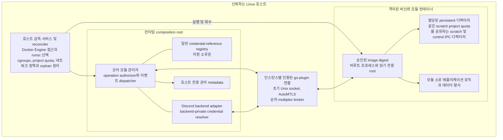
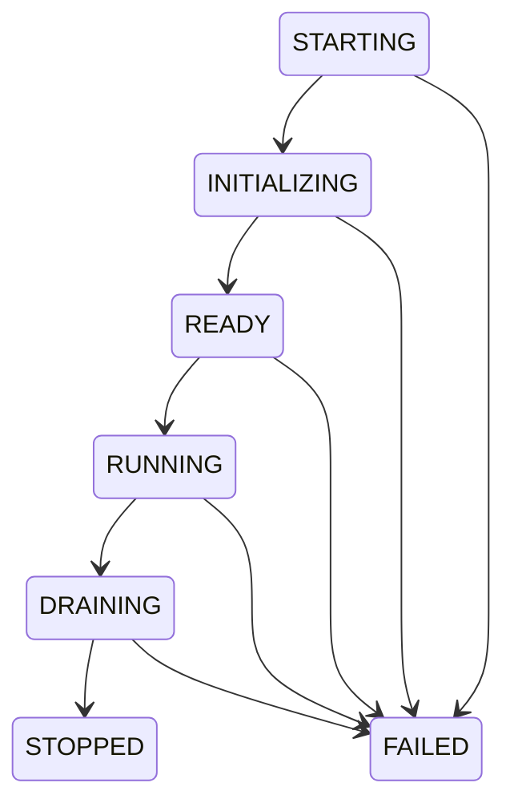

# 백엔드 중립 다중 모듈 런타임과 실행 격리 - Spec Proposal

| Item       | Detail                           |
|------------|----------------------------------|
| Author     | Seonguk Moon                     |
| Created    | 2026-10-29                       |
| Status     | **Draft** / In Review / Approved |
| Reviewers  |                                  |

---

## 1. Summary

범용 모듈을 독립된 실행 인스턴스로 관리하는 백엔드 중립 런타임을 정의합니다. 모듈별 설정, 실제 승인 권한, 순서가 보장되는 메모리 이벤트 큐, 수명주기와 정리 절차를 제공하며, Linux 호스트에서 Docker Engine과 runsc/gVisor를 사용해 프로세스, 파일시스템, 네트워크와 자원을 격리합니다. go-plugin의 인증된 양방향 브로커는 유지하되, 컨테이너 실행기와 Unix 소켓 연결 방식은 고정된 배포 조합의 실제 통합 검증을 통과해야 배포할 수 있습니다.

## 2. Background & Motivation

현재 저장소에서 확인한 동작과 이번 설계에서 요구하는 동작을 구분합니다.

| 구분 | 근거 또는 요구 사항 |
|---|---|
| 현재 실행 구조 | `main.go`는 `PLUGIN_PATH`에 지정한 한 프로세스를 `exec.Command`로 실행하고 Discord 세션을 직접 구성합니다. 여러 설치 모듈의 독립된 상태, 자원, 승인 범위를 관리하는 실행 계층은 아닙니다. |
| 현재 수명주기 | `shared/core-v1/interface.go`의 `OnStage`는 오류를 반환하지 않습니다. 런타임 래퍼는 RPC 오류를 버리고, `main.go`는 `MODULE_INIT` 전후 상태를 출력하지만 준비 완료를 활성화 조건으로 사용하지 않습니다. 인터페이스 주석에 있는 재조회 설명을 실제 구현된 준비 절차로 간주하지 않습니다. |
| 현재 권한과 설정 | 기존 manifest의 문자열 권한 목록만으로 요청별 승인 범위와 인증된 호출자를 판별할 수 없습니다. `GetConfig`는 proto 정의가 있지만, 이번 제안에서 요구하는 모듈별 구조화 설정 전달과 접근 통제가 구현된 상태는 아닙니다. |
| 현재 이벤트와 명령 | `main.go`는 삭제 이벤트도 생성 훅으로 전달하고, 명령 등록 전에 `DefaultMemberPermissions`를 `nil`로 덮어씁니다. 단일 모듈 코드에 있는 콜백을 그대로 여러 모듈에 복제하면 순서, 소유권과 실패 전파 문제가 남습니다. |
| 현재 종료 처리 | 여러 오류 경로에서 `os.Exit`를 호출하므로 `defer client.Kill()`만으로 모든 정리 경로를 보장할 수 없습니다. 호스트 프로세스가 강제 종료된 뒤 컨테이너를 회수하는 외부 감독 구조도 별도로 필요합니다. |
| 확정 요구 사항 | 일반 관리 봇, 명령 및 메시지 모듈, 오디오 모듈을 모두 지원합니다. 코어에 Discord DTO나 음악 기능을 넣지 않으며, 필수 권한과 선택 권한, 운영자 승인, 모듈별 영속 디렉터리를 구분합니다. |
| 제안하는 구현 방법 | Docker용 `RunnerFunc`, 다중화 브로커, 호스트의 cgroups와 project quota, 호스트 입력 및 전달 경로를 모두 다루는 네트워크 정책, 외부 감독 서비스를 결합합니다. 아래에서 구현 방법으로 제시한 항목은 이미 동작을 검증한 저장소 기능이 아닙니다. |

이 문서는 [프로토콜 계약](flexmodule-1-protocol-contracts.md)의 `core-v2` 계약을 실행하는 런타임 명세입니다. 현재 v1 코드는 현황의 근거로만 인용합니다. 통합 전환에서는 런타임, 모든 모듈과 예제를 함께 다시 빌드하고, 이전 프로토콜과 호환 별칭을 남기지 않습니다.

## 3. Goals & Non-Goals

### 3.1 Goals

- [ ] 안정적인 `ModuleID`와 매 실행마다 새로 발급하는 `InstanceID`를 구분하고, 여러 모듈의 시작, 중지, 실패와 정리를 독립적으로 관리합니다.
- [ ] 인증된 브로커 연결에서 호출자 신원을 확정하고, 모든 helper 호출에 실제 권한, 백엔드 자원 범위와 실행 상태를 적용합니다.
- [ ] 필수 권한 거부 시 활성화를 거절하며, 선택 권한의 거부 결과를 포함한 실제 grants를 모듈에 전달합니다.
- [ ] 전체 시작 및 준비 완료 제한 30초, 정상 애플리케이션 drain 10초, 자동 재시작 없음이라는 기본 동작을 구현합니다.
- [ ] 모듈별 단일 이벤트 처리 경로와 256개 또는 32MiB의 FIFO 한도를 적용하고, 넘친 모듈만 명시적으로 실패시킵니다.
- [ ] Linux 호스트의 Docker Engine과 runsc를 통해 승인된 OCI 이미지만 실행하고, 비루트 사용자, 읽기 전용 루트, capability 제거와 호스트 제어 경로 차단을 적용합니다.
- [ ] CPU, 메모리, PID 및 스레드, 영속 공간과 임시 공간의 한도를 실제 호스트 자원 통제로 강제합니다.
- [ ] 승인된 모듈에는 호스트 및 sandbox 경계에서 관측하고 강제할 수 있는 공개 인터넷 목적지로의 통신을 제공하고, 승인되지 않은 모듈에는 외부 네트워크를 제공하지 않습니다. IPv4와 IPv6의 실제 목적지, 호스트 주소, 내부망, 링크 로컬, 메타데이터와 DNS 경로를 통제하며, 허용된 공개 서비스의 이후 중계까지 종단 간 격리한다고 약속하지 않습니다.
- [ ] 모듈별 영속 디렉터리는 재시작과 이미지 갱신 후에도 보존하고, 인스턴스 임시 자원과 참조는 회수합니다.
- [ ] 런타임 소유 Discord 자격 증명을 원문으로 전달하지 않고, 인스턴스, 목적, 자원과 만료에 묶인 typed reference로만 필요한 기능을 제공합니다.
- [ ] 정상 종료, 시작 실패, 시간 초과, 큐 초과, 모듈 충돌과 호스트 런타임 충돌에 동일한 멱등 정리 규칙을 적용합니다.

### 3.2 Non-Goals

- [ ] 코어에 음악 재생, Discord 이벤트 타입, 길드 권한 계산이나 다른 백엔드의 업무 로직을 넣지 않습니다. `media` 자원 등급은 모듈 종류가 아닙니다.
- [ ] Kubernetes, 직접 OCI 번들을 실행하는 별도 launcher, rootless 배포, 다른 운영체제와 비 Go SDK는 이번 구현 범위가 아닙니다.
- [ ] 영속 이벤트 로그, 재시작 후 이벤트 재생, exactly-once 전달, 실패한 이벤트의 자동 재전송과 모듈 자동 재시작을 제공하지 않습니다.
- [ ] 모듈에 공용 KV, SQL, 데이터베이스 서비스나 임의 호스트 경로 접근 API를 제공하지 않습니다.
- [ ] 임의 URL HTTP proxy, shell helper, Docker 제어 API, 일반 OAuth 인증 흐름이나 자격 증명 원문 내보내기를 제공하지 않습니다.
- [ ] Docker 네트워크 또는 volume을 설정했다는 이유만으로 공개 인터넷 전용 통신이나 디스크 용량 제한이 충족되었다고 간주하지 않습니다.
- [ ] 부분적으로 성공한 Discord 외부 변경을 자동으로 되돌리는 트랜잭션을 약속하지 않습니다.

## 4. Technical Design

### 4.1 Architecture Overview

#### 구성 요소와 신뢰 경계



코어는 설치 식별자, 실행 상태, 설정, grants, 자원 소유권과 일반 `EventEnvelope`만 처리합니다. Discord 어댑터는 intents, Discord 자원 관계, typed 이벤트 변환, 명령 소유권, credential purpose와 Discord 서비스 정리를 담당합니다. composition root에서는 두 계층을 조합할 수 있지만 코어 proto와 코어 실행 패키지는 Discord DTO 또는 `discordgo`를 import하지 않습니다.

한 `ModuleID`에는 동시에 하나의 활성 인스턴스만 허용합니다. 시작 중이거나 이전 인스턴스의 정리가 끝나지 않은 경우도 점유 상태로 취급합니다. 이는 영속 디렉터리의 동시 쓰기와 과거 소유권의 재사용을 막기 위한 실행 계약입니다. 모듈의 manifest 이름이나 RPC metadata는 이 점유권을 바꾸지 못합니다.

호스트 감독 서비스는 모듈 밖에서 동작하는 신뢰 구성 요소입니다. Docker daemon, quota 설정과 방화벽 변경에 필요한 호스트 권한을 가집니다. 모듈에 이 권한이나 해당 서비스의 제어 소켓을 전달하지 않습니다. 감독 서비스는 런타임 프로세스의 실제 생존 여부를 pidfd 등 PID 재사용을 구분할 수 있는 호스트 식별 수단으로 감시하며, 런타임이 사라지면 그 실행 세대의 컨테이너를 중지하고 정리합니다. 서비스 관리자에는 감독 서비스가 비정상 종료될 때도 호스트 전용 정리 경로를 실행하도록 구성합니다. 인프로세스 `defer`나 모듈의 종료 보고만으로 이 역할을 대체하지 않습니다.

#### go-plugin과 Docker 실행기의 결합

go-plugin v1.6.3의 `ClientConfig`는 `Cmd`, `Reattach`, `RunnerFunc` 중 **정확히 하나**만 허용합니다. 이 제안은 `RunnerFunc`만 설정합니다. `Cmd`와 `Reattach`는 `nil`이며, `exec.Command("docker", ...)`를 `Cmd`에도 넣는 구성은 잘못된 구성으로 거절합니다.

`RunnerFunc`를 사용하는 경우 go-plugin은 비어 있는 실행 경로의 `exec.Cmd`를 만들고 bootstrap 환경을 채워 factory에 전달합니다. Docker 실행기는 이 `cmd.Path`를 실행 파일로 사용하지 않습니다. 승인된 `ModuleSpec`에서 이미지와 컨테이너 내부 entrypoint를 가져오고, `cmd.Env`의 bootstrap 값을 실제 Docker container `Env`에 전달합니다. launcher 프로세스의 환경만 바꾸는 구현은 이 계약을 충족하지 않습니다.

| 항목 | 실행 계약 |
|---|---|
| 프로토콜 | 애플리케이션 handshake version 2와 gRPC만 허용합니다. 이전 버전이나 net/rpc로 낮추지 않습니다. |
| 인증 | `AutoMTLS=true`로 실행마다 새 인증 채널을 구성합니다. 보호된 bootstrap stdout과 해당 컨테이너의 연결을 묶습니다. magic cookie는 호환 실행 여부를 확인하는 값이며 인증 수단이 아닙니다. |
| 환경 | `SkipHostEnv=true`를 사용합니다. 호스트 `DISCORD_TOKEN`, 임의 호스트 환경과 secret source를 상속하지 않습니다. 승인된 이미지 환경과 bootstrap 환경의 예약 이름 충돌도 거절합니다. |
| 브로커 | `GRPCBrokerMultiplex=true`를 사용하고, core와 backend broker 연결을 하나씩 순차적으로 개설합니다. Reattach는 제공하지 않습니다. 모든 reverse helper server에도 해당 실행의 TLS 및 principal 바인딩을 유지합니다. |
| stdout 및 stderr | Docker attach는 `Tty=false`로 열고 프레임을 demultiplex합니다. `Stdout()`에는 모듈 stdout만, `Stderr()`에는 모듈 stderr만 전달합니다. attach와 bounded collector를 container 시작 전에 준비하여 프로세스 시작 시점부터 수집합니다. 최초 stdout 줄은 handshake여야 하며 launcher 진단을 앞에 넣지 않습니다. 유효한 handshake는 원형을 보존하여 go-plugin에 전달하고 일반 로그로 복제하지 않습니다. |
| 프로세스 소유권 | `ID()`는 실제 Docker container ID를 반환합니다. `Wait()`는 attach 프로세스가 아니라 실제 컨테이너 종료를 관찰합니다. `Kill()`은 컨테이너 중지, 종료 확인과 삭제를 책임집니다. |
| 초기 소켓 | go-plugin이 만든 인스턴스 전용 호스트 디렉터리 `H`를 컨테이너의 전용 경로 `C`에 연결합니다. `H`는 scratch와 같은 XFS filesystem에 있어야 하며, container 시작 전에 해당 인스턴스 scratch의 project ID와 inheritance를 적용합니다. `PLUGIN_UNIX_SOCKET_DIR`는 `C`로 바꿉니다. |
| 주소 변환 | `PluginToHost`는 `C → H`, `HostToPlugin`은 `H → C`만 허용합니다. Unix 이외 주소, 절대 경로 바꿔치기, `..`, symlink, 다른 인스턴스 디렉터리와 범위 밖 소켓은 거절합니다. 단순 문자열 prefix 비교나 경로 검사 후 원래 pathname으로 dial하는 check-then-dial은 허용하지 않습니다. 실제 connect 시점까지 소유 디렉터리와 허용 소켓의 경계를 유지하여, 검사와 연결 사이의 경로 교체로 다른 소켓에 연결할 수 없어야 합니다. |
| 소켓 접근 | 디렉터리와 socket mode, `UnixSocketConfig.Group`, 컨테이너 UID/GID 및 호스트 보안 정책을 함께 맞춥니다. 다른 모듈의 소켓 디렉터리를 열 수 없어야 합니다. |

Docker container 생성 시 `HostConfig.LogConfig.Type="none"`을 지정하고, 이 설정을 확인하기 전에는 시작하지 않습니다. 모듈 stdout 및 stderr의 유일한 보관 경로는 bounded attach collector입니다. go-plugin 진단이나 host logger로 전달하는 경우도 이 한도 안에서 처리하며, Docker logging driver, daemon journal 또는 다른 host sink에 모듈 출력을 별도로 복제하지 않습니다.

첫 stdout 줄은 `limits.control_message_max_bytes`를 넘지 않아야 하며, 이 줄을 모으는 bootstrap 버퍼와 stderr를 포함한 collector의 전체 메모리 버퍼는 `limits.log_buffer_bytes` 안에 있어야 합니다. 두 한도를 함께 지킬 수 없는 설정은 거절합니다. 줄바꿈 없는 초과 입력, 잘못된 handshake, 첫 줄을 완성하지 못한 EOF 또는 startup deadline 초과는 시작 실패입니다. bootstrap 중 stderr와 잘못된 stdout도 별도 무제한 버퍼에 쌓지 않고 같은 bounded 경로에서 처리합니다. 로그 파일은 `limits.log_file_max_bytes`를 넘지 않으며 활성 파일을 포함한 보관 수에 `limits.log_retained_files`를 적용합니다. 이 수집 및 보관 한도는 handshake 전부터 실행 종료까지 유지합니다.

runsc의 후보 설정은 `--host-uds=create`와 외부에서 소켓이 보이는 비 overlay 공용 IPC mount입니다. 다중화 브로커를 사용하므로 별도 호스트 helper socket으로 접속하기 위한 더 넓은 `--host-uds=all`을 기본값으로 채택하지 않습니다. `--file-access-mounts=shared`를 포함한 실제 mount 구성은 고정한 runsc 배포 버전에서 확인합니다.

이 결합은 go-plugin과 runsc 소스로 뒷받침되는 **제안된 통합 방식이며, 아직 실행 검증한 조합이 아닙니다**. 선택한 Docker Engine 및 runsc 버전, 비루트 UID/GID, 보안 label, 다중화 reverse RPC와 정리 경로를 함께 검증하기 전에는 배포 승인을 내리지 않습니다. AddrTranslator의 경로 검사 결과가 실제 broker connect 대상까지 유지되는 race-safe 결합도 이 gate에 포함합니다. pathname을 검사하거나 정규화했다는 사실만으로 안전한 연결을 입증한 것으로 보지 않으며, 특정 라이브러리가 이를 이미 제공한다고 주장하지 않습니다. 실패하면 새 우회 transport, host network, privileged 실행, 임의 호스트 mount 또는 넓은 UDS 권한으로 우회하지 않습니다.

#### 컨테이너의 고정 보안 속성

- 이미지 참조는 registry와 repository가 포함된 immutable digest입니다. mutable tag만 지정한 이미지는 실행하지 않습니다. 설치 단계에서 준비한 이미지와 실행 시 확인한 digest가 일치해야 합니다.
- 승인된 non-zero UID/GID로 모듈을 실행하고, `ReadonlyRootfs=true`, `CapDrop=[ALL]`, `no-new-privileges`, `Privileged=false`를 적용합니다. 호스트 PID, IPC 및 network namespace를 공유하지 않습니다.
- runsc는 격리된 network stack을 사용합니다. 기본 platform은 추가 KVM device 전달을 요구하지 않는 `systrap`입니다. Docker의 자동 restart policy는 사용하지 않습니다.
- 모듈에 허용하는 호스트 데이터 mount는 런타임이 생성하고 소유권을 확인한 해당 모듈의 persistent, 해당 인스턴스의 scratch 및 전용 IPC 디렉터리뿐입니다. writable IPC에도 scratch와 같은 인스턴스 project의 byte 및 inode quota를 적용하고 사용량을 합산합니다. 이 제한된 데이터 및 IPC 연결을 제외한 임의 호스트 mount는 금지합니다. `/`, 호스트 홈, `/proc`의 호스트 view, Docker socket, containerd socket, runsc 상태 디렉터리와 감독 서비스 socket을 노출하지 않습니다.
- 이미지가 선언한 임의 volume, host device, 추가 mount, published port 또는 특권 설정을 그대로 받아들이지 않습니다. 허용 목록 밖의 image volume과 실행 설정은 거절합니다. 모듈이 쓰는 임시 파일 경로는 quota가 적용되는 scratch에 연결하며, IPC에 일반 파일을 쓰더라도 같은 한도에 포함합니다. `/tmp` 등에 별도 무제한 writable layer를 만들지 않습니다.
- 모듈에서 보이는 proc 및 device는 sandbox가 제공하는 제한된 view입니다. 호스트의 seccomp, SELinux 또는 AppArmor 정책을 무효화해서 실행을 통과시키지 않습니다.

### 4.2 Data Model Changes

#### 식별자와 실제 권한

| 데이터 | 소유자와 수명 | 규칙 |
|---|---|---|
| `ModuleID` | 호스트 설치 설정, 재시작과 이미지 갱신 후 유지 | 운영자가 등록한 논리 식별자입니다. manifest가 다른 값을 주장해도 바꾸지 않습니다. |
| `InstanceID` | 호스트가 매 `Launch`에서 새로 생성 | 충돌을 허용하지 않는 불투명 식별자입니다. 실패한 시작의 ID도 다음 실행에서 재사용하지 않습니다. |
| `InstancePrincipal` | 인증된 helper broker server/connection에 바인딩 | `{ModuleID, InstanceID}`입니다. 요청 본문이나 `module-id` metadata에서 생성하지 않습니다. |
| `ModuleManifest` | 모듈의 요구 사항 | protocol major, 표시용 메타데이터, 필수 및 선택 core capability, backend 요구 사항을 담습니다. 요구는 승인과 다릅니다. |
| `Grants` | 호스트와 backend가 협상한 실행별 불변 snapshot | 실제 core capability, backend별 capability와 범위, 자원 등급 및 실제 한도, `NONE` 또는 `PUBLIC_INTERNET` egress policy를 담습니다. 변경하려면 인스턴스를 중지하고 새로 실행합니다. |
| `ResourceScope` | 코어가 저장하고 backend가 해석 | 명시적인 `all_resources=true` 또는 `ResourceSelector.resource_ids`를 사용합니다. selector 내부 조건은 AND, 여러 scope는 OR입니다. 빈 scope 목록은 아무 권한도 주지 않습니다. 빈 selector는 등록된 operation이 resource-free로 명시한 경우에만 허용하며 wildcard로 해석하지 않습니다. |
| `CredentialRef` | 인스턴스 소유, 목적별 만료 | `opaque_id`, `backend_id`, `purpose`, 정확한 `ResourceSelector`와 `expires_at`을 담습니다. 보이는 메타데이터는 vault의 원본 기록과 대조하는 설명 값이며 스스로 권한을 증명하지 않습니다. |
| `EventEnvelope` | 런타임 메모리 | `backend_id`, `backend_major`, `event_type`, `ingress_sequence`, `received_at`, typed `Any payload`를 담습니다. credential 원문이나 SDK transport object를 담지 않습니다. |

`CapabilityGrant.constraints`는 backend가 등록한 허용 타입만 사용합니다. 코어는 Discord 권한 비트나 voice priority의 뜻을 해석하지 않으며, 등록된 어댑터가 해당 제약을 검증합니다.

#### 운영자 설정 스키마

호스트 설정의 최상위는 `schema_version=2`, `host`, `backends`, `resource_profiles`, `defaults`, `limits`, `modules`로 구성합니다. 아래 표는 구현할 설정 계약입니다. secret과 호스트 경로가 있는 호스트 문서 전체를 모듈에 직렬화해서 전달하지 않습니다.

| 경로 | 타입과 필수 여부 | 의미 및 검증 |
|---|---|---|
| `host.docker_endpoint` | 호스트 전용 Unix socket 경로, 필수 | 신뢰된 런타임만 접근합니다. 모듈 설정이나 mount 목록으로 전달하지 않습니다. |
| `host.docker_engine_version` | 정확한 버전, 필수 | 통합 승인 기록의 버전과 일치해야 합니다. |
| `host.runsc_runtime_name`, `host.runsc_version`, `host.runsc_sha256` | 문자열, 필수 | Docker에 등록한 runsc와 검증한 바이너리를 지정합니다. 이름만 같은 다른 바이너리로 바꾸지 않습니다. |
| `host.management_directory` | 절대 경로, 필수 | 호스트 전용 관리 metadata와 감독 서비스 기록을 보관합니다. module mount 밖입니다. |
| `host.storage_root` | 절대 경로, 필수 | 런타임이 persistent 및 인스턴스 scratch의 자식 디렉터리를 생성합니다. 모듈이 제출한 경로는 사용하지 않습니다. |
| `host.ipc_root` | 절대 경로, 필수 | 인스턴스 IPC 디렉터리를 생성할 root입니다. scratch와 같은 XFS filesystem에 있어야 하며, 각 IPC 디렉터리에 해당 인스턴스 scratch의 project ID와 inheritance를 container 시작 전에 적용합니다. 별도 IPC quota를 추가하지 않습니다. |
| `host.quota_backend` | `xfs-project`, 필수 | 이번 구현 방식은 XFS의 project quota입니다. accounting과 enforcement, project inheritance가 모두 활성화되어야 합니다. 다른 filesystem을 quota가 있는 것으로 추정하지 않습니다. |
| `host.network` | 구조체, 필수 | 지원하는 Docker iptables firewall backend, IPv4 및 IPv6 정책, resolver 목록, 호스트 public 주소, 내부 및 인프라 prefix, metadata 목적지 목록을 명시합니다. 동적 호스트 주소도 정책 집합에 반영합니다. |
| `backends` | backend ID별 등록 설정, 필수 | backend major, 어댑터 설정과 host-only secret source 식별자를 담습니다. Discord bot token은 이 계층에만 있습니다. |
| `resource_profiles` | `general`, `media` 및 승인된 override | 아래 한도를 사용합니다. 등급 이름에서 기능이나 권한을 추론하지 않습니다. |
| `defaults.startup_deadline`, `defaults.drain_deadline` | duration, 기본 30초 및 10초 | 각 단계에 따로 추가되는 시간이 아니라 실행 시작 전체와 정상 drain 전체의 상한입니다. |
| `defaults.event_queue_events`, `defaults.event_queue_bytes` | 양의 정수, 기본 256 및 33,554,432 | 두 한도 중 먼저 도달한 한도를 적용합니다. |
| `limits` | 유한한 양의 값들, 필수 | 아래의 기본값 미합의 항목을 모두 지정합니다. 누락이나 unlimited 값은 설정 오류입니다. |
| `modules[].module_id` | 비어 있지 않은 고유 문자열, 필수 | host installation identity입니다. filesystem 경로로 직접 이어 붙이지 않습니다. |
| `modules[].image` | digest가 고정된 OCI image 참조, 필수 | 실행 시 image digest를 다시 대조합니다. |
| `modules[].entrypoint`, `modules[].args` | 문자열 배열 | 실행 파일은 이미지 내부 절대 경로입니다. image에 있는 명령 또는 운영자가 승인한 명령을 확정하며, host shell 명령으로 해석하지 않습니다. |
| `modules[].uid`, `modules[].gid` | non-zero 정수, 필수 | 데이터 및 IPC 접근 권한과 일치해야 합니다. |
| `modules[].approval` | `Grants`와 동일한 승인 구조, 필수 | 지원 여부와 manifest 요구를 대조하기 전의 운영자 승인 상한입니다. 최종 actual grants와 구분합니다. |
| `modules[].config` | 명시적인 JSON object, 필수 | 해당 모듈에만 전달할 설정 snapshot입니다. 최상위는 객체이며 내부 숫자, null과 빈 값의 의미를 보존합니다. runtime secret을 가져오는 환경 치환이나 host config 병합을 지원하지 않습니다. |
| `modules[].credential_bindings` | 이름별 backend provisioned credential 연결 | backend, 호스트 전용 secret 식별자, purpose와 정확한 resource selector를 기록합니다. 원문은 `GetConfig` 응답에 포함하지 않습니다. |

`limits`에서 운영자가 반드시 유한한 값을 정해야 하는 항목은 `termination_deadline`, `docker_api_deadline`, `hook_rpc_deadline`, `readiness_poll_interval`, `control_message_max_bytes`, `config_max_bytes`, `control_rpcs_per_instance`, `credential_refs_per_instance`, `credential_ref_max_ttl`, `persistent_inode_limit`, `scratch_inode_limit`, `log_buffer_bytes`, `log_file_max_bytes`, `log_retained_files`입니다. 이는 합의되지 않은 수치를 새 기본값으로 만드는 대신 필수 운영 설정으로 남기는 항목입니다. 음수, 0으로 무제한을 뜻하는 값, 서로 맞지 않는 한도를 거절합니다. 전송 한도는 허용한 이벤트와 upload chunk의 protobuf 부가 크기를 포함해야 하며, readiness 조회 간격은 시작 제한 시간 안에서 작동해야 합니다.

`scratch_inode_limit`는 scratch와 writable IPC 전체에 합산하여 적용합니다. `control_message_max_bytes`는 bootstrap 첫 stdout 줄의 상한에도 사용하고, `log_buffer_bytes`, `log_file_max_bytes`, `log_retained_files`는 프로세스 시작부터 종료까지의 attach 수집에 적용합니다. bootstrap 또는 IPC를 이유로 별도 무제한 경로나 새 숫자 기본값을 두지 않습니다.

업로드 저장소에는 [프로토콜 계약](flexmodule-1-protocol-contracts.md)과 [Discord 백엔드 및 파일 전송](flexmodule-3-discord-backend.md)에 따른 호스트 및 인스턴스별 업로드 레코드 개수 상한도 운영자가 유한한 양의 값으로 반드시 설정합니다. 예약 중인 레코드, 완료한 ref, 회수 대기 레코드와 삭제 tombstone을 모두 포함합니다. 구체적인 저장소 설정과 강제는 P3가 담당하며, 이 문서는 별도 설정 필드 이름이나 숫자 기본값을 추가하지 않습니다.

`GetConfig`는 승인한 module JSON의 snapshot만 반환합니다. 다른 모듈 ID를 지정하는 인자가 없으며, runtime 및 backend secret source, host 경로와 환경에 접근하는 기능도 없습니다. 실행 중 설정이나 grants를 자동 갱신하지 않습니다.

#### 확정 자원 기본값

| 자원 | `general` | `media` | 호스트 강제 수단 |
|---|---:|---:|---|
| CPU 상한 | 0.5 CPU | 2 CPU | cgroup CPU quota, Docker `NanoCPUs=500000000` 또는 `2000000000` |
| 메모리 상한 | 256MiB, 268,435,456 bytes | 1GiB, 1,073,741,824 bytes | cgroup memory hard limit |
| PID 및 스레드 상한 | 64 | 128 | guest `RLIMIT_NPROC` soft/hard 상한과 별도의 호스트 task cgroup `PidsLimit` |
| 영속 디렉터리 quota | 1GiB, 1,073,741,824 bytes | 5GiB, 5,368,709,120 bytes | 별도 XFS project hard quota |
| scratch 및 writable IPC 합산 quota | 256MiB, 268,435,456 bytes | 2GiB, 2,147,483,648 bytes | 두 경로가 공유하는 인스턴스별 단일 XFS project hard quota |

운영자 override도 같은 강제 수단을 사용합니다. CPU share만 설정한 것은 CPU 상한이 아닙니다. 메모리는 swap으로 우회하지 않도록 Docker의 `MemorySwap=Memory`와 호스트의 실제 swap 제한을 확인합니다. cgroup v2에서는 `cpu.max`, `memory.max`, `memory.swap.max`, `pids.max`의 적용 결과를 대조합니다.

PID 및 스레드 한도는 **guest의 프로세스 및 스레드 총수에도 적용**합니다. Docker `HostConfig.Ulimits`에 `Name=nproc`, `Soft=Hard=64` 또는 `128`을 지정하여 OCI `process.rlimits`의 `RLIMIT_NPROC`로 전달합니다. 모듈은 고정된 non-zero UID로 실행하고 capability 전체 제거 및 no-new-privileges를 유지합니다. soft limit을 hard limit보다 높이거나 UID 변경, setuid 실행 또는 namespace 생성으로 계수를 우회할 수 없어야 합니다. 이 값은 Go goroutine 수가 아니라 Linux task 수입니다.

현재 gVisor 소스에서 `runsc/boot/limits.go`는 OCI rlimit를 guest limit set에 반영하고, `kernel.TaskSet.NewTask`는 모든 새 task에 `UserCounters.incRLimitNProc`를 호출합니다. 해당 함수는 UID별 task 수를 원자적으로 증가시킨 뒤 한도를 넘고 root `CAP_SYS_ADMIN` 또는 `CAP_SYS_RESOURCE` 예외가 없으면 증가를 취소하고 `EAGAIN`을 반환합니다. 따라서 `RLIMIT_NPROC` 값이 조회된다는 사실만으로 강제를 주장하지 않고, 이 실제 task 생성 경로가 있는 고정된 runsc 버전을 사용합니다.

동시에 호스트 `PidsLimit=64` 또는 `128`로 sentry, gofer 및 해당 sandbox의 호스트 task도 제한합니다. 호스트 한도에는 실행기 내부 overhead가 포함되므로 guest가 한도만큼의 task를 반드시 만들 수 있다는 가용성 보장은 없습니다. guest 한도를 호스트 수로 바꾸어 해석하거나 overhead를 이유로 확정 수치를 올리지 않습니다. guest rlimit에 먼저 도달하면 task 생성을 거절하고, 호스트 한도에 먼저 도달해 sandbox가 종료되면 해당 인스턴스를 실패 처리합니다. 고정한 배포 조합에서 guest process/thread 부하와 limit 우회, 호스트 task 상한, 일반 Go 모듈의 시작 가능 여부를 함께 검증하며, 충족하지 못하면 실행을 승인하지 않습니다.

project quota는 persistent와 인스턴스 임시 공간에 서로 다른 non-zero project ID를 할당합니다. persistent project ID는 `ModuleID`에 따라 유지하며, scratch project ID는 `InstanceID`마다 새로 할당하여 scratch 및 writable IPC 디렉터리 둘 다에 사용합니다. 두 임시 경로는 같은 XFS filesystem에 있어야 합니다. container 시작 전에 두 디렉터리 전체의 같은 project ID와 inheritance flag를 확인하고, 해당 project의 byte hard limit 및 `scratch_inode_limit`를 적용합니다. persistent에도 별도의 byte hard limit과 `persistent_inode_limit`를 적용합니다. 검사와 적용이 끝나기 전에 컨테이너를 시작하지 않으며 Docker volume 크기 옵션이나 주기적인 디렉터리 사용량 계산으로 hard quota를 대신하지 않습니다.

scratch와 IPC의 할당 공간 및 inode 사용량은 같은 project에서 합산합니다. 일반 등급 256MiB, media 등급 2GiB는 두 경로를 합친 상한이며 IPC에 별도 용량을 더하지 않습니다. 디스크 quota는 filesystem이 계산하는 할당 공간의 상한으로, sparse file의 논리 길이나 애플리케이션 데이터 구조의 크기를 의미하지 않습니다. inode 고갈도 같은 project의 필수 inode 한도로 막습니다. 이미 저장된 persistent 사용량보다 작은 한도로 갱신하려는 경우 데이터 삭제로 맞추지 않고 실행을 거절합니다.

모듈 persistent 디렉터리의 파일 형식, SQLite 사용 여부와 데이터 마이그레이션은 모듈이 소유합니다. 정상 중지, 실패, 재시작과 이미지 갱신에서 runtime은 해당 디렉터리를 삭제하지 않습니다. 인스턴스 종료 시 scratch와 IPC를 모두 제거하고 열린 handle과 남은 할당까지 회수한 뒤에만 공유 project ID와 관련 소유 claim을 반환합니다. 어느 한 경로라도 남아 있으면 project ID나 소유 기록을 재사용하지 않습니다.

[Discord 백엔드 및 파일 전송](flexmodule-3-discord-backend.md)의 upload spool은 모듈 persistent 및 scratch/IPC project와 별개입니다. 파일당 500MiB, chunk 256KiB, 동시 upload 2개/인스턴스 및 8개/호스트, 저장 및 예약 공간 2GiB/인스턴스 및 8GiB/호스트, 완료 후 TTL 30분의 계약을 그대로 사용합니다. reservation과 사용 중인 lease가 남은 공간도 계산하며, 인스턴스 종료 시 새 lease를 막고 기존 작업을 종료한 뒤 회수합니다. 이는 모듈의 영속 데이터가 아닙니다.

업로드 시작 전에 byte와 동시성 예약에 더해 레코드 자리 하나를 원자적으로 예약합니다. 같은 자리는 `RECEIVING`, 완료한 ref, 회수 대기 및 삭제 tombstone까지 계속 계산하며, zero-byte 파일이나 byte 회수만으로 반환하지 않습니다. 호스트 또는 인스턴스 레코드 상한에 도달하면 부분 예약 없이 `ResourceExhausted`와 `QUOTA_EXCEEDED`로 거절합니다. 새 upload를 위해 아직 유효한 tombstone을 조기 제거하지 않습니다.

삭제한 ref는 원래 `expires_at` 전이고 같은 소유 인스턴스가 유효한 동안 반복 삭제에 성공합니다. byte를 회수한 뒤에도 opaque ID, 소유 인스턴스와 원래 만료 시각을 담은 tombstone을 유지하며 삭제 및 반복 호출은 TTL을 늘리지 않습니다. tombstone은 원래 만료 시각 또는 인스턴스 종료 중 먼저 발생한 때 제거하고 이후 삭제는 `NOT_FOUND`입니다. 다른 owner의 참조는 존재를 공개하지 않는 소유권 오류로 거절하며 tombstone도 새 읽기를 허용하지 않습니다. 만료나 인스턴스 종료 뒤에도 실제 lease 및 파일 회수에 필요한 내부 정리 레코드와 그 자리는 정리가 끝날 때까지 계산합니다.

#### 런타임 내부 관리 metadata

호스트 전용 관리 저장소를 추가합니다. 제안하는 저장 형식은 호스트 전용 SQLite이며, 모듈에 SQL이나 조회 서비스를 노출하지 않습니다. 모듈의 업무 데이터 및 backend 명령 registry와도 구분합니다.

| 기록 | 필수 필드 및 불변 조건 |
|---|---|
| `installations` | `module_id` PK, runtime이 만든 `storage_key`, 고유 persistent project ID, 승인 UID/GID, image digest, config revision, approval revision입니다. `storage_key`로 관리 root 아래 경로를 만들며 module 문자열을 경로로 사용하지 않습니다. |
| `runtime_epochs` | 새 실행 세대 ID, host boot identity, 실제 supervisor가 추적하는 process identity, 시작 시각, 종료 또는 회수 상태입니다. PID 숫자만으로 생존을 판별하지 않습니다. |
| `instances` | `instance_id` PK, `module_id`, runtime epoch, image digest, container ID, 상태, 실패 reason, 시작 및 종료 시각, cleanup 상태입니다. 정리가 끝나지 않은 인스턴스가 있으면 같은 모듈의 새 실행을 막습니다. |
| `resource_claims` | 인스턴스별 container, network endpoint 및 policy, scratch와 IPC가 공유하는 project ID 및 두 경로, 기타 임시 자원의 호스트 식별자, allocation 및 cleanup 상태입니다. 생성 전에 의도를 기록하고 생성 결과를 이어 기록해 충돌 중간 단계도 회수할 수 있게 합니다. 두 임시 경로의 삭제와 할당 회수가 끝나기 전에 공유 project claim을 해제하지 않습니다. |

관리 metadata에는 이벤트 payload, raw credential, upload body 또는 모듈 업무 데이터를 기록하지 않습니다. `InstancePrincipal`, 활성 event work reference, 실제 broker binding, FIFO와 credential-reference registry는 실행 중 메모리에 있습니다. credential 원문은 backend-private resolver와 승인된 host secret source에만 있으며, 코어는 목적 문자열과 소유 메타데이터 및 host-only backend handle을 관리합니다.

Discord command registry의 `(applicationID, guildID, commandType, name) → {ModuleID, commandID}`는 Discord 어댑터가 소유하는 별도 metadata입니다. command와 component/modal route의 활성 대상은 현재 `InstanceID`로 해석합니다. 코어가 Discord registry schema를 소유하거나 이를 일반 모듈 DB로 공개하지 않습니다.

### 4.3 Core Logic

#### 시작 상태 전이



`FAILED`는 정리 성공과 같은 뜻이 아닙니다. 실패가 확정되면 상태를 즉시 바꾸고 이벤트 및 새 작업을 막으며, 별도 cleanup 상태가 완료될 때까지 자원 점유를 유지합니다. `STOPPED`는 정상 정리가 끝난 결과입니다. 실패했던 실행은 정리 후에도 원래 failure reason을 잃지 않습니다.

1. `Launch`는 같은 `ModuleID`의 점유 여부, 설정, 고정 이미지, 승인 정책과 호스트 전제 조건을 확인합니다. caller deadline과 기본 30초 중 먼저 끝나는 단일 startup deadline을 생성합니다. 준비된 이미지가 없거나 필요한 host 기능이 없으면 시작을 거절합니다.
2. 새 `InstanceID`와 관리 기록을 만들고 quota, 네트워크 정책, 디렉터리와 container claim을 확보합니다. scratch 및 IPC가 같은 XFS filesystem과 같은 인스턴스 project의 byte/inode 한도 및 inheritance를 사용하는지 확인합니다. 정책이 준비되기 전에는 untrusted module을 실행하지 않습니다.
3. `HostConfig.LogConfig.Type="none"`인 container를 생성하고 bounded attach collector를 준비한 뒤 `RunnerFunc`로 시작합니다. 프로세스 시작부터 stdout 및 stderr를 제한하며 version 2 handshake, AutoMTLS와 순차 broker 연결을 완료합니다. 이 시점의 module helper는 manifest 및 승인 협상에 필요한 경로 외에는 사용할 수 없습니다.
4. `GetManifest`에서 필수 및 선택 요구를 읽습니다. 코어와 각 backend가 지원하는 기능, 운영자 approval, resource scope 및 backend 선행 조건을 대조해 actual grants를 만듭니다. 필수 항목이 하나라도 충족되지 않으면 `FAILED`로 정리합니다. 초기 network policy는 DNS를 포함한 외부 통신이 닫힌 상태이며, actual grants를 확정한 뒤에만 승인된 public policy를 엽니다. final policy가 `NONE`이면 외부 통신을 열지 않습니다.
5. backend `Prepare`를 완료하고 `INITIALIZING`으로 이동합니다. `OnStage(INIT)`에는 `InitContext{module_id, instance_id, grants, persistent_directory, scratch_directory}`를 전달합니다. 디렉터리 값은 sandbox 내부 경로이며 host 경로가 아닙니다.
6. `INIT` 성공 후 `GetStatus`의 `READY`를 기다립니다. `NOT_READY`는 남은 startup deadline 안에서 필수 설정의 조회 간격으로 다시 확인합니다. `FAILED`, hook 오류 또는 deadline 초과는 시작 실패입니다. 각 재조회에서 30초를 새로 부여하지 않습니다.
7. `READY`에서 START 활성화가 진행 중임을 표시한 뒤 `OnStage(START)`와 backend `Activate`를 성공시킵니다. 모든 준비가 완료되면 `RUNNING` 전이와 core admission barrier 개방을 원자적으로 확정하고 activation gate에서 대기 중인 호출을 해제합니다. 그 전에는 이벤트를 큐에 넣거나 외부에 활성 명령 route를 노출하지 않습니다.

`OnStage(START)`는 background worker를 시작한 뒤 반환해야 하며, 그 worker의 `RUNNING` 전용 helper 호출 완료를 동기적으로 기다려서는 안 됩니다. START 활성화가 진행 중인 `READY`에서는 인증, actual grant와 resource scope를 통과한 `RUNNING` 전용 호출만 인스턴스 activation gate에서 기다릴 수 있습니다. 대기 중에는 작업을 admission하거나 side effect를 실행하지 않습니다. 대기 호출도 기존 `control_rpcs_per_instance` 한도에 포함하며 caller context와 남은 단일 startup deadline으로 제한합니다. `RUNNING` 확정 후에도 현재 상태와 권한을 admission과 함께 다시 확인하고, 시작 실패, caller 취소, 기한 만료 또는 drain 전환은 대기를 해당 상태 및 오류로 끝냅니다. 기존 INIT-safe operation의 정책은 그대로 유지하며 다른 잘못된 상태는 정상적으로 거절합니다. 별도 공개 RPC, 준비 완료 polling API 또는 loop retry를 추가하지 않습니다.

`Prepare`와 `Activate`는 core의 admission barrier를 우회해서 이벤트를 전달하지 않습니다. 실제 Discord 명령 생성 등 INIT의 외부 부작용은 실패 시 자동 원상복구된다고 보장하지 않습니다. backend가 소유권 및 성공한 remote 결과를 기록하고, 다음 운영자 실행에서 자신의 변경만 조정합니다.

시작 중 stop 요청이 오면 activation gate의 대기 호출을 오류로 끝내고 추가 시작 단계를 진행하지 않은 채 이미 확보한 자원을 정리합니다. 시작 실패를 다른 모듈의 실패로 확대하지 않으며, 재실행은 운영자의 명시적 실행 요청으로만 가능합니다.

시작 제한 시간은 인스턴스별입니다. 다른 untrusted 모듈의 manifest 또는 readiness를 기다리는 공용 startup barrier를 두지 않습니다. backend가 준비되지 않았으면 해당 backend에 의존하는 인스턴스만 자신의 남은 startup 시간 안에서 실패하며, core-only 모듈의 시작은 Discord 상태와 무관합니다. 새 모듈에 과거 READY event를 만들어 전달하지 않습니다. 초기 정보가 필요하면 INIT, 승인된 config 또는 backend API를 사용하며 이벤트 재생으로 설명하지 않습니다.

#### 권한, intents와 자원 소유권

실제 허용 집합은 `manifest 요구 ∩ 운영자 approval ∩ 지원 기능 ∩ backend 선행 조건`으로 정합니다. scope는 backend가 정의한 자원 관계에 따라 교집합을 계산하며, 요청 ID를 믿고 상위 guild나 application을 정하지 않습니다. 메시지, channel, webhook 등은 backend가 확인한 실제 소유 관계로 판정합니다.

필수 capability의 요구 scope가 일부만 허용된 경우도 필수 요구 미충족입니다. 선택 capability는 허용되는 범위로 축소할 수 있지만 실제 scope를 INIT grants에 그대로 전달합니다. 기본 core capability 이름은 `core.config.read`, `core.upload`, `core.network.public_egress`입니다. 이들의 resource-free selector는 인증된 자기 인스턴스에만 적용됩니다. capability 문자열 prefix를 wildcard 권한으로 해석하지 않습니다.

- manifest의 필수 capability 또는 필수 backend가 충족되지 않으면 활성화를 거절합니다. 선택 항목이 거절되면 actual grants에서 빠집니다. 모듈은 INIT에서 받은 결과만 사용해야 합니다.
- `core.network.public_egress`는 명시적인 capability입니다. 이 capability의 승인과 `Grants.egress_policy=PUBLIC_INTERNET`이 모두 있어야 공개 인터넷 통신을 제공합니다. 선택 요청만 거절되었다면 실제 policy는 `NONE`이며, 필수 요청을 충족하지 못하면 시작하지 않습니다.
- 기능별 allow-state와 필요 capability는 신뢰된 operation registry에 등록합니다. caller가 state 정책, 필요 권한 또는 resource mapping을 지정하지 못합니다.
- Discord gateway intents는 모듈 활성화 전에 신뢰된 운영자 backend 설정과 승인된 capability 계획에서 확정합니다. 여러 untrusted manifest를 모두 기다려 shared session을 여는 barrier는 만들지 않습니다. 어댑터는 각 모듈의 actual grants가 요구하는 intent를 계산하여 활성 gateway 세션 및 Discord 측 privileged intent 설정에 포함되는지 `Prepare`에서 확인합니다.
- 실행 중인 backend에 없는 intent가 새 모듈에 필요하면 `BACKEND_RECONFIGURATION_REQUIRED`로 활성화를 거절합니다. 기존 모듈을 몰래 재접속시키거나 intent를 자동으로 넓히지 않습니다. 운영자가 backend 재구성 및 재시작을 결정합니다.
- intent 활성화, bot의 Discord 권한, FlexModule capability와 모듈의 자원 scope는 서로 다른 조건입니다. 하나로 나머지를 승인한 것으로 보지 않습니다.
- 명령은 `(applicationID, guildID, type, name)` 소유권 충돌을 거절하고, 다른 모듈 또는 외부 운영자가 소유한 명령을 일괄 삭제하거나 덮어쓰지 않습니다. 모듈이 보낸 `DefaultMemberPermissions`의 unset, 명시적 0 및 실제 bitmask를 보존합니다. 런타임 승인과 Discord 최종 사용자 권한을 혼합하지 않습니다.
- command 및 autocomplete interaction은 command registry의 유일한 소유 `ModuleID`를 정하고, 현재 활성 `InstanceID`의 실제 이벤트 grant와 resource scope를 확인한 뒤 전달합니다. `discord.routes.manage`는 이 전달의 선행 조건이 아닙니다.
- component 및 modal interaction은 `RegisterInteractionRoutes`로 claim한 정확한 `(applicationID, interactionKind, customID)`의 유일한 소유자를 정하고, 현재 활성 `InstanceID`에 적용되는 이벤트 grant, resource scope와 경로 소유권을 확인한 뒤 전달합니다. `discord.routes.manage`는 경로 등록 및 해제 관리에 적용하며 command 및 autocomplete에 전파하지 않습니다. 같은 소유자의 route 등록은 멱등이며 다른 소유자의 중복은 거절합니다. callback credential은 위 조건을 통과하여 선택된 소유 인스턴스에만 발급하고 broadcast하지 않습니다. 상세 route quota와 API는 프로토콜 및 Discord 백엔드 제안을 따릅니다.
- bot 전체 presence처럼 공유되는 backend 자원도 어댑터가 단일 활성 writer lease를 관리합니다. 경쟁하는 필수 writer는 활성화를 거절하고 선택 writer는 actual grants에서 제외합니다. 마지막 호출로 덮어쓰는 정책이나 이전 상태의 자동 복원을 코어에 추가하지 않습니다.

#### 이벤트 순서와 실패 격리

backend ingress는 하나의 제한된 동기 admission 경로로 연결합니다. Discord 어댑터는 현재 로컬 `discordgo`의 `SyncEvents` 실행 정책을 명시적으로 설정하고, 서로 독립된 goroutine으로 먼저 fan-out한 뒤 순서를 복구하는 방식을 사용하지 않습니다. SDK의 내부 State 처리가 끝난 typed event를 분류하며, raw `__EVENT__`를 별도 이벤트처럼 다시 전달하지 않습니다.

런타임의 단일 직렬 admission 지점에서 backend dispatch마다 전역 `ingress_sequence`를 한 번 증가시킵니다. 현재 runtime lifetime에서 1부터 시작하며, overflow 전에 backend admission을 실패시킵니다. 모듈에는 scope와 이벤트 권한으로 필터링된 증가 부분수열이 전달되므로 번호의 간격은 정상입니다. 이 값은 Discord gateway sequence 또는 재시작 재생 cursor가 아닙니다.

backend는 credential을 포함한 원본 객체를 모듈별 안전한 typed payload로 projection하고, 해당 인스턴스에만 유효한 reference를 넣은 뒤 직렬화합니다. 코어는 수정 가능한 SDK 객체의 pointer를 큐에 보관하지 않습니다. queued data는 불변 serialized envelope이며 크기를 계산한 뒤 제한 안에서만 저장합니다. 다수 모듈에 같은 불변 데이터를 공유하더라도 각 모듈의 논리 보관 byte 수는 각각 계산합니다.

기본 FIFO 한도는 수락했지만 아직 hook이 끝나지 않은 이벤트를 기준으로 **256개 또는 32MiB**입니다. 처리 중인 한 개도 이 수와 byte 수에 포함합니다. 정확히 한도까지는 허용하고, 다음 이벤트를 넣으면 어느 한도라도 초과하는 경우 그 모듈을 `EVENT_QUEUE_OVERFLOW`로 실패시킵니다. 단일 envelope 자체가 한도를 넘는 경우도 같습니다. 해당 모듈의 cleanup을 예약한 뒤 다른 모듈 admission을 계속하며, 느린 module RPC를 전역 ingress에서 기다리지 않습니다.

각 모듈에는 이벤트를 처리하는 lane이 하나 있습니다. 이전 `OnEvent`의 성공 응답을 받기 전에는 다음 이벤트를 보내지 않습니다. 오류, timeout 또는 transport loss가 발생하면 이전 handler가 실제로 끝났다고 추정하지 않습니다. 그 인스턴스를 실패시키고 stop 또는 kill하기 전에는 다음 hook을 전달하지 않습니다. 자동 재전송은 하지 않습니다.

모듈에게 허용되지 않은 event나 `RUNNING` 전후에 도착한 event는 애초에 수락하지 않은 것으로 구분합니다. 수락 후 조용히 버리고 건강한 `RUNNING`으로 남기는 동작은 금지합니다. 실패 후 남은 큐를 버릴 때는 failure reason과 미완료 작업이 있었음을 상태에 남기되, payload를 영속 event log로 저장하지 않습니다.

로컬 SDK의 현재 event catalog를 기준으로 typed payload와 internal event를 분류합니다. raw READY session ID, resume URL, voice server token과 transport 내부 event를 공개하지 않습니다. partial update의 presence와 실제로 존재하는 `BeforeUpdate` 또는 `BeforeDelete`만 보존합니다. SDK가 아직 모르는 신규 이벤트나 복원할 수 없는 필드를 지원한다고 표시하지 않습니다.

#### drain과 종료

정상 `Stop`은 전체 애플리케이션 drain에 기본 10초를 사용합니다. caller가 더 짧은 deadline을 지정하면 그 시점이 우선입니다. caller 취소가 정리 자체를 중단시키지는 않으며, 남은 강제 종료는 별도의 유한한 host cleanup context에서 계속합니다.

1. 상태와 admission gate를 원자적으로 `DRAINING`으로 바꾸고 새 이벤트를 막습니다. backend `Drain`은 route와 새 backend 작업을 차단하지만 이미 수락된 작업에 필요한 연결을 즉시 없애지 않습니다.
2. 실행 중인 event hook이 있다면 남은 drain 시간 안에서 끝나게 합니다. 그 뒤 같은 직렬 callback 경로에서 `OnStage(DRAIN)`을 보냅니다. DRAIN은 새 background 작업을 멈추라는 통지이며, 아직 전달되지 않은 수락 이벤트가 끝날 때까지 내부에서 기다리는 barrier가 아닙니다.
3. DRAIN 이후에도 이미 큐에 수락한 이벤트를 FIFO 순서로 전달할 수 있습니다. SDK는 DRAIN을 받았다는 이유로 이 이벤트를 거절하지 않습니다. 남은 시간 안에 처리할 수 없는 작업은 취소합니다.
4. 새 upload, playback job, receive subscription 등 장기 자원 생성은 DRAINING에서 항상 거절합니다. 기존 RPC 및 lease는 남은 drain deadline 안에서만 완료할 수 있습니다. 자신의 작업 cancel, ref delete와 자원 release는 허용합니다.
5. 수락된 event의 유한한 응답 작업을 위해 delivery 시 runtime이 `flexmodule-work-ref` metadata를 발급합니다. 이미 큐에 있던 이벤트를 DRAINING에서 전달할 때도 발급합니다. 이 opaque reference는 실제 broker instance, 해당 active delivery, 전체 drain deadline에 묶이고 hook 반환 또는 취소 시 만료합니다. SDK는 callback context에서만 이를 전달합니다.
6. DRAINING에서 새 유한 helper 호출은 active work reference, 기존 grants, scope와 등록된 drain-safe operation 조건을 모두 만족해야 합니다. 이 reference는 신원이나 새 권한이 아닙니다. START 또는 임의 background 작업 수명에 발급하지 않으며, 장기 자원 생성 금지를 해제하지 않습니다. 같은 untrusted process 내부의 실제 call stack을 증명하는 장치도 아닙니다.
7. drain을 마치거나 시간이 끝나면 남은 context를 취소하고, owned stream, voice 작업, upload lease와 credential reference를 종료합니다. 인스턴스 종료 시 upload ref와 삭제 tombstone의 유효성도 끝내며, 실제 lease 및 파일 회수가 끝나지 않은 내부 정리 레코드와 byte 및 레코드 자리 계산은 회수 완료까지 유지합니다. 이전 hook이 끝났음을 확인했고 연결이 유효한 경우 `OnStage(STOP)`을 유한한 종료 시간 안에서 호출합니다. 멈추지 않은 handler와 STOP을 겹쳐 실행하지 않습니다.
8. backend cleanup, broker 종료, go-plugin 종료, 실제 container의 kill 및 wait, container 삭제와 scratch 및 IPC 정리를 수행합니다. 두 임시 경로와 열린 handle의 회수가 끝나야 공유 project claim을 해제합니다. persistent 디렉터리는 유지합니다. 한 정리 단계의 오류 때문에 나머지 단계의 시도를 생략하지 않습니다.

go-plugin v1.6.3의 `Client.Kill()`은 애플리케이션 10초 drain을 구현하지 않습니다. 이 라이브러리의 자체 종료 대기와 `Runner.Kill()`은 drain 다음 단계입니다. 필수 설정의 `termination_deadline` 안에서 끝나야 하며, attach 연결만 끊고 container를 남겨서는 안 됩니다.

`SIGTERM`, `SIGINT`, 모듈 crash, RPC 실패, startup timeout, queue overflow와 부분 생성 실패는 같은 resource-claim 정리 경로를 사용합니다. 이 호스트 자원 회수에서 이미 삭제된 자원의 재삭제는 성공으로 처리하며, 모듈의 `DeleteUpload` 응답에는 별도로 P1의 소유권 및 원래 만료 규칙을 적용합니다. 아직 소유한 자원이 남으면 cleanup 상태와 원래 실패를 기록하고 동일 모듈의 재실행을 막습니다. 재시도 대상은 호스트 자원 회수이며 모듈 자동 재시작이 아닙니다.

호스트 런타임 crash 이후에는 감독 서비스와 다음 startup reconciliation이 관리 journal 및 trusted Docker labels를 대조합니다. 죽은 runtime epoch의 컨테이너는 adopt 또는 reattach하지 않고 중지 및 삭제합니다. crash 중간에 container 생성만 끝났거나 journal에 claim만 남은 경우도 회수합니다. Docker 자원이 다른 host workload의 것인지 모호하면 이름 패턴만으로 삭제하지 않고, 소유 증거가 확인된 자원만 정리하며 해당 설치의 실행을 막습니다.

#### credential-reference 경계

generic registry는 소유자, backend ID, 목적 식별자, 정확한 resource selector, expiry와 lease를 관리합니다. Discord 어댑터가 interaction, webhook, voice 또는 운영자가 제공한 사용자 credential의 의미를 해석하고, 실제 secret은 backend-private resolver에서만 가져옵니다. 코어에 Discord token 종류별 업무 분기를 넣지 않습니다.

발급 및 사용은 다음 조건을 지킵니다.

- bot token은 runtime 전용이며 임의 사용 가능한 보통 `CredentialRef`로도 노출하지 않습니다.
- event, REST 응답과 error를 경계 밖으로 내보내기 전에 원문 token을 제거하거나 typed reference로 바꿉니다. raw JSON, URL에 포함된 token, debug 출력과 오류 body도 동일하게 검사 및 정제합니다. raw 이벤트 우회 경로를 만들지 않습니다.
- 순수 DTO converter는 임의 credential을 만들지 않습니다. runtime의 projection 단계가 encoder를 받아 reference를 발급합니다. 모듈에는 resolver를 제공하지 않습니다.
- backend가 참조를 사용할 때 core authorizer를 통과한 실제 principal을 사용합니다. vault 기록의 instance, backend, purpose, 정확한 resource와 expiry를 대조한 뒤 backend resolver에 내부 handle을 전달합니다. 모듈이 보낸 reference metadata로 vault 기록을 변경하지 않습니다.
- 발급 기간은 원본 credential의 유효기간, 필수 운영 설정의 최대 TTL과 인스턴스 수명 중 먼저 끝나는 시점까지입니다. expired 또는 revoked reference는 새 lease를 만들지 못합니다.
- 정상 drain에서 이미 승인된 credential lease는 남은 작업 시간 안에서만 사용할 수 있습니다. grace 기간이나 remote credential 만료를 늘리지 않습니다. 인스턴스 종료 후 같은 `ModuleID`로 다시 시작해도 과거 reference를 사용할 수 없습니다.
- 운영자가 준비한 사용자 credential은 해당 bot API에 필요한 purpose와 resource에 제한된 binding으로만 제공할 수 있습니다. 모듈은 `discord.credentials.reference` grant 아래 `Discord.GetProvisionedCredentialRef(binding_name)`을 호출하며 backend가 현재 `ModuleID` 및 `InstanceID`에 배정한 binding만 참조합니다. 발급은 INITIALIZING 또는 RUNNING에서만 허용하고 DRAINING에서는 새로 발급하지 않습니다. config에는 binding name만 둘 수 있으며 원문이나 유효한 opaque ref를 일반 JSON 설정으로 위장해 전달하지 않습니다. 임의 host secret ID, bot-token binding, 일반 OAuth flow와 secret export는 허용하지 않습니다.

#### 실제 목적지에 적용하는 네트워크 정책

공개 인터넷 허용은 URL 문자열 검사가 아니라 호스트 및 sandbox 네트워크 경계에서 관측하고 강제할 수 있는 실제 IP 패킷의 목적지 정책입니다. 이 경계에서 변환된 목적지와 운영자 inventory의 호스트, 내부 및 metadata 주소를 포함합니다. 인증된 전용 control IPC는 인터넷과 별개인 Unix socket 경로입니다.

`NONE` 인스턴스는 Docker 외부 network endpoint를 만들지 않고 외부 DNS도 사용하지 않습니다. sandbox 내부 loopback은 해당 sandbox 안에서만 사용할 수 있으며 host loopback이 아닙니다. core helper를 통해 승인받은 backend 작업을 수행하는 것과 직접 인터넷 socket을 여는 것은 별개의 권한입니다.

`PUBLIC_INTERNET` 인스턴스는 전용 Docker bridge endpoint와 source anti-spoof 정책을 사용합니다. 모듈 간 직접 통신과 외부에서 새로 들어오는 연결은 허용하지 않으며, published port를 만들지 않습니다. 호스트 감독 서비스는 endpoint 및 interface에 따라 정책을 적용하여 caller가 packet source 주소를 바꾸는 것으로 다른 인스턴스 정책을 얻지 못하게 합니다.

| 경로 | 필수 처리 |
|---|---|
| Host `INPUT` | 모듈에서 호스트 자신으로 향하는 통신을 차단합니다. 모든 host local address, bridge gateway와 호스트 public IP도 포함합니다. |
| Forwarding | Docker `DOCKER-USER` 등 실제 전달 경로에서 모듈의 egress 및 peer 접근을 통제합니다. bridge 간 또는 동일 bridge 트래픽이 정책을 우회하지 않도록 bridge filtering 조건도 검사합니다. |
| IPv4와 IPv6 | 두 주소 계열 모두에 같은 정책을 적용합니다. IPv6가 열려 있는데 IPv4 규칙만 있는 호스트에서는 실행을 거절합니다. |
| 실제 목적지 | 호스트 및 sandbox 경계에서 적용되는 NAT 및 route 이후 목적지와 host-local 판정을 다룹니다. HTTP redirect와 DNS rebinding으로 직접 연결 목적지가 바뀌어도 같은 규칙을 적용합니다. |
| Policy 변경 | 차단 집합을 broad `ESTABLISHED` 허용보다 먼저 적용하고, 새로 금지된 목적지의 기존 owned conntrack도 정리합니다. 주소 갱신 실패 시 public 통신을 닫고 관련 인스턴스를 중지합니다. |

공개 목적지 판정에서는 loopback, unspecified, private, carrier-grade NAT, link-local, multicast, broadcast, 비공개 또는 예약된 special-purpose 범위를 제외합니다. IPv6 ULA, link-local과 IPv4-mapped 또는 변환 주소를 통한 우회도 차단합니다. 호스트 및 sandbox 경계에서 식별하고 강제할 수 있는 NAT64 및 네트워크 계층 터널 전환 prefix를 일반 IPv6 public 주소로 허용해서 IPv4 차단을 우회하지 못하게 합니다. 기본 주소 집합은 버전을 기록한 IANA special-purpose registry에 근거하며, 그 위에 호스트의 모든 local/public 주소, 운영자가 지정한 내부 public prefix, cloud infrastructure 및 metadata 주소를 추가합니다.

호스트 public 주소는 interface에 직접 붙은 주소만으로 끝내지 않습니다. 외부 NAT에 매핑된 host public 주소와 cloud 제공 주소도 운영자 inventory로 포함합니다. `169.254.0.0/16` 차단만으로 모든 cloud metadata 및 infrastructure 목적지를 차단했다고 주장하지 않습니다. 실제 배포 환경의 추가 목적지를 누락한 설정은 운영 승인을 받을 수 없습니다.

DNS는 운영자가 고정한 resolver IP에 대한 UDP/TCP 53 경로로 제한합니다. resolver는 명시적으로 승인한 public 주소이며 host resolver로 자동 fallback하지 않습니다. Docker embedded DNS를 사용하는 배포 조합은 `HostConfig.DNS`의 명시적 upstream 외에 host resolv.conf 또는 다른 주소로 전달하지 않는지 고정 버전에서 확인해야 합니다. namespace 내부 stub이 존재한다는 이유만으로 host DNS 접근 전체를 허용하지 않습니다. stub 및 upstream 경로를 포함한 관측 가능한 실제 패킷이 이 계약을 만족하지 않으면 그 배포 조합을 거절합니다.

공개 목적지와의 일반 통신에 destination allowlist를 추가하지 않습니다. 공개 서비스가 제공하는 DoH 등의 애플리케이션 내용까지 분류하는 정책도 약속하지 않습니다. 어떤 DNS 응답을 사용하더라도 이 경계에서 실제 private, host 또는 metadata 목적지로 직접 나가는 socket은 연결할 수 없어야 합니다. 허용된 공개 서비스가 트래픽을 다시 중계하거나 application tunnel을 제공하고 모듈 간 통신을 매개하는 것까지 막지는 못하며, 공개 인터넷을 거친 종단 간 격리를 보장하지 않습니다. 이 한계가 host INPUT 및 forwarding의 직접 접근 차단을 완화하지는 않습니다. runtime 자체는 임의 URL을 대신 호출해 경계를 우회하는 proxy를 제공하지 않습니다.

#### 시작 전제 조건과 fail-closed 규칙

다음 조건 중 하나라도 충족하지 못하면 module 실행 전에 `HOST_PREREQUISITE_FAILED`로 거절합니다.

- 승인한 Linux 호스트와 rootful Docker Engine, digest가 일치하는 runsc 등록 및 지원하는 cgroup v2 환경입니다. systemd cgroup driver를 사용할 때는 runsc가 요구하는 systemd 조건도 충족합니다.
- CPU, memory, swap 및 호스트 task 제한을 실제 sandbox 관련 프로세스 전체에 적용할 수 있고, guest의 `RLIMIT_NPROC` soft/hard 64 또는 128도 새 process 및 thread에 강제할 수 있습니다. `docker inspect`나 guest limit 조회 값만 있고 실제 생성 경로의 강제가 다른 경우는 실패입니다.
- XFS project quota의 accounting, hard-limit enforcement 및 inheritance를 persistent에 적용하고, scratch와 writable IPC에는 같은 XFS filesystem의 같은 인스턴스 project로 적용할 수 있습니다. 두 임시 경로의 byte 및 inode를 합산하여 강제해야 하며 IPC만 제외하거나 별도 quota를 더해서는 안 됩니다. 충분한 project ID, inode 한도와 호스트 여유 공간을 확보합니다.
- IPv4/IPv6의 host INPUT 및 forwarding 정책, host/public 및 infrastructure inventory, 좁은 DNS 경로를 적용하고 유지할 수 있습니다. Docker가 관리하는 규칙과 실제 우선순위가 확인되어야 합니다.
- 고정된 runsc에서 비 overlay 공유 UDS mount, 비루트 socket 접근, AutoMTLS와 순차 multiplex broker가 통합 승인되어 있습니다. 경로 검사와 connect 사이에 적대적으로 디렉터리나 socket 경로를 교체해도 허용 범위 밖으로 연결되지 않는 방식까지 같은 배포 조합에서 입증해야 합니다.
- 감독 서비스, crash 후 reconciliation과 유한한 log 보관 설정을 사용할 수 있습니다. container 시작 전에 `HostConfig.LogConfig.Type="none"`과 준비된 bounded attach collector를 확인하며, stderr 및 잘못된 bootstrap stdout을 포함하여 프로세스 시작부터 수집 한도를 적용합니다. Docker daemon의 journal, debug와 기타 host logging도 운영자가 유한하게 보관하도록 구성하고 모듈 출력을 별도 무제한 사본으로 남기지 않아야 합니다. attach collector의 한도가 독립된 host log sink까지 제한한다고 간주하지 않습니다.

보안 정책이나 자원 enforcement가 실행 중 사라진 경우도 단순 경고로 남기지 않습니다. 새 admission을 막고 관련 인스턴스를 실패 및 회수합니다. 안전한 연결을 유지할 수 없는 상황에서 일반 Docker 실행이나 무제한 자원으로 낮추지 않습니다.

## 5. API Design

### 5-1. New / Modified

이 절은 구현할 Go 및 gRPC 계약입니다. 현재 저장소에 아래 함수가 이미 구현되어 있다는 뜻은 아닙니다. wire type 정의는 [프로토콜 계약](flexmodule-1-protocol-contracts.md)을 사용하며, 코어 API에 Discord type을 추가하지 않습니다.

#### 호스트 실행 및 인증 API

```go
// ModuleSpec is a trusted installation snapshot selected by the host.
// ModuleID is stable across launches; image and process settings are never
// accepted from an untrusted module RPC. Config and Approval are immutable
// for the lifetime of the launched instance.
type ModuleSpec struct {
    ModuleID ModuleID
    ImageDigest string
    Entrypoint []string
    Args []string
    UID uint32
    GID uint32
    Config JSONValue
    Approval Grants
    CredentialBindings []ProvisionedCredentialBinding
}

// InstancePrincipal identifies one authenticated module execution.
// It is installed by the broker server for its own connection and must never
// be constructed from request payloads, module-id metadata, or manifest names.
type InstancePrincipal struct {
    ModuleID ModuleID
    InstanceID InstanceID
}

// Launch acquires the module's exclusive installation lease and starts a new
// instance under one startup deadline. It returns only after RUNNING is
// committed and eligible activation-gate waiters can proceed. START must
// return without awaiting a RUNNING-only call. Every failure aborts pending
// activation waits and initiates idempotent cleanup; it never restarts the
// module automatically or replaces an instance still being cleaned up.
func (m *Manager) Launch(ctx context.Context, spec ModuleSpec) (*Instance, error)

// Stop closes admission and drains accepted work within the configured grace
// period. Repeated calls join the same stop operation. Caller cancellation
// cannot abandon host cleanup, and persistent module data is never deleted.
// Stopping an already stopped installed module succeeds; an unknown ModuleID
// returns ErrModuleNotInstalled.
func (m *Manager) Stop(ctx context.Context, moduleID ModuleID) error

// PrincipalFromContext returns the principal installed by the authenticated
// per-instance broker. Missing, stale, or unbound connections are rejected.
func PrincipalFromContext(ctx context.Context) (InstancePrincipal, error)

// AccessRequest describes a host-selected operation and its target resource.
// Scope must be derived or verified by the backend against authoritative
// resource relationships; caller-supplied parent IDs are not trusted facts.
type AccessRequest struct {
    Backend string
    Operation string
    Scope ResourceScope
}

// Authorize checks the connection principal, immutable actual grants,
// registered operation policy, resolved resource scope, and instance state.
// The operation registry, not the request, chooses allowed lifecycle states.
// During READY with START activation in progress, otherwise valid RUNNING-only
// calls wait before admission or side effects under the existing control-RPC
// count limit, caller context, and remaining startup deadline. RUNNING commit
// releases them subject to a fresh state and authorization check; activation
// failure, cancellation, deadline, or drain aborts them. Init-safe policies
// are unchanged; this gate is not permission to execute in an invalid state.
// During drain, new finite completion calls additionally require an active
// event work reference unless the operation is an owner cleanup operation.
func (a *Authorizer) Authorize(ctx context.Context, req AccessRequest) (InstancePrincipal, error)

// Reconcile cleans resources owned by dead runtime epochs or incomplete
// claims. It never adopts or restarts orphaned module processes and must not
// remove resources without trusted ownership evidence.
func (m *Manager) Reconcile(ctx context.Context) error
```

`Instance`는 호스트가 보유하는 실행 handle이며 `ModuleID`, `InstanceID`, 현재 `RuntimeState`, failure reason과 cleanup 상태의 snapshot을 제공합니다. 모듈에 Docker client나 mutable manager pointer를 주지 않습니다. `ProvisionedCredentialBinding`은 설정 절의 backend ID, binding name, host-only secret ID, purpose와 exact selector를 담는 호스트 타입입니다.

#### 모듈 수명주기와 설정 API

```go
// Hook is implemented by every module using core-v2.
// All callbacks observe caller cancellation. Event callbacks are serialized;
// a timed-out callback is not assumed finished, so the host terminates that
// instance instead of delivering another event concurrently.
type Hook interface {
    // GetManifest returns requirements, not approvals. Its Name is display
    // metadata and cannot select the installation identity.
    GetManifest(ctx context.Context) (*ModuleManifest, error)

    // GetStatus reports module readiness. READY is necessary but insufficient
    // for activation: INIT, START, grants, and backend checks must also pass.
    GetStatus(ctx context.Context) (*Status, error)

    // OnStage handles INIT, START, DRAIN, or STOP and propagates failures.
    // InitContext appears only on INIT. START may launch background workers
    // but must return without synchronously awaiting their RUNNING-only
    // helper calls, which can wait at the host's bounded activation gate.
    // DRAIN must not reject or wait for queued events which the host is still
    // entitled to deliver afterward.
    OnStage(ctx context.Context, req *StageRequest) error

    // OnEvent processes one admitted typed envelope. A nil error completes
    // that delivery; an error is an explicit instance failure, not a retry
    // request. The SDK carries any event work reference in this context.
    OnEvent(ctx context.Context, event *EventEnvelope) error
}

// GetConfig returns only the calling instance's approved JSON snapshot.
// The request has no ModuleID selector and cannot read host environment,
// runtime configuration, another module's data, or raw backend secrets.
func (s *CoreServer) GetConfig(ctx context.Context, req *emptypb.Empty) (*JSONValue, error)
```

`Status.readiness`는 `NOT_READY`, `READY`, `FAILED`입니다. `RuntimeState`는 별도 호스트 권위 상태이며 module status가 이를 직접 바꾸지 않습니다. 실제 grants는 `INIT`의 `InitContext`에만 확정 전달하므로 별도 `GetGrants` API나 실행 중 grant 변경 API를 추가하지 않습니다.

#### 백엔드 어댑터와 이벤트 admission

```go
// BackendPreparation carries one module's requirements and the operator's
// approval ceiling. The backend may narrow optional capabilities, but it
// must reject missing required capabilities instead of silently granting
// functionality unsupported by the active backend connection.
type BackendPreparation struct {
    Requirement *BackendRequirement
    Approved *BackendGrant
}

// BackendBinding contains the backend's immutable actual grant snapshot.
// Runtime-only session, resolver, and connection objects remain private
// to the adapter and are never serialized into this value.
type BackendBinding struct {
    Grant *BackendGrant
}

// BackendAdapter isolates backend-specific policy from the core manager.
// All methods are scoped to the authenticated principal chosen by the host.
// Cleanup must tolerate partial preparation and repeated invocation.
type BackendAdapter interface {
    // Prepare checks requirements, scopes, and backend prerequisites, and
    // installs instance-bound services without opening event admission.
    Prepare(ctx context.Context, p InstancePrincipal, req BackendPreparation) (*BackendBinding, error)

    // Activate completes backend readiness after START. Core admission
    // remains closed until every participating backend has succeeded.
    Activate(ctx context.Context, p InstancePrincipal) error

    // Drain prevents new routes and long-lived work while preserving the
    // resources required by already admitted work until its deadline.
    Drain(ctx context.Context, p InstancePrincipal) error

    // Cleanup cancels and releases all transient resources of this instance.
    // Stable module-owned metadata is retained under backend policy.
    Cleanup(ctx context.Context, p InstancePrincipal) error
}

// Admit records one sanitized typed backend dispatch at the runtime's global
// ordering point. It never calls a module inline. Each eligible instance is
// projected and offered bounded immutable bytes independently; overflow
// fails that instance without waiting for its cleanup or blocking peers.
func (d *Dispatcher) Admit(ctx context.Context, event BackendEvent) error
```

`BackendEvent`는 backend ID, major, event type, 수신 시각과 등록된 typed payload 및 projection 경로를 가진 호스트 내부 입력입니다. core는 payload를 해석하지 않습니다. `Admit` 전에 backend가 권한 및 scope 판별에 필요한 신뢰된 자원 사실을 확보해야 하며, ingress에서 module RPC 또는 무제한 외부 조회를 기다리지 않습니다. `Admit`는 per-module overflow를 전체 backend 오류로 반환하지 않고 해당 인스턴스 실패를 기록합니다. 잘못된 backend 등록이나 안전하게 해석할 수 없는 dispatch는 backend-origin 오류로 구분합니다.

#### generic credential-reference registry

```go
// CredentialBinding is created only by a trusted backend projector or
// provisioning adapter. BackendHandle is an in-process secret-store handle,
// never a wire token; Core treats Purpose and Resource as opaque typed data.
type CredentialBinding struct {
    BackendID string
    Purpose string
    Resource ResourceSelector
    ExpiresAt time.Time
    BackendHandle BackendCredentialHandle
}

// Issue binds a backend credential handle to one authenticated instance.
// It rejects invalid or unbounded expiry and enforces reference limits.
// Runtime bot credentials are excluded by backend issuance policy.
func (v *CredentialRegistry) Issue(ctx context.Context, owner InstancePrincipal, binding CredentialBinding) (*CredentialRef, error)

// CredentialRequirement is computed by the trusted backend operation from
// its actual target and purpose. Request metadata cannot supply this policy.
type CredentialRequirement struct {
    BackendID string
    Purpose string
    Resource ResourceSelector
}

// Acquire checks principal, state or admission lease, owner, expiry, and
// exact stored metadata before returning a host-only backend handle lease.
// It never returns a raw secret or a resolver to the module.
func (v *CredentialRegistry) Acquire(ctx context.Context, ref *CredentialRef, want CredentialRequirement) (*CredentialLease, error)

// RevokeInstance forbids new leases and cancels remaining leases according
// to the manager's already established drain or terminal-stop deadline.
// Repeated revocation is safe and never revalidates old instance handles.
func (v *CredentialRegistry) RevokeInstance(ctx context.Context, owner InstancePrincipal) error
```

`CredentialLease`의 내부 backend handle은 trusted adapter만 사용할 수 있고 `Release()`는 멱등입니다. API parameter에 원문 token 대신 `CredentialRef`를 사용하는 상세 Discord request는 백엔드 제안에서 정의합니다.

#### Docker Runner factory

```go
// NewDockerRunnerFactory captures one trusted ModuleSpec and resource lease.
// The returned factory is assigned to ClientConfig.RunnerFunc only; Cmd and
// Reattach must remain nil. goPluginCmd has an empty executable path and
// carries bootstrap metadata in Env. The implementation must transfer that
// environment into the container, not execute goPluginCmd on the host.
func NewDockerRunnerFactory(spec ModuleSpec, lease SandboxLease) func(
    logger hclog.Logger,
    goPluginCmd *exec.Cmd,
    hostSocketDir string,
) (runner.Runner, error)
```

`SandboxLease`는 관리 journal에 등록한 quota, network, directory와 container claim의 호스트 전용 묶음입니다. factory는 `hostSocketDir`가 scratch와 같은 XFS filesystem에 있는지 확인하고 같은 인스턴스 project ID 및 inheritance를 적용한 뒤에만 container를 시작할 수 있습니다. 반환 객체는 v1.6.3의 `Start`, `Diagnose`, `Stdout`, `Stderr`, `Name`, `Wait`, `Kill`, `ID`, `PluginToHost`, `HostToPlugin`을 모두 실제 container lifecycle에 연결합니다. 주소 변환과 실제 broker 연결 사이의 race-safe 경계는 위의 고정 배포 통합 gate를 충족해야 합니다. `Start` 취소와 별개로 종료 및 정리 context를 관리합니다. `Diagnose`에는 secret과 host 민감 경로를 포함하지 않으며, 진단 출력도 별도 무제한 로그 sink를 만들지 않습니다.

#### 핵심 의사코드

```text
Launch(ctx, spec):
    validate trusted spec and all fail-closed host prerequisites
    acquire exclusive ModuleID lease; create fresh InstanceID and durable claims
    startup := min(caller deadline, now + configured startup deadline)
    provision persistent quota and one scratch/IPC byte-and-inode project on the same XFS filesystem
    set project inheritance on both temporary paths and install closed-by-default network policy
    create container with HostConfig.LogConfig.Type="none"; prepare bounded attach collection
    start container with RunnerFunc only; bound bootstrap output and authenticate v2 multiplex brokers
    manifest := Hook.GetManifest(startup)
    actual := negotiate required/optional grants with backend Prepare
    if any required requirement is unsatisfied: fail and cleanup
    bind immutable config, actual grants and per-instance operation authorizer
    state := INITIALIZING
    Hook.OnStage(INIT, InitContext)
    wait for GetStatus == READY within the same startup deadline
    state := READY; mark START activation in progress with a closed activation gate
    Hook.OnStage(START)  // starts workers and returns without awaiting gated calls
    activate prepared backends without opening core admission
    atomically commit RUNNING and open event admission; release activation waiters
    return instance handle
on every error:
    record original failure; close admission; fail every activation-gate waiter
    run idempotent cleanup for every recorded claim; do not relaunch

Admit(dispatch):
    under global ordering point, assign the next runtime ingress sequence
    for each eligible RUNNING instance, without invoking its hook:
        verify event capability and backend-resolved resource scope
        project credential-safe payload for that authenticated instance
        determine bounded serialized envelope size
        if retained count or bytes would exceed its limit:
            mark only that instance FAILED(EVENT_QUEUE_OVERFLOW)
            schedule cleanup; continue to the next instance
        enqueue immutable envelope and account retained count and bytes

Deliver(instance):
    take the oldest accepted event on the sole callback lane
    issue opaque active-delivery work reference, including during drain
    invoke Hook.OnEvent with caller cancellation and applicable deadline
    revoke reference on return or cancellation
    if success: release retained event accounting; deliver the next event
    else: close admission and terminate the instance before any next delivery

Authorize(ctx, operation):
    principal := PrincipalFromContext(ctx)  // authenticated broker, not metadata
    policy := trusted operation registry[operation]
    check actual grant and trusted backend-resolved target scope
    if RUNNING: admit according to policy
    else if INITIALIZING: allow only registered init-safe operations
    else if READY and START activation is in progress and policy is RUNNING-only:
        wait before admission under control_rpcs_per_instance, caller context and startup deadline
        on activation failure, cancellation, deadline or drain: return the matching state/error
        recheck principal, grant, scope and RUNNING atomically with admission
    else if DRAINING:
        allow owner cleanup or an already admitted server-side lease
        reject every new upload, job, subscription or other long-lived resource
        allow a new finite operation only with active event work reference
    else: reject ordinary work
    bind a server-side admission lease to the effective cancellation deadline

Stop(instance):
    atomically close event admission and enter DRAINING; fail activation-gate waiters
    set one global drain deadline; backend Drain blocks new routes/resources
    finish active hook, notify DRAIN, then process already queued events in order
    at exhaustion or deadline, cancel all unfinished work
    call STOP only if prior callback termination is known and transport is usable
    revoke instance refs; clean backend resources; close brokers
    invalidate upload refs and tombstones; keep cleanup records and counts until actual reclamation
    terminate, wait for, and delete the real container under bounded host cleanup
    remove scratch and IPC, close remaining handles, then release their shared project claim
    reclaim remaining transient claims; retain persistent data
    record STOPPED or FAILED plus cleanup completion; release exclusive lease last
```

### 5-2. Error Handling

호스트 API는 typed error를 반환합니다. gRPC 경계에서는 [프로토콜 계약](flexmodule-1-protocol-contracts.md)의 `ErrorDetail`과 gRPC status를 사용합니다. 이 제안은 REST API를 추가하지 않으므로 HTTP 상태 코드를 만들지 않습니다.

| Reason | gRPC 경계 | 처리 |
|---|---|---|
| `INVALID_CONFIGURATION` | `InvalidArgument` | 필수 유한 설정 누락, 잘못된 JSON 또는 scope, 고정되지 않은 image 등입니다. 생성한 claim이 있으면 정리합니다. |
| `MODULE_NOT_INSTALLED` | `NotFound` | 운영자 host API가 알 수 없는 `ModuleID`를 지정했습니다. 모듈 RPC의 타인 존재 조회 기능으로 사용하지 않습니다. |
| `MODULE_ALREADY_ACTIVE` | `AlreadyExists` | 시작, 실행, drain 또는 cleanup 중인 같은 모듈을 다시 실행하려고 했습니다. |
| `HOST_PREREQUISITE_FAILED` | `FailedPrecondition` | runsc, quota, cgroups, firewall, DNS, bounded logging 또는 supervisor 조건이 충족되지 않았습니다. 격리를 낮추지 않습니다. |
| `PROTOCOL_INCOMPATIBLE` | `FailedPrecondition` | handshake 또는 backend major가 일치하지 않습니다. v1 fallback은 없습니다. |
| `UNAUTHENTICATED_INSTANCE` | `Unauthenticated` | broker 연결에 유효한 실행 principal이 없습니다. metadata로 보완하지 않습니다. |
| `REQUIRED_CAPABILITY_DENIED`, `RESOURCE_SCOPE_DENIED` | `PermissionDenied` | 필수 권한은 활성화 실패, 실행 중 부적절한 범위 요청은 해당 RPC 실패입니다. |
| `BACKEND_RECONFIGURATION_REQUIRED` | `FailedPrecondition` | 활성 gateway 세션에 필요한 intent 등 선행 조건이 없습니다. 다른 모듈의 연결을 자동 재구성하지 않습니다. |
| `INSTANCE_NOT_RUNNING`, `INSTANCE_DRAINING` | `FailedPrecondition` | 등록된 상태 정책에 맞지 않습니다. READY에서 START 활성화 중인 유효한 RUNNING 전용 호출은 위 gate에서 제한적으로 대기할 수 있지만 먼저 실행하지는 않습니다. 활성화 실패 또는 drain은 대기를 끝내며, 기존 init-safe, owner cleanup 및 event completion 정책은 유지합니다. |
| `EVENT_QUEUE_OVERFLOW` | host failure reason, 필요한 제어 응답은 `ResourceExhausted` | 해당 모듈만 실패 및 정리합니다. overflow한 이벤트를 수락했다고 응답하지 않습니다. |
| `STARTUP_DEADLINE_EXCEEDED`, `HOOK_DEADLINE_EXCEEDED` | `DeadlineExceeded` | 시작 전체 또는 hook 기한을 초과했습니다. 이전 handler가 끝났다는 추정 없이 인스턴스를 종료합니다. |
| `MODULE_REPORTED_FAILURE`, `HOOK_FAILED` | 원인에 맞는 status와 sanitized detail | 상태 또는 callback의 실패를 호스트 failure에 반영합니다. 오류를 성공으로 바꾸지 않습니다. |
| `CREDENTIAL_REFERENCE_INVALID` | `PermissionDenied` | 다른 instance, 잘못된 purpose 또는 resource, 변조, expiry와 revocation입니다. 타인 credential 존재 여부를 구별해 주지 않습니다. |
| `RESOURCE_LIMIT_EXCEEDED` | `ResourceExhausted` 또는 host terminal failure | API-level reservation은 명시적으로 거절합니다. filesystem `EDQUOT`, cgroup OOM 또는 task 제한에 따른 process 종료는 실제 결과를 기록합니다. |
| `QUOTA_EXCEEDED` | `ResourceExhausted` | upload의 호스트 또는 인스턴스별 레코드 개수 상한에 도달했습니다. byte가 없는 파일과 삭제 tombstone도 계산하며 유효한 tombstone을 조기 퇴거하거나 부분 예약하지 않습니다. |
| `COMMAND_OWNERSHIP_CONFLICT` | `AlreadyExists` | 다른 모듈의 command 또는 route 소유권을 덮어쓰지 않습니다. |
| `BROKER_TRANSPORT_LOST` | `Unavailable` | 진행 중 작업의 remote 결과가 불명확할 수 있습니다. 자동 재전송하지 않고 인스턴스를 종료합니다. |
| `CLEANUP_INCOMPLETE` | `Unavailable` 또는 원래 failure와 결합한 host error | 남은 claim을 보존하고 재실행을 막습니다. 다른 정리 작업을 계속하고 supervisor가 회수합니다. |
| `CANCELLED` | `Cancelled` | caller 작업을 취소하되 이미 수행된 외부 변경의 취소를 보장하지 않습니다. host cleanup은 별도 유한 context에서 계속합니다. |

`ErrorDetail.origin`은 `FLEXMODULE`, `BACKEND`, `TRANSPORT`로 구분합니다. `reason`, `operation`, `backend_id`, `remote_outcome`, field violation과 등록된 typed backend detail을 담되 raw token, credential URL과 unsafe backend body를 포함하지 않습니다. `remote_outcome`의 `NOT_SENT`, `RESPONSE_RECEIVED`, `UNKNOWN`을 구분하여 timeout이 외부 mutation 미발생을 뜻하지 않도록 합니다. 에러 코드와 진단은 운영 상태이며 자동 retry 또는 idempotency 보장이 아닙니다.

## 6. Implementation Plan

### 6-1. Milestones

아래 단계는 입력, 산출물과 수용 조건을 각각 설명합니다. 선행 계약과 host 통합에 의존하므로 독립 배포 단계라고 간주하지 않습니다. 모든 기간과 담당자는 아직 정하지 않았습니다.

| Phase | Task | Estimated Duration | Owner |
|---|---|---|---|
| Phase 1 | 입력: P0 build baseline과 P1 core-v2 계약. 산출물: 설정 schema, ModuleSpec, 관리 metadata, 상태 전이 및 operation registry. 수용: 필수 및 선택 승인, immutable config, 모듈 중복 실행과 잘못된 상태 요청의 결과가 본 문서와 일치합니다. | 미정 | 미정 |
| Phase 2 | 입력: Phase 1과 고정한 Docker/runsc 후보. 산출물: 실제 Docker `RunnerFunc`, 시작 시점부터의 bounded attach 수집, stdout demux, 주소 mapper, AutoMTLS 및 순차 multiplex broker. 수용: 비루트 shared UDS의 정방향 및 reverse RPC, 실제 connect 시점의 경로 교체 차단, handshake 전후 출력 한도와 실제 container 종료를 통합 환경에서 입증합니다. 실패한 조합은 배포 불가로 남깁니다. | 미정 | 미정 |
| Phase 3 | 입력: Phase 2의 실행기와 운영자가 준비한 호스트. 산출물: cgroup profiles, persistent quota 및 scratch/IPC 합산 XFS project quota, IPv4/IPv6 INPUT 및 forwarding 정책, resolver 제한과 supervisor. 수용: 모든 부정 보안 사례 및 byte/inode 한도 초과를 실제 host에서 차단하고 누락된 전제 조건은 실행 전에 거절합니다. | 미정 | 미정 |
| Phase 4 | 입력: Phase 1의 계약과 Phase 2~3의 강제 수단. 산출물: 30초 startup, INIT/READY/START gate, 모듈별 FIFO, 10초 drain과 인증 authorizer. 수용: 순서, overflow 격리, work-ref 제한과 timeout 후 다음 hook 차단이 맞습니다. | 미정 | 미정 |
| Phase 5 | 입력: Phase 4와 P3 backend의 권한 및 ownership 구현. 산출물: typed credential-reference registry 통합, 실제 intent 사전 조건, command 소유권, upload 및 선택 voice cleanup 연결. 수용: raw secret이 경계를 통과하지 않고 모든 resource 참조에 같은 principal 및 scope 규칙이 적용됩니다. | 미정 | 미정 |
| Phase 6 | 입력: 전체 실행 경로. 산출물: 멱등 teardown, crash journal reconciliation 및 P6 검증 시나리오와 운영 문서. 수용: 정상 종료, 모든 부분 실패와 런타임 강제 종료 후 container, scratch 및 IPC 잔존이 없고 persistent 데이터만 보존됩니다. 공유 scratch/IPC project는 두 경로와 남은 할당의 회수가 끝난 뒤에만 반환합니다. | 미정 | 미정 |

#### 구체적 수용 기준

이 목록은 구현 뒤 실행할 검증 계약입니다. 본 제안 작성 중 통과한 결과가 아닙니다.

| ID | 시나리오 | 기대 결과 |
|---|---|---|
| R01 | 서로 다른 일반 모듈을 동시에 실행하고 하나만 중지합니다. | 별도 `InstanceID`, config와 grants를 사용하며 다른 모듈의 event lane과 resource가 유지됩니다. 일반 모듈 실행에 media 도구가 필요하지 않습니다. |
| R02 | 같은 설치를 중지 후 다른 image digest로 다시 실행합니다. | `ModuleID`와 persistent 데이터는 유지되고 `InstanceID`는 바뀝니다. 이전 upload 및 credential ref는 거절되며 scratch를 재사용하지 않습니다. |
| R03 | manifest 이름, `module-id` metadata와 reference의 owner 정보를 다른 모듈 값으로 바꿉니다. | 인증된 broker principal은 바뀌지 않습니다. 타인 config, data, scope, upload, credential 및 voice resource 접근이 거절됩니다. |
| R04 | 필수 capability 및 필수 backend를 거부하고, 별도로 선택 항목만 거부합니다. | 앞의 실행은 활성화되지 않습니다. 뒤의 실행은 정확히 축소된 actual grants와 제한된 동작으로 시작합니다. |
| R05 | INIT, readiness 및 START의 시간을 합쳐 startup 한도를 넘깁니다. | 기본 총 30초 안에 실패합니다. 각 단계가 30초씩 별도로 기다리지 않으며 부분 생성 자원이 정리됩니다. |
| R06 | DRAIN 시작 전에 event를 여러 개 수락하고 기존 RPC도 실행합니다. | 기본 총 10초 안에서 FIFO를 처리합니다. DRAIN 뒤 전달한 queued event도 SDK가 거절하지 않습니다. 시간 초과 작업은 취소됩니다. |
| R07 | DRAINING에서 work-ref 없이 새 message 응답을 보내거나, 유효한 ref로 새 upload/job/subscription을 생성합니다. | 앞의 임의 새 작업과 뒤의 모든 장기 자원 생성은 거절됩니다. active delivery의 승인된 유한 응답과 owner cleanup만 통과합니다. hook이 끝난 ref와 다른 instance ref는 거절됩니다. |
| R08 | event hook이 실패하거나 timeout 뒤에도 내부에서 실행됩니다. | module을 실패 및 종료하고 다음 event를 보내지 않습니다. 반환 확인 없이 동시 실행으로 넘어가거나 자동 재전송하지 않습니다. |
| R09 | FIFO event 수와 serialized bytes를 각각 경계까지 채우고 다음 event를 추가합니다. | 기본 256개 및 32MiB까지 계산하며 처리 중 event도 포함합니다. 초과한 모듈만 실패합니다. 작은 event를 받는 다른 모듈은 계속 처리합니다. |
| R10 | SDK 입력 객체를 admission 후 변경하고 raw/internal event를 주입합니다. | queued snapshot은 바뀌지 않습니다. raw 중복 전달과 session 및 voice credential 유출이 없으며 partial 필드를 임의로 채우지 않습니다. |
| R11 | 활성 gateway에 없는 intent를 요구하고 privileged intent 설정도 누락시킵니다. | 실제 grant를 허위로 주지 않고 활성화를 거절합니다. 기존 모듈에 숨은 reconnect나 intent 확대가 없습니다. |
| R12 | 같은 command key를 두 모듈이 claim하고 permission을 unset, 0 및 non-zero로 등록합니다. 별도로 `discord.routes.manage`가 없는 command 소유자와 component/modal 경로의 소유자를 대상으로 dispatch합니다. | 중복은 거절하고 각 permission presence를 보존합니다. command/autocomplete는 소유권 및 실제 event grant/scope로 전달되며 route 관리 권한 부재만으로 차단되지 않습니다. component/modal은 정확한 claimed route 소유권 및 적용 grant/scope를 검사하고 callback credential은 선택된 현재 인스턴스에만 발급합니다. 무관한 기존 명령을 지우지 않으며 실패한 INIT의 외부 부작용도 기록으로 조정합니다. |
| R13 | mutable image tag, root UID, privileged flag, host namespace, Docker socket 및 임의 host mount를 요청합니다. | container 시작 전에 거절합니다. 허용된 데이터와 IPC mount 밖의 host 파일 및 제어 API를 열 수 없습니다. |
| R14 | `Cmd`와 `RunnerFunc`를 함께 설정하거나 reattach를 시도합니다. | configuration invariant로 거절합니다. 올바른 factory는 empty cmd의 Env를 실제 container에 전달하고 host 환경은 전달하지 않습니다. |
| R15 | stdout과 stderr가 섞여 나오는 컨테이너로 handshake 및 reverse RPC를 수행합니다. | 프로세스 시작 전에 준비된 bounded attach가 두 stream을 demux하며 유효한 첫 stdout 줄을 변경 없이 go-plugin에 전달합니다. 고정된 runsc의 `--host-uds=create` 및 비 overlay shared mount로 비루트 multiplex가 동작하며, 넓은 권한 fallback은 없습니다. |
| R16 | handshake socket 주소에 `..`, symlink, 다른 instance 경로, TCP 또는 host control socket을 넣고, 허용 경로 검사와 실제 connect 사이에 디렉터리 및 socket 경로를 적대적으로 교체합니다. | 정적 위조와 경로 교체 경합 모두 허용 범위 밖 소켓에 연결되지 않습니다. 검사 후 pathname dial만으로 합격 처리하지 않으며 같은 고정 broker/runsc 조합에서 race-safe 연결을 입증하지 못하면 배포하지 않습니다. 다른 인스턴스 certificate 및 같은 magic cookie만으로 인증할 수 없고 우회 transport나 권한 fallback은 없습니다. |
| R17 | CPU, memory, guest fork 및 thread 부하를 한 모듈에서 발생시키고 rlimit 상승, UID 및 namespace 변경으로 우회를 시도합니다. | 0.5/2 CPU 및 256MiB/1GiB 상한, guest process/thread 총수 64/128과 별도의 host task 64/128 상한을 모두 지킵니다. guest NPROC soft/hard가 실제로 새 task를 거절하며, host overhead 때문에 sandbox가 먼저 종료되어도 다른 모듈은 유지됩니다. 일반 Go startup이 한도에 맞지 않는 조합은 승인하지 않고 수치를 올리거나 자동 재시작하지 않습니다. |
| R18 | persistent, scratch 및 writable IPC 각각과 scratch/IPC 교차 쓰기로 한도 초과 allocation, 많은 빈 파일 및 cross-project hard link를 시도합니다. IPC 삭제가 끝나지 않은 상태에서 project 회수도 시도합니다. | persistent는 별도 project 한도를 사용하고 scratch와 IPC는 같은 XFS filesystem의 같은 project ID 및 inheritance로 byte와 inode를 합산합니다. 두 임시 경로 전체가 일반 256MiB/media 2GiB 및 `scratch_inode_limit`를 넘을 수 없으며 별도 IPC 용량을 더하지 않습니다. IPC까지 accounting, enforcement 및 inheritance를 적용하지 못하면 container를 시작하지 않습니다. scratch와 IPC 모두 삭제되고 열린 handle 및 할당이 회수될 때까지 공유 project ID와 claim을 재사용하지 않습니다. |
| R19 | IPv4 private, loopback, CGNAT, link-local, metadata와 호스트 public IP로 연결합니다. | host INPUT과 forwarding 양쪽에서 차단됩니다. DOCKER-USER만 설치한 상태를 합격으로 보지 않습니다. |
| R20 | IPv6 ULA, link-local, host 주소와 호스트 및 sandbox 경계에서 식별 가능한 IPv4 변환 및 네트워크 계층 tunnel 주소를 이용합니다. | 실제 패킷 목적지에 적용한 IPv4 정책을 우회하지 못합니다. IPv6가 가능한데 해당 차단 수단이 없으면 startup이 거절됩니다. 허용된 공개 서비스의 onward relay나 application tunnel까지 차단했다는 수용 조건은 아닙니다. |
| R21 | 공개 URL에서 private/host URL로 redirect하거나 동일 이름의 DNS 응답을 public에서 private로 바꿉니다. | 실제 새 연결이 차단됩니다. URL 또는 hostname 문자열 검사만으로 통과시키지 않습니다. |
| R22 | 임의 DNS 서버, host resolver와 Docker embedded DNS의 fallback을 시도합니다. | 승인된 resolver 경로만 동작합니다. 지정하지 않은 host upstream으로 전달되는 배포 조합은 승인하지 않습니다. `NONE` 모듈은 외부 DNS 및 인터넷에 접근하지 못하지만 인증된 control IPC는 사용할 수 있습니다. |
| R23 | 원문 bot, interaction, webhook 및 voice token이 있는 event, REST 응답, URL과 error를 경계로 내보냅니다. | raw secret이 module payload, config, 로그 또는 error detail에 나타나지 않습니다. 적절한 typed ref 또는 명시적 runtime-only 제거를 적용합니다. |
| R24 | credential의 purpose, resource 또는 expiry를 바꾸거나 다른 instance에서 사용합니다. | vault 원본 기록과 비교하여 거절합니다. operator provisioned user credential도 허용한 bot 작업 밖에서 해석하거나 export할 수 없습니다. |
| R25 | 정상 종료, startup 중간 실패, SIGTERM/SIGINT, module crash, runtime SIGKILL 및 cleanup 중 crash를 각각 발생시킵니다. | 동일한 멱등 정리와 외부 reconciliation으로 실제 container, broker, scratch, IPC와 임시 claim을 회수합니다. persistent 데이터와 명령의 안정적 소유 metadata는 유지합니다. |
| R26 | quota, firewall, cgroup 제한, bounded logging 또는 supervisor를 제거하거나 적용을 실패시킵니다. | 시작 전에는 실행을 거절하고 실행 중에는 admission을 닫고 관련 인스턴스를 회수합니다. 격리 없는 fallback이나 무제한 resource 상태가 없습니다. |
| R27 | upload를 읽는 REST 작업 중 instance stop을 수행합니다. | 새 lease를 막고 기존 작업을 drain 또는 취소한 뒤 파일과 예약 공간을 회수합니다. reader가 사용하는 동안 quota를 먼저 반환하지 않습니다. |
| R28 | orphan container와 비 FlexModule workload가 함께 있는 호스트를 재시작합니다. | trusted ownership이 확인된 orphan만 정리합니다. 다른 workload를 삭제하지 않고, orphan을 adopt하거나 자동 재실행하지 않습니다. |
| R29 | handshake 전부터 stderr를 flood하고 줄바꿈 없는 과대 stdout 또는 잘못된 첫 줄을 보냅니다. 유효한 handshake 뒤에도 stdout 및 stderr flood를 계속합니다. | container 시작 전에 `HostConfig.LogConfig.Type="none"`과 attach 수집이 준비됩니다. 유효한 handshake 첫 줄은 보존하고 잘못되거나 한도를 넘는 bootstrap은 시작 실패로 정리합니다. bootstrap 줄은 `control_message_max_bytes`, 전체 수집 버퍼는 `log_buffer_bytes`, 로그 파일 및 활성 파일을 포함한 보관 수는 `log_file_max_bytes`와 `log_retained_files`를 넘지 않습니다. handshake 전후 모두 같은 한도를 지키며 Docker daemon journal, debug 또는 다른 host log에 무제한 사본이 남지 않습니다. 별도 host logging의 유한 보관은 운영 전제 조건으로 확인합니다. |
| R30 | START가 background worker를 시작한 뒤 반환하고, worker가 RUNNING 확정 전 첫 RUNNING 전용 helper를 호출합니다. 별도로 대기 중 시작 실패, caller 취소, 기한 만료 및 drain을 발생시키고 동시 대기 상한도 채웁니다. | 인증, 실제 grant 및 scope를 통과한 호출만 READY/START activation gate에서 기다리며 기존 `control_rpcs_per_instance`, caller context와 남은 startup deadline을 넘지 않습니다. START는 해당 호출을 동기적으로 기다리지 않습니다. RUNNING 확정 뒤 현재 권한과 상태를 다시 확인한 호출만 admission하고 side effect를 실행합니다. 실패 및 종료 조건에서는 대기를 오류로 끝내며, RUNNING 전 실행, 새 공개 준비 API, loop retry와 다른 상태의 일반 허용은 없습니다. |
| R31 | zero-byte 파일을 포함해 upload 레코드 상한을 채우고 완료한 ref를 삭제한 뒤 byte 회수, 반복 삭제, 원래 만료 및 인스턴스 종료를 각각 관찰합니다. | 호스트와 인스턴스 모두 RECEIVING 예약, 완료 및 회수 대기 레코드, 삭제 tombstone을 같은 자리 한도에 포함합니다. byte 회수만으로 자리를 반환하지 않고 유효한 tombstone을 조기 퇴거하지 않습니다. 같은 owner의 반복 삭제는 원래 만료 전이며 같은 인스턴스가 유효할 때만 성공합니다. 원래 만료나 인스턴스 종료로 tombstone이 제거되면 `NOT_FOUND`이며, 실제 회수에 필요한 내부 레코드와 자리는 정리 완료까지 유지합니다. 한도 초과는 부분 예약 없이 `ResourceExhausted/QUOTA_EXCEEDED`입니다. |

### 6-2. Dependencies

- [빌드 및 의존성 기준선](flexmodule-0-build-and-dependency-baseline.md)이 Go 1.24 및 로컬 SDK 의존성을 정리하고, [프로토콜 계약](flexmodule-1-protocol-contracts.md)이 major version, principal, grants, event 및 credential wire 계약을 확정해야 합니다.
- [도메인 변환](flexmodule-2-domain-conversions.md)은 runtime boundary에서 사용할 안전한 DTO 변환과 presence 의미를 제공합니다. 이 작업과 런타임 작업은 동결된 P1 계약을 바탕으로 진행할 수 있습니다.
- [Discord 백엔드](flexmodule-3-discord-backend.md)는 본 문서의 인증, 상태와 scope 통제를 실제 bot API, event, command 및 upload에 연결합니다. 인증되지 않은 중간 helper 구현을 배포 가능한 결과로 간주하지 않습니다.
- [음성 작업](flexmodule-5-voice-jobs.md)은 선택 backend capability이며 같은 instance ownership과 drain을 사용합니다. 현재 Discord 음성 전송에 필요한 native voice 구성과 호환성을 backend가 충족하지 못하면 필수 voice 요청은 활성화를 거절하고 선택 요청은 actual grants에서 제외합니다. 이 조건은 core-only 또는 일반 모듈의 시작을 막지 않습니다. 미디어 인코더 및 변환 도구는 필요한 모듈의 이미지에 포함하며, 이를 위해 호스트나 일반 모듈 이미지에 인코더를 설치하지 않습니다.
- [예제 및 검증](flexmodule-6-examples-and-validation.md)은 통합된 실행 경로에서 일반 bot 및 선택 voice 사례와 보안 부정 사례를 실행합니다.
- 라이브러리 및 호스트 의존성은 go-plugin v1.6.3의 custom runner와 multiplex broker, gRPC, Protocol Buffers, rootful Docker Engine, 고정된 runsc/gVisor, cgroup v2, persistent 및 scratch/IPC 합산 XFS project quota와 실제 IPv4/IPv6 host firewall입니다.
- 필요한 privileged host provisioning, bounded attach 수집 및 독립 host logging의 유한 보관, 감독 서비스 운영 준비는 모듈 컨테이너 밖의 배포 선행 조건입니다. rootless나 Kubernetes 설정을 준비한 것으로 이를 대체하지 않습니다.
- runsc의 UDS 및 mux 결합, 실제 connect 시점의 race-safe 경로 제한과 기본 자원 한도에 대한 실제 통합 검증은 아직 수행되지 않은 수용 gate입니다. upstream master 소스 또는 문서만으로 특정 배포 버전의 호환성을 보장하지 않습니다.

## 7. References

### 현재 저장소 근거

- [현재 런타임과 Discord 초기화](../../main.go): 단일 `PLUGIN_PATH`, `Cmd` 실행, lifecycle 호출, 명령 permission 덮어쓰기, 이벤트 전달과 종료 경로입니다.
- [현재 core interface](../../shared/core-v1/interface.go), [module server](../../shared/core-v1/module/server.go), [runtime client](../../shared/core-v1/runtime/client.go): context 없는 wrapper, void stage와 오류 전달 한계의 근거입니다.
- [현재 core helper proto](../../proto/core-v1/helper.proto), [현재 core hook proto](../../proto/core-v1/hook.proto): 기존 설정 및 lifecycle wire 정의입니다.
- [로컬 SDK event 등록](../../discordgo/eventhandlers.go), [event dispatch](../../discordgo/event.go), [gateway 수신](../../discordgo/wsapi.go), [event DTO](../../discordgo/events.go), [state](../../discordgo/state.go): typed event 분류, SyncEvents, raw 후속 dispatch와 메모리 state의 근거입니다.
- [프로젝트 설계 논의](https://github.com/thirdscam/chatanium/issues/10).

### 실행, 격리와 보안 근거

- [go-plugin v1.6.3 client](https://github.com/hashicorp/go-plugin/blob/v1.6.3/client.go): 정확히 하나의 `Cmd`/`Reattach`/`RunnerFunc`, bootstrap 환경, AutoMTLS, stdout handshake와 종료 처리입니다.
- [go-plugin v1.6.3 Runner interfaces](https://github.com/hashicorp/go-plugin/blob/v1.6.3/runner/runner.go): 실제 실행 수명주기 및 주소 변환 계약입니다.
- [go-plugin v1.6.3 GRPCBroker](https://github.com/hashicorp/go-plugin/blob/v1.6.3/grpc_broker.go), [client multiplexer](https://github.com/hashicorp/go-plugin/blob/v1.6.3/internal/grpcmux/grpc_client_muxer.go), [server multiplexer](https://github.com/hashicorp/go-plugin/blob/v1.6.3/internal/grpcmux/grpc_server_muxer.go): 다중화 연결과 브로커 경로입니다.
- [Docker를 통한 gVisor 실행](https://gvisor.dev/docs/user_guide/quick_start/docker/), [gVisor networking](https://gvisor.dev/docs/user_guide/networking/), [platforms](https://gvisor.dev/docs/user_guide/platforms/), [security model](https://gvisor.dev/docs/architecture_guide/security/): runsc 등록, 격리와 별도 호스트 자원 및 네트워크 통제의 근거입니다.
- [runsc flags](https://github.com/google/gvisor/blob/master/runsc/config/flags.go), [runsc config](https://github.com/google/gvisor/blob/master/runsc/config/config.go): host UDS 및 mount 후보 설정의 소스입니다. master는 배포 pin이 아니며 통합 gate를 대신하지 않습니다.
- [gVisor systemd cgroup driver](https://gvisor.dev/docs/user_guide/systemd/): resource mapping 및 cgroup driver 전제 조건입니다.
- [gVisor task 제한 관련 공개 issue #2490](https://github.com/google/gvisor/issues/2490): host task 상한에서 guest 오류 형태나 sandbox 생존을 단정하지 않아야 하는 근거입니다. 이 문서의 한도 검증을 대신하는 자체 시험 결과가 아닙니다.
- [gVisor guest task counter](https://github.com/google/gvisor/blob/master/pkg/sentry/kernel/kernel.go), [guest task creation](https://github.com/google/gvisor/blob/master/pkg/sentry/kernel/task_start.go), [OCI rlimit 적용](https://github.com/google/gvisor/blob/master/runsc/boot/limits.go): `RLIMIT_NPROC`의 실제 task 생성 시 강제 경로입니다. 선택한 배포 pin에서도 이 경로와 비루트 권한 조건을 확인합니다.
- [Docker resource constraints](https://docs.docker.com/engine/containers/resource_constraints/), [Docker firewall과 iptables](https://docs.docker.com/engine/network/firewall-iptables/), [Docker daemon attack surface](https://docs.docker.com/engine/security/#docker-daemon-attack-surface).
- [Docker Engine API](https://docs.docker.com/reference/api/engine/version/v1.43.yaml): 비 TTY attach framing, container 환경과 lifecycle API의 근거입니다. 실제 배포 Engine 버전은 통합 승인 조합에 고정합니다.
- [XFS project quota](https://man7.org/linux/man-pages/man8/xfs_quota.8.html): project inheritance, hard limit 및 directory-tree quota의 근거입니다.
- [IANA IPv4 special-purpose address registry](https://www.iana.org/assignments/iana-ipv4-special-registry/iana-ipv4-special-registry.xhtml), [IANA IPv6 special-purpose address registry](https://www.iana.org/assignments/iana-ipv6-special-registry/iana-ipv6-special-registry.xhtml): 공개 목적지 분류의 주소 자료입니다.
- [gRPC status codes](https://grpc.io/docs/guides/status-codes/), [cancellation](https://grpc.io/docs/guides/cancellation/), [deadlines](https://grpc.io/docs/guides/deadlines/).
