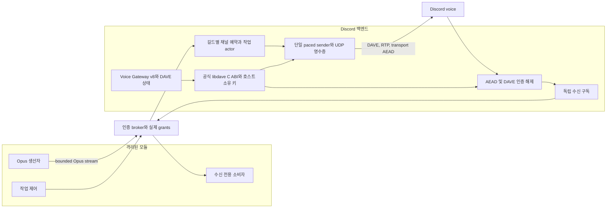

# 선택적 Discord 음성 작업과 수신 구독 - Spec Proposal

| Item | Detail |
|---|---|
| Author | Seonguk Moon |
| Created | 2026-10-29 |
| Status | **Draft** / In Review / Approved |
| Reviewers | |

---

## 1. Summary

Discord 음성을 선택적 백엔드 기능으로 제공하고, 모듈이 인코딩한 Opus를 개별 패킷이 아닌 재생 작업 단위로 예약합니다. 우선순위 선점, 남은 프레임 재개, 소유자 제어, 독립적인 음성 수신 구독을 인증된 실행 인스턴스에 연결합니다. 같은 길드에 작업이나 수신 구독이 하나라도 남아 있으면 음성 채널을 고정하고, 유한한 버퍼와 역압력, 멱등적인 정리 절차로 다른 모듈의 작업을 보호합니다.

## 2. Background & Motivation

**기존 감사 기준선과 현재 upstream source의 차이**는 다음과 같습니다. v1 동작 관찰은 역사적 감사이며 P5의 최종 구현 또는 실제 음성 통신 검증 결과가 아닙니다.

- 기존 `VoiceJoin`은 `module-id` 메타데이터를 신뢰하고 같은 길드의 다른 채널 요청에 기존 세션을 취소한 뒤 이동했습니다. 연결의 권한과 생명주기를 인증된 실행 인스턴스에 연결하지 않았습니다.
- 기존 스케줄러는 개별 `OpusSend` 프레임을 작업으로 취급했고 시간 안에 채널이 비워지지 않으면 프레임을 잃을 수 있었습니다. 차단되는 `Dequeue()`는 취소를 직접 받지 않았습니다.
- P0의 upstream base commit `f43dd94faaacd5b163e9e783f14b5bd8be639fc9`의 [voice.go](https://github.com/bwmarrin/discordgo/blob/f43dd94faaacd5b163e9e783f14b5bd8be639fc9/voice.go)는 `OpusSend` 버퍼 두 칸 및 sender 내부 프레임을 사용하며 `48000` Hz, `960` samples와 ticker로 pacing합니다. 이는 P5 변경 전 upstream 근거이며 현재 패치 적용 SDK의 구현 설명이 아닙니다. upstream은 context-aware 제출 및 UDP receipt 계약을 제공하지 않으므로 P5에서 공개 채널과 모든 직접 호출자를 이관해야 합니다. 기존 스케줄러와 예제의 별도 20ms sleep도 제거합니다.
- 기존 SDK 감사의 transport는 `xsalsa20_poly1305`/NaCl이었지만 새 upstream source는 표준 `crypto/aes`와 `cipher.NewGCM`의 `aead_aes256_gcm_rtpsize`로 바뀌었습니다. 이 변경은 **DAVE나 필수 XChaCha20-Poly1305 지원의 완료가 아닙니다.** 현행 Discord는 rtpsize AEAD와 2026-03-01 이후 DAVE를 요구하므로 upstream 교체나 큐 수정만으로 voice를 구현 또는 검증했다고 주장하지 않습니다. 아래 v8, seq_ack, DAVE 전이, XChaCha, receipt 및 수신 요구를 모두 유지합니다.
- 기존 수신 브로드캐스터는 동일 protobuf 패킷 포인터를 여러 구독자에게 전달하고 각 스트림이 `ConnectionId`를 수정했습니다. 구독 정리는 송수신 중 채널을 직접 닫고 마지막 구독자 수만으로 연결 종료를 판단했습니다.
- 기존 음성 클라이언트의 join 전 leave는 격리된 동작 검사에서 panic을 일으켰습니다. 이 문서는 당시 결과를 근거로 사용하며, 작성 중 검사를 다시 실행하지 않았습니다.

**확정된 요구사항**은 모듈의 Opus 인코딩, 높은 우선순위의 선점, 미전송 부분의 재개, 길드당 고정 채널, 별도 수신 소유권입니다. 아래의 작업 상태, 전송 영수증, 크레딧 모델은 이를 구현하기 위한 기술 계약이며, 현재 코드가 이미 제공하는 기능이라는 뜻이 아닙니다. 음성은 범용 런타임의 필수 기능이나 모듈 종류가 아닙니다.

## 3. Goals & Non-Goals

### 3.1 Goals

- [ ] `discord.voice.play`와 `discord.voice.receive`를 별도 선택적 capability로 제공합니다.
- [ ] 인증된 인스턴스만 자기 작업과 구독을 제어하고, 승인된 길드와 채널 및 우선순위 상한을 지키게 합니다.
- [ ] 높은 우선순위가 송신 경계에서 선점하고, 같은 우선순위는 접수 순서를 지키며, 선점된 작업은 미전송 프레임부터 재개합니다.
- [ ] 일시정지, 재개, 취소, 입력 종료, 실제 로컬 송신 완료를 구분합니다.
- [ ] 대기 작업, 일시정지 작업, 수신 구독과 연결 준비 중 예약까지 채널 소유권에 포함합니다.
- [ ] 제한된 메모리로 프레임과 수신 패킷을 처리하고, 대기나 송수신 오류를 조용한 성공으로 처리하지 않습니다.
- [ ] 모듈 종료, crash, deadline, EOF 및 반복 정리에서 교착, 채널 중복 close, 패킷 변조와 자원 누수를 방지합니다.

### 3.2 Non-Goals

- [ ] 코어에 Discord 음성, 음악 목록, 검색, 다운로드 또는 트랜스코딩을 넣지 않습니다.
- [ ] PCM, 임의 길이 Opus 패킷, 자동 채널 이동, 여러 채널 동시 재생 또는 서버 측 믹싱을 제공하지 않습니다.
- [ ] Discord가 이미 받아 간 프레임이나 UDP로 보낸 프레임을 회수하지 않습니다. 실제 수신, 재생 또는 청취 완료를 보장하지 않습니다.
- [ ] 재시작 후 작업 복구, 영속 음성 큐, 자동 재시도, 재접속 후 프레임 재전송을 제공하지 않습니다.
- [ ] voice token, 봇 token, `VoiceConnection`, 소켓 또는 임의 `Speaking` 제어권을 모듈에 노출하지 않습니다.
- [ ] 일반 관리 봇에 음성 권한, `ffmpeg`, `yt-dlp` 또는 media 리소스 프로필을 요구하지 않습니다.

## 4. Technical Design

### 4.1 Architecture Overview



코어는 인스턴스 인증, capability grant와 종료 통지를 담당합니다. Discord 백엔드는 길드별 연결, resource scope 검사, 우선순위 및 Opus 전송을 담당합니다. 모듈은 파일을 읽거나 인코더를 실행하여 Opus를 생산하며, 런타임은 이를 다시 인코딩하지 않습니다.

작업과 구독을 등록하기 전에 `PrincipalFromContext`로 `InstanceID`를 확인합니다. 메타데이터의 `module-id`, manifest 이름이나 요청의 문자열로 소유자를 결정하지 않습니다. `discord.voice.play` grant의 제약은 `discordv2.VoicePlaybackConstraints{max_priority: sint32}`이며, 제약 메시지가 없으면 무제한으로 해석하지 않고 grant 검증을 실패시킵니다. `guild_id`와 `channel_id`는 백엔드가 검증한 resource selector로 검사합니다. 여러 selector는 OR, 하나의 selector 안의 식별자는 AND입니다. 수신 권한만 받은 모듈은 재생 작업을 만들 수 없고, 재생 권한만 받은 모듈은 수신 패킷을 얻을 수 없습니다.

안전한 `VoiceStateUpdate` 관찰은 별도의 `discord.event.VOICE_STATE_UPDATE` domain event와 `GuildVoiceStates` intent를 따릅니다. 해당 이벤트를 받는 관리 모듈에 playback이나 receive capability를 요구하지 않습니다. voice server token, endpoint handoff와 `VoiceState.SessionID`는 host transport 경계에 남기며 일반 event payload로 내보내지 않습니다.

기존 v1 `VoiceJoin/VoiceStream/VoiceLeave/VoiceSpeaking/GetQueueStatus` 및 공개 송수신 채널 기반 클라이언트를 v2 작업 및 구독 계약으로 교체합니다. 호환 별칭을 남기지 않습니다. DiscordGo의 공개 `OpusSend` 경로도 전송 영수증을 제공하는 문맥 인식 경로로 교체하며 SDK의 직접 호출자와 root-module airhorn 예제의 기능 이관은 [네 번째 SDK 패치](../../third_party/discordgo/patches/0004-native-dave-voice-transport.patch)에 보존합니다. 기존 버퍼 경로를 우회 송신 통로나 호환 shim으로 유지하지 않습니다.

기본 runtime은 DAVE CGO package를 import하거나 link하지 않습니다. 선택적 `voice && cgo` build만 공식 libdave의 고정 버전을 연결하며, 미연결 상태에서는 voice capability를 제공하지 않습니다. `voice`를 요청하면서 CGO가 비활성화된 경우에는 build/configuration 오류로 처리하고 가짜 정상 backend를 만들지 않습니다. ordinary runtime과 일반 모듈 이미지는 native DAVE, `ffmpeg`, `yt-dlp`를 요구하지 않습니다. voice-enabled host 산출물은 `bin/voice-runtime/runtime`과 `bin/voice-runtime/lib/`의 실제 native runtime 의존성 및 해당 license로 구성하며, media 모듈 이미지와 별개입니다.

### 4.2 Data Model Changes

음성 상태는 메모리에만 존재합니다. 영속 테이블, 재생 복구 로그 또는 코어 데이터베이스는 추가하지 않습니다. 기존 음성 DTO는 다음 정보로 교체합니다.

각 `GuildVoiceSession`은 transport AEAD mode/key, Voice Gateway의 최신 `seq_ack`, 협상된 DAVE version, recognized participant 집합, MLS session, outgoing encryptor, sender별 incoming decryptor 및 prepared/active transition 상태도 소유합니다. 이 상태는 module DTO나 영속 파일로 내보내지 않습니다. `READY`는 단순 UDP 연결이 아니라 필요한 transport와 DAVE 송수신 context가 준비된 상태입니다.

| 모델 | 필수 정보와 불변조건 |
|---|---|
| `GuildVoiceSession` | 길드, 고정 채널, 연결 generation, `JOINING/READY/CLOSING/CLOSED`, 작업 예약 수, 수신 예약 수, 현재 송신 중 프레임, 종료 원인입니다. 두 예약 수와 진행 중 정리가 모두 해소되기 전에는 다른 채널을 받지 않습니다. |
| `PlaybackJob` | 런타임 발급 `JobID`, `InstanceID`, 길드와 채널, 변경 불가 priority, 접수 ordinal, 상태와 사유, 유한한 expiry, 입력 스트림 결합 여부, 최종 sequence, 크레딧 및 세 종류 송신 cursor입니다. |
| `BufferedOpusFrame` | `JobID`, sequence, Opus 바이트, 실제 검증한 sample 수입니다. 승인된 프레임 바이트의 소유권을 넘기며, 재생 도중 내용을 수정하지 않습니다. |
| `PlaybackSnapshot` | 작업 상태, 사유, `LastAcceptedSequence`, `LastSubmittedSequence`, `LastUDPWrittenSequence`, `InputEnded`, `FinalSequence`, credit 상한, terminal error입니다. |
| `VoiceSubscription` | 런타임 발급 `SubscriptionID`, `InstanceID`, 길드와 채널, 유한한 expiry, 수신 필터, 패킷 및 바이트 한도가 있는 독립 큐, terminal 상태입니다. |
| `ReceivedVoicePacket` | 구독 ID, SSRC, RTP sequence와 timestamp, Opus 바이트, 수신 순번과 시각입니다. 확실하지 않은 SSRC를 임의의 사용자 ID로 바꾸지 않습니다. |
| 종료 기록 | 소유자와 최종 상태를 포함하는 유한한 보존 기록입니다. 같은 cancel/unsubscribe의 재호출을 안전하게 처리하되, 기록 수와 보존 기간에도 운영자 제한을 적용합니다. |

프레임 sequence는 **1부터 시작**합니다. `0`은 아직 해당 단계의 프레임이 없다는 뜻이며 유효한 프레임 번호가 아닙니다. `FinalSequence=0`인 명시적 입력 종료는 빈 작업을 뜻합니다. 정수 상한에 이르면 실패하며 wrap하지 않습니다. RTP의 자체 sequence와 작업 sequence는 별개입니다.

`LastAcceptedSequence`는 검증된 프레임을 런타임의 제한된 버퍼에 접수한 마지막 번호입니다. `LastSubmittedSequence`는 로컬 Discord 송신기에 소유권을 넘긴 마지막 번호입니다. `LastUDPWrittenSequence`는 로컬 `UDP.Write` 성공 영수증을 받은 마지막 번호입니다. 항상 `LastUDPWrittenSequence <= LastSubmittedSequence <= LastAcceptedSequence`를 지킵니다. 네트워크 오류 직전의 제출은 결과가 불명확할 수 있으므로, 실패한 제출을 자동 재전송하지 않습니다.

#### 필수 유한 설정

사용자가 수치를 확정하지 않은 항목에는 임의의 기본값을 넣지 않습니다. 음성 기능을 활성화할 때 다음 설정이 모두 유한한 양수이거나, 명시된 목적에 맞는 유한한 상한이어야 합니다. 누락 또는 모순이면 음성 service 준비를 실패시키고 음성 capability를 부여하지 않습니다. 이 설정은 일반 Discord 기능의 필수조건이 아니며, 음성 required capability가 있는 모듈의 활성화 실패와 optional capability만 거절되는 경우를 P1/P4에 따라 구분합니다.

암호화 경계에도 voice WebSocket text/binary frame 크기, participant/decryptor 수, proposal 및 prepared transition 수와 바이트, 암호화 전후 frame buffer, handshake/rekey deadline의 유한 설정을 추가합니다. 기본값을 임의로 만들지 않으며, 검증되지 않은 길이로 native allocation을 요청하지 않습니다.

- 호스트 및 인스턴스별 음성 세션 수, 길드 및 인스턴스별 동시 작업 수, 전체 대기 작업 수입니다.
- 작업, 인스턴스 및 호스트별 프레임 수와 Opus 바이트 수, 미사용 전송 크레딧 예약량, 단일 Opus 패킷 및 gRPC 메시지 크기입니다.
- 작업 수명, 첫 스트림 결합 대기, 활성 생산자의 입력 무응답, 연결 준비, UDP 제출, 송신 영수증 및 종료 대기 deadline입니다. 입력 무응답 시간은 정상적인 일시정지나 크레딧 없는 선점 대기를 생산자 오류로 계산하지 않지만, 절대 작업 수명은 계속 적용합니다.
- 인스턴스 및 길드별 수신 구독 수, 구독 수명, 구독별 및 전체 수신 큐의 패킷 수와 바이트 수, 느린 수신 스트림 deadline입니다.
- 상태 응답 및 제어 mailbox, 종료 기록 수와 보존 기간, 큐 조회 반환량입니다. 조회 결과가 제한을 넘으면 continuation을 사용하며 무제한 응답을 만들지 않습니다.

프레임, 미사용 크레딧, 송신 중 프레임, gRPC 입출력 메시지와 상태 mailbox를 모두 메모리 계산에 포함합니다. 작업의 최대 수명과 스트림 deadline은 호출자가 취소할 수 있는 문맥과 별개로 런타임이 강제합니다. 상위 인스턴스의 CPU, 메모리 및 PID 제한은 [런타임 격리 제안](flexmodule-4-runtime-and-isolation.md)을 따릅니다.

### 4.3 Core Logic

#### 채널 예약과 연결

1. 작업 생성 또는 수신 구독 시 인증, 실제 grant, scope와 quota를 먼저 검사합니다.
2. 길드 actor에서 원자적으로 채널을 예약합니다. 기존 예약의 채널이 다르면 `CHANNEL_CONFLICT`로 거절합니다. queued 또는 paused 작업, 연결 준비 중 예약, 수신 전용 구독도 충돌 판단에 포함합니다.
3. 같은 채널의 추가 소유자는 기존 연결을 공유합니다. 연결 준비는 generation당 한 번만 실행하며 반복 ensure-join은 새 연결이나 중복 참조를 만들지 않습니다. 연결 준비 중에는 예약을 유지하고, 실패하면 해당 generation에 종속된 작업과 구독에 원인을 전달한 뒤 정확히 한 번 해제합니다.
4. 작업 접수와 연결 준비 완료는 다릅니다. 생성 응답은 `QUEUED/WAITING_CONNECTION`일 수 있으며, `RUNNING`은 transport 준비와 실제 송신 선택 후에만 가능합니다.
5. 사용자 pause, 입력 EOF, 마지막 수신자 이탈만으로 연결을 끊지 않습니다. **작업 예약 수와 수신 예약 수가 모두 0**이고 송신 중 프레임과 정리가 끝났을 때 disconnect합니다. disconnect 완료 전에는 길드의 closing 예약을 남깁니다.
6. 외부에서 봇의 채널이 바뀌거나 연결이 끊기면 기존 예약을 다른 채널로 바꾸지 않습니다. 해당 세션 작업과 구독을 명시적으로 실패시키고 정리하며, 자동 이동이나 자동 복구를 하지 않습니다.

마지막 소유 자원의 disconnect에서는 로컬 송수신 작업과 native handle을 정리한 것만으로 SDK의 길드 예약을 해제하지 않습니다. main Gateway에 leave를 보낸 뒤 해당 봇의 채널이 비어 있는 `VOICE_STATE_UPDATE`를 받고, SDK 처리와 호스트의 순서 보장 observer 호출까지 마쳐야 다음 연결 generation에 예약을 넘깁니다. 이 leave 확인은 명시적으로 종료 중인 기존 generation에서만 소비합니다. 종료 요청 없이 받은 채널 이탈, 다른 채널로의 이동과 session 변경은 계속 실패로 처리합니다. 호출자의 취소나 종료 deadline이 먼저 오면 유한하게 오류를 반환하되, 전송한 leave가 아직 확인되지 않은 예약은 유지하며 늦게 도착한 확인과 로컬 정리가 모두 끝난 뒤 해제합니다. 반복 disconnect나 오래된 handle은 leave를 다시 보내 새 연결을 끊지 않습니다.

정상적인 마지막 참조 해제 뒤 연결이 종료 중이어도, 기존 소유 인스턴스가 같은 길드와 채널에 새 재생 작업을 생성하면 `QUEUED/WAITING_CONNECTION`으로 접수합니다. 이때 종료 중인 인스턴스의 세션 예약을 새 작업에 넘기므로 세션 quota를 중복 차감하거나 상한을 넓히지 않습니다. 기존 disconnect가 성공하기 전에는 새 transport를 획득하거나 새 프레임을 제출하지 않습니다. 종료 중인 예약에 다른 소유자나 다른 채널이 끼어들 수 없으며, 기존 disconnect의 오류나 소유자 종료가 발생하면 대기 중인 새 작업도 실패 또는 취소로 정리합니다. 대기 작업이 취소되더라도 기존 disconnect와 마지막 세션 예약은 실제 정리가 끝날 때까지 유지합니다. actor 조회와 소유자 lane의 접수 사이에도 짧은 admission 참조를 유지하여, 정상적인 연결 종료가 진행 중인 접수 요청의 actor를 먼저 제거하지 못하게 합니다. 이 참조는 접수 성공이나 실패, 호출 취소 직후 반환하며 스트림 수명까지 유지하지 않습니다.

명시적 공개 `Join/Leave`는 없습니다. 작업 또는 구독의 획득과 해제가 연결을 관리합니다. `CreatePlaybackJob`의 별도 호출은 별도 작업이며 재호출 중복 제거를 약속하지 않습니다. 반면 같은 소유 자원의 연결 확보와 해제, 반복 cancel/unsubscribe 및 내부 join 실패 정리는 멱등적입니다. 생성 응답을 놓친 경우 자동 생성 재시도를 하지 않고 소유 작업 조회 또는 수명 만료로 수습합니다.

#### 작업 상태와 우선순위

| 상태 또는 입력 | 처리 |
|---|---|
| 생성 | `QUEUED`로 접수하고 변경 불가 ordinal을 부여합니다. 연결, 입력 또는 상위 우선순위를 기다리는 사유를 구분합니다. |
| 실행 선택 | 재생 가능한 작업 중 priority 내림차순, 접수 ordinal 오름차순으로 선택하여 `RUNNING`으로 전환합니다. 프레임 없는 작업은 다른 준비된 작업을 막지 않습니다. |
| 상위 priority 도착 | 현재 송신기에 넘어간 한 프레임의 영수증까지 기다리고, 추가 제출을 중단합니다. 기존 작업을 `QUEUED/PREEMPTED`로 옮기고 준비된 상위 작업을 실행합니다. |
| 동일 priority 도착 | 실행 중인 작업을 선점하지 않습니다. 동일 priority에서 기존 접수 ordinal을 유지합니다. 선점 후 재개도 새 작업 생성으로 취급하지 않습니다. |
| 소유자 pause | 이미 제출된 한 프레임의 처리를 마친 경계에서 `PAUSED`로 전환합니다. 입력 버퍼와 cursor는 유지합니다. RPC 완료 이후 새 프레임을 제출하지 않습니다. |
| 소유자 resume | `PAUSED`를 원래 ordinal의 `QUEUED`로 옮깁니다. 이미 queued/running인 작업에는 동일 상태를 반환합니다. |
| 입력 고갈 | 끝났다고 처리하지 않습니다. `QUEUED/WAITING_INPUT`으로 옮기고 다른 준비된 작업을 선택합니다. 새 프레임 도착으로 다시 선택 가능해집니다. |
| 명시적 입력 종료 | `InputEnded=true`를 기록합니다. 남은 프레임은 그대로 재생하며, EOF만으로 완료시키지 않습니다. |
| 마지막 영수증 | `InputEnded`이고 `LastUDPWrittenSequence=FinalSequence=LastAcceptedSequence`일 때만 `COMPLETED`입니다. 빈 작업은 명시적 `FinalSequence=0` 확인 후 완료할 수 있습니다. |
| 취소 | 새 입력과 제출을 막고 미제출 프레임을 폐기합니다. 이미 제출된 프레임은 철회하지 않으며, bounded transport 정리 후 `CANCELLED`로 끝납니다. |
| 수명 초과 또는 오류 | 새 입력과 제출을 막고 `FAILED` 및 원인을 기록합니다. 오류를 완료로 바꾸지 않습니다. |

terminal 상태는 `COMPLETED/CANCELLED/FAILED`입니다. terminal 작업을 pause/resume하여 되살릴 수 없습니다. 이미 terminal인 작업의 cancel은 기존 결과를 그대로 반환합니다. 지속적인 높은 우선순위 입력에 의한 낮은 우선순위의 기아를 숨기지 않습니다. 자동 priority aging을 추가하지 않으며 작업 수명과 quota로 상한을 강제합니다.

#### 입력 스트림과 역압력

`StreamPlayback`의 첫 메시지는 오직 `Bind{job_id}`입니다. 한 작업에 생산자 스트림 하나만 결합할 수 있으며, 다른 인스턴스의 ID나 두 번째 생산자는 거절합니다. 이후 프레임은 `sequence=LastAcceptedSequence+1`이어야 하고, 마지막에는 `EndInput{final_sequence}`를 보냅니다. gap, duplicate, 종료 후 추가 프레임 및 잘못된 최종 번호는 성공으로 무시하지 않습니다.

서버는 누적 `CreditThroughSequence`와 `CreditThroughBytes`를 알립니다. 클라이언트는 다음 sequence와 누적 Opus 바이트가 두 상한을 모두 넘지 않을 때만 보냅니다. 크레딧은 실제로 예약한 메모리와 프레임 자리만 발급하며, queued 작업에도 준비를 위한 제한된 초기 창만 제공합니다. 선점 또는 pause 시 새 크레딧 발급을 중단하되 이미 발급한 크레딧은 강제로 회수하지 않습니다. 그 범위에서 도착하는 데이터도 이미 계산한 예약 안에 넣습니다.

프레임 검증과 버퍼 접수 뒤에만 accepted cursor를 올립니다. SDK의 `Send` 반환이나 네트워크 write는 런타임 접수 확인이 아닙니다. 작업이 다시 소비되면 해제한 quota만큼 크레딧을 늘립니다. 클라이언트 SDK도 무제한 로컬 큐를 만들지 않고, 크레딧 부족 시 인코더의 다음 읽기나 제출을 기다리게 합니다. gRPC 흐름 제어만으로 애플리케이션 버퍼 제한을 대신하지 않습니다.

클라이언트는 `EndInput` 다음 송신 측을 half-close하고, 최종 snapshot 또는 실패를 받을 때까지 수신 측을 유지합니다. `EndInput` 없는 입력 EOF는 `INPUT_TRUNCATED`입니다. 명시적 종료 뒤의 정상 half-close는 취소가 아니며, 스트림 전체의 취소, 연결 손실 또는 deadline은 해당 작업을 실패시키거나 명시적 취소 원인으로 끝냅니다. 자동 스트림 재결합 및 replay는 제공하지 않습니다. ack는 누적 cursor를 포함하므로 중간 상태 통지를 합칠 수 있지만, 최종 결과를 정상 완료처럼 유실시키지는 않습니다.

#### 현행 Voice Gateway, AEAD 및 DAVE

P0에 고정한 공개 DiscordGo의 봇 REST와 main Gateway 계약은 유지하되 voice 경로는 현행 프로토콜로 교체합니다. 레거시 XSalsa 및 non-rtpsize AES 경로를 성공 fallback으로 남기지 않습니다. UDP transport는 `aead_xchacha20_poly1305_rtpsize`를 필수로 지원하고, 서버가 광고하며 구현에서 지원하는 경우 `aead_aes256_gcm_rtpsize`를 우선 선택합니다. 이 transport 암호화는 DAVE frame 암호화와 별개의 계층입니다.

1. 호스트는 main Gateway의 `VOICE_STATE_UPDATE`와 `VOICE_SERVER_UPDATE`를 모두 받아 session ID, endpoint 및 token을 확보합니다. 명시적인 Voice Gateway `v=8` 연결에서 Hello, heartbeat 및 ACK를 처리하고, text뿐 아니라 binary message의 sequence도 최신 `seq_ack`에 반영합니다. heartbeat와 Resume wire 형식은 이 값을 사용하지만, 아래 운영 정책에 따라 연결 손실 후 자동 Resume를 시작하지 않습니다.
2. Identify opcode 0의 `max_dave_protocol_version`은 고정한 libdave의 `daveMaxSupportedProtocolVersion()`과 실제 adapter 구현 범위 중 지원 가능한 값으로 제한합니다. Ready opcode 2 뒤 UDP discovery와 Select Protocol opcode 1로 현행 AEAD mode를 선택합니다. Session Description opcode 4에서 transport mode/key뿐 아니라 `dave_protocol_version`도 읽습니다.
3. Clients Connect 11과 Client Disconnect 13으로 recognized participant ID 집합을 유지합니다. binary External Sender Package 25는 gateway의 공개 external-sender credential이며, libdave에 설치합니다. 모듈에 MLS private key나 media key를 제공하는 절차가 아닙니다.
4. 처음 협상한 nonzero DAVE version 및 JSON Prepare Epoch 24의 `epoch=1`에서는 해당 version의 로컬 MLS 상태를 새로 준비하고, 매번 새 일회용 Key Package를 binary 26으로 보냅니다. opcode 24의 필드는 `protocol_version`과 `epoch`이며 `transition_id`를 추가하지 않습니다. 그 밖의 epoch/version 변화는 공식 기존 group 전이 규칙을 따릅니다.
5. binary Proposals 27의 append/revoke와 recognized participant 목록을 libdave에 전달합니다. 결과 Commit과 필요한 Welcome을 binary 28로 보냅니다. 자신이 commit을 만들었다는 이유로 송신 키를 먼저 바꾸지 않고 gateway가 선택한 commit을 기다립니다.
6. binary Announce Commit Transition 29 또는 Welcome 30의 `uint16 transition_id`와 MLS payload를 처리합니다. 새 receiver ratchet을 먼저 준비한 뒤 JSON Transition Ready 23을 보냅니다. 기존 sender context는 JSON Execute Transition 22가 준비된 ID를 지시할 때까지 유지합니다.
7. JSON Prepare Transition 21은 `protocol_version`과 `transition_id`를 가집니다. 0이 아닌 ID의 지원 가능한 전이는 target context와 receiver를 준비하고 23을 보낸 뒤 22에서 sender를 전환합니다. `transition_id=0`은 초기화 또는 재초기화의 즉시 실행 전이로 처리하고 22를 무한히 기다리지 않습니다. sole-member reset의 `24(epoch=1)` 다음 `21(transition_id=0)`에서도 pending local group을 올바르게 활성화합니다.
8. commit/welcome이 실제 실패한 경우 JSON Invalid Commit Welcome 31로 해당 transition ID를 알리고 MLS 상태를 재설정한 뒤 새 26을 보냅니다. libdave의 ignored commit과 failed commit을 구분하며 ignored 결과를 무조건 실패로 취급하지 않습니다. 이 프로토콜 복구에도 유한한 deadline을 적용합니다.
9. server-to-client binary frame은 `uint16 BE sequence | uint8 opcode | payload`, client-to-server는 `uint8 opcode | payload`입니다. 25~30은 binary, 21~24와 31은 JSON입니다. 29/30의 transition ID는 payload 안에 있으며, JSON parser 하나로 모두 처리하지 않습니다.

준비 상태는 transport와 DAVE에 각각 두고 결합합니다. playback은 유효한 active outgoing DAVE context 및 transport가 있을 때만 `RUNNING`이 되며, 수신은 올바른 sender별 decryptor와 transport 인증을 통과한 뒤에만 구독으로 나갑니다. 첫 voice UDP data 전에는 Speaking opcode 5를 보냅니다. 송신 순서는 `Opus -> DAVE frame encryption -> RTP -> negotiated transport AEAD -> UDP`이며, 수신은 `UDP authentication/decryption -> RTP 및 extension 처리와 frame 복원 -> sender별 DAVE decryption -> permissioned Opus stream`입니다. 복호화 실패한 데이터를 평문 또는 다른 sender의 frame으로 전달하지 않습니다.

일반적인 participant/rekey 전이는 트랙 sequence, queue ordinal이나 재개 위치를 초기화하지 않습니다. 유효한 active 송신 context가 있는 동안 기존 context로 처리하고, 없는 구간에는 새 프레임 제출과 credit 발급을 멈춘 뒤 준비 완료 후 미제출 프레임부터 계속합니다. 이미 submitted된 한 프레임의 소유권과 receipt 경계는 유지합니다. 이전 epoch의 receiver ratchet은 공식 전이 규칙에 따라 최대 10초의 in-flight media 처리 범위에서 유지합니다. 이 시간은 사용자 resource 기본값이 아니라 현행 DAVE 프로토콜의 전이 규칙이며, 직접 만든 키 fallback 대신 libdave decryptor 전이 기능을 사용합니다.

Voice Gateway v8의 buffered Resume framing과 text/binary `seq_ack`는 protocol adapter 및 유한 fixture에서 검증하지만, 이 제안의 운영 정책은 연결 손실 시 기존 작업과 구독을 실패시키는 것입니다. 자동 Resume, rejoin, 모듈 stream 재결합 또는 media replay를 켜지 않습니다. 연결이 유지되는 동안 필요한 DAVE participant/rekey 및 invalid-commit 복구는 이 금지와 별개의 필수 protocol 전이입니다. 새 소유 작업의 join은 새 transport/MLS 상태에서 시작합니다. DAVE 실패 시 평문으로 내리거나 문서에 없는 봇 예외를 가정하지 않습니다. 과거 migration 문서의 protocol 0 절차를 현재 mandatory-E2EE 호출의 보편적 기본값으로 삼지 않습니다.

#### native bridge와 키 소유권

공식 `discord/libdave` C ABI에 대한 얇은 CGO bridge를 사용합니다. 구현 pin은 `v1.2.2/cpp`, commit `6396c90aedbb9a6ee117ea9ce1ce9832af6a3375`입니다. MLS, ratchet 파생, DAVE frame 형식 또는 암호를 자체 구현하지 않습니다. libdave는 전체 voice Gateway client, RTP receiver, 권한 계층 또는 Opus decoder를 제공하지 않으므로 위 adapter 흐름을 실제로 구현해야 합니다.

session마다 MLS session 하나, outgoing encryptor와 sender별 incoming decryptor를 소유합니다. MLS control 및 frame context 전이는 직렬화하며 임의의 동시 C API 호출 안전성을 가정하지 않습니다. library 최대 출력 크기 함수로 bounded 재사용 buffer를 준비하고, 각 opaque handle은 대응 Destroy 함수로, library 할당 바이트는 `daveFree`로 해제합니다. C가 Go slice/string pointer를 호출 이후 보관하지 못하게 하고, callback은 고정 Go 1.27.3의 `runtime/cgo.Handle` 또는 C 소유 context 규칙을 사용합니다.

bot/voice credential, transport key, MLS private/signature key와 media ratchet은 호스트에만 둡니다. 패킷, 오류, 로그 또는 protobuf에 private state나 key handle을 넣지 않습니다. 세션 종료에서는 native 작업과 callback의 종료를 먼저 동기화한 뒤 handle과 key-bearing buffer를 한 번만 해제하고 재사용 상태를 지웁니다. 다른 모듈의 receive/job 참조가 남아 있으면 세션 키를 먼저 파괴하지 않습니다.

#### Opus 검증과 유일한 pacing 담당자

현재 로컬 sender의 표본률과 프레임 크기를 근거로 v2의 입력 형식을 `OPUS_48KHZ_20MS`로 고정합니다. 이는 운영 quota 수치가 아니라 프로토콜의 인코딩 형식입니다. 모듈은 패킷 하나가 48kHz 기준 960 samples, 총 20ms가 되도록 생산합니다. 런타임은 Opus TOC와 프레임 수 및 길이를 해석하여 실제 duration, 비어 있는 패킷, 잘린 패킷과 허용 크기를 검증하며, 호출자가 붙인 duration 값만 믿지 않습니다. 다른 duration은 모듈에서 변환한 뒤 다시 새 작업으로 제출해야 합니다.

pacing은 로컬 Discord 송신기 한 곳에서만 수행합니다. 스케줄러와 모듈은 고정 `Sleep(20ms)`를 하지 않습니다. sender는 단조 시계로 제출 사이의 간격과 RTP timestamp를 관리하고, 오래된 tick을 몰아서 소비하여 burst를 만들지 않습니다. 입력이 늦으면 과거 프레임을 뒤늦게 한꺼번에 보내지 않습니다.

기존 `OpusSend`의 두 칸 버퍼와 sender 내부 프레임은 새 경로에서 제거합니다. guild transport당 제출된 미완료 프레임은 최대 하나이며, 이 프레임도 quota와 cursor에 포함합니다. 우선순위 선점 및 pause의 완료 경계는 그 한 프레임의 영수증 이후입니다. 이미 제출된 프레임을 큐에서 빼서 회수하거나 다른 작업의 프레임으로 바꾸지 않습니다. `LastUDPWrittenSequence` 역시 Discord 수신 확인이 아닌 로컬 쓰기 결과입니다.

#### 수신 구독과 정리

수신 구독은 재생 작업을 만들지 않습니다. 수신만 하는 모듈에는 인코더나 media 도구가 필요하지 않습니다. 연결의 self-mute/self-deaf는 개별 모듈이 지정하지 않고, 작업 및 수신 참조에 맞추어 런타임이 관리합니다. 수신 권한이 없는 모듈에는 패킷을 분배하지 않습니다.

수신기는 원본 packet이 재사용될 수 있는 경계에서 바이트 소유권을 확보합니다. fan-out 중에는 immutable payload만 공유하며, 구독 ID 등 가변 envelope는 구독별로 생성합니다. 공유 protobuf 객체를 보낸 뒤 수정하지 않습니다. 한 구독의 큐가 한도를 넘거나 수신자가 deadline 안에 읽지 않으면 해당 구독만 명시적 오류로 종료합니다. UDP 자체의 손실 가능성과 런타임 overflow를 구분하며, overflow 후 정상 구독인 것처럼 계속 보고하지 않습니다.

정리 순서는 `새 작업 차단 -> 소유 자원 terminal 전이 -> 생산자/수신자 문맥 취소 -> 송신 영수증 또는 bounded 종료 대기 -> 버퍼와 크레딧 반환 -> 소유 예약 감소 -> 마지막 두 종류 참조 확인 -> disconnect`입니다. 채널을 사용하는 모든 goroutine의 종료 전에 공유 채널을 닫지 않습니다. 클라이언트에는 외부에서 닫을 수 있는 송신 채널을 노출하지 않으며, receive 스트림과 terminal 결과는 단일 소유자가 종료합니다. 중복 EOF, cancel, timeout, instance-stop과 transport failure가 경합해도 자원 해제는 한 번만 실행합니다.

인스턴스 drain에서는 새 작업과 구독을 거절하고, 이미 접수한 작업은 상위 런타임의 10초 drain 범위에서 마칠 수 있습니다. 제한이 끝나면 남은 작업과 구독을 취소합니다. crash는 즉시 소유 자원을 취소합니다. 한 인스턴스의 종료로 다른 인스턴스의 작업이나 마지막 남은 수신 구독을 끊지 않습니다. 런타임 crash의 컨테이너 정리는 [런타임 격리 제안](flexmodule-4-runtime-and-isolation.md)의 호스트 supervisor 및 reconciliation에 의존합니다.

## 5. API Design

### 5-1. New / Modified

아래는 새 `discord-v2` Go 편의 API의 규범 계약입니다. 전송은 gRPC이며 `time.Duration`은 wire에서 protobuf `Duration`, `time.Time`은 `Timestamp`로 표현합니다. 메서드의 context는 RPC 문맥으로 사용하고 wire 데이터에 넣지 않습니다. 소유자 필드는 요청에 없습니다.

```go
type JobID string
type SubscriptionID string

type CreatePlaybackJobRequest struct {
    GuildID   string
    ChannelID string
    Priority  int32
    Lifetime  time.Duration
    Format    OpusFormat // Only OPUS_48KHZ_20MS is accepted.
}

type JobRequest struct { JobID JobID }

type PlaybackSnapshot struct {
    JobID                   JobID
    GuildID, ChannelID       string
    Priority                int32
    State                   PlaybackState
    Reason                  PlaybackReason
    LastAcceptedSequence    uint64
    LastSubmittedSequence   uint64
    LastUDPWrittenSequence  uint64
    InputEnded              bool
    FinalSequence           uint64
    CreditThroughSequence   uint64
    CreditThroughBytes      uint64
    ExpiresAt               time.Time
    TerminalError           *VoiceError
}

type PlaybackInput struct {
    // Exactly one alternative is present. Bind must be the first message.
    Bind     *JobRequest
    Frame    *OpusFrame
    EndInput *PlaybackEnd
}

type OpusFrame struct { Sequence uint64; Opus []byte }
type PlaybackEnd struct { FinalSequence uint64 }

type PlaybackQueueRequest struct {
    GuildID string
    Limit uint32
    Continuation string
}

type PlaybackQueue struct {
    Jobs []PlaybackSnapshot
    NextContinuation string
}

type SubscribeVoiceRequest struct {
    GuildID, ChannelID string
    Lifetime time.Duration
    SSRCs []uint32 // Empty means all packets within the authorized channel.
}

type VoicePacket struct {
    SubscriptionID SubscriptionID
    SSRC uint32
    RTPSequence uint32
    RTPTimestamp uint32
    ReceiveSequence uint64
    ReceivedAt time.Time
    Opus []byte
}

type VoiceReceiveEvent struct {
    // Exactly one of Ready, Packet, or Terminal is present.
    Ready *VoiceSubscriptionSnapshot
    Packet *VoicePacket
    Terminal *VoiceSubscriptionSnapshot
}

type VoiceSubscriptionSnapshot struct {
    SubscriptionID SubscriptionID
    GuildID, ChannelID string
    State SubscriptionState // JOINING, ACTIVE, CLOSED, or FAILED.
    ExpiresAt time.Time
    TerminalError *VoiceError
}

type UnsubscribeVoiceRequest struct { SubscriptionID SubscriptionID }

type VoiceService interface {
    // CreatePlaybackJob reserves an owner-bound job and its guild channel.
    // The authenticated principal supplies ownership; no metadata identity is trusted.
    // Success means admission, not voice readiness or successful audio delivery.
    CreatePlaybackJob(context.Context, CreatePlaybackJobRequest) (PlaybackSnapshot, error)

    // StreamPlayback binds exactly one producer to an owned job.
    // Frames are accepted only in sequence and within server-issued frame/byte credits.
    // The caller must read snapshots concurrently and keep receiving after EndInput.
    StreamPlayback(context.Context) (PlaybackStream, error)

    // PausePlaybackJob stops new sender submissions after the single in-flight frame.
    // It preserves unsent frames and returns only after the pause boundary is applied.
    // Repeating a pause on an already paused job returns its current snapshot.
    PausePlaybackJob(context.Context, JobRequest) (PlaybackSnapshot, error)

    // ResumePlaybackJob makes a paused job eligible without resetting its cursor.
    // It preserves the original FIFO ordinal and does not promise immediate execution.
    ResumePlaybackJob(context.Context, JobRequest) (PlaybackSnapshot, error)

    // CancelPlaybackJob discards only unsent input and releases the job exactly once.
    // Already submitted audio cannot be retracted; repeating cancellation is safe.
    CancelPlaybackJob(context.Context, JobRequest) (PlaybackSnapshot, error)

    // GetPlaybackQueue returns only jobs owned by the authenticated instance.
    // Results are bounded and ordered by effective scheduling order; paused and terminal
    // records are labeled rather than represented as runnable positions.
    GetPlaybackQueue(context.Context, PlaybackQueueRequest) (PlaybackQueue, error)

    // SubscribeVoice creates a receive-only owner and returns a server stream.
    // The first event carries the subscription ID; ACTIVE follows transport readiness.
    // Playback capability, an encoder, and media binaries are not prerequisites.
    SubscribeVoice(context.Context, SubscribeVoiceRequest) (VoiceReceiveStream, error)

    // UnsubscribeVoice ends an owned subscription without cancelling playback jobs.
    // Repeated release of a retained terminal record is successful and does not
    // decrement the session reference count again.
    UnsubscribeVoice(context.Context, UnsubscribeVoiceRequest) (VoiceSubscriptionSnapshot, error)
}

type PlaybackStream interface {
    // Send observes context cancellation and never buffers unbounded producer input.
    // Its return is not a server acceptance or UDP-delivery acknowledgement.
    Send(PlaybackInput) error
    // Recv returns cumulative ownership-safe state, credit, and terminal information.
    Recv() (PlaybackSnapshot, error)
    // CloseSend half-closes input; EndInput must already have been sent.
    CloseSend() error
}

type VoiceReceiveStream interface {
    // Recv returns immutable packet data or an explicit terminal result.
    // Cancelling the stream context releases only this receive subscription.
    Recv() (VoiceReceiveEvent, error)
}
```

`SubscriptionState=JOINING` header는 예약과 ID만 확인합니다. 연결 준비가 끝나면 `ACTIVE`를 알리고 패킷을 시작합니다. 구독 stream context 취소 또는 EOF는 unsubscribe와 같은 해제 경로를 사용합니다. `SSRCs` 항목 수에도 필수 유한 설정을 적용하며, 필터를 권한 대체 수단으로 쓰지 않습니다. queue continuation은 소유 인스턴스, 길드, 조회 generation에 결합하여 다른 인스턴스의 cursor로 재사용할 수 없게 합니다. 변경으로 일관된 조회를 이어갈 수 없으면 명시적으로 재조회를 요구합니다.

`GetPlaybackQueue`에서 continuation이 비어 있는 첫 요청은 해당 인스턴스가 소유한 작업과 조회 generation을 함께 캡처한 뒤, 캡처한 대상에 대한 권한을 확인합니다. 첫 페이지는 이 시점의 변경 불가능한 snapshot으로 구성하므로, 권한 확인이나 응답 구성 중 일반적인 재생 상태 갱신이 발생해도 `STALE_CONTINUATION`으로 실패하지 않습니다. 반환한 continuation은 캡처한 generation에 결합됩니다. continuation을 포함한 후속 요청은 조회 중에도 같은 generation을 유지해야 하며, generation이 바뀌면 기존과 같이 `STALE_CONTINUATION`으로 거부합니다. 첫 페이지를 반환하기 전에 갱신이 발생했다면 반환한 continuation도 이미 만료되었을 수 있습니다. 대상별 권한 확인, 소유자 및 길드 결합, 응답 개수와 직렬화 바이트 제한은 첫 요청과 후속 요청에 동일하게 적용합니다.

아래 로컬 DiscordGo API는 런타임 내부 transport를 위한 변경이며 모듈 gRPC에 노출하지 않습니다.

```go
// SubmitOpus transfers one immutable packet to the sole paced sender.
// It returns after handoff, not after UDP transmission. The caller must retain
// the packet unchanged until Done yields its single result. No public OpusSend
// queue remains, and cancellation before handoff never submits the packet.
// A valid negotiated transport and active DAVE sender context are prerequisites.
// The sender applies DAVE encryption, RTP framing, and transport AEAD before write.
func (v *VoiceConnection) SubmitOpus(ctx context.Context, opus []byte) (*OpusSubmission, error)

// Done reports exactly one local UDP-write result and is owned by the sender.
// A nil error proves only local write success, never Discord receipt or playback.
// After handoff, cancellation or an error must not trigger automatic retransmission.
func (s *OpusSubmission) Done() <-chan OpusWriteResult

type OpusWriteResult struct { Err error }
```

아래 내부 interface는 adapter의 규범 계약이며 공식 C 함수의 이름이나 signature를 그대로 옮긴 것이라는 뜻이 아닙니다. 모든 method는 같은 세션의 직렬화된 소유자에서 호출합니다.

```go
type DAVEContext interface {
    // Initialize creates a fresh runtime-only MLS group context for the negotiated
    // version and local participant. It does not publish readiness by itself.
    Initialize(ctx context.Context, version uint16, groupID, selfUserID string) error
    // SetExternalSender installs the gateway's public sender package after bounded
    // framing validation; it must not replace local private participant identity.
    SetExternalSender(ctx context.Context, senderPackage []byte) error
    // FreshKeyPackage returns a newly generated one-use package for opcode 26.
    FreshKeyPackage(ctx context.Context) ([]byte, error)
    // ProcessProposals applies append/revoke against recognized gateway participants
    // and returns the optional commit/welcome bytes for opcode 28, without activation.
    ProcessProposals(ctx context.Context, operation DAVEProposalOperation, proposals []byte, recognizedIDs []string) (DAVECommitWelcome, error)
    // ProcessCommit distinguishes applied, ignored, and failed results.
    // An ignored winning-commit result is not a failed-commit recovery trigger.
    ProcessCommit(ctx context.Context, transitionID uint16, commit []byte) (DAVECommitResult, error)
    // ProcessWelcome validates recognized participants before preparing receiver keys.
    ProcessWelcome(ctx context.Context, transitionID uint16, welcome []byte, recognizedIDs []string) error
    // PrepareReceivers installs pending receiver ratchets before Transition Ready.
    // It retains valid old receivers only for the protocol-defined in-flight window.
    PrepareReceivers(ctx context.Context, transitionID uint16) error
    // ExecuteTransition switches the active outgoing context for a prepared ID.
    // Transition ID zero follows the protocol's immediate initialization rule.
    ExecuteTransition(ctx context.Context, transitionID uint16) error
    // EncryptOpus writes DAVE-encrypted encoded audio into bounded caller-owned dst.
    // It performs no RTP/UDP encryption, pacing, transmission, or automatic replay.
    EncryptOpus(ctx context.Context, ssrc uint32, opus, dst []byte) (int, error)
    // DecryptOpus authenticates a frame with the recognized sender's decryptor.
    // It returns encoded Opus, never PCM, and never falls back to plaintext.
    DecryptOpus(ctx context.Context, senderID string, encrypted, dst []byte) (int, error)
    // Close synchronizes callbacks and destroys all native owners exactly once.
    // No key, ratchet, or retained Go pointer may survive this runtime-only context.
    Close() error
}
```

`DAVEProposalOperation`은 공식 append/revoke 구분, `DAVECommitWelcome`은 commit과 존재할 때의 welcome 바이트, `DAVECommitResult`는 applied/ignored/failed 구분입니다. 각 바이트 결과에도 필수 크기 제한과 명확한 소유권을 적용합니다.

```text
handle_voice_message(message):
  validate bounded framing; update seq_ack for sequenced text and binary messages
  update recognized participants or external sender package as the opcode requires
  on session description or prepare epoch 1:
    initialize/reset DAVE for the negotiated version; send a fresh key package
  on commit/welcome:
    distinguish ignored from failed; recover failures via opcode 31 and fresh package
    prepare receiver ratchets before sending Transition Ready
  on Execute Transition or immediate transition ID zero:
    switch the prepared sender context at the serialized frame boundary
  publish transport-ready only when negotiated AEAD and required DAVE contexts are valid
  wake queued jobs without changing their sequence, ordinal, or unsent buffers

send_one_owned_frame(frame):
  require active DAVE and transport readiness; retain the one in-flight owner
  encrypt Opus with libdave into a reusable bounded buffer
  apply RTP and negotiated transport AEAD
  wait for the sole pacing boundary; perform UDP write; return its receipt
  do not replay or decrement submitted sequence after any post-handoff failure
```

```text
create_job(ctx, request):
  principal = authenticate(ctx)
  validate instance state, playback grant, resource scope, priority ceiling, lifetime, format
  in guild actor:
    reject incompatible existing channel or exhausted quotas
    reserve one owner job reference; assign job ID and immutable acceptance ordinal
    ensure one connection attempt for the current channel generation
    return QUEUED snapshot

accept_frame(job, frame):
  require authenticated stream owner and sequence == accepted + 1
  require frame and byte cumulative credits; validate actual Opus duration and size
  transfer immutable bytes into the reserved bounded job buffer
  advance accepted sequence; publish cumulative snapshot; wake scheduler

schedule(guild):
  wait on work, transport result, control command, deadline, or shutdown
  if a transport frame is outstanding:
    keep processing control and cancellation; do not submit another frame
    on receipt: advance UDP-written cursor on success; otherwise fail affected session
  apply pending pause/cancel/preemption at this boundary
  select highest-priority ready job, using original acceptance ordinal for ties
  submit its next unsubmitted frame to the sole sender
  on handoff: advance submitted cursor and retain buffer ownership until receipt
  on terminal completion: release the job reference exactly once
  if job references == 0 and receiver references == 0:
    close transport once after bounded cleanup and release channel reservation

unsubscribe(owner, subscription):
  locate owner-bound active or retained terminal record
  if terminal: return its existing terminal result
  atomically prevent new fan-out, cancel its stream, wait for the sole writer
  release queued packet bytes and exactly one receiver reference
  do not release any job reference
  close the guild transport only when both reference classes are empty
```

모든 제어 요청은 guild actor의 유한 mailbox와 context를 사용합니다. 네트워크 join, UDP 완료 또는 느린 수신을 기다리는 동안 전역 잠금으로 다른 길드나 모듈을 막지 않습니다. speaking 상태는 sender와 연결 정리 담당자가 소유합니다. 마지막 송신, pause, cancel, 오류 및 종료 경로에서 정리하고, speaking 해제 오류도 원인에 포함하되 필수 자원 정리를 생략하지 않습니다.

### 5-2. Error Handling

REST가 아닌 gRPC 계약입니다. 아래 code는 HTTP status가 아닙니다. 오류 세부정보에는 안전한 resource ID, 실패 단계와 이미 제출했을 가능성을 남기되 음성 credential, 원본 인증 헤더나 내부 소켓 경로를 넣지 않습니다.

| gRPC code / 사유 | 발생 조건과 처리 |
|---|---|
| `Unauthenticated` | 인증된 인스턴스 principal이 없거나 broker 인증이 유효하지 않습니다. 문자열 metadata로 대체하지 않습니다. |
| `PermissionDenied` | playback/receive grant, 길드 또는 채널 scope, priority ceiling을 위반합니다. Discord의 실제 권한 거절과 FlexModule 거절을 세부 원인으로 구분합니다. |
| `NotFound` | 소유하지 않은 ID, 존재하지 않는 ID 또는 보존 기간이 지난 terminal ID입니다. 다른 인스턴스 자원 존재 여부를 노출하지 않습니다. |
| `InvalidArgument` | 잘못된 Opus, 지원하지 않는 format, sequence gap/duplicate, 잘못된 final sequence, lifetime, 크레딧 위반이나 잘못된 필터입니다. 입력 검증 실패는 관련 작업을 명시적으로 실패시키고 정리합니다. |
| `FailedPrecondition / CHANNEL_CONFLICT` | 같은 길드가 다른 채널에 예약되어 있습니다. 기존 작업을 끊거나 채널을 바꾸지 않습니다. |
| `FailedPrecondition` | terminal 작업 재개, 두 번째 생산자 결합, 종료 후 입력, drain 중 신규 작업 등 상태 계약을 위반합니다. |
| `ResourceExhausted` | 작업, 예약, 메모리, 구독 또는 제어 한도에 도달합니다. 정상 크레딧 소진은 오류 대신 역압력이며, 수신 overflow는 해당 구독을 명시적으로 실패시킵니다. |
| `DeadlineExceeded` | 연결, 작업 수명, 생산자 무응답, 수신, UDP 또는 정리 deadline에 도달합니다. 이미 제출된 프레임을 미전송으로 되돌리지 않습니다. |
| `Cancelled` | 소유자 취소, stream context 취소 또는 상위 인스턴스 종료입니다. 정상 EndInput 뒤 half-close와 구분합니다. |
| `Unavailable` | 음성 연결 손실, Discord transport 또는 broker 오류입니다. 자동 replay 없이 마지막 cursor와 실패를 보존하고 소유 자원을 정리합니다. |
| `Unavailable / VOICE_TRANSPORT_UNSUPPORTED` | 사용 가능한 voice-enabled backend, 현행 AEAD mode 또는 지원 DAVE version이 없습니다. capability를 제공하지 않거나 해당 세션을 실패시키며 레거시 mode나 평문으로 fallback하지 않습니다. |
| `DeadlineExceeded / DAVE_NOT_READY` | 초기 handshake 또는 필요한 key transition이 설정한 시간 안에 완료되지 않습니다. 아직 없는 암호화 context로 Opus를 보내지 않고 작업 및 구독을 정리합니다. |
| `Internal` | 불변조건 위반 또는 내부 transport 오류입니다. 성공으로 숨기지 않고 영향을 받은 연결을 안전하게 종료합니다. |

제어 RPC의 deadline이 지난 순간 이미 pause/cancel이 적용되었을 수 있습니다. 오류만 보고 반대 동작이 일어나지 않았다고 단정하지 않으며, 동일 소유 작업 조회로 상태를 확인합니다. 같은 작업에 cancel을 다시 보내는 것은 안전하지만 새 작업을 자동으로 생성하지 않습니다.

## 6. Implementation Plan

### 6-1. Milestones

아래 단계는 앞 단계의 출력에 의존합니다. 독립적으로 이해할 수 있는 작업 단위이며, 각각을 독립 배포하거나 중간 구현을 안전한 런타임으로 제공한다는 뜻이 아닙니다.

| Phase | Task | Estimated Duration | Owner |
|---|---|---|---|
| Phase 1 | P1/P4의 principal, grant와 종료 계약을 입력으로 v2 작업/구독 DTO, 상태 전이, 필수 유한 설정을 확정합니다. 검수 기준은 identity 필드 위조가 불가능하고 모든 상태, EOF와 cursor 의미가 하나로 정의되는 것입니다. | 미정 | 미정 |
| Phase 2 | 고정한 공식 libdave CGO bridge, voice Gateway v8/seq_ack/text-binary opcode, MLS 전이, 현행 AEAD transport와 송수신을 구현합니다. 로컬 공개 `OpusSend`를 제거하고 `SubmitOpus`/UDP receipt 및 vendored airhorn 호출을 이관합니다. 검수 기준은 DAVE readiness gate, 실제 encrypt/decrypt, 단일 pacing 및 우회 경로 부재이며 큐 fixture만으로 통과시키지 않습니다. | 미정 | 미정 |
| Phase 3 | 채널 예약 actor, 소유 작업 큐, credit window, preempt/pause/resume/cancel을 구현합니다. 검수 기준은 동순위 FIFO, 높은 순위 선점 후 남은 sequence의 정확한 재개, 상한 초과 거절 및 전송된 프레임의 재전송 부재입니다. | 미정 | 미정 |
| Phase 4 | 수신 전용 구독과 독립 참조 계산, immutable fan-out, 인스턴스 종료 연결을 구현합니다. 검수 기준은 마지막 수신자와 마지막 작업 중 하나만 없어져도 다른 쪽이 계속 동작하고 반복 정리에서 panic이나 누수가 없는 것입니다. | 미정 | 미정 |
| Phase 5 | P6 예제와 아래 시나리오를 실제 v2 경로로 연결하고 v1 음성 호출을 제거합니다. 오프라인 transport 검사와 승인된 길드 smoke를 분리하여 결과를 기록합니다. | 미정 | 미정 |

#### 시나리오별 인수 조건

| 시나리오 | 관찰해야 하는 결과 |
|---|---|
| 일반 모듈의 선택적 음성 grant 거절 | 일반 메시지와 관리 기능은 활성화되며, 음성 helper 호출만 명시적으로 거절됩니다. 필수 음성 grant가 거절된 모듈은 P1/P4에 따라 활성화하지 않습니다. |
| 위조 metadata 및 다른 인스턴스 ID 사용 | 상대 작업 조회, 취소, pause, 수신 및 priority 상승이 모두 실패하고 상대 큐가 바뀌지 않습니다. |
| 낮은 priority 작업 A와 높은 B | A의 submitted 프레임 한 개가 끝난 뒤 B가 시작합니다. B 완료 후 A의 다음 미제출 sequence부터 이어지며 처음부터 재생하지 않습니다. |
| 같은 priority A/B/C | 준비된 작업은 접수 ordinal을 지킵니다. 입력 없는 A가 B를 무한히 막지 않으며 A가 다시 준비되면 정의한 순서대로 처리됩니다. |
| pause와 credit 경합 | 이미 발급한 credit 안의 데이터만 접수하고 추가 credit을 멈춥니다. pause 응답 뒤 새 submitted sequence가 생기지 않으며 resume 때 버퍼를 잃지 않습니다. |
| 짧은 입력과 EOF | 한 프레임 입력도 마지막 UDP receipt 전에는 완료하지 않습니다. 빈 명시적 입력과 잘린 스트림을 서로 다르게 처리합니다. |
| 입력 버퍼와 느린 sender | 메모리와 미사용 credit이 설정 상한에 머물고 producer가 대기합니다. 조용한 프레임 drop이나 무제한 goroutine이 생기지 않습니다. |
| 같은 길드의 채널 충돌 | queued/paused 작업만 있는 경우와 receive-only 구독만 있는 경우 모두 다른 채널을 거절합니다. 다른 길드는 영향받지 않습니다. |
| 마지막 수신자 이탈 | 작업이 남으면 재생과 연결을 유지합니다. 마지막 작업이 끝나도 수신자가 남으면 수신을 유지합니다. 둘 다 없을 때 한 번 disconnect합니다. |
| 느린 수신자와 정상 수신자 | 느린 구독만 명시적으로 실패합니다. 정상 구독 데이터가 변조되지 않고 다른 구독 ID가 섞이지 않습니다. |
| join 실패, 취소, timeout, crash 동시 발생 | terminal 전이와 참조 해제가 한 번씩 일어나며 close panic, 교착, 남은 연결 및 버퍼가 없습니다. |
| UDP 오류 또는 외부 채널 변경 | 완료 대신 실패와 마지막 accepted/submitted/written cursor를 반환합니다. 자동 이동이나 replay가 없습니다. |
| DAVE 초기화 및 sole-member reset | nonzero version 초기화와 `24(epoch=1) -> 21(transition_id=0)`에서 필요한 키를 준비하고 즉시 전이를 처리합니다. 단순 UDP 연결만으로 RUNNING/ACTIVE가 되지 않습니다. |
| participant join/leave 및 rekey | recognized roster와 sender별 decryptor가 바뀌고 receiver 준비 뒤 Ready, Execute 뒤 sender 전환 순서를 지킵니다. 기존 작업 cursor와 미제출 프레임을 유지합니다. |
| invalid 또는 ignored commit | ignored를 실패로 오인하지 않습니다. 실제 실패에는 31 및 새 26을 적용하고 deadline 이후 명시적으로 종료하며 plaintext를 보내지 않습니다. |
| v8 binary sequence와 Resume | server/client binary framing과 Resume wire의 seq_ack를 protocol fixture에서 검증합니다. 실제 연결 손실은 기존 작업과 구독을 실패시키며 자동 Resume/rejoin, stream 재결합 및 media replay를 시작하지 않습니다. |
| native artifact와 일반 runtime | pinned archive의 digest/ABI/header와 선택 Linux의 loader closure를 실제 확인합니다. 일반 runtime은 native DAVE 없이 빌드 및 실행되고, voice 요청만 unavailable로 처리합니다. |
| 실제 승인 길드 | 승인된 채널에서 playback, preemption 및 receive-only 동작을 확인합니다. 로컬 write 성공만으로 청취 성공을 판정하지 않으며 별도 관찰 결과를 기록합니다. |

이 문서를 작성하는 단계에서는 build, test, lint, formatter 또는 실제 Discord 접속을 실행하지 않습니다. 구현 뒤 수행할 구체적인 검사 경계와 자격증명 조건은 [예제와 검증 제안](flexmodule-6-examples-and-validation.md)에 정의합니다.

### 6-2. Dependencies

- [빌드 기준선](flexmodule-0-build-and-dependency-baseline.md), [프로토콜 계약](flexmodule-1-protocol-contracts.md), [도메인 변환](flexmodule-2-domain-conversions.md), [Discord 백엔드](flexmodule-3-discord-backend.md), [런타임 격리](flexmodule-4-runtime-and-isolation.md)의 통합이 필요합니다.
- context-aware sender 및 오류 영수증 변경은 `third_party/discordgo/patches/0004-native-dave-voice-transport.patch`로 보존합니다. 모든 소비 모듈은 루트 `go.mod`의 `github.com/bwmarrin/discordgo` pin과 같은 요구 버전을 사용하며 로컬 `replace`로 같은 준비된 소스를 선택합니다. 직접 Go 명령 전에는 `make prepare-sdk`와 공유 lease 안의 읽기 전용 재검증이 필요합니다. 공개 SDK 저장소와 태그는 기능의 역사적 출처이며 빌드의 선행 조건이 아닙니다.
- 공식 libdave `v1.2.2/cpp` 및 위 commit의 C ABI와 고정한 native 의존성 closure가 필요합니다. 공개 Linux x64 BoringSSL asset의 release metadata SHA256은 `e9688ba3a1b0908e5e7aa037f400a2f59c69c98677a83a857ed0f2849c338312`이지만 실제 다운로드 바이트를 계산해 검증한 결과는 아닙니다. 구현은 실제 digest, symbol/header ABI와 target distro/glibc loader 호환성을 검증해야 하며 맞지 않으면 같은 pinned source 및 submodule로 target-compatible builder에서 빌드합니다.
- native builder에는 libdave의 최소 요구 CMake 3.20 이상과 C++17 toolchain, MLSPP, nlohmann_json 및 선택한 crypto가 필요합니다. 최신 builder 후보는 CMake `4.4.5`이지만 해당 release와의 실제 빌드 성공은 별도 검증 대상입니다. libdave `v1.2.2/cpp`의 vcpkg gitlink `16c71a39e5a0fc0bdb3fad03beef8f38ee00ee3b`, BoringSSL builtin baseline `7adc2e4d49e8d0efc07a369079faa6bc3dbb90f3` 및 MLSPP commit `1cc50a124a3bc4e143a787ec934280dc70c1034d`의 고정 closure를 보존합니다. OpenSSL 1.1.1 이상도 upstream이 허용하지만 검증 없이 공개 BoringSSL closure와 섞지 않으며 builder를 일반 runtime이나 모듈 이미지에 설치하지 않습니다.
- `make build-voice`는 `CGO_ENABLED=1` 및 `-tags voice`로 `voice && cgo` host runtime과 native library/license bundle을 만들고 일반 `make build/build-all`에는 DAVE를 강제하지 않습니다. Go floor `1.27.0` 및 compiler `1.27.3`은 P0를 따릅니다. UDP XChaCha20-Poly1305는 고정 `golang.org/x/crypto v0.58.0`의 AEAD를, AES-GCM은 표준 AEAD를 사용합니다. 새 upstream이 SDK의 x/crypto 의존성을 없앴더라도 P5의 필수 XChaCha 구현 의존성은 별도이며 libdave가 UDP AEAD를 대신하지 않습니다.
- Native lock은 이 저장소의 [tools/native/native-lock.json](../../tools/native/native-lock.json), 승인된 libdave ABI 패치는 [third_party/libdave/patches/0001-flexmodule-abi.patch](../../third_party/libdave/patches/0001-flexmodule-abi.patch)에서 관리합니다. EL9 builder/packaging과 `.tools/native`의 native 출력도 이 저장소가 소유합니다. 호스트가 먼저 SDK를 준비한 뒤 공유 lease를 유지하며 `/source`에 안정적인 상대 alias와 불변 세대를 함께 mount합니다. container는 `/source/.tools/deps/discordgo`를 쓰기 없이 검증하고 `Path`, `Version`, `Sum`, `GoModSum`, `PatchSHA256`, `SourceSHA256`을 호스트 값과 비교합니다. 별도 `/sdk` mount는 없습니다. `make build-native`는 application Go를 컴파일하지 않습니다.
- Opus 패킷의 실제 duration과 길이를 검증할 구현이 필요합니다. 전체 음성 디코딩이나 runtime-side `ffmpeg` 실행으로 이를 대신하지 않습니다.
- 실제 smoke에는 운영자가 승인한 봇 자격증명, 길드, 채널, 해당 Discord 권한과 테스트 참여자가 필요합니다. credential은 호스트 백엔드만 소유합니다.
- 음성을 사용하는 모듈의 인코더 및 media OCI image는 P6에서 관리합니다. 수신 전용 기능과 일반 봇에는 이 이미지가 선행 조건이 아닙니다.

## 7. References

현재 voice jobs는 [internal/backend/discord/voicejobs](../../internal/backend/discord/voicejobs/), 모듈 client는 [shared/discord-v2/voice_client.go](../../shared/discord-v2/voice_client.go), transport/DAVE bridge는 [유지 관리하는 SDK 패치](../../third_party/discordgo/README.md)로 준비한 소스에 있습니다. 아래 v1 helper, 기존 예제 및 local SDK 경로는 2026-10-29 감사의 역사적 근거이며 현재 구현 위치가 아닙니다.

- [현재 음성 helper와 연결 수명](../../shared/discord-v1/runtime/voice_helper.go)
- [현재 프레임 스케줄러](../../shared/discord-v1/runtime/voice_scheduler.go)
- [현재 수신 브로드캐스터](../../shared/discord-v1/runtime/voice_broadcaster.go)
- [현재 모듈 음성 클라이언트](../../shared/discord-v1/module/voice_client.go)
- [로컬 DiscordGo 음성 transport와 pacing](../../discordgo/voice.go)
- [직접 OpusSend를 사용하는 vendored airhorn 예제](../../discordgo/examples/airhorn/main.go)
- [현재 음악 봇의 프레임 생산](../../chatanium-musicbot/audio.go)
- [현재 voice-player 인코딩 및 전송](../../voice-player-module/audio.go)
- [현재 음성 integration 실행 경로](../../integration-tests/test-voice.go)
- [gRPC cancellation](https://grpc.io/docs/guides/cancellation/)
- [gRPC deadlines](https://grpc.io/docs/guides/deadlines/)
- [gRPC status codes](https://grpc.io/docs/guides/status-codes/)
- [Discord 현행 voice transport 및 DAVE 요구사항](https://docs.discord.com/developers/topics/voice-connections.md)
- [DAVE frame 흐름](https://daveprotocol.com/#frame-flow)
- [DAVE voice Gateway opcode](https://daveprotocol.com/#voice-gateway-opcodes)
- [DAVE protocol 전이](https://daveprotocol.com/#protocol-version-changes)
- [DAVE sole-member reset](https://daveprotocol.com/#sole-member-reset)
- [DAVE invalid commit/welcome 복구](https://daveprotocol.com/#recovery-from-invalid-commit-or-welcome)
- [고정한 공식 libdave release](https://github.com/discord/libdave/releases/tag/v1.2.2/cpp)
- [고정 commit의 libdave C ABI](https://github.com/discord/libdave/blob/6396c90aedbb9a6ee117ea9ce1ce9832af6a3375/cpp/includes/dave/dave.h)
- [libdave native 빌드 요구사항](https://github.com/discord/libdave/blob/6396c90aedbb9a6ee117ea9ce1ce9832af6a3375/cpp/CMakeLists.txt)
- [고정 Go 1.27.3의 CGO 포인터 및 callback 규칙](https://github.com/golang/go/blob/go1.27.3/src/cmd/cgo/doc.go)
