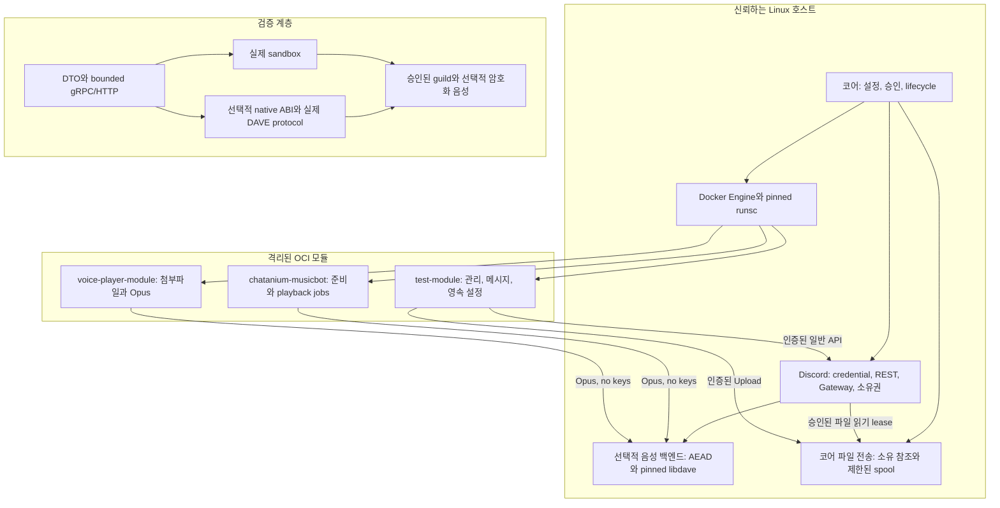

# 범용 봇 예제와 통합 검증 - Spec Proposal

| Item | Detail |
|---|---|
| Author | Seonguk Moon |
| Created | 2026-10-29 |
| Status | **Draft** / In Review / Approved |
| Reviewers | |

---

## 1. Summary

관리 및 moderation, 메시지와 interaction, 첨부파일을 실제 v2 호출로 사용하는 범용 봇 예제를 완성하고, 음악 및 음성 예제는 선택적으로 분리합니다. 기존 빌드 실패와 24개 격리 동작 검사, 전체 DTO와 공식 봇 API 및 이벤트 계약, 인증과 격리의 부정 시나리오를 재현 가능한 검증 대상으로 연결합니다. 미디어 도구는 버전과 digest를 고정한 별도 OCI 이미지에 포함하며, 현재 제안서 작성 단계에서는 코드 변경이나 검사를 실행하지 않습니다.

## 2. Background & Motivation

FlexModule은 음악 플랫폼이 아니라 범용 모듈 런타임입니다. 현재 `test-module`은 간단한 메시지 및 command 응답을 보여 주지만 관리 기능, 영속 설정, 다양한 interaction 형태와 큰 첨부파일의 완전한 왕복을 보여 주지는 않습니다. 현재 `Makefile`은 음악 봇 빌드를 기본 경로에 포함하고 voice-player 빌드는 주석 처리합니다. 이 상태를 범용 봇의 완성 기준으로 삼을 수 없습니다.

사전 조사에서 확인한 기준선은 다음과 같습니다. 아래 결과는 기존 조사 결과이며 이 문서를 작성하면서 다시 실행한 결과가 아닙니다.

| 조사 범위 | 확인된 결과와 해석 |
|---|---|
| 루트 및 음악 봇 빌드 | converter의 정의되지 않은 component/embed 함수 및 flags 타입 문제 등 네 곳에서 실패했습니다. P0에서 기준선을 복구한 뒤 v2 전환까지 확인해야 합니다. |
| voice-player 빌드 | 로컬 교체 의존성 대신 업스트림 DiscordGo를 사용하여 새 component 심볼과 맞지 않았습니다. 별도 모듈도 같은 로컬 계약으로 빌드해야 합니다. |
| Buf schema build | 성공했습니다. 이것만으로 Go converter, server 또는 runtime의 완전성을 주장할 수 없습니다. |
| 비활성 converter 파일 여덟 개 | 중복 제거 후 별도 격리 빌드에서는 컴파일되었습니다. 존재하지 않는 추가 컴파일 실패를 전제하지 않으며, 필드 의미와 실제 이관을 별도로 검증합니다. |
| 격리 동작 검사 24개 | nil panic, 필드 누락, 문자열 및 bitmask 오해, 입력 presence 손실, 정수 option accessor 불일치와 실제 gRPC `Unimplemented`를 관찰했습니다. |
| 실제 통합 | 실제 Discord 및 gVisor 실행은 수행되지 않았습니다. 아래 계획의 완료 여부와 기존 결과를 구분해야 합니다. |

현재 음악 봇은 초기화가 끝나기 전에 ready를 설정하고 provider 오류를 반환하지 않습니다. 다운로드는 일정 chunk 수 이후에만 readiness 신호를 보내므로 짧은 파일이나 오류에서 대기가 끝나지 않을 수 있습니다. 전역 state map, 직접 반환하는 slice와 동시성 없는 일부 상태 접근, 오류를 반환하지 않는 재생 함수 및 pause/skip goroutine도 이관 대상입니다.

현재 voice-player는 길드와 채널 ID를 코드에 고정하고, 첨부파일 이름으로 로컬 경로를 만들며, 문맥 및 크기 제한 없는 `http.Get`/`io.Copy`를 사용합니다. 수동 speaking 해제는 중간 오류에서 건너뛸 수 있습니다. 실험용 `helper-service`의 별도 초기화 및 callback 방향, 가짜 helper와 문자열 SQL은 생산용 설정 또는 저장소 패턴으로 유지하지 않습니다.

## 3. Goals & Non-Goals

### 3.1 Goals

- [ ] 일반 OCI 모듈 하나가 관리, 메시지, interaction 및 영속 데이터 예제를 실행하도록 완성합니다.
- [ ] members, roles, channels, ban/unban, timeout/clear-timeout, audit 조회를 실제 typed helper로 수행하고 Discord command permission을 그대로 보존합니다.
- [ ] DM, command, 버튼과 select, modal, autocomplete, 메시지 수정 및 clear, 첨부파일 업로드와 재사용을 실제 경계에서 확인합니다.
- [ ] 음악 및 voice-player를 선택적 media 이미지로 이관하고, readiness, 짧은 파일, 동시성, 오류 전달, 작업 큐와 종료 처리를 수정합니다.
- [ ] 모든 선언 DTO와 현재 로컬 공식 봇 API 및 이벤트의 처리 결정을 검증 사례에 연결합니다. 호출 여부만 확인하는 시험으로 payload 의미를 대체하지 않습니다.
- [ ] 인증 위조, 자원 소유권 침해, credential 누출, quota와 네트워크 격리 우회에 대한 실패 사례를 포함합니다.
- [ ] build target, 예제 문서, changelog와 README의 아키텍처 그림을 최종 구현과 일치시키고 v1 및 가짜 생산 경로를 제거합니다.

### 3.2 Non-Goals

- [ ] 코어에 음악 처리, 일반 SQL/KV 서비스, 임의 HTTP proxy 또는 미디어 설치 기능을 추가하지 않습니다.
- [ ] 호스트에 `ffmpeg`나 `yt-dlp`를 설치하거나 모듈 시작 시 자동 설치 및 업데이트하지 않습니다.
- [ ] 일반 봇의 성공 조건에 음성 권한, 인터넷 egress, media 프로필 또는 미디어 도구를 포함하지 않습니다.
- [ ] 라이브 자격증명 없는 환경에서 Discord 성공, 청취 성공 또는 실제 gVisor 격리를 검증했다고 주장하지 않습니다.
- [ ] 오프라인 테스트의 HTTP fixture나 transport 대체 객체를 생산용 fallback으로 제공하지 않습니다.
- [ ] current local DiscordGo에 없는 API, 사용자 계정 전용 기능, OAuth 로그인 흐름 또는 다른 백엔드 구현을 추가하지 않습니다.
- [ ] 이벤트 영속화, 재시작 후 replay, exactly-once, 자동 재시도와 자동 모듈 재시작을 제공하지 않습니다.

## 4. Technical Design

### 4.1 Architecture Overview



`test-module`을 일반 봇의 실행 가능한 기준 예제로 사용합니다. 관리 및 메시지 예제를 별도 프레임워크나 프로토콜로 만들지 않고, 동일한 core-v2 lifecycle/config와 discord-v2 helper 및 typed event 계약을 사용합니다. 기능별 request/response는 P1과 P3의 규범 DTO를 재사용하며 새로운 ad-hoc JSON RPC를 만들지 않습니다.

모든 예제는 `INIT`에서 설정과 실제 grants를 확인하고 필요한 저장소 및 리소스를 준비한 뒤에만 ready를 반환합니다. `START`와 `RUNNING` 이전에 Discord 이벤트를 처리하지 않습니다. required capability 거절은 활성화 실패, optional capability 거절은 해당 기능의 명시적 비활성화로 처리합니다. module ID는 설치 설정에 고정되며, 예제 코드가 `module-id` 메타데이터로 인증을 대신하지 않습니다.

`START`는 background worker를 시작한 뒤 반환하며, RUNNING 전용 helper의 완료를 callback 안에서 기다리지 않습니다. START가 진행 중인 `READY` 상태에 도착한 유효한 호출은 P4의 유한 activation gate에서 대기하고, START 성공과 RUNNING 확정 뒤에만 부작용을 시작합니다. 실패·취소·startup deadline은 대기 호출도 종료합니다. 준비 상태 경쟁을 helper 재시도로 해결하지 않습니다.

미디어 프로필은 CPU와 메모리 배분 정책이지 모듈 종류 선택자가 아닙니다. 일반 예제의 기본 상한은 0.5 CPU, 256MiB 메모리, 64 PID/thread, 영속 1GiB와 scratch 256MiB입니다. media 프로필은 2 CPU, 1GiB 메모리, 128 PID/thread, 영속 5GiB와 scratch 2GiB입니다. 운영자의 승인과 실제 grant가 적용되며, 크기 제한은 Docker volume 선언이 아니라 P4의 project quota로 강제합니다. 일반 예제는 인터넷 egress를 승인하지 않아도 호스트 Discord helper를 사용할 수 있습니다.

실험용 `helper-service`의 실행 코드와 별도 protocol은 통합 cutover에서 제거합니다. 생산 build, 이미지, 문서의 추천 경로에서 제외하고 공식 core config 및 모듈별 영속 디렉터리를 사용합니다. 가짜 DB 응답, SQL 문자열 proxy 또는 또 하나의 helper 초기화 관례를 이름만 바꾸어 남기지 않습니다. 삭제 사실과 대체 경로는 changelog에 기록합니다.

### 4.2 Data Model Changes

이 단계는 모듈용 공통 DB나 KV 서비스를 추가하지 않습니다. P4의 호스트 내부 관리 metadata와 구분하여, 일반 예제는 모듈이 소유한 영속 디렉터리 안의 JSON 파일로 설정을 저장합니다. JSON은 이 예제의 명시적인 저장 형식이며, 실패 시 가짜 DB나 메모리 저장소로 자동 전환하지 않습니다.

| 모델 | 계약 |
|---|---|
| `GeneralExampleConfig` | 운영자가 허용한 길드, 텍스트 채널, 실제 smoke 대상, 관리 예제 활성화 여부 등 모듈 범위 설정입니다. Core.GetConfig로 받으며 host env나 봇 token을 읽지 않습니다. |
| `ExampleState` | `schema_version`과 길드별 `audit_reply_channel_id`를 포함합니다. 예제 `/settings` 명령으로 선택한 응답 채널을 재시작 및 이미지 변경 뒤에도 유지합니다. |
| `InteractionRouteClaim` | application ID, interaction 종류와 정확한 custom ID의 소유권입니다. P3 백엔드가 durable ownership metadata를 관리하며, 예제의 임의 prefix나 메모리 map만으로 라우팅하지 않습니다. |
| `MediaConfig` | 승인된 길드 및 음성 채널 선택 범위, 작업 priority, 입력 파일 크기, 준비 작업 수, 목록 길이, HTTP/인코더 deadline 등 유한 설정입니다. 수치를 확정하지 않은 항목은 운영 필수 설정으로 처리합니다. |
| `PreparedAudio` | 모듈 scratch의 불투명 파일 핸들, byte 수, 프레임 수, 포맷 및 수명입니다. 외부 filename, provider ID 또는 URL을 호스트 경로로 사용하지 않습니다. |
| `PlaylistEntry` | 모듈 발급 entry ID, track metadata, `PREPARING/READY/PLAYING/PAUSED/FAILED` 상태, 연결된 playback job ID 및 마지막 오류입니다. runtime의 priority 스케줄러를 복제하지 않습니다. |
| `PlaylistSnapshot` | `Current`와 `Waiting`을 분리한 immutable snapshot입니다. 현재 곡을 무조건 queue[0]으로 추정하지 않습니다. |
| 검증 결과 | 시나리오 ID, 실행 layer, 실제 실행 여부, PASS/FAIL/NOT_RUN, 근거 및 실패 원인입니다. 자격증명 또는 호스트 전제조건 부족은 PASS가 아닌 NOT_RUN입니다. |

영속 파일이 없는 첫 설치는 빈 유효 설정으로 초기화할 수 있습니다. 파일 손상, 지원하지 않는 schema, quota, 권한 또는 fsync/rename 실패는 명시적으로 반환하며 기존 파일을 덮어쓰거나 성공으로 숨기지 않습니다. 임시 파일은 같은 모듈 디렉터리에서 생성하고, 성공한 write/flush/sync 뒤 atomic rename합니다. `STOP`에서 영속 파일을 삭제하지 않습니다. 음악 목록, playback cursor, credential/file ref와 이벤트는 인스턴스를 넘어 영속화하지 않습니다.

### 4.3 Core Logic

#### 일반 봇의 관리 및 moderation 예제

다음 명령군은 범용 API를 보여 주기 위한 구현 계약입니다. 명령 이름은 예제의 기술적 인터페이스이며 코어가 강제하는 업무 규칙이 아닙니다.

| 명령군 | 실제 동작과 성공 조건 |
|---|---|
| `/member-info` | guild member, 역할 및 관련 표시 정보를 조회하고 partial member를 안전하게 표시합니다. local cache의 필드가 없다고 임의의 완전한 member를 만들지 않습니다. |
| `/role-add`, `/role-remove` | 대상 member와 role ID를 typed request로 전달합니다. 실제 Discord 권한 또는 역할 계층 거절을 사용자에게 보고하고 성공 기록을 만들지 않습니다. |
| `/channel-create`, `/channel-edit`, `/channel-delete` | 승인된 테스트 길드에서 이름, 종류, parent, permission overwrites 등 해당 DTO를 그대로 사용합니다. 수정 시 unset, zero, clear를 구분하며, 삭제는 예제가 생성한 테스트 채널에 한정합니다. |
| `/ban`, `/unban` | operator가 명시한 시험 대상에서만 실행합니다. audit-log reason을 typed 필드로 전달하고, 실패 뒤 자동 resend하지 않습니다. |
| `/timeout`, `/clear-timeout` | timeout timestamp 설정 및 명시적 null 해제를 실제 member-edit 계약으로 전달합니다. 누락 값을 해제로 오해하지 않습니다. |
| `/audit-log` | audit 로그를 조회하고 dynamic old/new JSON 값의 수치 및 presence를 보존합니다. credential과 개인정보가 불필요하게 원본 로그에 출력되지 않게 합니다. |
| `/settings` | 승인된 audit 응답 채널을 모듈 영속 파일에 저장합니다. 재시작과 이미지 변경 후 같은 설정을 읽고, 다른 모듈은 읽거나 수정하지 못합니다. |

각 명령은 실제 작업에 필요한 Discord `DefaultMemberPermissions`, contexts 및 integration types를 명시하고 P3 등록 경로에 전달합니다. nil과 명시적 0, 복수 권한 bitmask를 보존하며 런타임이 nil로 덮어쓰지 않습니다. FlexModule grant와 Discord 사용자 권한은 별개입니다. grant가 있다고 사용자 권한 검사를 생략하거나 Discord 사용자 권한을 완화하지 않습니다. member가 없는 DM에서 guild moderation을 시도하면 지원하지 않는 문맥임을 명시하며 panic이나 임의 guild fallback을 만들지 않습니다.

초기화 시 등록한 command는 `(guild, type, name)` 소유권 충돌을 실패로 처리합니다. 종료 시 다른 모듈이나 운영자가 만든 command를 일괄 삭제하지 않습니다. command ID에 따른 routing을 사용하며 이름만 같다는 이유로 다른 모듈에 전달하지 않습니다.

예상 가능한 사용자 입력 오류와 Discord 권한·자원·rate-limit 거절은 예제의 작업 실패입니다. 내부 함수는 원래 오류를 반환하고, 이벤트 경계는 안전한 실패 응답을 실제로 전달한 뒤 해당 이벤트를 처리 완료할 수 있습니다. 이때 원격 작업이 성공했다고 기록하지 않습니다. 오류 응답조차 실패했거나 처리되지 않은 내부 오류가 남으면 `OnEvent`에 오류를 반환하며, P4의 인스턴스 실패 정책을 따릅니다. 정상적으로 설명한 명령 거절과 처리되지 않은 hook 오류를 같은 결과로 만들지 않습니다.

#### interaction, 메시지 및 첨부파일 예제

- 메시지 예제는 guild와 DM의 create/update/delete를 서로 다른 이벤트로 처리합니다. nil author, partial update, 실제로 없는 BeforeUpdate/BeforeDelete를 정상 입력으로 다루고, delete를 create hook으로 보내지 않습니다.
- command, message component, modal submit과 autocomplete를 먼저 구분한 다음 해당 accessor를 사용합니다. 모든 interaction에 `ApplicationCommandData()`를 호출하지 않습니다. 사용자 식별은 guild member의 user 또는 DM interaction의 user를 명시적으로 선택하며 둘 다 없으면 오류로 처리합니다.
- 버튼과 select, modal root를 보내기 전에 P3의 `RegisterInteractionRoutes`로 `(applicationID, interactionKind, customID)`를 선점합니다. 요청의 `claims`는 `InteractionRouteClaim` 목록이며, `InteractionRouteKind`는 `MESSAGE_COMPONENT` 또는 `MODAL_SUBMIT`을 사용하고 `UNSPECIFIED`는 거절합니다. 등록 batch는 로컬 registry transaction에서 전부 적용되거나 전부 거절됩니다. 같은 소유자의 동일 등록은 멱등적이고 다른 소유자의 중복은 batch 전체를 거절합니다. 등록은 INIT/RUNNING에서, 같은 `claims` 구조를 사용하는 `UnregisterInteractionRoutes`에 의한 소유 route 해제는 DRAINING에서도 수행할 수 있으며 dispatch 시 실제 grant를 다시 검사합니다. 원문 custom ID를 몰래 prefixing하거나 길이를 줄이지 않습니다. text input의 child ID는 modal 필드로 다루며 별도 route로 등록하지 않습니다.
- `/form` 예제는 버튼 또는 select로 modal을 열고, modal submit의 입력값을 typed payload로 읽어 응답합니다. autocomplete는 focused option과 후보를 전달하며 command의 `Autocomplete` 속성과 실제 reverse conversion을 모두 확인합니다.
- 초기 interaction 응답, 명시적인 defer, response edit 및 follow-up을 서로 다른 실제 API로 사용합니다. 느린 작업은 예제 코드가 명시적으로 defer를 선택합니다. helper가 업로드, defer 또는 retry를 몰래 수행하지 않습니다. 만료되었거나 다른 인스턴스의 interaction credential ref는 실패합니다.
- 일반 메시지 및 interaction 응답에는 embed, allowed mentions, flags, component와 첨부파일을 포함합니다. 수정 예제는 content의 빈 문자열, embed/component/attachment의 명시적 빈 목록, timeout의 null 등 서로 다른 clear 의미를 보여 줍니다. 첨부파일 수정에는 P1/P2의 `AttachmentEditEntry`와 존재성이 있는 목록을 사용합니다. 목록은 수정 후 전체 첨부파일 집합이며 기존 ID와 새 파일 index를 typed variant로 구분합니다. index 0도 명시된 값입니다. 추가 파일이 없을 때 목록 생략은 유지, 빈 목록은 전체 삭제이고, 추가 파일이 있으면 목록에 각 새 index를 정확히 한 번 포함해야 합니다.
- 첨부파일은 core-neutral upload stream에 metadata와 순서 있는 chunk를 보내고 완료된 ref만 사용합니다. chunk는 256KiB, 저장 계층 파일 한도는 500MiB, 완료 ref TTL은 30분입니다. 동일 인스턴스에서 재사용하고 삭제 및 만료 뒤 신규 사용을 거절합니다.
- 삭제가 완료된 자신의 ref를 원래 만료 시각 전까지 다시 삭제하면 성공합니다. 이 멱등성은 소유자별 tombstone으로 유지하며 인스턴스 종료나 원래 만료 시각까지의 유한한 계약입니다. 파일 바이트를 회수한 뒤에도 해당 기록은 entry 한도에 포함합니다.
- 저장 계층의 500MiB와 Discord 전송 한도를 구분합니다. Discord endpoint 및 목적지 제한보다 큰 파일은 전송 성공을 약속하지 않으며 실제 오류를 반환합니다. retained/new attachments와 `attachment://filename`, `payload_json`, `files[n]` 대응을 검증합니다.
- 모듈의 `UploadedFileRef`는 바이트를 전달하는 수단이며 persistent data나 runtime host 경로가 아닙니다. 업로드된 파일을 재사용할 때도 active read lease와 소유자 및 만료 검사를 거칩니다.

#### 음악 봇: 준비 완료, 오류 및 목록 상태

기존 `Start()`와 `GetMusic()`를 context-aware provider 계약으로 교체합니다. `INIT`에서 설정과 media image의 실행 파일 및 고정 버전을 확인한 뒤 provider를 준비합니다. `yt-dlp`의 설치, `-U`, 주기적 업데이트와 host path 탐색을 제거합니다. provider 초기화 실패나 scratch 준비 오류는 `OnStage` 오류로 반환하고 ready를 true로 만들지 않습니다.

음원 준비는 트랙별로 완료된 bounded artifact를 만든 뒤 게시합니다. 첫 트랙이 준비되면 목록 전체의 다운로드를 기다리지 않고 재생할 수 있지만, 아직 쓰고 있는 불완전한 파일을 ready로 제공하지 않습니다. 읽기가 `(n > 0, io.EOF)`를 반환하면 남은 n bytes를 먼저 처리합니다. writer flush, 파일 close, 인코더 종료 상태와 실제 frame 수를 확인한 뒤에만 성공합니다. 한 프레임짜리 짧은 오디오는 정상 성공하고, 프레임이 없는 입력은 명시적 `EMPTY_AUDIO` 오류입니다. 특정 chunk 수를 기다리는 readiness 채널은 제거합니다.

길드별 playlist actor가 entry, 현재 job, loop 설정과 명령 결과를 소유합니다. 전역 map에 동기화 없는 접근을 하거나 내부 slice를 그대로 반환하지 않습니다. 다운로드 worker와 command handler는 actor에 결과를 전달하며, worker 수와 목록 길이는 유한합니다. 외부 I/O, Discord RPC 또는 취소 신호 전송을 lock을 잡은 채 기다리지 않습니다.

목록은 예제의 음악 순서만 관리하고 실제 재생 선점은 P5에 맡깁니다. 한 길드의 이 예제는 현재 트랙에 playback job 하나를 연결합니다. `/play`의 동시 호출은 접수 순서와 provider 결과 순서대로 대기 항목을 추가하고, 준비 완료 순서가 늦다고 목록 위치를 임의로 바꾸지 않습니다. 첫 항목의 준비가 실패하면 실제 오류를 기록하고 제거한 뒤 다음 항목을 처리합니다. 제한 시간과 queue 상한이 있어 무한 대기와 무제한 예약을 허용하지 않습니다.

- `/list`는 current와 waiting을 분리한 snapshot을 반환합니다.
- `/remove`는 대기 항목의 명시적 entry ID 또는 snapshot에서 검증한 index를 제거합니다. 현재 항목을 off-by-one으로 삭제하지 않으며 current 제거는 `/skip` 계약을 사용합니다.
- `/pause`와 `/resume`는 현재 P5 job을 제어하고 응답 상태를 반영합니다. 신호 goroutine을 만들고 timeout 뒤 버리지 않습니다.
- `/skip`은 현재 job을 cancel하고, 실제 terminal 경계와 artifact lease 해제 뒤 다음 항목으로 이동합니다.
- loop는 정상 `COMPLETED`된 항목만 다시 큐 끝에 넣습니다. 실패나 취소를 성공으로 처리하여 무한 반복하지 않습니다.
- priority 선점은 현재 트랙을 목록에서 빼지 않습니다. job의 남은 프레임이 재개될 때 같은 항목을 계속 사용합니다.
- decoder EOF 또는 `CloseSend`만으로 완료 응답을 보내지 않습니다. P5의 최종 `COMPLETED` snapshot을 기다리고, 실패 또는 취소는 구분합니다.
- artifact를 참조하는 준비 작업, 현재 재생 또는 대기 항목이 남아 있으면 파일을 지우지 않습니다. 마지막 소유자가 해제된 뒤 삭제하며, partial 파일은 성공 cache로 인식하지 않습니다.

provider, 파일 준비, helper 응답과 playback 오류는 원래 호출 경로로 반환합니다. 상태 embed나 오류 메시지 전송도 실제 실패를 기록하되 원래 원인을 덮어쓰지 않습니다. 임의의 10초 sleep을 API rate-limit 처리로 사용하지 않고 P3의 실제 rate-limit 오류 계약을 따릅니다. 숨은 자동 재시도는 추가하지 않습니다.

장시간 준비 및 재생은 이벤트 callback 안에서 끝까지 기다리지 않습니다. callback은 유한한 명령 검증, 명시적 defer 또는 접수 응답과 목록 접수까지만 수행합니다. 접수한 worker는 인스턴스 수명에 결합한 별도 context와 `MediaLimits` deadline을 사용하며, callback context나 `flexmodule-work-ref`를 background 권한처럼 보관하지 않습니다. DRAIN에서 새 준비와 job 생성을 막고, 기존 stream·작업 완료 또는 소유 자원 취소는 P4/P5의 남은 drain 시간 안에서 처리합니다.

#### voice-player: 구성, HTTP, 경로와 종료

길드와 음성 채널은 Core.GetConfig에서 읽고 실제 grant의 scope와 대조합니다. 코드에 개인 길드 ID, channel ID, module ID 또는 credential을 고정하지 않습니다. 입력 메시지 채널도 구성한 범위에 한정하고 다른 길드 또는 DM의 첨부파일을 임의의 기본 길드로 재생하지 않습니다.

다운로드는 `http.NewRequestWithContext`로 수행합니다. finite HTTP deadline, redirect 수, 응답 크기 및 동시 다운로드 수를 필수 설정으로 받습니다. HTTP 비성공 응답을 오디오 파일로 저장하지 않습니다. Content-Length가 상한을 넘으면 조기에 거절하고, 미제공 또는 거짓인 경우에도 실제 읽은 바이트를 상한+1까지 제한해 초과를 확인합니다. body와 파일은 모든 종료 경로에서 닫습니다. URL 형식 검사는 필요하지만 SSRF 격리의 근거는 P4의 실제 IPv4/IPv6 목적지 차단입니다. redirect, DNS 변경 또는 ffmpeg 하위 프로세스가 이 경계를 우회할 수 없어야 합니다.

첨부파일 이름은 표시용 metadata로만 사용하고 scratch 안에 무작위 이름의 파일을 만듭니다. `../`, 절대경로, separator, 같은 filename의 동시 입력 및 symlink가 저장 경로를 결정하지 못하게 합니다. 파일 확장자는 초기 후보 선택에만 사용하며 실제 인코더 검증 실패를 반환합니다. 준비와 재생 중에는 파일을 유지하고, 오류, 취소 및 종료 후 partial과 완성 artifact를 소유권에 맞게 해제합니다.

voice-player도 P5의 작업 API를 사용합니다. 공개 `Speaking(true/false)`, `Join/Leave` 및 `Send(frame, priority, timeout)` 호출은 제거합니다. speaking과 마지막 연결 정리는 runtime voice owner가 처리하므로 오류 경로에서 speaking 해제를 빠뜨리는 패턴을 남기지 않습니다. 모듈은 자기 job의 cancel과 스트림 종료를 보장하며 다른 소유자의 연결을 끊지 않습니다.

#### 이미지와 배포 산출물

일반 모듈 이미지에는 `ffmpeg`, `yt-dlp`, DCA 인코더 실행 환경이나 host installer를 넣지 않습니다. 음악 봇 및 voice-player의 별도 media 이미지에는 필요한 바이너리의 정확한 release version과 다운로드 checksum 또는 OCI digest를 저장소에 고정합니다. 이미지의 base digest와 tool lock이 일치해야 하며, `latest`, 런타임 `MustInstall`, 자체 업데이트 또는 호스트 설치에 의존하는 이미지는 수용하지 않습니다. 구체적인 버전은 구현에서 선정하여 lock에 커밋하며, 이 제안서가 사용자 승인 버전을 임의로 지어내지는 않습니다.

DAVE는 media 모듈의 인코딩 도구가 아니라 호스트 voice transport의 의존성입니다. 일반 runtime은 DAVE를 import/link하지 않고, 선택적 `make build-voice`만 P5의 `voice && cgo` bridge와 고정한 공식 libdave를 포함합니다. 출력은 `bin/voice-runtime/runtime` 및 `bin/voice-runtime/lib/`의 검증된 native runtime closure와 license입니다. 일반 모듈 이미지와 음악/voice-player-module 이미지에도 MLS 키나 DAVE backend를 넣지 않습니다. 모듈은 계속 Opus만 생산하고 runtime이 DAVE 및 UDP transport 암호화를 처리합니다. 음성 backend가 없으면 실제 grant에서 unavailable을 알려야 하며 가짜 정상 voice helper를 제공하지 않습니다.

`v1.2.2/cpp`, commit `6396c90aedbb9a6ee117ea9ce1ce9832af6a3375`의 release/header가 존재한다는 조사와 실제 target Linux에서 link/load 및 encrypted voice가 성공한다는 검증은 다릅니다. native archive digest와 header/export ABI, loader 의존성 및 target distro 호환성을 구현 단계에서 확인합니다. 일반 `make build/build-all`과 offline 일반 봇 시험에 이 native 의존성을 강제하지 않습니다.

read-only rootfs와 승인된 scratch 및 persistent mount만 사용합니다. media subprocess는 모듈 컨테이너 안에서 같은 resource 및 network 제한을 받습니다. 작업 취소는 context와 프로세스 그룹 종료로 인코더 및 자식을 끝내고, drain 후 남은 프로세스는 P4가 제한된 시간 안에 종료합니다. Docker socket, host filesystem 또는 host environment를 이미지에 넘기지 않습니다.

#### 전체 회귀 범위

다음 24개 항목은 기존 격리 검사 이름과 대응합니다. 새 검사는 v2 계약의 관찰 가능한 결과를 assert하며, 기존 소스의 특정 문자열 존재나 단순 함수 호출 횟수만으로 통과시키지 않습니다.

| # | 기존 scenario | 반드시 확인할 수정 결과 |
|---|---|---|
| 1 | `default_embed_type` | 기본 빈 embed type도 source API의 유효한 기본값 계약으로 변환되며 panic하지 않습니다. 지원하지 않는 실제 variant는 명시적 오류입니다. |
| 2 | `rich_embed_roundtrip` | `rich`가 왕복 후 그대로 남고 NUL 또는 숫자-rune 문자열이 되지 않습니다. |
| 3 | `allowed_mentions_roundtrip` | users/roles/everyone 문자열 의미와 명시적 빈 parse 목록을 정확하게 보존합니다. |
| 4 | `emoji_available` | Available 값이 반대 필드나 기본값으로 바뀌지 않습니다. true와 false 양쪽을 확인합니다. |
| 5 | `message_loss` | flags, mentions, reactions, reference 및 P2에 열거한 나머지 Message 필드를 실제 값으로 왕복합니다. |
| 6 | `send_fields_and_file` | allowed mentions, component, flags와 file bytes를 보존하여 실제 multipart receiver가 원문과 동일한 파일을 받습니다. Reader=nil을 성공으로 인정하지 않습니다. |
| 7 | `edit_clear_roundtrip` | content 빈 문자열, embed/component/attachment 빈 목록과 unset을 구분하여 HTTP patch에서 실제 clear를 확인합니다. |
| 8 | `thumbnail_width` | width와 height를 서로 바꾸거나 누락하지 않습니다. |
| 9 | `user_global_name` | global name과 현재 User의 안전한 domain 필드를 보존하고 credential은 정책대로 제거합니다. |
| 10 | `command_permissions_presence` | nil, 명시적 0, 복수 권한 및 표현 가능한 큰 값의 차이가 실제 command payload에 남습니다. |
| 11 | `command_autocomplete` | forward/reverse DTO와 등록 요청 모두에서 Autocomplete=true가 보존됩니다. |
| 12 | `integer_option_accessor` | 로컬 SDK `IntValue()`가 기대하는 float64 형태로 재구성하고, 정확하게 표현하지 못하는 정수는 거절합니다. |
| 13 | `role_option_value` | role ID 및 모든 option kind가 자기 형태와 accessor를 유지합니다. 알 수 없는 타입을 nil로 삼키지 않습니다. |
| 14 | `resolved_member_without_user` | partial member에서 nil User를 허용하고 실제 없는 user를 조작하거나 panic하지 않습니다. |
| 15 | `resolved_map_key` | map key와 내부 object ID가 다를 때 입력 key를 보존합니다. |
| 16 | `webhook_edit_fields` | content 외 embed, component, allowed mentions, retained/new attachment 및 patch presence를 실제 payload로 검증합니다. |
| 17 | `partial_channel` | nil nested field와 partial channel을 안전하게 처리하고 지원하는 전체 channel edit 필드를 보존합니다. |
| 18 | `partial_activity` | nil emoji/assets/party/secrets 등 nested 값의 presence를 보존하고 panic하지 않습니다. credential 경계 정책은 별도로 적용합니다. |
| 19 | `partial_presence` | nil activity/client 상태 등 partial presence를 다루고 없는 값을 채우지 않습니다. |
| 20 | `nil_timestamp` | 없는 timestamp를 Unix epoch로 만들지 않습니다. 명시적 epoch와 구분합니다. |
| 21 | `voice_leave_before_join` | v1 공개 leave 경로를 제거하고, v2의 아직 생성하지 않은 자원 정리와 반복 cancel/unsubscribe에서 panic이 없음을 확인합니다. |
| 22 | `non_command_logging_accessor` | component/modal/autocomplete 이벤트와 로그에서 command 전용 accessor를 부르지 않습니다. 민감한 원본 DTO 덤프를 하지 않습니다. |
| 23 | `enum_contract` | channel type은 명시적 매핑, message flags는 numeric bitmask로 처리합니다. 예컨대 ephemeral=64를 enum ordinal 6으로 전송하지 않습니다. |
| 24 | `missing_helper_rpc_over_grpc` | 기존 18개 누락 RPC를 실제 인증 gRPC 호출과 HTTP fixture까지 왕복하여 의미를 검증하고, compile-time server 완전성과 전체 신규 API catalog도 함께 확인합니다. |

24번의 기존 누락 RPC는 `ApplicationCommandCreate`, `ApplicationCommandDelete`, `ApplicationCommandEdit`, `ApplicationCommands`, `Gateway`, `GatewayBot`, `MessageReactionAdd`, `MessageReactionRemove`, `MessageReactionsRemoveAll`, `ThreadJoin`, `ThreadLeave`, `ThreadMemberAdd`, `ThreadMemberRemove`, `ThreadStart`, `UserChannelPermissions`, `VoiceRegions`, `WebhookCreate`, `WebhookExecute`입니다. 이 목록만 구현하는 것으로 완료하지 않으며 전체 P3 catalog가 완료 기준입니다.

#### 전체 DTO, API 및 이벤트 수용 조건

- DTO 기준선의 154 messages와 23 enums를 모두 P2의 처리 inventory에 연결합니다. 72개 활성 pair, File/WebhookParams의 단방향, 두 inline object, 39개 disabled-only, 28개 미구현 및 11개 scalar wrapper의 각각에 대해 완전 변환, inline, wrapper 또는 의도적인 runtime/credential 대체 결정이 있어야 합니다. transport 객체를 억지로 round-trip하여 완료로 세지 않습니다.
- 기존 154개 message가 새 범위의 상한은 아닙니다. P3의 전체 retained API signature에서 도달하는 request, response와 nested type closure도 P2 inventory와 검증에 포함합니다. 현재 proto에 없는 SDK 객체 및 streaming/credential 전환으로 생기는 DTO도 누락 없이 처리하고, 전체 선언 수만 맞춘 빈 converter로 완료하지 않습니다.
- field matrix의 모든 안전한 domain field에 양방향 값 및 presence 검사를 둡니다. 11개 component variant, command contexts/integration types/permissions, 모든 option kind, interaction resolved maps, modal/autocomplete/poll/files, channel edits, gateway session-start limit, voice-region flags, activity, audit 및 monetization 계열을 포함합니다. unknown representable 값, invalid union, nil nested 구조도 확인합니다.
- audit-log의 OldValue/NewValue 및 dynamic JSON은 큰 정수, null, 배열, 객체와 원래 수치 정확도를 유지해야 합니다. protobuf double 기반 blanket conversion으로 손실을 허용하지 않습니다.
- 모든 공식 봇 operation은 typed gRPC request에서 실제 HTTP method, route, query, payload, audit reason, 응답 및 오류까지 확인합니다. Discord HTTP와 main Gateway의 version 10, Voice Gateway의 version 8, FlexModule protocol major 2를 혼동하지 않습니다. `VoiceRegions`는 정확한 `/api/v10/voice/regions` 경로를 사용하며 중복 slash를 허용한 기대값으로 검사하지 않습니다. alias는 canonical operation과 같은 의미로 전달되는지 확인하고, 제외 operation은 제외 근거와 함께 공개 service에 생기지 않았는지 확인합니다. 서버가 `Unimplemented`를 상속하거나 all-nil helper로 성공하는 경우는 실패입니다.
- 사용자 승인 credential이 추가로 필요한 봇 operation도 catalog에 포함합니다. 예를 들어 GuildMemberAdd는 host의 bot 인증과 승인된 user `CredentialRef`를 구분합니다. credential 없이 해당 라이브 시험을 실행했다고 주장하지 않습니다. OAuth-owner-only operation과 폐지된 route는 봇 지원으로 오인하지 않습니다.
- 현재 로컬 event handler의 73개 등록 이름 전부에 disposition을 붙입니다. 그중 synthetic은 `__CONNECT__`, `__DISCONNECT__`, `__EVENT__`, `__RATE_LIMIT__` 네 개이며 나머지 69개와 중복 집계하지 않습니다. 모듈에 전달하기로 한 typed bot-domain event는 정상, partial, routing 및 ordering 검사를 갖습니다. raw event, session/resume 식별자와 voice credential handoff 등 host-only 항목은 외부로 나가지 않음을 검사합니다.
- 안전한 `VoiceStateUpdate` 관찰은 일반 gateway domain event로 검증하며 `discord.voice.play`나 `discord.voice.receive`를 요구하지 않습니다. voice server token과 transport session ID는 이 이벤트를 통해 누출하지 않습니다.
- 한 모듈의 이벤트 FIFO는 256 events 또는 32MiB 중 먼저 찬 한도로 동작하고 한 processing lane에서 admitted order를 지킵니다. overflow는 그 모듈의 실패와 정지로 이어져야 하며 다른 모듈은 계속 처리합니다. 종료 후 replay나 조용한 healthy drop은 허용하지 않습니다.

#### 보안 및 경계 부정 검사

| 경계 | 실패시켜야 하는 요청과 관찰 기준 |
|---|---|
| 인스턴스 인증 | 위조 `module-id`, 다른 broker 인증, 과거 InstanceID, manifest 이름을 통한 다른 ModuleID 주장입니다. 다른 소유자의 데이터나 존재 여부를 돌려주지 않습니다. |
| grant와 scope | required 거절 시 활성화 실패, optional 거절 후 일반 기능 유지, 다른 길드/채널 접근 및 voice priority 상한 초과입니다. FlexModule 거절과 Discord 403을 구분합니다. |
| credential | bot token, voice token, interaction/webhook token이 DTO, raw event, HTTP 오류, redirect URL, 로그에 드러나면 실패입니다. purpose/resource/owner/expiry가 틀린 ref를 거절합니다. |
| 파일 ref | 다른 인스턴스 및 재시작 후 재사용, 삭제/TTL 뒤 신규 lease, 잘린 upload, offset/chunk 오류, 파일명 path/header injection입니다. 삭제한 자신의 ref는 원래 expiry 전 반복 삭제에 성공하고, 외부 또는 알 수 없는 ref와 구분합니다. 진행 중 lease는 안전하게 완료 또는 취소하고 회수 전 byte quota를 반환하지 않습니다. |
| 업로드 메모리 | 500MiB 저장 성공과 Discord 허용 크기를 별도로 시험합니다. multipart 생성이 파일 전체를 `bytes.Buffer`에 담지 않고 제한된 메모리에서 진행되며 취소 시 writer/reader/HTTP가 종료되어야 합니다. |
| 업로드 quota | instance 2 및 host 8 동시 upload, instance 2GiB 및 host 8GiB 저장 한도에 in-flight reservation과 lease를 포함합니다. 별도의 유한 host/instance entry 한도는 예약, live ref와 유효한 deletion tombstone을 모두 포함합니다. 0-byte upload와 즉시 삭제를 반복해도 기록 수가 무제한 증가하거나 유효한 tombstone이 조기 축출되지 않아야 합니다. |
| command와 component 소유권 | command 및 custom-ID collision, 다른 owner의 unregister/delete, 허위 prefix route와 재시작 후 탈취입니다. 원래 command permission 및 custom ID를 바꾸지 않습니다. command/autocomplete는 command owner, event grant와 scope로 전달하며 custom-ID 관리 기능을 쓰지 않는 모듈에 `discord.routes.manage`를 요구하지 않습니다. |
| 네트워크 | 미승인 모듈의 인터넷, 승인 모듈의 host/private/link-local/metadata/internal 및 host public IP 접근, IPv4/IPv6, DNS 재바인딩 및 redirect 우회입니다. 실제 목적지 차단과 제한된 resolver/control IPC 예외를 확인합니다. |
| 파일시스템과 프로세스 | 다른 모듈 persistent data, host path, Docker socket/control path, symlink escape 및 무제한 PID/메모리/디스크 사용입니다. scratch와 guest-writable IPC가 같은 XFS project byte/inode quota를 합산하고, IPC 경로의 일반 파일 및 inode 생성으로 우회할 수 없어야 합니다. socket 경로 검사와 connect 사이의 symlink 교체도 거절합니다. project quota 미지원 호스트는 시작부터 실패해야 합니다. |
| 로그 | Docker의 container logging driver는 `none`이며 제한된 attach 수집만 사용합니다. handshake 이전의 긴 stdout 및 stderr, 정상 실행 중의 출력 폭주에서도 bootstrap buffer, host 메모리와 보관 파일 한도가 유지되어야 합니다. 별도 daemon/journal sink가 무제한 복제본을 만들면 실패입니다. |
| 종료 및 장애 | INIT 오류, 30초 startup 초과, 10초 drain 초과, crash, SIGTERM/SIGINT 및 runtime crash orphan입니다. persistent data를 유지하고 임시 리소스, broker, 프로세스와 container를 정리하며 자동 재시작하지 않습니다. |
| 음성 | 다른 소유자 job 제어, channel conflict, 느린 receiver, queue overflow, pause/cancel/EOF 경합, 선점 중 남은 sequence 손실 및 이미 submitted된 프레임 재전송입니다. P5의 두 종류 참조 해제를 모두 확인합니다. |

오프라인 시험만으로 실제 gVisor 또는 호스트 방화벽을 입증하지 않습니다. 해당 항목은 준비된 호스트에서 실제 container와 네트워크 대상으로 시험하며, 제한을 완화하여 통과시킨 결과는 인정하지 않습니다.

## 5. API Design

### 5-1. New / Modified

새 REST API를 만들지 않습니다. 예제 모듈은 P1의 lifecycle/config/events, P3의 typed Discord 및 upload, P5의 voice API를 사용합니다. 다음 함수는 예제의 public 함수 또는 package 경계에 적용할 규범 계약입니다. wire DTO와 기본 서비스 signature를 복제하지 않으며 `DiscordAPI`, `VoiceService`, `InteractionHandle` 등은 해당 제안의 타입을 뜻합니다.

```go
type GeneralExampleConfig struct {
    GuildIDs []string
    TextChannelIDs []string
    EnableModerationExamples bool
}

type GuildSettings struct { AuditReplyChannelID string }
type ExampleState struct {
    SchemaVersion uint32
    Guilds map[string]GuildSettings
}

// OpenSettings opens the module-owned persistent file and validates its schema.
// A missing first-install file starts with valid empty settings; corrupt, unsupported,
// inaccessible, or over-quota storage returns an error rather than a fake fallback.
func OpenSettings(ctx context.Context, persistentDir string) (*SettingsStore, error)

// SetGuildSettings persists a validated update using a same-directory temporary file,
// flush/sync, and atomic rename. It returns only after the durable update succeeds.
// The directory is the module's mounted path, never a caller-supplied host path.
func (s *SettingsStore) SetGuildSettings(ctx context.Context, guildID string, value GuildSettings) error

// GetGuildSettings returns an independent value without exposing mutable store state.
// It distinguishes an absent guild setting from an empty but explicitly saved value.
func (s *SettingsStore) GetGuildSettings(ctx context.Context, guildID string) (GuildSettings, bool, error)

// HandleInteraction dispatches by the typed interaction kind before using accessors.
// It preserves Discord end-user permission rules, uses owner-bound credentials,
// and reports expected command failures explicitly. An unhandled failure, including
// failure to send its error response, is returned to the lifecycle hook.
func (b *GeneralBot) HandleInteraction(ctx context.Context, interaction InteractionHandle) error

// HandleMessage handles the typed create/update/delete payload without inventing
// absent fields or snapshots. DM authorship does not require a guild Member object.
func (b *GeneralBot) HandleMessage(ctx context.Context, event MessageEvent) error
```

예제 저장소의 schema version은 구현에서 실제 첫 형식을 고정하여 커밋합니다. 지원하지 않는 version은 초기화 실패이며, 호환되지 않는 파일을 빈 설정으로 덮어쓰지 않습니다. 이 저장소는 일반 runtime helper로 노출하지 않습니다.

```go
type Track struct {
    ID string
    Title string
    SourceURL string
    ThumbnailURL string
}

type PreparedAudio interface {
    // Open returns a new bounded reader over a complete, validated Opus artifact.
    // The handle cannot be forged from an attachment filename or provider ID.
    Open(ctx context.Context) (io.ReadCloser, error)
    FrameCount() uint64
    // Release drops one owner and removes scratch data only after the final owner.
    // Repeating release by the same owner is safe.
    Release() error
}

type Provider interface {
    // Initialize validates image-pinned tools and configuration without installing
    // or updating binaries. Failure must prevent module readiness.
    Initialize(ctx context.Context) error
    // Resolve obtains a bounded ordered result set under the caller's deadline.
    // It does not swallow process failures, partial parse errors, or empty results.
    Resolve(ctx context.Context, query string) ([]Track, error)
}

// PrepareAudio creates a complete bounded scratch artifact, validates frame count
// and encoder exit status, and publishes no handle on failure. A short valid source
// succeeds without waiting for an arbitrary chunk threshold; all processes and
// partial files are closed on cancellation or failure.
func PrepareAudio(ctx context.Context, track Track, limits MediaLimits) (PreparedAudio, error)

// PlayPrepared streams contiguous 20ms Opus packets using server credits and waits
// for the terminal playback snapshot. EOF is input completion, not playback success.
// It performs no pacing sleep, metadata identity injection, or automatic replay.
func PlayPrepared(ctx context.Context, voice VoiceService, audio PreparedAudio, request CreatePlaybackJobRequest) (PlaybackSnapshot, error)

// DownloadAttachment reads through a context-bound HTTP request into a generated
// scratch file, checks status and actual byte count, and never trusts Filename as
// a path. Failure removes partial data and returns the original fetch error.
func DownloadAttachment(ctx context.Context, client *http.Client, attachment MessageAttachment, limits DownloadLimits) (ScratchFile, error)

type Playlist interface {
    // Enqueue serializes accepted entries, enforces queue bounds, and starts no
    // duplicate playback worker. Completion order must not reorder accepted tracks.
    Enqueue(ctx context.Context, tracks []Track) ([]PlaylistEntryID, error)
    // Snapshot returns detached current/waiting state, not the internal slice.
    Snapshot(ctx context.Context) (PlaylistSnapshot, error)
    // Remove removes a waiting entry only; the active entry must be skipped.
    Remove(ctx context.Context, entry PlaylistEntryID) error
    // Pause and Resume apply the corresponding owned playback-job operation.
    Pause(ctx context.Context) (PlaybackSnapshot, error)
    Resume(ctx context.Context) (PlaybackSnapshot, error)
    // Skip cancels only the current job and advances after its terminal boundary.
    Skip(ctx context.Context) error
    // SetLoop requeues only successfully completed entries when enabled.
    SetLoop(ctx context.Context, enabled bool) error
    // Close rejects new work, cancels pending preparation, and drains or cancels
    // owned jobs within ctx. It releases scratch owners, not persistent settings.
    Close(ctx context.Context) error
}
```

`MediaLimits`와 `DownloadLimits`는 byte, frame, 결과 수, 동시 작업 수, HTTP/redirect, subprocess 출력, queue 및 각 deadline의 필수 유한 설정입니다. 이 문서에 숫자를 임의로 정하지 않으며 누락된 필수 설정을 무제한으로 해석하지 않습니다. public 메서드는 모든 오류와 취소를 반환하고, context 없는 구형 함수 및 void 성공형 wrapper를 남기지 않습니다.

```text
INIT example:
  read module-scoped Core.GetConfig and actual grants
  validate required operations, configured resource scopes, and finite limits
  open module-owned settings; fail on invalid persistent state
  if this is a media image:
    verify pinned tools and initialize providers; do not install anything
  declare commands with unchanged DefaultMemberPermissions/contexts/integration types
  register exact component/modal-root routes before sending interactive payloads
  publish ready only after all required initialization succeeds

handle moderation interaction:
  switch on typed kind; reject unsupported DM context without Member dereference
  validate selected guild/channel and caller permission for the example command
  explicitly defer if the operation needs asynchronous preparation
  call the exact typed Discord operation with the owner-bound credential/context
  on success: persist settings if this command changes settings, then send result
  on expected command failure: send a safe failure response; complete only the event delivery
  on unhandled failure or failed reporting: return the original error and reporting error

prepare track:
  reserve bounded worker, scratch bytes, and playlist position
  create a generated partial artifact under scratch
  fetch/encode with caller context, bounded bytes/output, and process cancellation
  for each read: write n bytes first, then process EOF or error
  flush, check close and encoder exit errors, validate at least one valid Opus frame
  atomically publish complete artifact and notify playlist once
  on any failure: remove partial, release reservation, deliver exactly one error

play track:
  create owned job at the configured channel and granted priority
  bind producer; read credits and snapshots concurrently
  while credit allows: read next Opus frame and send next sequence
  at input EOF: send EndInput(finalSequence), then half-close
  wait for COMPLETED, CANCELLED, or FAILED snapshot
  update playlist only from the terminal result; release artifact owner
  on cancellation or error: cancel owned job; retain original error if reporting fails
```

#### 빌드 및 검증 실행 인터페이스

아래 target은 향후 구현의 계약입니다. 현재 제안서 작성 중 실행한 명령 목록이 아닙니다.

| Target | 입력과 산출물 및 실행 경계 |
|---|---|
| `make build` | native DAVE를 import/link하지 않는 Linux runtime과 일반 `test-module`을 빌드합니다. 미디어 executable을 설치하거나 실행하지 않습니다. |
| `make build-voice` | `voice && cgo`로 pinned libdave를 연결한 선택적 host runtime과 native library/license bundle을 `bin/voice-runtime/`에 만듭니다. 실제 digest, ABI 및 loader closure 검증이 필요하며 기본 build와 별개입니다. |
| `make build-media` | 같은 로컬 DiscordGo 및 v2 계약으로 음악 봇과 voice-player의 Go 산출물을 빌드합니다. 별도 nested module의 실패도 전체 실패로 반환합니다. |
| `make build-all` | P0에서 정의한 유지 대상 root, 로컬 SDK 및 독립 예제 module을 각각 빌드합니다. 제거 대상 helper-service 두 module은 명시적으로 폐기하며 실패를 숨기기 위한 임의 제외는 허용하지 않습니다. |
| `make image-module` | 미디어 도구가 없는 일반 모듈 OCI 이미지를 만듭니다. |
| `make image-media` | pinned tool lock을 사용하는 두 media 예제 OCI 이미지를 만듭니다. host installer 또는 runtime update 경로가 있으면 완료가 아닙니다. |
| `make check-offline` | Buf, 영향을 받은 root/nested/vendored Go 대상, DTO, 인증된 gRPC 및 로컬 HTTP/voice transport의 유한 시험을 수행합니다. 라이브 Discord나 secret 없이 재현합니다. |
| `make check-sandbox` | 준비된 Linux 호스트에서 실제 Docker/runsc, 인증 broker IPC, cgroups/project quota와 IPv4/IPv6 격리를 확인합니다. Discord credential은 필요하지 않습니다. |
| `make smoke-discord` | 운영자가 승인한 test guild, bot credentials 및 시험 대상만 사용합니다. destructive moderation에는 명시적 대상 승인이 필요합니다. |
| `make smoke-voice` | voice-enabled artifact와 별도 승인된 음성 채널 및 참여자를 사용하여 실제 DAVE+AEAD playback/receive, participant 전이 및 P5 job 동작을 확인합니다. 일반 smoke의 필수조건이 아닙니다. |

검사에는 case별 timeout과 전체 실행 deadline을 둡니다. local gRPC listener, HTTP server, worker, subprocess와 파일을 반드시 정리합니다. 오프라인 suite에서 로컬 fixture를 명시적으로 주입할 수 있지만 생산 API에 임의 endpoint/header/URL 전달 기능을 열지 않습니다. root, 음악 봇, voice-player, 영향을 받은 vendored DiscordGo 및 integration package를 빠짐없이 포함하며, build 실패 package를 단순 제외해서 통과시키지 않습니다.

현재 독립 `go.mod` 여덟 개의 처분은 P0와 일치시킵니다. root, `discordgo`, `discordgo/examples/linked_roles`, `discordgo/examples/voice_receive`, `chatanium-musicbot`, `voice-player-module`은 유지 대상별 빌드를 확인하고, `helper-service`와 `helper-service/plugin-go-grpc`는 생산 protocol 제거 대상입니다. 일반 `test-module` 및 integration package는 해당 상위 module의 대상에 포함합니다. linked-roles 같은 별도 예제의 OAuth 요구를 범용 모듈의 런타임 capability나 일반 smoke 전제조건으로 옮기지 않습니다.

실제 smoke의 자격증명은 호스트 백엔드만 읽습니다. 모듈 이미지, config, env 또는 검사 로그에 bot token을 전달하지 않습니다. 승인된 guild 및 channel이 없거나 credential이 없으면 해당 검사를 `NOT_RUN`으로 표시하고 라이브 검수 미완료를 보고합니다. 실제 요청이 변경을 일으킨 뒤 응답을 놓쳤을 수 있으므로, 단순 timeout을 근거로 동일 moderation 요청을 재전송하지 않습니다.

### 5-2. Error Handling

예제 자체는 새 HTTP error contract를 만들지 않습니다. helper의 gRPC 오류와 안전한 Discord API error detail을 보존하고, 아래 도메인 오류를 구분합니다.

| 오류 | 예제 및 검증에서 요구하는 처리 |
|---|---|
| 초기화, 필수 grant 또는 설정 오류 | ready를 올리지 않고 INIT 실패를 반환합니다. 30초 startup deadline 및 P4 cleanup을 적용합니다. |
| 저장 파일 손상, 권한 또는 quota | 가짜 DB/메모리 fallback 없이 실패합니다. 기존 파일과 다른 모듈 데이터를 보존합니다. |
| 지원하지 않는 DM/moderation 문맥 | 명시적 지원 범위 오류를 반환합니다. nil member panic이나 기본 guild 실행을 하지 않습니다. |
| command/custom-ID 소유권 충돌 | 등록과 관련 전송을 중단하고 원인을 반환합니다. 기존 소유자 또는 unrelated command를 삭제하지 않습니다. |
| HTTP 비성공, 크기 초과, redirect 한도 | 다운로드를 실패시키고 body와 partial 파일을 정리합니다. `Content-Length`만 믿지 않습니다. |
| provider 실패, 빈 결과, 불완전한 출력 | 실제 오류를 전달하고 준비 작업 및 queue reservation을 해제합니다. 부분 배열의 범위를 넘어 읽지 않습니다. |
| 인코더 실패 또는 `EMPTY_AUDIO` | 파일을 ready/cache로 게시하지 않으며 무기한 readiness 대기를 남기지 않습니다. |
| queue 초과, 없는 항목, current 제거 | 각각 명시적인 한도/대상/상태 오류입니다. 무조건 성공 메시지나 nil track으로 바꾸지 않습니다. |
| helper 또는 voice 실패 | 안전한 원인, 상태 및 cursor를 유지합니다. decoder EOF와 실제 `COMPLETED`를 혼동하지 않습니다. |
| `Cancelled` / `DeadlineExceeded` | context를 HTTP, subprocess, stream과 queue에 전파하고 소유 자원을 해제합니다. 이미 발생한 Discord 변경의 rollback을 약속하지 않습니다. |
| Discord 403, 429 또는 그 밖의 API 오류 | P3의 typed detail과 retry-after를 보존합니다. FlexModule 권한 거절과 구분하며 새 자동 재시도 계층을 만들지 않습니다. |
| 오류 응답을 보내는 helper마저 실패 | 최초 원인을 잃지 않고 reporting 실패도 별도로 남깁니다. 성공으로 종료하거나 민감한 raw 응답을 덤프하지 않습니다. |
| 검증 전제조건 부족 | `NOT_RUN`과 정확한 부족 항목을 기록합니다. 전체 성공 문구를 출력하지 않습니다. |

## 6. Implementation Plan

### 6-1. Milestones

P0부터 P5까지의 실제 계약 및 구현을 입력으로 사용합니다. 예제 작성과 시험 준비를 일부 병행할 수 있지만, 인증된 v2 API와 runtime 통합이 끝나기 전에 안전한 배포판이나 전체 성공을 선언하지 않습니다.

| Phase | Task | Estimated Duration | Owner |
|---|---|---|---|
| Phase 1 | P0 기준선과 P1/P2/P3 inventory를 검사 case에 연결하고 v2 ordinary `test-module`의 lifecycle/config/interaction 경로를 이관합니다. 산출물은 실제 typed helper를 사용하는 일반 이미지이며, media 도구 없이 ready와 메시지 왕복이 성립해야 합니다. | 미정 | 미정 |
| Phase 2 | member/role/channel/ban/timeout/audit 명령, command permission 보존, route ownership와 JSON 영속 설정을 완성합니다. 산출물은 restart 뒤 설정을 유지하는 관리 예제이며 타 모듈 데이터와 command를 침범하지 않아야 합니다. | 미정 | 미정 |
| Phase 3 | DM, button/select, modal, autocomplete, edit-clear 및 streamed attachment 예제를 완성합니다. 산출물은 실제 gRPC와 HTTP fixture를 통과하는 end-to-end 흐름이며, 전체 필드와 bytes 및 오류 의미를 검증해야 합니다. | 미정 | 미정 |
| Phase 4 | media image pinning과 context-aware provider/preparation, playlist actor 및 voice-player의 경로/HTTP 처리를 구현합니다. P5 작업 API로 모든 caller를 이관하고 짧은 음원, 동시 명령, 실패와 cancel 시나리오를 만족해야 합니다. | 미정 | 미정 |
| Phase 5 | 24개 기준선 실패, 모든 DTO/API/event inventory 및 보안 부정 사례의 offline/sandbox 검증을 수행합니다. 산출물은 실제 실행 근거와 미실행 사유를 분리한 결과이며, 누락된 case를 단순 success stub으로 채우지 않습니다. | 미정 | 미정 |
| Phase 6 | 승인된 guild의 일반 smoke와 선택적 voice smoke를 실행하고 자원을 정리합니다. v1 및 helper-service 생산 경로를 제거하고 target, 예제 README, changelog와 root 아키텍처 그림을 최종 동작에 맞춥니다. | 미정 | 미정 |

#### 실행 layer별 인수 시나리오

| Layer | 입력 및 실행 | 반드시 관찰할 결과 |
|---|---|---|
| 오프라인 DTO | P2의 모든 field matrix, presence, union, nil 및 unknown-value fixture | 안전 domain 값의 정확한 왕복, credential/runtime-only 필드의 명시적 대체, 24개 과거 실패의 수정입니다. |
| 오프라인 gRPC/HTTP | 실제 생성 client/server, 인스턴스 인증, 제한된 로컬 Discord HTTP fixture | 모든 canonical API의 정확한 경로 및 payload, HTTP error의 안전한 변환, alias 동등성, 취소/크기/lease 오류 및 Unimplemented 부재입니다. |
| 오프라인 lifecycle/event | 실제 v2 hooks, bounded ingress와 instance FIFO | INIT/START gate, 오류 전달, arrival order, 느린 모듈 격리, 256 events/32MiB overflow와 no replay입니다. |
| 오프라인 일반 예제 | 관리 명령, DM, 버튼, select, modal, autocomplete와 JSON store | command 권한이 그대로 전달되고 route owner만 이벤트를 받으며 settings가 재개방 후 유지됩니다. |
| 오프라인 media | 작은 유효 파일, 빈 파일, 잘린 파일, 느린 HTTP, oversized body, decoder/process 실패 및 동시 명령 | 짧은 입력 성공, 무한 readiness 대기 부재, 정확한 오류, queue/current 일관성, bounded memory와 scratch cleanup입니다. |
| 오프라인 voice | bounded transport receipt fixture와 둘 이상의 인증된 instance | priority preempt/resume, 세 cursor, 동일 priority FIFO, channel conflict, receive-only 및 두 참조 클래스의 독립 해제입니다. 이 결과를 실제 Discord 청취로 표기하지 않습니다. |
| 선택적 native/protocol 통합 | pinned libdave C ABI와 target Linux loader, 실제 암호화 함수 및 bounded voice Gateway text/binary fixture | 48kHz/20ms frame encrypt/decrypt, recognized participants, 초기/sole-member 전이, ignored/failed commit 구분, seq_ack, key teardown과 ordinary no-DAVE 빌드입니다. queue mock 성공과 분리하여 기록합니다. |
| 실제 sandbox | pinned runsc와 project quota, 실제 broker UDS/TLS, 승인/미승인 네트워크 | host/private/internal/metadata 및 host public IPv4/IPv6 차단, resolver/control IPC 제한, 자원 상한, crash 및 orphan 정리입니다. |
| 실제 일반 Discord | 승인된 guild와 채널, bot token은 호스트 보관, 승인한 대상 member/role | 메시지/DM/interaction, 파일 전송 및 수정, role/channel/ban/timeout/audit의 실제 성공과 실제 권한 거절입니다. 시험용으로 생성한 것만 정리합니다. |
| 실제 선택적 음성 | voice-enabled artifact, 승인된 같은 guild/channel, 봇과 다른 참여자, 수신 전용 및 재생 모듈 | 현행 AEAD와 DAVE를 협상한 실제 송수신, participant join/leave rekey와 초기/sole-member 전이, 선점 뒤 남은 음성 및 두 참조 클래스의 분리입니다. 암호화 해제된 receive stream과 실제 소리를 따로 확인하며 단순 UDP write로 완료를 주장하지 않습니다. |
| 재시작/이미지 변경 | 동일 ModuleID의 새 InstanceID, 보존한 persistent 디렉터리 | 일반 설정은 유지하고 옛 file/credential/job ref는 사용할 수 없으며 이벤트를 replay하지 않습니다. |

현행 Discord가 요구하는 DAVE가 준비되지 않은 상태에서 job을 RUNNING으로 만들거나, legacy XSalsa/평문으로 보내어 smoke를 통과시키면 실패입니다. native/protocol 통합은 Resume wire와 text/binary `seq_ack`의 fixture 검증, 연결이 유지되는 동안의 invalid-commit 복구, 지원하지 않는 version과 빠진 backend의 명시적 거절도 포함합니다. 실제 연결 손실에서는 기존 작업과 구독을 실패시키고 자동 Resume/rejoin, module stream 재결합 및 media replay를 시작하지 않는지 확인합니다. 실제 두 참여자 송수신 및 key 전이를 실행하지 않았다면 음성 동작은 `NOT_RUN` 또는 미완료이며 오프라인 queue 결과로 대체하지 않습니다.

실제 moderation smoke는 사전 승인한 시험 계정과 역할에만 적용합니다. 도구가 접근 가능한 사용자 계정을 임의로 선택하지 않습니다. cleanup이 가능한 시험 자원 ID를 기록하고, timeout 뒤 결과가 불명확한 변경은 상태 조회로 확인합니다. 삭제할 권한이 없는 자원이나 unrelated command를 성공 보고를 위해 정리하지 않습니다.

#### 문서 및 산출물 완료 기준

- root README 그림은 backend-neutral core, 실제 Discord adapter, host credential 경계, isolated ordinary/media module, 별도 upload 및 optional voice를 표현해야 합니다. 음악을 중심에 놓거나 현재 지원하지 않는 플랫폼 및 backend가 완성된 것처럼 표시하지 않습니다.
- 일반 예제 README는 media tool 설치 없이 실행하는 경로와 config/grant, persistent 데이터 위치 및 권한을 설명해야 합니다.
- media README는 image lock, 모듈 내부 인코딩, finite 설정, network 승인과 P5 job 의미를 설명하고 host installer 및 `module-id` 인증 예제를 제거해야 합니다.
- integration 문서는 offline, actual sandbox와 approved-guild smoke의 전제조건을 구분하고, 실행되지 않은 검사를 통과로 표현하지 않아야 합니다.
- changelog에는 core-v2/discord-v2의 호환되지 않는 전환, 전체 재빌드, v1 및 helper-service 제거, owner-bound ref와 stream 변경 및 이미지 pinning을 명시해야 합니다.
- 위 변경은 미래 구현의 산출물입니다. 이번 작업은 제안서만 작성하며 README, code, target 또는 changelog를 이미 수정했다거나 검사를 실행했다고 보고하지 않습니다.

### 6-2. Dependencies

- [빌드 및 의존성 기준선](flexmodule-0-build-and-dependency-baseline.md), [프로토콜 계약](flexmodule-1-protocol-contracts.md), [도메인 변환](flexmodule-2-domain-conversions.md), [Discord 백엔드](flexmodule-3-discord-backend.md), [런타임 격리](flexmodule-4-runtime-and-isolation.md), [음성 작업](flexmodule-5-voice-jobs.md)의 계약과 실제 구현이 필요합니다.
- Go 1.24 계열 계약, 고정한 Buf 생성 도구, 로컬 DiscordGo, go-plugin, Docker Engine 및 고정 runsc가 필요합니다. 실제 host prerequisites와 broker UDS 동작은 P4 검증 없이는 충족한 것으로 취급하지 않습니다.
- media 이미지에만 `ffmpeg`, `yt-dlp` 및 해당 Go wrapper/Opus 처리 의존성을 고정합니다. 바이너리 checksum, 버전, base image digest는 빌드 입력으로 관리합니다.
- 선택적 voice-enabled host artifact만 P5의 pinned official libdave C ABI/CGO, native runtime closure와 현행 UDP AEAD를 요구합니다. 일반 runtime 및 모듈에는 이를 요구하지 않습니다. Go 1.24 유지, source/release pin, native symbol/loader 검사와 실제 encrypted send/receive가 별도의 수용 조건입니다.
- 오프라인 fixture에는 실제 자격증명이 필요하지 않습니다. 실제 sandbox 검사는 신뢰할 수 있는 Linux 호스트와 quota/네트워크 시험 환경이 필요합니다. 실제 Discord 검사는 별도로 승인된 bot credential, guild, channel, 테스트 계정 및 권한이 필요합니다.
- GuildMemberAdd 등 추가 user-authorized credential이 필요한 operation의 실제 검증에는 해당 용도로 provision된 host credential이 필요합니다. 일반 OAuth 구현이나 모듈로의 secret export는 의존성에 포함하지 않습니다.

## 7. References

- [현재 일반 모듈](../../test-module/main.go)
- [현재 일반 모듈의 음성 시험 파일](../../test-module/voice_test.go)
- [현재 음악 봇 lifecycle 및 command 흐름](../../chatanium-musicbot/main.go)
- [현재 음악 준비 및 재생](../../chatanium-musicbot/audio.go)
- [현재 음악 목록 상태](../../chatanium-musicbot/state.go)
- [현재 provider 계약](../../chatanium-musicbot/provider/provider.go)
- [현재 yt-dlp 설치 및 업데이트 경로](../../chatanium-musicbot/provider/youtube.go)
- [현재 voice-player 설정 및 HTTP 처리](../../voice-player-module/main.go)
- [현재 voice-player 변환 및 Opus 전송](../../voice-player-module/audio.go)
- [현재 integration 실행 경로](../../integration-tests/test-voice.go)
- [현재 실험 helper-service](../../helper-service/README.md)
- [현재 Makefile](../../Makefile)
- [현재 root README](../../README.md)
- [현재 README 아키텍처 그림](https://github.com/user-attachments/assets/1cf77e2c-ea04-47be-b2c5-1d4bb7bd9fc6)
- [Chatanium 모듈 설계 이슈](https://github.com/thirdscam/chatanium/issues/10)
- [현재 변환 계층](../../shared/discord-v1/convert/)
- [현재 Discord helper 구현](../../shared/discord-v1/runtime/helper.go)
- [현재 로컬 DiscordGo event 등록](../../discordgo/eventhandlers.go)
- [Discord 파일 업로드](https://docs.discord.com/developers/reference#uploading-files)
- [Discord 메시지 생성](https://docs.discord.com/developers/resources/message#create-message)
- [Discord 메시지 수정](https://docs.discord.com/developers/resources/message#edit-message)
- [Protobuf field presence](https://protobuf.dev/programming-guides/field_presence/)
- [gRPC cancellation](https://grpc.io/docs/guides/cancellation/)
- [gRPC deadlines](https://grpc.io/docs/guides/deadlines/)
- [gVisor Docker 빠른 시작](https://gvisor.dev/docs/user_guide/quick_start/docker/)
- [현행 Discord voice 및 DAVE 요구사항](https://docs.discord.com/developers/topics/voice-connections.md)
- [DAVE protocol과 frame/전이 계약](https://daveprotocol.com/)
- [선택적 native voice artifact의 고정 libdave release](https://github.com/discord/libdave/releases/tag/v1.2.2/cpp)
